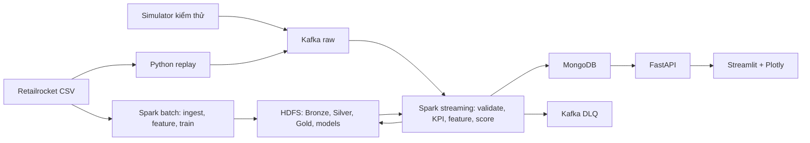

# Kế hoạch triển khai E-commerce User Behavior Analytics Platform trong 7 ngày

## 1. Mục tiêu, hiện trạng và phạm vi đã chốt

Xây dựng đồ án chạy được toàn bộ chuỗi **dữ liệu hành vi → Kafka → Spark → HDFS → Machine Learning → MongoDB → API → dashboard**, có kiểm thử và bằng chứng xử lý phân tán.

Kế hoạch dựa trên [đoạn chat bạn cung cấp](https://chatgpt.com/share/6ad1cfcb-59c8-83ec-87da-893fb55e5214), dữ liệu đã có trong workspace và các lựa chọn đã xác nhận:

| Nội dung                 | Phương án chốt                                   |
| ------------------------ | ------------------------------------------------ |
| Nhân lực                 | Một người                                        |
| Thời gian                | Bảy ngày, khoảng 56 giờ làm việc                 |
| Môi trường               | Máy hiện tại, dành khoảng 10 GB RAM cho hệ thống |
| Lưu trữ phân tán         | HDFS: một NameNode, hai DataNode                 |
| Xử lý phân tán           | Spark Standalone: một master, hai worker         |
| Machine Learning         | K-Means và Random Forest bằng Spark MLlib        |
| Dự đoán trên sự kiện mới | Có, theo micro-batch                             |
| Giao diện                | FastAPI + Streamlit + Plotly                     |
| Triển khai               | Docker Compose trên một máy                      |


**Mục đích cao nhất của đề tài là biến dữ liệu hành vi mua sắm thành thông tin giúp doanh nghiệp hiểu khách hàng và quyết định nên cải thiện việc bán hàng ở đâu.**

Cụ thể, hệ thống cần trả lời ba câu hỏi:

1. **Khách hàng đang làm gì và dừng ở đâu?**  
   Sản phẩm nào được quan tâm? Bao nhiêu người đi từ **xem → thêm giỏ → mua**? Bước nào mất nhiều khách nhất?
2. **Có những nhóm khách hàng với hành vi khác nhau nào?**  
   Dùng K-Means để phân nhóm theo mức độ tương tác, tần suất hoạt động và hành vi giỏ hàng, giúp người vận hành hiểu từng nhóm.
3. **Khách nào có dấu hiệu sẽ mua trong 24 giờ tiếp theo?**  
   Dùng Random Forest để tạo điểm dự đoán, hỗ trợ xác định nhóm khách cần ưu tiên theo dõi hoặc thử nghiệm chăm sóc.

Ví dụ: dashboard cho thấy một sản phẩm được xem rất nhiều nhưng ít được thêm vào giỏ. Người vận hành có cơ sở chọn sản phẩm đó để kiểm tra trang sản phẩm và thử cải thiện trải nghiệm. Hệ thống giúp **xác định vấn đề cần điều tra**; hiệu quả cải thiện vẫn cần đo lường bằng thực nghiệm.

Ở góc độ **đồ án Big Data**, bạn cần chứng minh toàn bộ chuỗi hoạt động được: tiếp nhận sự kiện, xử lý phân tán, lưu trữ, phân tích, dự đoán và hiển thị kết quả cập nhật trên dashboard. Kafka, Spark, HDFS và Docker phục vụ chuỗi này.

### Hiện trạng đã kiểm tra

Workspace mới có dữ liệu, chưa có mã nguồn ứng dụng. Máy có 12 CPU logic, khoảng 16 GB RAM và 373 GB dung lượng trống; đã có Docker, Docker Compose, Python và Java.

Kết quả kiểm tra trực tiếp [events.csv](Dataset/retailrocket-recommender-system-dataset/events.csv):

| Chỉ số                           |               Kết quả |
| -------------------------------- | --------------------: |
| Tổng dòng sự kiện                |             2.756.101 |
| Xem sản phẩm                     |             2.664.312 |
| Thêm giỏ                         |                69.332 |
| Sự kiện mua                      |                22.457 |
| Visitor khác nhau                |             1.407.580 |
| Visitor có mua                   |                11.719 |
| Mã giao dịch khác nhau           |                17.672 |
| Dòng trùng hoàn toàn             |                   460 |
| Sự kiện sau loại trùng hoàn toàn |             2.755.641 |
| Thời gian quan sát theo UTC      | 03/05/2015–18/09/2015 |

Các dòng hiện chưa được sắp theo timestamp. Hai file thuộc tính sản phẩm có tổng cộng 20.275.902 dòng; cây danh mục có 1.669 dòng.

Các thông tin tài nguyên và dữ liệu trên được kiểm tra ngày 16/10/2026; dung lượng trống và RAM khả dụng có thể thay đổi khi triển khai.

### Những điểm cần điều chỉnh từ kế hoạch trong chat

- Funnel chính thức chỉ có **xem → thêm giỏ → mua**. Retailrocket không cung cấp bước bắt đầu thanh toán.
- Tách **số sự kiện mua** và **số giao dịch**; một giao dịch có thể chứa nhiều sản phẩm.
- Đồ án phân khúc theo hành vi; chưa đủ căn cứ để gọi các cụm là “giá trị cao”, “sắp rời bỏ” hoặc tính doanh thu.
- Định nghĩa thống nhất bài toán Random Forest: **visitor có phát sinh giao dịch trong 24 giờ tiếp theo hay không**.
- Huấn luyện và dự đoán phải dùng chung định nghĩa feature.
- Hai DataNode và hai Spark worker trên một máy chứng minh cơ chế phân tán giữa các tiến trình; khả năng chịu lỗi khi cả máy hỏng nằm ngoài phạm vi.

Nguồn dữ liệu chính thức là [Retailrocket trên Kaggle](https://www.kaggle.com/datasets/retailrocket/ecommerce-dataset). V1 sử dụng `events.csv` cho phân tích và ML; các file còn lại được lưu ở Bronze và mô tả trong tài liệu dữ liệu. Việc khai thác toàn bộ thuộc tính sản phẩm được để sau tuần đầu.

**Điều kiện hoàn thành:** chạy lại được từ hướng dẫn, dashboard hiển thị dữ liệu thật, sự kiện mới làm cập nhật cả KPI và kết quả dự đoán, có báo cáo đánh giá mô hình cùng kết quả kiểm thử lỗi/restart.

## 2. Kiến trúc, dữ liệu và cơ chế vận hành

### 2.1. Kiến trúc tổng thể



Batch và streaming dùng chung module chuẩn hóa, tính feature và tải model. Chạy huấn luyện tách thời điểm với streaming để phù hợp ngân sách RAM.

### 2.2. Công nghệ và cấu hình nền

| Thành phần            | Cấu hình triển khai                        |
| --------------------- | ------------------------------------------ |
| Runtime ứng dụng      | Python 3.11 trong container                |
| Kafka                 | `apache/kafka:3.9.1`, KRaft, một broker    |
| Spark                 | Spark 3.5.7, Scala 2.12, Java 17           |
| Spark–Kafka connector | `spark-sql-kafka-0-10_2.12:3.5.7`          |
| HDFS                  | Hadoop 3.4.2, Java 11 trong container HDFS |
| MongoDB               | Nhánh 8.0, một instance                    |
| API và dashboard      | FastAPI, Streamlit, Plotly                 |
| Điều phối             | Docker Compose và các lệnh Makefile        |

Khóa phiên bản dependency và image digest sau smoke test ngày đầu. Đóng gói sẵn connector trong image để buổi demo không phụ thuộc tải Maven.

Các phiên bản và cơ chế tích hợp được đối chiếu với [Spark 3.5.7](https://spark.apache.org/docs/3.5.7/), [Spark–Kafka](https://spark.apache.org/docs/3.5.7/structured-streaming-kafka-integration.html), [Kafka Docker/KRaft](https://kafka.apache.org/39/getting-started/quickstart/) và [Hadoop Java Versions](https://cwiki.apache.org/confluence/spaces/HADOOP/pages/100827883/Hadoop+Java+Versions).

Ngân sách bộ nhớ ban đầu:

| Nhóm dịch vụ               |    RAM dự kiến |
| -------------------------- | -------------: |
| Kafka                      |           1 GB |
| NameNode và hai DataNode   |        1,75 GB |
| Spark master và hai worker |        4,25 GB |
| Spark driver               |        1,25 GB |
| MongoDB                    |         0,5 GB |
| API, dashboard, producer   |           1 GB |
| Tổng                       | Khoảng 9,75 GB |

Mỗi Spark worker có hai core, một executor khoảng 1 GB heap. Giới hạn container phải chừa thêm bộ nhớ cho Python và JVM overhead. Không chạy thêm Grafana, Airflow hoặc các giao diện quản trị riêng trong tuần đầu.

HDFS đặt replication factor bằng 2 và dùng volume riêng cho từng DataNode. [Cơ chế replication của HDFS](https://hadoop.apache.org/docs/r3.4.2/hadoop-project-dist/hadoop-hdfs/HdfsDesign.html) là cơ sở để kiểm tra việc đọc dữ liệu khi một DataNode dừng.

### 2.3. Hợp đồng sự kiện

Producer gửi JSON có cấu trúc:

```json
{
  "schema_version": 1,
  "run_id": "replay-001",
  "event_id": "sha256-or-deterministic-id",
  "source": "retailrocket",
  "visitor_id": "257597",
  "item_id": "355908",
  "event_type": "view",
  "transaction_id": null,
  "event_time": "2015-09-10T10:00:00.000Z",
  "emitted_at": "2026-10-16T07:00:00.000Z"
}
```

Quy tắc cố định:

- ID được biểu diễn bằng chuỗi.
- Chuẩn hóa `view → view`, `addtocart → add_to_cart`, `transaction → purchase`.
- `event_time` giữ thời gian nghiệp vụ gốc; `emitted_at` ghi thời gian producer phát.
- Event Retailrocket có ID xác định từ phiên bản dataset và năm trường gốc. Dòng trùng hoàn toàn sinh cùng ID.
- Simulator dùng seed và số thứ tự để tái lập được sự kiện.
- Mỗi lần chạy có `run_id`; lịch sử, replay và simulator được phân biệt rõ.
- Không yêu cầu `session_id` ở đầu vào; session được suy ra trong bước phân tích.

Kiểm tra schema, trường bắt buộc, timestamp, loại sự kiện và mã giao dịch của sự kiện mua. Bản ghi lỗi phải có mã nguyên nhân cụ thể.

### 2.4. Kafka

V1 sử dụng hai topic:

| Topic                  | Partitions | Key              | Nội dung                         |
| ---------------------- | ---------: | ---------------- | -------------------------------- |
| `ecommerce.events.raw` |          3 | `visitor_id`     | Event từ replay/simulator        |
| `ecommerce.events.dlq` |          1 | ID bản ghi nguồn | Event lỗi và thông tin chẩn đoán |

Cả hai có replication factor bằng 1; raw giữ dữ liệu 48 giờ. Producer bật idempotence, `acks=all`, retry hữu hạn và báo lỗi khi gửi thất bại.

Chưa cần topic trung gian cho KPI hoặc prediction: Spark ghi các kết quả đó trực tiếp vào MongoDB.

### 2.5. Các tầng lưu trữ

| Tầng        | Nội dung                                                      |
| ----------- | ------------------------------------------------------------- |
| Bronze      | Bốn CSV gốc; payload Kafka và metadata topic/partition/offset |
| Silver      | Event chuẩn hóa, loại trùng, có nguồn và thời gian UTC        |
| Gold        | KPI, funnel, feature và kết quả đánh giá                      |
| Models      | Spark PipelineModel, metadata, schema feature và metrics      |
| Checkpoints | Tiến độ Structured Streaming theo từng run                    |

Parquet là định dạng dữ liệu xử lý chính. Dữ liệu lịch sử phân vùng theo ngày sự kiện; dữ liệu streaming lưu theo run và micro-batch. Có bước gom file sau khi kết thúc run demo.

MongoDB chỉ lưu dữ liệu phục vụ giao diện:

- KPI tổng quan và chuỗi thời gian.
- Funnel đã tính.
- Hồ sơ feature mới nhất của visitor.
- Phân khúc và prediction.
- Thông tin model.
- Tiến độ pipeline và offset đã xử lý.

### 2.6. Luồng batch

1. Lưu CSV gốc lên HDFS, ghi manifest và checksum.
2. Đọc `events.csv` bằng schema tường minh.
3. Chuẩn hóa event, timestamp và kiểu dữ liệu.
4. Loại trùng theo ID đã định nghĩa.
5. Ghi Silver theo ngày.
6. Tạo Gold cho phân tích lịch sử và dữ liệu huấn luyện.
7. Huấn luyện, đánh giá và lưu model.
8. Xuất một đoạn dữ liệu đã sắp thời gian cho producer replay.

Không đưa toàn bộ dataset vào pandas hoặc bộ nhớ driver.

### 2.7. Luồng streaming và phục hồi

Dùng Structured Streaming đọc raw với trigger khởi đầu **15 giây**, xử lý trong `foreachBatch`:

1. Lưu payload gốc vào Bronze.
2. Parse, validate và nhận diện bản ghi trùng.
3. Phân loại sự kiện đến trễ.
4. Commit Silver hợp lệ.
5. Tính lại các cửa sổ KPI bị ảnh hưởng.
6. Tính feature cho visitor có thay đổi.
7. Áp dụng hai model đã tải.
8. Upsert kết quả vào MongoDB và ghi tiến độ hoàn thành.

Cơ chế bảo đảm:

- Mỗi micro-batch có khóa `(run_id, batch_id)`.
- Ghi Parquet vào thư mục tạm rồi rename để commit trên HDFS.
- Khi retry, tái sử dụng batch đã commit.
- MongoDB dùng khóa duy nhất và replace/upsert giá trị tổng hợp; tránh cộng dồn lại khi retry.
- DLQ giữ định danh nguồn; consumer kiểm thử loại được bản tin gửi lại.
- Lỗi sink phải làm batch thất bại để Spark retry.
- Đặt checkpoint trên HDFS và giữ lại khi restart.

`foreachBatch` mặc định có ngữ nghĩa ghi ít nhất một lần; tính đúng khi retry cần được xây dựng ở sink. Kế hoạch này kiểm thử từng sink, không giả định có transaction chung giữa Kafka, HDFS và MongoDB. Tham khảo [Structured Streaming](https://spark.apache.org/docs/3.5.7/structured-streaming-programming-guide.html).

Ngưỡng đến trễ ban đầu là **10 phút theo event-time**. Lưu mốc event-time đã xử lý của run; bản ghi quá ngưỡng vẫn được giữ trong Bronze và vùng cách ly. Trong v1, quy tắc này được thực hiện tường minh trong micro-batch, tránh ghép nhiều phép toán streaming có trạng thái.

## 3. Phân tích, Machine Learning và giao diện

### 3.1. KPI và funnel

| Chỉ số            | Định nghĩa                                             |
| ----------------- | ------------------------------------------------------ |
| Processed events  | Số event hợp lệ, duy nhất                              |
| Views             | Số event `view`                                        |
| Add to cart       | Số event `add_to_cart`                                 |
| Purchase events   | Số event `purchase`                                    |
| Transactions      | Số `transaction_id` khác nhau                          |
| Active visitors   | Visitor khác nhau trong năm phút event-time gần nhất   |
| Buyer rate        | Visitor có mua / visitor có tương tác trong khoảng lọc |
| Events per minute | Event hợp lệ theo cửa sổ một phút                      |

Không cộng số visitor hoặc giao dịch khác nhau của từng phút để suy ra tổng toàn khoảng.

Funnel được tính riêng:

- Session là chuỗi tương tác của cùng visitor, ngắt khi không hoạt động quá 30 phút.
- Chuỗi chuyển đổi phải có thứ tự thời gian **view → add_to_cart → purchase**, cùng sản phẩm và cùng session.
- Mỗi session được tính tối đa một lần ở mỗi bước.
- Giao dịch thiếu bước xem/thêm giỏ vẫn nằm trong KPI mua hàng; không được tự bổ sung bước funnel.
- Funnel của phiên đang diễn ra hiển thị trạng thái tạm tính.

Giá trị ứng dụng cần thể hiện trên dashboard: nhận diện sản phẩm được quan tâm, mức rơi giữa các bước và nhóm visitor cần ưu tiên theo dõi.

### 3.2. Feature dùng chung

Định nghĩa một hàm tính feature từ các event trong cửa sổ **bảy ngày trước thời điểm `t`**, tức `[t − 7 ngày, t)`.

Các feature v1:

| Feature                     | Ý nghĩa                                   |
| --------------------------- | ----------------------------------------- |
| `view_count_7d`             | Lượt xem                                  |
| `cart_count_7d`             | Lượt thêm giỏ                             |
| `transaction_count_7d`      | Giao dịch khác nhau                       |
| `unique_items_7d`           | Sản phẩm tương tác khác nhau              |
| `active_days_7d`            | Ngày có tương tác theo UTC                |
| `recency_hours`             | Khoảng cách từ tương tác gần nhất đến `t` |
| `cart_view_ratio_7d`        | Số thêm giỏ / số xem                      |
| `transaction_view_ratio_7d` | Số giao dịch / số xem                     |

Mẫu số bằng 0 cho kết quả 0. Hai tỷ lệ cuối là tỷ số hành vi, không được trình bày như funnel có thứ tự.

Quy tắc triển khai:

- Tính distinct trên toàn cửa sổ, không cộng distinct từng ngày.
- Không đưa visitor ID, item ID hoặc nhãn tương lai vào vector.
- Lưu `feature_version`, thứ tự cột và quy tắc biến đổi.
- Cùng một tập event và thời điểm `t` phải cho cùng feature trong batch và streaming.

### 3.3. K-Means

Mục tiêu là nhóm visitor theo mức độ và kiểu tương tác.

- Tập huấn luyện: visitor hoạt động trong bảy ngày trước `2015-07-15T00:00:00Z`.
- Biến đổi `log1p` cho biến đếm, sau đó chuẩn hóa.
- Thử `K ∈ {2, 3, 4, 5}`, seed cố định bằng 42.
- Chọn K có silhouette cao nhất; nếu bằng nhau chọn K nhỏ hơn.
- Lưu pipeline, tâm cụm, silhouette, số lượng và thống kê feature từng cụm.

Tên cụm được đặt sau khi đọc kết quả, ví dụ “chủ yếu xem” hoặc “tương tác giỏ hàng nhiều”. Không áp đặt trước rằng dữ liệu phải tạo ra một số nhóm kinh doanh nhất định.

Khả năng K-Means và đánh giá phân cụm được mô tả trong [Spark MLlib Clustering](https://spark.apache.org/docs/3.5.7/ml-clustering.html).

### 3.4. Random Forest

**Đơn vị dự đoán:** một visitor tại thời điểm chốt feature.

**Nhãn:** `purchase_in_next_24h = 1` nếu visitor có ít nhất một giao dịch trong `[t, t + 24 giờ)`; ngược lại là 0. Chỉ tạo mẫu khi có đủ cửa sổ quan sát tương lai.

Tạo snapshot hằng ngày lúc 00:00 UTC cho visitor có tương tác trong bảy ngày trước đó:

| Tập        | Ngày chốt feature     |
| ---------- | --------------------- |
| Train      | 11/05/2015–15/07/2015 |
| Validation | 17/07/2015–15/08/2015 |
| Test       | 17/08/2015–17/09/2015 |

Khoảng cách tại ranh giới giúp nhãn 24 giờ của tập trước không chồng sang thời điểm bắt đầu tập sau. Toàn bộ bước fit và chọn tham số chỉ dùng train/validation.

Cấu hình thí nghiệm:

- Baseline dự đoán không mua và baseline hằng theo tỷ lệ dương của train.
- Random Forest với `numTrees ∈ {50, 100}`, `maxDepth ∈ {5, 8}`.
- Train giữ toàn bộ mẫu dương, lấy mẫu âm xác định theo hash với tỷ lệ mục tiêu tối đa 20 âm/1 dương.
- Validation và test giữ tỷ lệ lớp thật.
- Chọn cấu hình theo PR-AUC validation.
- Chọn ngưỡng nhãn theo F1 của lớp mua trên validation; nếu bằng nhau chọn ngưỡng có precision cao hơn.
- Đánh giá test sau khi khóa cấu hình.

Báo cáo:

- Tỷ lệ lớp và số mẫu từng tập.
- PR-AUC, ROC-AUC.
- Precision, recall, F1 của lớp mua.
- Confusion matrix.
- Precision trong nhóm 1% visitor có score cao nhất.
- Feature importance và thời gian huấn luyện.

Trả kết quả dưới tên `purchase_score` trong khoảng `[0,1]`. Vì có lấy mẫu âm và chưa hiệu chỉnh xác suất, giao diện không diễn giải score thành phần trăm xác suất mua đã được kiểm chứng.

Thuật toán được triển khai bằng [Spark Random Forest](https://spark.apache.org/docs/3.5.7/ml-classification-regression.html).

### 3.5. Dự đoán cho luồng mới

Mỗi micro-batch thực hiện:

1. Xác định visitor vừa có event hợp lệ.
2. Đặt `t` bằng thời gian event lớn nhất đã chấp nhận cộng một mili giây.
3. Lấy lịch sử bảy ngày trước `t`.
4. Tính feature bằng hàm dùng trong huấn luyện.
5. Chạy K-Means và Random Forest.
6. Lưu feature, cluster, score, nhãn và phiên bản model.

Đối với replay:

- Seed lịch sử chỉ được lấy trước thời điểm bắt đầu replay.
- Các event trong đoạn replay được bổ sung khi thực sự đi qua Kafka.
- Không truy cập phần lịch sử tương lai để tính feature.
- Độ trễ dùng `emitted_at` và thời gian xử lý thực tế; biểu đồ nghiệp vụ dùng `event_time`.

Đối với simulator:

- Chạy bằng run riêng.
- Có visitor mới chưa tồn tại trong lịch sử.
- Có kịch bản chỉ xem, xem rồi thêm giỏ, và phát sinh mua.
- Kiểm tra feature/prediction được cập nhật; không ép score phải tăng sau mọi hành động.

Model được tải một lần khi khởi động ứng dụng streaming. Nếu thiếu model hoặc sai schema feature, hiển thị trạng thái scoring chưa sẵn sàng, không tạo kết quả giả.

### 3.6. API

API dùng tiền tố `/api/v1`. Các API nghiệp vụ phải nhận `run_id` để tránh trộn các lần chạy.

| Endpoint                     | Nội dung                                 |
| ---------------------------- | ---------------------------------------- |
| `GET /health`                | Trạng thái API và kết nối MongoDB        |
| `GET /runs`                  | Danh sách run, nguồn và khoảng thời gian |
| `GET /overview`              | KPI trong khoảng lọc                     |
| `GET /timeseries`            | Chuỗi thời gian một phút                 |
| `GET /funnel`                | Funnel và trạng thái tạm tính/hoàn tất   |
| `GET /segments`              | Quy mô và đặc điểm cụm                   |
| `GET /predictions`           | Visitor được xếp theo score              |
| `GET /visitors/{visitor_id}` | Feature và prediction mới nhất           |
| `GET /models`                | Phiên bản, tham số và metrics            |
| `GET /pipeline`              | Tiến độ, độ trễ, lỗi và backlog          |

Prediction trả tối thiểu:

`visitor_id`, `cluster_id`, `purchase_score`, `predicted_label`, `threshold`, `feature_version`, `model_version`, `as_of_event_time`, `scored_at`.

Quy tắc chung:

- Thời gian đầu vào có múi giờ, chuẩn hóa về UTC.
- Danh sách mặc định 50 dòng, tối đa 200.
- Dữ liệu chưa sẵn sàng có trạng thái rõ; không thay bằng số 0 gây hiểu nhầm.
- Dashboard đọc qua API; không truy vấn trực tiếp MongoDB.

### 3.7. Dashboard ba màn hình

| Màn hình                | Thành phần                                                                                             |
| ----------------------- | ------------------------------------------------------------------------------------------------------ |
| Tổng quan và hành trình | KPI, biểu đồ theo phút, funnel, sản phẩm được tương tác nhiều                                          |
| Phân khúc và dự đoán    | Quy mô cụm, đặc trưng cụm, bảng score, chi tiết visitor, metrics mô hình                               |
| Theo dõi pipeline       | Tốc độ vào/xử lý, backlog, batch duration, lỗi/trùng/trễ, trạng thái scoring và liên kết Spark/HDFS UI |

Dashboard tự cập nhật mỗi năm giây, có bộ chọn run và hiển thị rõ chế độ lịch sử/replay/simulator. Ngày mặc định lấy từ run, tránh mở vào ngày hiện tại rồi không thấy dữ liệu năm 2015.

Backlog được tính từ **Kafka end offsets trừ offsets của batch đã hoàn thành theo từng partition**. Spark không commit consumer offsets theo cách consumer thông thường, nên không chỉ dựa vào báo cáo consumer group để suy ra lag. Tham khảo [Spark Kafka Integration](https://spark.apache.org/docs/3.5.7/structured-streaming-kafka-integration.html).

## 4. Lịch thực hiện bảy ngày và sản phẩm bàn giao

### Ngày 1 — Nền tảng và cụm dịch vụ · 8 giờ

**Công việc**

- Tạo cấu trúc module cho producer, batch, streaming, ML, API, dashboard và tests.
- Tạo cấu hình môi trường, event schema, Dockerfile và Compose.
- Dựng Kafka, HDFS, Spark và MongoDB.
- Thiết lập volume, network, resource limit và healthcheck.
- Khóa dependency sau smoke test.

**Đầu ra nghiệm thu**

- Hai DataNode và hai Spark worker được nhận diện.
- Spark ghi/đọc được Parquet trên HDFS.
- Producer/consumer gửi nhận được JSON.
- API kết nối được MongoDB.

**Mốc bắt buộc:** hoàn thành đọc/ghi xuyên dịch vụ trong ngày đầu.

### Ngày 2 — Dữ liệu lịch sử và nguồn sự kiện · 8 giờ

**Công việc**

- Lập data dictionary và báo cáo chất lượng dữ liệu.
- Lưu CSV gốc lên HDFS.
- Xây batch chuẩn hóa và loại trùng.
- Ghi Silver theo ngày.
- Xuất replay đã sắp thời gian.
- Viết producer có tốc độ tùy chỉnh và simulator có seed.

**Đầu ra nghiệm thu**

- Silver lịch sử có 2.755.641 event sau loại trùng hoàn toàn, nếu không phát hiện thêm lỗi hợp lệ cần loại.
- Manifest giải thích được mọi chênh lệch raw/Silver.
- Replay phát đúng thứ tự thời gian và schema.

### Ngày 3 — Streaming, KPI và phục hồi · 8 giờ

**Công việc**

- Hoàn thiện `foreachBatch`, Bronze/Silver và checkpoint.
- Xử lý schema lỗi, trùng và sự kiện đến trễ.
- Tính KPI theo phút và active visitors.
- Ghi MongoDB bằng upsert.
- Kiểm tra retry sau lỗi sink và restart Spark.
- Tạo Gold funnel cho lịch sử và run demo.

**Đầu ra nghiệm thu**

- Event qua Kafka làm thay đổi KPI trong MongoDB.
- Event lỗi có mặt trong DLQ.
- Retry/restart không tăng sai tổng event, giao dịch hoặc visitor.

### Ngày 4 — Feature và hai mô hình · 9 giờ

**Công việc**

- Viết hàm feature dùng chung và kiểm thử biên thời gian.
- Tạo snapshot, nhãn và chia tập.
- Chạy K-Means, chọn K và diễn giải cụm.
- Chạy baseline và bốn cấu hình Random Forest.
- Chọn ngưỡng bằng validation, đánh giá test.
- Lưu model và metadata.

**Đầu ra nghiệm thu**

- Có hai Spark PipelineModel tải lại được.
- Có bảng metrics thực tế và so sánh baseline.
- Có bằng chứng feature không dùng dữ liệu sau thời điểm chốt.

### Ngày 5 — Scoring luồng mới và API · 8 giờ

**Công việc**

- Tải model vào streaming.
- Kết hợp lịch sử trước replay và event mới.
- Tính feature cho visitor thay đổi rồi cập nhật prediction.
- Kiểm tra visitor hoàn toàn mới.
- Hoàn thiện API và index MongoDB.
- Ghi offset, latency và trạng thái model.

**Đầu ra nghiệm thu**

- Event mới làm cập nhật hồ sơ feature và prediction.
- Feature batch/stream khớp trên fixture kiểm thử.
- API trả đủ KPI, cluster, prediction và metrics.

### Ngày 6 — Dashboard và kiểm thử toàn hệ thống · 8 giờ

**Công việc**

- Hoàn thiện ba màn hình.
- Chạy replay và simulator xuyên suốt hệ thống.
- Đối chiếu API/dashboard với Gold.
- Đo tải 10, 50 và 100 event/giây.
- So sánh một và hai Spark worker bằng cùng một job batch.
- Kiểm tra dừng DataNode, Spark worker và restart Kafka.

**Đầu ra nghiệm thu**

- Dashboard sử dụng dữ liệu thật.
- Có bảng throughput, latency, backlog và tài nguyên.
- Có log/ảnh chứng minh replication và phân phối task.

### Ngày 7 — Báo cáo, đóng gói và diễn tập · 7 giờ

**Công việc**

- Hoàn thiện báo cáo kỹ thuật và kết quả ML.
- Chuẩn bị slide và kịch bản demo.
- Chạy lại theo README từ các artifact đã chuẩn bị.
- Xuất bản sao model, metrics và bằng chứng kiểm thử.
- Dành hai giờ trong ngày để sửa lỗi tích hợp còn lại.

**Đầu ra nghiệm thu**

- Người khác có thể chạy theo hướng dẫn.
- Demo hoàn thành trong khoảng 10 phút.
- Báo cáo ghi rõ kết quả đạt được và giới hạn.

### Các lệnh vận hành cần cung cấp

| Lệnh                | Mục đích                           |
| ------------------- | ---------------------------------- |
| `make up`           | Khởi động hạ tầng                  |
| `make doctor`       | Kiểm tra dịch vụ và dependency     |
| `make ingest`       | Tạo Bronze/Silver lịch sử          |
| `make features`     | Tạo dữ liệu huấn luyện             |
| `make train`        | Huấn luyện và đánh giá             |
| `make prepare-demo` | Chuẩn bị lịch sử và dữ liệu replay |
| `make stream`       | Chạy xử lý và scoring              |
| `make replay`       | Phát dữ liệu demo                  |
| `make simulate`     | Chạy kịch bản dữ liệu giả lập      |
| `make test`         | Chạy kiểm thử                      |
| `make down`         | Dừng dịch vụ, giữ dữ liệu          |

Các lệnh tái lập artifact phải kiểm tra phiên bản/manifest và tránh âm thầm nhân đôi dữ liệu. Thao tác xóa volume chỉ nằm trong lệnh reset riêng.

Sản phẩm bàn giao gồm mã nguồn, cấu hình triển khai, schema/data dictionary, kết quả ML, báo cáo hiệu năng, bộ kiểm thử, README, slide và kịch bản demo.

## 5. Kiểm thử, tiêu chí nghiệm thu và giới hạn

### 5.1. Bộ kiểm thử bắt buộc

| Nhóm         | Tình huống và kết quả mong đợi                                                       |
| ------------ | ------------------------------------------------------------------------------------ |
| Schema       | Thiếu ID, event type lạ, JSON hỏng, timestamp sai → có lỗi rõ và bản ghi DLQ         |
| Timestamp    | Chuyển Unix milliseconds đúng UTC; không nhầm giây/mili giây                         |
| Trùng lặp    | Trùng trong batch, giữa hai batch và khi retry → chỉ tính một lần                    |
| Giao dịch    | Một transaction có nhiều item → tổng giao dịch vẫn bằng một                          |
| Distinct     | Visitor/item xuất hiện nhiều ngày → distinct bảy ngày không bị cộng lặp              |
| Funnel       | Khác thứ tự, khác item hoặc khác session → không tính nhầm chuỗi chuyển đổi          |
| Feature      | Event đúng mốc `t` và `t−7d` được xử lý đúng khoảng đã định nghĩa                    |
| Nhãn         | Có mua trong 24 giờ, mua ngoài 24 giờ, thiếu quan sát tương lai → nhãn/loại mẫu đúng |
| Leakage      | Thêm event sau `t` không làm thay đổi feature tại `t`                                |
| Batch/stream | Cùng input và `t` → cùng vector feature                                              |
| Visitor mới  | Chưa có lịch sử vẫn tạo feature hợp lệ và prediction                                 |
| Restart      | Lỗi sau commit HDFS hoặc giữa các bước ghi MongoDB → retry không cộng dồn sai        |
| Event trễ    | Trong ngưỡng được cập nhật; quá ngưỡng được cách ly và ghi nhận                      |
| Phân tán     | Dừng một worker/DataNode → quan sát được xử lý phục hồi trong phạm vi đã cấu hình    |

Tests dùng dữ liệu nhỏ có kết quả biết trước. Full dataset được kiểm tra bằng thống kê đối soát và manifest.

### 5.2. Mục tiêu hiệu năng

Mức nghiệm thu ban đầu:

- Duy trì **10 event/giây trong ít nhất năm phút**, bật KPI và scoring.
- Mục tiêu độ trễ p95 từ phát event đến dữ liệu phục vụ API **không quá 60 giây**, sau giai đoạn khởi động.
- Khi dừng producer, backlog giảm về 0.
- Không mất event hợp lệ so với tập đầu vào duy nhất.
- Không có container bị OOM.

Các mức 50 và 100 event/giây là thí nghiệm xác định giới hạn. Báo cáo phải ghi kết quả thực tế; không coi các mức này là cam kết trước khi đo.

So sánh một/hai worker phải dùng cùng dữ liệu và cấu hình job. Chỉ kết luận tăng tốc nếu số đo chứng minh được.

### 5.3. Kịch bản demo khoảng 10 phút

1. **Một phút:** trình bày kiến trúc, Spark workers và HDFS DataNodes.
2. **Một phút:** mở thống kê dữ liệu và kết quả huấn luyện đã lưu.
3. **Năm phút:** replay đoạn `10:00–16:00 UTC ngày 10/09/2015` ở 10 event/giây. Đoạn này đã kiểm tra có khoảng 2.692 event, gồm xem, thêm giỏ và mua.
4. Trong lúc replay, quan sát KPI, chọn visitor để xem feature và prediction cập nhật.
5. **Một phút:** gửi event lỗi và kiểm tra DLQ.
6. **Hai phút:** trình bày kết quả kiểm thử restart/replication và kết luận từ mô hình.

Huấn luyện được chạy trước buổi bảo vệ; demo sử dụng model artifact thật. Kiểm thử dừng DataNode thực hiện trước và lưu bằng chứng, vì thời gian phát hiện node lỗi có thể dài hơn thời lượng trình diễn.

### 5.4. Giả định và giới hạn đã chọn

- Một tuần tương ứng khoảng 56 giờ làm việc; dành lại tài nguyên máy trước khi chạy cụm.
- V1 tập trung vào dữ liệu sự kiện và tám feature hành vi đã chốt.
- Dự đoán luồng mới chạy theo micro-batch 15 giây; không có huấn luyện lại liên tục.
- Score là điểm mô hình, chưa phải xác suất đã hiệu chỉnh.
- Một broker Kafka, một NameNode và một MongoDB tạo ra các điểm lỗi đơn; không tuyên bố hệ thống có HA toàn phần.
- Chưa triển khai frontend riêng, đăng nhập, cloud, Kubernetes, Deep Learning, recommendation engine hoặc khai thác toàn bộ thuộc tính sản phẩm.
- Nếu tiến độ trễ, giảm trang trí giao diện và số biểu đồ; giữ các hạng mục cốt lõi: Kafka, HDFS nhiều node, Spark nhiều worker, hai mô hình, scoring sự kiện mới và kiểm thử đúng dữ liệu.
- Kết quả ML được đánh giá bằng số đo thật. Trường hợp mô hình chưa vượt baseline phải được phân tích và báo cáo rõ, thay vì đặt trước một mức accuracy để đạt.
