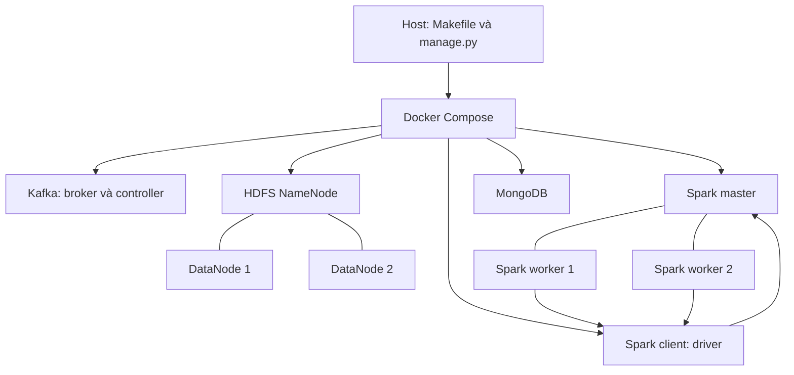
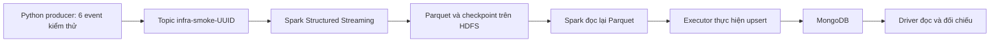

# 01 — Kiến trúc và công dụng các công nghệ

[← Mục lục](README.md)

## 1. Mục đích của phần hạ tầng

Hạ tầng tạo môi trường để dữ liệu sự kiện có thể đi từ nguồn phát đến hệ thống xử lý và lưu trữ. Mục tiêu trước mắt là chứng minh các thành phần kết nối đúng và có thể giữ dữ liệu qua lần khởi động lại; các bài toán phân tích và ML được xây tiếp trên môi trường này.

Một ví dụ trong bộ kiểm thử là gửi sáu event JSON vào Kafka, dùng Spark đọc thành DataFrame, ghi Parquet lên HDFS rồi đưa dữ liệu sang MongoDB. Nhờ đó, lỗi kết nối được phát hiện trước khi triển khai nghiệp vụ phức tạp.

## 2. Docker và Docker Compose

| Khái niệm      | Là gì?                                                                       | Công dụng trong dự án                                                  |
| -------------- | ---------------------------------------------------------------------------- | ---------------------------------------------------------------------- |
| Docker image   | Gói môi trường có filesystem, chương trình và dependency                     | Giữ phiên bản Java/Python/Spark/Hadoop nhất quán                       |
| Container      | Một tiến trình hoặc nhóm tiến trình chạy từ image với môi trường được cô lập | Chạy từng broker, node lưu trữ hoặc worker độc lập                     |
| Dockerfile     | Công thức build image                                                        | Cài Hadoop/Spark, thư viện và chuẩn bị quyền thư mục                   |
| Docker Compose | Khai báo và điều phối nhiều service                                          | Khởi động toàn cụm, nối mạng, gắn volume và quản lý dependency         |
| Docker network | Mạng kết nối các container                                                   | Cho phép truy cập `kafka`, `namenode`, `mongodb` bằng DNS service name |
| Named volume   | Vùng dữ liệu do Docker quản lý, tách khỏi vòng đời container                 | Giữ log Kafka, metadata/block HDFS và database MongoDB                 |
| Bind mount     | Gắn đường dẫn của host vào container                                         | Cung cấp cấu hình, script và dataset; bản hiện tại mount read-only     |

Container không phải một máy ảo độc lập. Hai DataNode trong Compose vẫn dùng tài nguyên của cùng máy vật lý.

## 3. Vai trò từng hệ thống

| Công nghệ      | Trách nhiệm                                           | Ví dụ                                              |
| -------------- | ----------------------------------------------------- | -------------------------------------------------- |
| Kafka          | Nhận, phân vùng và lưu event theo topic               | Producer gửi JSON; Spark đọc lại theo offset       |
| Spark          | Thực thi phép xử lý trên nhiều executor               | Parse JSON, cộng tổng, đọc/ghi DataFrame           |
| HDFS           | Lưu file thành block và quản lý bản sao trên DataNode | Lưu Parquet, checkpoint và Spark event log         |
| MongoDB        | Lưu document để ứng dụng truy vấn                     | Lưu record kết quả theo khóa, cập nhật bằng upsert |
| Python runtime | Chạy driver, client và script kiểm tra                | Gửi Kafka, kiểm tra MongoDB, nộp PySpark job       |

Kafka lưu event theo retention và offset; HDFS lưu file dài hạn theo đường dẫn; MongoDB phục vụ truy vấn document. Mỗi thành phần có mô hình dữ liệu và nhiệm vụ riêng.

## 4. Cấu trúc chạy thực tế

Compose quản lý vòng đời container. Spark master quản lý tài nguyên Spark bên trong cụm. Đây là hai tầng điều phối khác nhau.

## 5. Luồng dữ liệu được kiểm tra

Các bước do [smoke pipeline](../infra/smoke/pipeline.py) thực hiện. Topic kiểm thử khác hai topic nghiệp vụ; dữ liệu được gắn run ID để có thể dọn riêng.

Checkpoint giữ tiến độ streaming. Trong kiểm thử, chạy lại cùng checkpoint phải giữ số record Parquet bằng sáu. Điều này chỉ xác minh kịch bản file sink đã viết trong test, không tự chứng minh mọi sink hoặc pipeline nghiệp vụ đều có ngữ nghĩa exactly-once.

## 6. Spark master, worker, driver và executor

- **Master:** nhận đăng ký worker, biết tổng core/bộ nhớ và phân phối tài nguyên cho ứng dụng.
- **Worker:** quản lý tiến trình executor trên node của nó.
- **Driver:** chạy chương trình điều khiển, tạo SparkSession và xây dựng kế hoạch thực thi.
- **Executor:** thực hiện task và giữ dữ liệu trung gian của ứng dụng.

Driver chạy trong `spark-client` bằng `spark-submit --deploy-mode client`. Hai worker có thể cấp hai executor, mỗi executor hai core và heap 1 GiB. Việc có hai worker trong UI chỉ chứng minh đăng ký tài nguyên; smoke test còn kiểm tra hostname thực thi task để xác nhận cả hai thực sự được dùng.

## 7. HDFS NameNode và DataNode

NameNode biết tên file, thư mục và vị trí block. Nội dung block nằm trên DataNode. Client hỏi NameNode về metadata rồi trao đổi dữ liệu với DataNode.

`dfs.replication=2` yêu cầu hai bản sao block. Hai DataNode có volume riêng, vì vậy dừng/recreate một container không đồng nghĩa xóa cả hai vùng block.

NameNode có metadata riêng trên volume. Nếu mất metadata NameNode thì việc còn các file block chưa đủ để tự khôi phục toàn bộ namespace.

## 8. Những khái niệm dễ nhầm

| Khái niệm         | Ý nghĩa                                                                  |
| ----------------- | ------------------------------------------------------------------------ |
| Kafka partition   | Phần của log topic; thứ tự/offset được xác định trong từng partition     |
| Spark partition   | Phần dữ liệu được xử lý bởi task; không mặc định bằng số Kafka partition |
| HDFS block        | Đơn vị lưu trữ file của HDFS                                             |
| HDFS replica      | Bản sao block trên DataNode                                              |
| Healthcheck       | Kiểm tra một service theo phép thử đã khai báo                           |
| Cluster readiness | Kiểm tra các service và cấu hình cần thiết có phối hợp đúng chưa         |

Ba partition trên một Kafka broker không tạo ra ba broker hoặc khả năng chịu lỗi broker. Hai bản sao HDFS trên cùng một máy không bảo vệ khỏi mất cả máy hoặc ổ đĩa chung. Bản triển khai hiện tại không cấu hình Kafka, NameNode, Spark master hoặc MongoDB ở chế độ HA.

## 9. Nguồn đối chiếu

- [Compose và topology](../compose.yaml)
- [Cấu hình Hadoop](../infra/config/hadoop/hdfs-site.xml)
- [Cấu hình Spark](../infra/config/spark/spark-defaults.conf)
- [Chi tiết từng service](02-services.md)
- [Ý nghĩa kiểm thử](06-testing.md)
