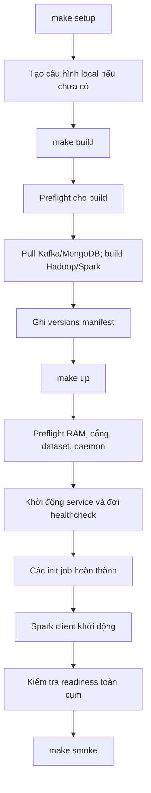
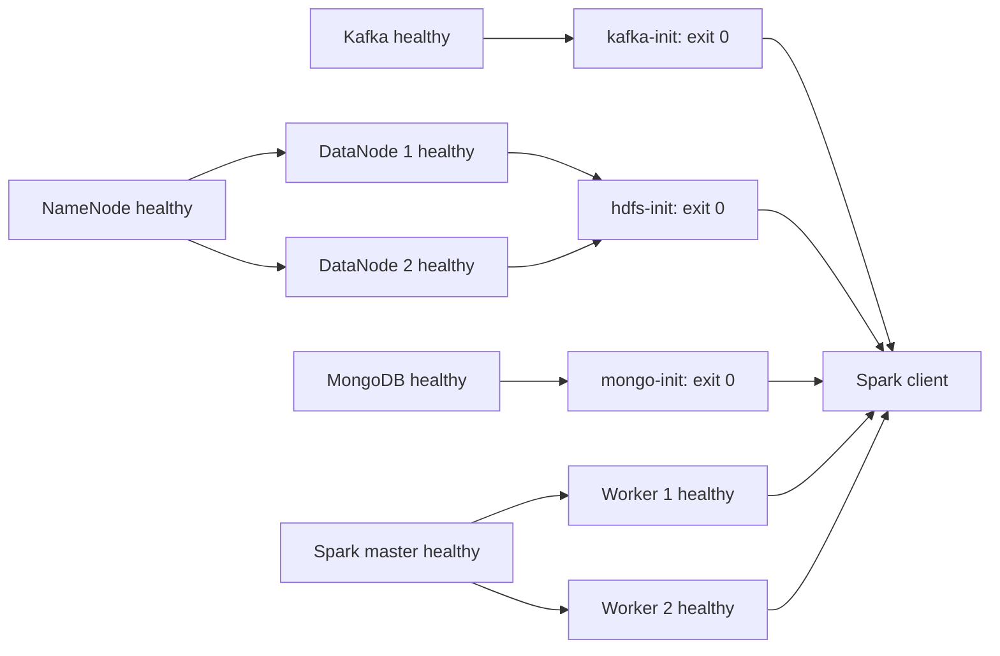

# 04 — Khởi tạo và vòng đời

[← Mục lục](README.md)

Phần này giải thích những gì xảy ra bên trong lệnh vận hành, dựa trên [script quản lý](../infra/manage.py) và [Compose](../compose.yaml).

## 1. Toàn bộ quá trình

Mỗi bước có thể thất bại và trả mã khác 0. Không nên coi việc command trước đã được gõ là bằng chứng bước đó thành công.

## 2. Setup: tạo định danh một lần

`make setup`:

1. Đọc template.
2. Nếu file local đã tồn tại, validate rồi giữ nguyên.
3. Nếu chưa có, sinh Kafka UUID và hai password độc lập.
4. Tạo file với mode 0600 và cơ chế không ghi đè file đã tồn tại.
5. Validate nội dung đã tạo.

Nếu file hiện hữu thiếu biến hoặc còn `__GENERATE__`, setup báo lỗi. Nó không sửa âm thầm hoặc thay password/cluster ID.

Setup không truy cập daemon, chưa tạo container, topic hoặc thư mục HDFS.

## 3. Build: chuẩn bị phần mềm trong image

Preflight build kiểm tra Docker/Compose, kiến trúc, CPU/AVX, dataset, cấu hình và disk khi thấy Docker data partition. Nó bỏ kiểm tra RAM khả dụng và xung đột cổng vì chưa khởi động toàn bộ cụm.

Sau đó:

- Pull image Kafka và MongoDB theo digest.
- Build image Hadoop qua service `namenode`.
- Build image Spark qua service `spark-master`.
- Các service cùng nhóm sử dụng lại image vừa build.
- Ghi image ID/digest và phiên bản Docker/Compose vào `artifacts/infra/versions.json`.

Hadoop build tải binary lean và kiểm tra checksum. Spark build cài Java, tải Spark, cài Python dependency, tải bốn JAR connector và kiểm tra checksum/dependency có sẵn.

Build không ingest dataset hoặc chạy mô hình ML.

## 4. Preflight trước khi khởi động

Các kiểm tra của `make up`:

| Kiểm tra                  | Mục đích                                           |
| ------------------------- | -------------------------------------------------- |
| Docker daemon             | Xác nhận CLI có thể điều khiển môi trường thực thi |
| Linux amd64/CPU/AVX       | Phù hợp runtime và MongoDB                         |
| Bốn CSV tồn tại, đọc được | Tránh mount sai và bước job sau thất bại           |
| Compose hợp lệ            | Bắt biến thiếu hoặc cấu hình không parse được      |
| RAM                       | Đảm bảo ngân sách cho các container cần chạy thêm  |
| Docker data disk          | Kiểm tra tối thiểu 30 GiB nếu đường dẫn thấy được  |
| Cổng host                 | Tránh giành cổng của dịch vụ khác                  |

Khi gọi `up` lại, script trừ giới hạn bộ nhớ của các service project đã chạy khỏi ngưỡng cần bổ sung. Đây là phép tính ngân sách dựa trên cấu hình, không phải phép đo RSS thực tế từng container.

Cổng được publish bởi container đang chạy của chính project được nhận diện để không coi là xung đột. Nếu Docker data partition không nhìn thấy từ phiên hiện tại, script thông báo cần kiểm tra tại Docker host; không giả định dung lượng workspace chính là dung lượng Docker data.

## 5. Dependency và bootstrap

### Kafka init

Tạo topic nếu thiếu rồi đọc lại partitions/RF/retention. Cấu hình đúng thì tiếp tục; sai thì thoát lỗi. Không xóa và tạo lại topic hiện có.

### HDFS init

Đợi JMX báo đúng hai live DataNode và safe mode OFF. Tối đa 60 lần thử, nghỉ hai giây giữa các lần; thời gian thực tế còn cộng thời gian gọi network/CLI. Sau đó tạo bảy thư mục và đặt mode 750 cho gốc `/ecommerce`.

NameNode healthcheck chỉ kiểm tra chính NameNode. Nếu nó chờ đủ DataNode trong khi DataNode lại chờ NameNode healthy, bootstrap sẽ bị vòng chờ.

### Mongo init

Kết nối root, tạo application user nếu thiếu, upsert marker bằng `$setOnInsert` rồi thử truy cập bằng app account.

Lỗi kết nối có retry hữu hạn; lỗi authentication/authorization được báo để sửa cấu hình. Account hiện có không tự bị đổi password.

## 6. Healthcheck và readiness

| Tầng                | Được kiểm tra như thế nào?                                                        |
| ------------------- | --------------------------------------------------------------------------------- |
| Kafka               | CLI truy vấn API của broker                                                       |
| NameNode/DataNode   | HTTP/JMX của process tương ứng                                                    |
| Spark master/worker | JSON UI trả lời được                                                              |
| MongoDB             | Root authentication và ping                                                       |
| Spark client        | Topology Spark/HDFS, Kafka topic metadata, đọc MongoDB bootstrap marker           |
| Sau `up`            | Script xác nhận chín service healthy, ba init exit 0, rồi chạy readiness có retry |

`docker compose up` dùng `--no-build --wait --wait-timeout 300`. Sau bước đợi này vẫn có kiểm tra cluster readiness riêng.

Healthcheck trả healthy chỉ chứng minh phép thử được định nghĩa đã thành công. Nó không chứng minh throughput, độ trễ nghiệp vụ hoặc chất lượng ML.

## 7. Định danh và dữ liệu khi restart

### HDFS

NameNode có VERSION thì kiểm tra cluster ID; không có VERSION và thư mục rỗng mới được format. Không có VERSION nhưng thư mục không rỗng thì từ chối format.

DataNode có VERSION thì kiểm tra cluster ID trước khi gọi Hadoop. Việc khôi phục storage bị hỏng không được tự động hóa bằng thao tác xóa metadata.

### Kafka

Khi `meta.properties` đã có, startup so sánh `cluster.id` với cấu hình. Không khớp thì dừng; giữ đúng ID là điều kiện để dùng lại dữ liệu.

### MongoDB

Account nằm trong database volume. Các biến khởi tạo root không phải cơ chế cập nhật account đã tồn tại. Việc đổi file rồi restart có thể làm healthcheck không xác thực được.

## 8. Dừng, khởi động lại và reset

- `make down` dừng/gỡ container/network của project, giữ named volume.
- `make up` dựng lại từ image và volume hiện có; init được thực hiện theo cơ chế dependency.
- `make reset CONFIRM=delete-project-data` gọi Compose down có xóa volume của project.
- Reset không xóa dataset, source code hoặc artifact host.
- Các service thường trực dùng `unless-stopped`; init job dùng `restart: "no"`.
- Grace period dừng service là 60 giây; lệnh down cũng dùng timeout 60 giây.

Container bị `unhealthy` nhưng process vẫn chạy không tự được restart chỉ nhờ restart policy. Dependency trong Compose chủ yếu điều phối khởi động, không phải controller luôn tự sửa mọi lỗi runtime.

Nếu khởi động thất bại giữa chừng, một phần container có thể vẫn chạy. Xem trạng thái/log, xử lý nguyên nhân rồi gọi lại; không reset toàn bộ như bước chẩn đoán đầu tiên.

## 9. Vòng đời một job kiểm thử

Makefile gọi script quản lý; script lấy khóa file để ngăn các job smoke/persistence được quản lý chạy chồng nhau. Sau đó chạy `spark-submit` trong client.

- Timeout mỗi lệnh job: 600 giây.
- Nếu quá hạn, `timeout` gửi tín hiệu dừng và có thời gian kill-after 15 giây.
- Log được lưu trên host.
- Chỉ khi process exit 0 và có dòng `INFRA_RESULT=...` mới ghi báo cáo JSON thành công.
- Khóa của manager không chặn job do người dùng tự gọi trực tiếp bằng Docker CLI.

Persistence test có ba lượt job create/verify/clean và một chu kỳ down/up; timeout một job không phải timeout tổng của toàn bộ phép thử.

Đọc tiếp [các lệnh vận hành](05-operations.md).
