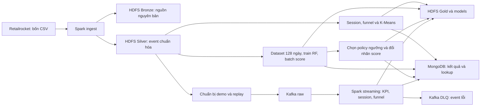

# Hướng dẫn chạy toàn bộ dự án trên máy mới

[← Mục lục tài liệu](README.md) · [README dự án](../README.md)

Tài liệu này dành cho developer nhận repository và tự chạy từ đầu: cài công cụ, chuẩn bị Retailrocket, dựng Docker Compose, ingest, phân tích lịch sử/streaming, K-Means, Random Forest và policy ưu tiên precision. Không cần `.env`, model, volume hoặc thư mục `artifacts/` của người bàn giao.

Đối chiếu mã nguồn và artifact đến **17/10/2026**. Các lệnh ứng dụng bên dưới chạy trong **Bash trên Linux hoặc Ubuntu WSL2**, tại thư mục gốc repository. Các khối PowerShell chỉ dùng để chuẩn bị Windows. Chạy từng giai đoạn và kiểm tra kết quả trước khi chuyển bước.

## Mục lục

1. [Phạm vi và luồng dữ liệu](#scope)
2. [Yêu cầu máy và công cụ](#requirements)
3. [Cài môi trường Linux hoặc Windows/WSL2](#os)
4. [Clone và chuẩn bị dataset](#source)
5. [Tạo cấu hình local](#configuration)
6. [Kiểm thử offline, build và khởi động](#infrastructure)
7. [Ingest Bronze/Silver](#ingestion)
8. [Phân tích lịch sử và demo streaming](#behavior)
9. [Feature và K-Means](#segments)
10. [Random Forest và batch scoring](#prediction)
11. [Policy precision và score mới](#policy)
12. [Đọc artifact, selector và theo dõi](#artifacts)
13. [Nghiệm thu chạy lại](#reuse)
14. [Khởi động lại, ngắt job và xử lý lỗi](#recovery)
15. [Dừng và dọn dữ liệu](#cleanup)
16. [Checklist bàn giao](#handoff)

<a id="scope"></a>
## 1. Phạm vi và luồng dữ liệu

Mục tiêu là biến hành vi xem sản phẩm, thêm giỏ và mua thành số liệu giúp hiểu khách hàng: họ dừng ở đâu trong funnel, có những nhóm hành vi nào và ai có dấu hiệu mua trong 24 giờ tiếp theo.



| Thành phần | Công dụng |
| --- | --- |
| Docker Compose | Khởi tạo network, volume, giới hạn tài nguyên, healthcheck và thứ tự init trên một máy. |
| Kafka | Nhận event replay, giữ offset và tách event lỗi sang DLQ. |
| HDFS | Lưu nguồn, Parquet, snapshot, checkpoint và model; hai DataNode giữ replication 2. |
| Spark | Xử lý batch/streaming và ML phân tán qua hai worker. |
| MongoDB | Giữ kết quả đã công bố, metadata và lookup theo visitor/sản phẩm. |
| Make và Python CLI | Kiểm tra điều kiện, điều phối job, khóa driver, ghi log và report. |

Đã có ingestion, KPI streaming, session/funnel lịch sử và streaming, K-Means lịch sử, RF batch và policy precision. **Scoring ML trên streaming, FastAPI và dashboard sản phẩm chưa triển khai**. Spark/HDFS UI là giao diện vận hành. Retailrocket không có giá/doanh thu hoặc bước bắt đầu thanh toán; funnel hiện tại là **xem → thêm giỏ → mua**. Hai worker/DataNode cùng một máy không bảo vệ khi cả máy hoặc ổ đĩa hỏng.

Các nhánh phụ thuộc như sau; thứ tự trong tài liệu là một lộ trình chạy đầy đủ:

| Giai đoạn | Cần có trước |
| --- | --- |
| Hạ tầng | Công cụ, bốn CSV, `.env`, image đã build |
| Ingest | Hạ tầng healthy, smoke đạt |
| Behavior lịch sử, demo streaming, K-Means | Silver đã ingest đạt chất lượng |
| RF | Silver; không cần dùng cluster K-Means làm feature |
| Policy | RF published, validation/test predictions và original batch score |

<a id="requirements"></a>
## 2. Yêu cầu máy và công cụ

| Hạng mục | Yêu cầu thực tế |
| --- | --- |
| Hệ điều hành chạy CLI | Linux `amd64`; Windows dùng Ubuntu WSL2, Linux containers |
| CPU | `x86_64`, hỗ trợ AVX, Docker thấy ít nhất 4 CPU logic |
| RAM | Khoảng **7 GiB khả dụng** trước khi dựng cả cụm; khuyến nghị máy có ít nhất 16 GB để còn RAM cho OS/Docker |
| Dung lượng | Preflight yêu cầu ít nhất **30 GiB trống ở Docker data**; nên dành 50–60 GiB trở lên và theo dõi khi lưu nhiều snapshot/model |
| Công cụ host | Git, GNU Make, Python 3.10+, Bash, curl, unzip, GNU coreutils |
| Docker | Daemon truy cập được, Compose hỗ trợ `up --wait`, Buildx plugin hoạt động |
| Mạng | Lần build đầu cần tải image, binary Apache, Python dependencies và dataset |

Tổng limit chín service thường trực là **6,25 GiB**. Ba init job có thể thêm 704 MiB, tổng tối đa **6,94 GiB**; bộ nhớ hệ điều hành và daemon nằm ngoài số này. Driver dùng heap 512 MiB, mỗi executor 640 MiB và một core. Chỉ chạy **một Spark driver tại một thời điểm**, kể cả smoke và integration test. Producer replay có thể chạy đồng thời với streaming theo hướng dẫn riêng.

Java, Spark, Hadoop, PySpark và các dependency ứng dụng được cài trong image; không cần cài chúng bằng pip hoặc Java trên host. Không giả định chạy được trên ARM/Apple Silicon hoặc Windows native. Chi tiết: [ngân sách RAM](infra/10-memory-budget.md).

<a id="os"></a>
## 3. Cài môi trường: chọn đúng một nhánh

### 3.1. Ubuntu 24.04 trên Linux

Chạy tại terminal của **máy Linux**, không áp dụng nhánh này trong WSL đang dùng Docker Desktop. Với máy đã có Docker hoạt động, kiểm tra ở mục 3.4 và bỏ qua cài lại. Máy có Docker/containerd cũ cần đối chiếu các package xung đột trước khi đổi bộ cài; tham khảo [hướng dẫn Ubuntu chính thức của Docker](https://docs.docker.com/engine/install/ubuntu/).

Cài công cụ và đăng ký repository Docker:

```bash
sudo apt update
sudo apt install -y ca-certificates curl git make python3 unzip
sudo install -m 0755 -d /etc/apt/keyrings
sudo curl -fsSL https://download.docker.com/linux/ubuntu/gpg -o /etc/apt/keyrings/docker.asc
sudo chmod a+r /etc/apt/keyrings/docker.asc
sudo tee /etc/apt/sources.list.d/docker.sources >/dev/null <<EOF
Types: deb
URIs: https://download.docker.com/linux/ubuntu
Suites: $(. /etc/os-release && echo "${UBUNTU_CODENAME:-$VERSION_CODENAME}")
Components: stable
Architectures: $(dpkg --print-architecture)
Signed-By: /etc/apt/keyrings/docker.asc
EOF
sudo apt update
sudo apt install -y docker-ce docker-ce-cli containerd.io docker-buildx-plugin docker-compose-plugin
sudo systemctl enable --now docker
sudo groupadd --force docker
sudo usermod -aG docker "$USER"
```

Đăng xuất và đăng nhập lại để nhận group mới, rồi kiểm tra mục 3.4. Quyền group Docker cho phép điều khiển daemon; chỉ cấp cho người dùng được phép vận hành máy. Không đổi socket sang `chmod 777` hoặc chạy toàn bộ Make bằng `sudo`. Xem [Linux post-install](https://docs.docker.com/engine/install/linux-postinstall/).

### 3.2. Arch Linux

Chạy trong terminal Arch:

```bash
sudo pacman -Syu --needed docker docker-compose docker-buildx git make python curl unzip
sudo systemctl enable --now docker
sudo groupadd --force docker
sudo usermod -aG docker "$USER"
```

Đăng xuất/đăng nhập lại. Trên Arch, **Buildx là package riêng**; chỉ có `docker` và `docker-compose` chưa đủ cho `make build`. Tên package đối chiếu từ repository Arch: [docker](https://archlinux.org/packages/extra/x86_64/docker/), [docker-compose](https://archlinux.org/packages/extra/x86_64/docker-compose/), [docker-buildx](https://archlinux.org/packages/extra/x86_64/docker-buildx/).

### 3.3. Windows 11 x64, Ubuntu 24.04 WSL2 và Docker Desktop

Nhánh này dùng Docker Desktop làm daemon. Các bước chuẩn bị theo tài liệu chính thức; dự án **chưa có lượt nghiệm thu runtime riêng trên Windows/WSL2**.

1. Bật virtualization trong BIOS/UEFI nếu chưa có. Mở **PowerShell Administrator**, cài WSL và Ubuntu:

```powershell
wsl --install -d Ubuntu-24.04
```

2. Khởi động lại Windows khi được yêu cầu. Mở Ubuntu, tạo Linux username/password. Trong PowerShell, cập nhật và kiểm tra:

```powershell
wsl --update
wsl --version
wsl --list --verbose
```

Ubuntu phải có `VERSION 2`. Nếu bản đã cài còn là WSL1, chuyển trước khi chạy dự án:

```powershell
wsl --set-version Ubuntu-24.04 2
```

Tên distro phải khớp `wsl --list --verbose`. Xem [Microsoft: cài WSL](https://learn.microsoft.com/en-us/windows/wsl/install). Docker yêu cầu WSL tối thiểu 2.1.5 và khuyến nghị cập nhật; kiểm tra theo [Docker Desktop WSL2](https://docs.docker.com/desktop/features/wsl/).

3. Cài [Docker Desktop for Windows](https://docs.docker.com/desktop/setup/install/windows-install/), mở ứng dụng. Chọn **Use the WSL 2 based engine**, bật **Resources → WSL Integration → Ubuntu-24.04**, Apply/Restart. Dùng **Linux containers**. Không cài thêm Docker Engine/CLI bằng apt trong Ubuntu này vì có thể xung đột với Desktop.
4. Trước khi chạy job, cấp đủ tài nguyên cho WSL. Ví dụ máy Windows có ít nhất 16 GB RAM: sửa hoặc tạo `%UserProfile%\.wslconfig` bằng Windows editor, giữ các tùy chỉnh khác nếu file đã tồn tại:

```ini
[wsl2]
memory=10GB
processors=4
swap=4GB
```

Đây là trần VM dùng chung cho WSL2, khác tổng limit container. Swap không thay thế yêu cầu RAM khả dụng. Khi không còn công việc trong các distro, thoát Docker Desktop rồi áp dụng từ PowerShell:

```powershell
wsl --shutdown
```

Mở lại Docker Desktop và Ubuntu. Lệnh trên dừng **mọi distro WSL đang chạy**; thực hiện trước khi có pipeline. Cơ chế cấu hình: [Microsoft `.wslconfig`](https://learn.microsoft.com/en-us/windows/wsl/wsl-config).

5. Từ đây dùng **terminal Ubuntu/Bash**, cài công cụ host:

```bash
sudo apt update
sudo apt install -y git make python3 curl unzip ca-certificates
```

Clone repository và lưu CSV trong filesystem Linux, ví dụ `~/workspace/`, để bind mount có hiệu năng tốt. Tránh đặt workspace/dataset dưới `/mnt/c`. Có thể mở `explorer.exe .` từ Ubuntu để chép ZIP vào thư mục Linux. Giữ file shell ở newline **LF**. Xem [Docker WSL best practices](https://docs.docker.com/desktop/features/wsl/best-practices/).

### 3.4. Kiểm tra trước khi clone

Trong Bash Linux/Ubuntu WSL của chính người sẽ chạy dự án:

```bash
uname -m
nproc
python3 --version
make --version
docker context show
docker info
docker compose version
docker buildx version
free -h
df -h .
```

Đạt khi kiến trúc `x86_64`, Docker báo Linux/amd64 và ít nhất bốn CPU, Python ≥3.10, không lỗi socket/daemon, Compose và Buildx in phiên bản. Preflight dự án còn kiểm tra AVX và tài nguyên. Trên WSL, cần đủ RAM khả dụng **bên trong Linux**, đồng thời đủ dung lượng ổ Windows chứa virtual disk của Docker Desktop; `df -h .` một mình không xác nhận ổ Docker còn trống.

Nếu Docker chưa truy cập được: Linux kiểm tra service/group và đăng nhập lại; WSL kiểm tra Desktop đang mở, Linux containers và integration đúng distro. Chưa chuyển sang build khi bước này còn lỗi.

<a id="source"></a>
## 4. Clone repository và chuẩn bị Retailrocket

### 4.1. Lấy đúng mã nguồn

Trong Bash, chọn workspace của mình. Ví dụ này dùng `~/workspace/` nhất quán cho mọi terminal:

```bash
mkdir -p ~/workspace
cd ~/workspace
git clone --branch dev https://github.com/quangnhathung/E-commerce-User-Behavior-Analytics-Platform.git
cd E-commerce-User-Behavior-Analytics-Platform
git status --short
git branch --show-current
git rev-parse HEAD
```

Nhánh hiện hành là `dev`. Khi bàn giao một phiên bản cố định, dùng commit/tag đã được nhóm thống nhất thay vì tự lấy mã mới giữa các job. Ghi lại commit vào biên bản; nó giúp giải thích khác biệt identity và model giữa hai máy. Nếu chọn đường dẫn workspace khác, thay `cd` ở các terminal trong tài liệu tương ứng.

### 4.2. Tải và giải nén dataset

Tải ZIP từ [Retailrocket recommender system dataset trên Kaggle](https://www.kaggle.com/datasets/retailrocket/ecommerce-dataset), đăng nhập Kaggle nếu trang yêu cầu. Ví dụ lưu ZIP đã tải thành `~/Downloads/retailrocket.zip` **bên trong Linux/WSL**. Không cần đưa Kaggle token vào `.env` hoặc Git.

Từ thư mục gốc repository, kiểm tra ZIP:

```bash
DATASET_ARCHIVE="$HOME/Downloads/retailrocket.zip"
test -f "$DATASET_ARCHIVE"
unzip -l "$DATASET_ARCHIVE"
```

Sửa giá trị biến nếu file tải có tên khác. Sau khi kiểm tra, giải nén vào thư mục mới:

```bash
mkdir -p Dataset/retailrocket-recommender-system-dataset
unzip "$DATASET_ARCHIVE" -d Dataset/retailrocket-recommender-system-dataset
```

Nếu ZIP có thư mục cha, sắp lại để **bốn CSV nằm trực tiếp** như sau, không lồng thêm một tầng:

```text
Dataset/retailrocket-recommender-system-dataset/
  events.csv
  category_tree.csv
  item_properties_part1.csv
  item_properties_part2.csv
```

| File | Header bắt buộc, đúng thứ tự |
| --- | --- |
| `events.csv` | `timestamp,visitorid,event,itemid,transactionid` |
| `category_tree.csv` | `categoryid,parentid` |
| `item_properties_part1.csv`, `item_properties_part2.csv` | `timestamp,itemid,property,value` |

Kiểm tra đủ file và header từ host; chưa cần Docker:

```bash
PYTHONPATH=app python3 - <<'PY'
import csv
from pathlib import Path
from ecommerce_analytics.contracts import HEADERS
root = Path("Dataset/retailrocket-recommender-system-dataset")
for name, expected in sorted(HEADERS.items()):
    path = root / name
    with path.open(encoding="utf-8", newline="") as source:
        actual = next(csv.reader(source), None)
    if actual != expected:
        raise SystemExit(f"Sai header: {path}: {actual}")
    print(f"OK {path}: {path.stat().st_size:,} bytes")
PY
```

Đạt khi cả bốn file được đọc và header khớp. File thiếu/sai header phải sửa trước. Dataset không được Git theo dõi hoặc đóng gói vào image; Compose mount nguồn **read-only**. Không sửa CSV trong khi job đang hash/đọc. Có thể dùng vị trí khác qua `DATASET_PATH` ở bước cấu hình, đồng thời đổi đường dẫn trong kiểm tra header.

Host đọc được chưa chắc container UID/GID 1000 đọc được. Với bộ dữ liệu công khai này, có thể cấp quyền đọc CSV và quyền đi qua **các thư mục dataset liên quan** cho runtime; kiểm tra lại trong container ở mục 6. Không đổi toàn bộ home hoặc dùng `chmod 777`.

<a id="configuration"></a>
## 5. Tạo và kiểm tra cấu hình local

**Nơi chạy:** thư mục gốc trong Bash. **Cần có:** công cụ và dataset đã sẵn sàng.

```bash
make setup
```

Lệnh tạo `.env` từ [template](../.env.example), quyền `0600`, sinh hai mật khẩu Mongo độc lập và Kafka cluster ID. Chạy lại giữ file có sẵn. Sửa `.env` bằng editor local nếu cần:

| Biến | Mặc định / tác dụng |
| --- | --- |
| `COMPOSE_PROJECT_NAME` | `ecommerce-analytics`; namespace container/network/volume của stack |
| `DATASET_PATH` | `./Dataset/retailrocket-recommender-system-dataset`; đường dẫn trên host |
| `MIN_AVAILABLE_RAM_GIB` | `7`; gate bộ nhớ, không phải lệnh cấp RAM cho Docker |
| `MIN_DOCKER_DISK_GIB` | `30`; gate dung lượng Docker data |
| `KAFKA_CLUSTER_ID`, `HDFS_CLUSTER_ID` | Danh tính dữ liệu bền vững trong volume; giữ ổn định khi khởi động lại |
| `MONGO_*` | Database, app/root account; password đã sinh chỉ lưu local |
| `KAFKA_HOST_PORT`, `MONGO_HOST_PORT` | `19092`, `27018`; endpoint host |
| `HDFS_UI_PORT` | `9870` |
| `SPARK_MASTER_UI_PORT`, `SPARK_WORKER_1_UI_PORT`, `SPARK_WORKER_2_UI_PORT` | `18080`, `18081`, `18082` |
| `SPARK_APPLICATION_UI_PORT` | `14040`, dùng khi driver đang chạy |

Các cổng host phải khác nhau, trong khoảng 1024–65535 và không bị ứng dụng khác chiếm. Đổi trước khi `make up`; dùng cổng mới khi mở UI. Giá trị có khoảng trắng phải được quote đúng theo [cấu hình](infra/03-configuration.md). Cấu hình hạ tầng lấy từ `.env`; đừng chỉ `export DATASET_PATH=...` rồi mong manager thay cấu hình file.

```bash
make config
```

Đạt khi Compose render hợp lệ. Output có thể chứa giá trị nhạy cảm đã resolve; không đưa nguyên output hoặc `.env` vào ticket/commit. Render thành công chưa chứng minh đủ RAM, dataset đọc được hay dịch vụ healthy.

Không tạo lại `.env` khi volume đang giữ dữ liệu. Đổi password trong file không tự đổi account đã tồn tại; đổi cluster ID có thể bị từ chối khi mount volume cũ. Giữ bản sao `.env` an toàn cùng kế hoạch backup volume. Xem [khởi tạo và vòng đời](infra/04-bootstrap-and-lifecycle.md).

<a id="infrastructure"></a>
## 6. Kiểm thử offline, build và khởi động hạ tầng

### 6.1. Kiểm thử local

**Cần có:** cấu hình và các công cụ đã cài; không cần cụm chạy.

```bash
make test
```

Bộ hiện tại có 34 test hạ tầng và 161 test ứng dụng. Trên máy bình thường kỳ vọng các suite kết thúc `OK`, không failure/error. Một phiên kiểm tra trong sandbox có 188 đạt, 7 HTTP skipped vì cấm loopback socket; đó là giới hạn của phiên ấy, **không phải số skip bắt buộc trên máy mới**. Test offline không chứng minh Spark/HDFS/Mongo/Kafka thực sự hoạt động. Nếu lỗi thiếu Compose/Bash/curl, sửa công cụ host rồi chạy lại.

### 6.2. Build image lần đầu

**Cần có:** Docker/Buildx, bốn CSV và `.env`; preflight build vẫn kiểm tra dataset.

```bash
make build
```

Build kéo Kafka/Mongo theo digest, dựng Hadoop/Spark và connector, ghi `artifacts/infra/versions.json`. Các bản chính: Kafka 3.9.1, Hadoop 3.4.2/Java 11, Spark 3.5.7/Java 17, Python 3.11 và MongoDB 8.0. Xác nhận exit code 0 và manifest được tạo.

Lần đầu tải binary Spark khoảng 382 MiB, Hadoop lean khoảng 489 MiB cộng base image/dependency; có thể lâu tùy mạng. Các dòng `Adding debian:...pem` là cập nhật CA. BuildKit cache giữ download đã kiểm checksum và phần tải dở. Khi mạng lỗi/ngắt, chạy lại `make build`; không prune cache trước khi retry. Lệnh build lại sử dụng cache nhưng cache vẫn chiếm disk. Nếu `docker: unknown command: docker buildx`, cài plugin ở đúng nhánh OS rồi kiểm tra `docker buildx version` trong cùng terminal. Xem [tối ưu build](infra/09-build-optimization.md).

### 6.3. Khởi động và smoke

**Cần có:** build đạt, đủ RAM/disk/cổng; chưa có Spark driver khác.

```bash
make up
make doctor
make smoke
```

Chạy từng lệnh; nếu một lệnh lỗi thì dừng ở đó. `make up` dùng image có sẵn, chờ healthcheck và init; không tự build image thiếu. Đạt khi có:

```text
Infrastructure ready: nine healthy services and three completed init jobs.
```

Readiness phải xác nhận hai Spark worker, hai HDFS DataNode, hai topic nghiệp vụ và app Mongo authentication. `kafka-init`, `hdfs-init`, `mongo-init` ở trạng thái `Exited (0)` là đúng; chín service còn lại phải healthy. Có thể xem lại bằng `make ps`.

Smoke tạo dữ liệu riêng để kiểm Kafka → Spark → HDFS/Mongo, hai worker, hai replica, checkpoint restart và upsert lặp. Đạt khi exit 0 và có `artifacts/infra/smoke.json`; xem `smoke.log` nếu lỗi. Smoke không ingest CSV và không đánh giá chất lượng ML. Cách đọc từng field: [kiểm thử hạ tầng](infra/06-testing.md).

Kiểm tra quyền đọc dataset từ chính runtime sau khi cụm lên:

```bash
docker compose exec -T spark-client bash -lc 'id; for f in /opt/dataset/events.csv /opt/dataset/category_tree.csv /opt/dataset/item_properties_part1.csv /opt/dataset/item_properties_part2.csv; do test -r "$f" || exit 1; done'
```

Nếu lỗi quyền, kiểm tra file và quyền đi qua các thư mục của `DATASET_PATH`, chỉnh đúng phạm vi rồi thử lại; không sửa mount thành writable.

**Tùy chọn trước ingest:** khi không có job, chạy `make persistence-test`. Nó tạo marker riêng, thực hiện `down/up` giữ volume, xác minh Kafka/HDFS/Mongo rồi dọn marker. Vì có restart cả stack, không chạy giữa demo hoặc training. Báo cáo `persistence-create`, `persistence-verify`, `persistence-clean` nằm ở `artifacts/infra/`.

<a id="ingestion"></a>
## 7. Ingest dữ liệu lịch sử vào Bronze/Silver

**Nơi chạy:** root repository, một terminal Bash. **Cần có:** doctor/smoke đạt, bốn CSV ổn định, không có Spark driver khác.

```bash
make test-data
make ingest
```

`test-data` chạy fixture tích hợp thật và dọn namespace riêng. `ingest` fingerprint bốn nguồn, lưu bản nguyên gốc vào Bronze, chuẩn hóa `events.csv`, tách dòng lỗi/quarantine, loại trùng hoàn toàn và ghi Silver Parquet theo ngày UTC. File thuộc tính/cây danh mục được giữ trong Bronze; chưa dùng toàn bộ thuộc tính cho ML.

**Đầu ra:** `artifacts/data/test-data.json`, `artifacts/data/latest-ingest.json`, `<dataset_version>/events-v1/{result,quality,manifest,bronze-manifest}.json` và `runs/<UUID>.log` trong `artifacts/data/`.

**Đạt khi:** test-data đạt cả chín test, cleanup thành công; ingest exit 0, `quality_status=passed`, hai worker/hai replica theo report. Với Retailrocket nguyên bản, có **2.756.101 event đầu vào, 460 dòng trùng và 2.755.641 event Silver**. Thời gian dữ liệu là năm 2015; không đổi cutoff sang ngày hiện tại.

```bash
python3 -m json.tool artifacts/data/latest-ingest.json
```

Nếu thiếu file/sai header, sửa nguồn rồi chạy lại. Nếu snapshot thiếu marker/sai checksum, dừng để kiểm tra log và snapshot; job không tự ghi đè bản published. Chạy lại cùng dữ liệu/mã sẽ xác minh Bronze/Silver trước khi reuse; hai cờ tương ứng là `bronze_reused` và `silver_reused` trong `result.json`. Xem [ingestion](data/03-ingestion.md) và [tiêu chí dữ liệu](data/05-testing.md).

<a id="behavior"></a>
## 8. Phân tích lịch sử và demo streaming

### 8.1. Kiểm thử và phân tích toàn bộ lịch sử

**Cần có:** Silver passed, không có job Spark khác. Chạy lần lượt:

```bash
make test-stream
make test-behavior
make analyze-behavior
make behavior-status
make behavior-status ITEM_ID=355908
```

`test-stream` kiểm replay, validation, duplicate/late event, DLQ, checkpoint và retry. `test-behavior` kiểm quy tắc session/funnel. Batch `analyze-behavior` tính session với khoảng bất hoạt **quá 30 phút**, funnel đúng thứ tự và cùng sản phẩm; Mongo công bố snapshot đã đối soát với HDFS Gold.

**Đầu ra:** `artifacts/streaming/test-stream.json`, `artifacts/analytics/test-behavior.json`, `artifacts/analytics/latest-analysis.json` và report/status theo analysis ID.

**Đạt khi:** 10 test streaming và 6 test behavior đạt, cleanup/resource đạt; phân tích lịch sử published. Cùng nguồn chuẩn có **2.755.641 event, 1.761.675 session và 235.061 sản phẩm**. `behavior-status` không truyền `RUN_ID` đọc phân tích lịch sử; truyền `RUN_ID` sẽ chọn kết quả demo tương ứng.

Test fault injection cố ý làm query lỗi để kiểm tra phục hồi. Ví dụ `RuntimeError: injected before Spark checkpoint commit` có thể xuất hiện giữa log dù suite đạt. Kết luận dựa trên **exit code, `OK`, JSON cuối `passed=true`, cleanup và monitor**, không dựa riêng vào chữ `ERROR`. Nếu cuối cùng `FAILED` hoặc exit khác 0, mở đúng log suite và sửa trước khi chạy dữ liệu chính.

### 8.2. Chuẩn bị demo mới

Chọn RUN_ID chưa dùng. Ví dụ xuyên suốt dưới đây là `onboarding-demo-001`; nếu đã có run này, thay bằng tên mới ở **mọi lệnh/mọi terminal**.

```bash
make prepare-demo RUN_ID=onboarding-demo-001
```

Mặc định lấy event trong `[2015-09-10T10:00:00.000Z, 2015-09-10T16:00:00.000Z)`, sắp theo hợp đồng replay, tốc độ 10 event/giây, giới hạn 10.000 event. Nguồn chuẩn có **2.692 event**; producer mất khoảng 4,5 phút chỉ để phát số event này ở tốc độ mặc định, chưa gồm thời gian drain.

Đầu ra là `artifacts/streaming/onboarding-demo-001/` với config, manifest và source snapshot, cùng pointer `latest-run.json`. Có thể đổi `START`, `END`, `RATE` ngay khi prepare; khi retry phải giữ nguyên config. Không dùng RUN_ID cũ cho một demo có mã/cửa sổ khác.

### 8.3. Terminal A: chạy consumer streaming trước

Mở Bash thứ nhất, vào cùng clone:

```bash
cd ~/workspace/E-commerce-User-Behavior-Analytics-Platform
make stream RUN_ID=onboarding-demo-001
```

Giữ terminal mở. Đợi có dòng **`STREAM_READY=onboarding-demo-001`** rồi mới replay. Consumer đọc Kafka, validate/dedup, cập nhật KPI/session/funnel, lưu checkpoint HDFS và snapshot Mongo.

### 8.4. Terminal B: phát replay

Mở Bash thứ hai, cùng thư mục và RUN_ID:

```bash
cd ~/workspace/E-commerce-User-Behavior-Analytics-Platform
make replay RUN_ID=onboarding-demo-001
```

Producer in `REPLAY_PROGRESS`, ghi ACK/end offsets và kết thúc với `status=completed`. Consumer ở terminal A sẽ drain đến các offset đã ACK, commit checkpoint, đối soát rồi tự kết thúc. **Producer xong chưa đủ để chạy job Spark khác**; đợi cả terminal A trả về prompt.

### 8.5. Theo dõi và nghiệm thu demo

Có thể dùng terminal thứ ba cho các lệnh status:

```bash
cd ~/workspace/E-commerce-User-Behavior-Analytics-Platform
make stream-status RUN_ID=onboarding-demo-001
make behavior-status RUN_ID=onboarding-demo-001
make behavior-status RUN_ID=onboarding-demo-001 ITEM_ID=355908
```

**Đạt khi:** replay completed, streaming exit 0, backlog 0, kết quả cuối được đánh dấu final và report/resource đủ; số accepted/invalid/duplicate/late được giải thích. Artifact tham chiếu demo chuẩn có 2.692 event, 1.893 session, funnel 1.882 → 35 → 9. Latency phụ thuộc máy, không yêu cầu khớp số đo của máy bàn giao.

Nếu ngắt giữa chừng, giữ source/checkpoint/ACK và chạy lại stream/replay **cùng RUN_ID, cùng mã và tham số** theo thứ tự trên. Replay completed không phát lại cả nguồn. Muốn demo lần mới, chuẩn bị RUN_ID mới. Không xóa checkpoint để né lỗi. Xem [vận hành streaming](streaming/03-operations.md), [phục hồi](streaming/04-testing-and-recovery.md) và [session/funnel](analytics/03-operations.md).

<a id="segments"></a>
## 9. Feature bảy ngày và K-Means lịch sử

**Cần có:** Silver passed và mọi stream đã kết thúc. Chạy tuần tự trong root:

```bash
make test-ml
make build-features
make train-segments
make segment-status
```

Builder lấy tám feature trên bảy ngày trước **`2015-07-15T00:00:00.000Z`**, không dùng sự kiện tại/sau cutoff. Pipeline biến đổi feature và StandardScaler, thử K=2..5, chọn silhouette tốt nhất, lưu/tải lại model và công bố assignment/profile theo visitor.

**Đầu ra:** `artifacts/ml/test-ml.json`, `latest-features.json`, `latest-model.json`, report theo snapshot/model và status. **Đạt khi:** 6 test tích hợp/cleanup đạt, feature/model published, fingerprint/replica/resource khớp. Với cửa sổ mặc định có **99.038 visitor**. Lượt tham chiếu chọn K=2, silhouette khoảng 0,853847; đây là kết quả đã đo, không phải con số cần hardcode vào code hay kỳ vọng mọi phiên bản môi trường cho ra tuyệt đối giống nhau.

Có thể tra visitor:

```bash
make segment-status VISITOR_ID=001
```

Visitor ID là chuỗi: `001` khác `1`; kết quả null có thể đúng nếu visitor không nằm trong cohort. Không gán tên “khách giá trị cao” cho cụm khi chưa có dữ liệu doanh thu/cơ sở đánh giá.

Nếu chưa có feature pointer, chạy `build-features` trước; `train-segments` không tự dựng nguồn thiếu. Nếu code hash/snapshot khác, xem report và phiên bản mã trước khi chọn lại ID. Xem [vận hành ML](ml/03-operations.md) và [kiểm thử K-Means](ml/04-testing.md).

<a id="prediction"></a>
## 10. Random Forest và batch scoring mua hàng

### 10.1. Kiểm thử và tạo dữ liệu huấn luyện

**Cần có:** Silver passed, không có driver khác; giữ nguyên mã/CSV trong suốt quá trình.

```bash
make test-purchase
make build-purchase-data
```

`test-purchase` chạy bảy test tích hợp RF với fixture nhỏ, gồm fit/save/load và sáu fault scenario. Builder thật tạo feature bảy ngày và nhãn **visitor có mua trong 24 giờ tiếp theo** ở 128 cutoff hằng ngày. Một visitor có thể có nhiều mẫu ở các cutoff khác nhau; tổng dưới đây không phải số người duy nhất.

| Split | Cutoff UTC, hai đầu bao gồm | Số ngày | Số mẫu | Positive |
| --- | --- | ---: | ---: | ---: |
| Train | 11/05–15/07/2015 | 66 | 5.196.014 | 1.750 |
| Validation | 17/07–15/08/2015 | 30 | 2.560.155 | 729 |
| Test | 17/08–17/09/2015 | 32 | 2.380.550 | 726 |
| Tổng | 128 cutoff | 128 | 10.136.719 | 3.205 |

Ngày 16/07 và 16/08 là khoảng nghỉ giữa split. Validation/test giữ nguyên cohort, không downsample. Các mốc đã cố định theo dữ liệu 2015 để kiểm soát dữ liệu tương lai; đừng thay bằng ngày chạy máy.

Builder chạy **20 chặng tuần tự**, thường tối đa bảy ngày/chặng và tạo một Spark application mỗi chặng. Theo dõi `PURCHASE_BUILD_CHUNK=9/20`, `PURCHASE_DAY` và `artifacts/prediction/<purchase_dataset_id>/progress.json`. Mỗi ngày đã commit được reuse khi retry; index cuối chỉ published khi đủ ngày. Chạy lại có thể đếm tiến độ host từ 0 nhưng vẫn dùng các daily snapshot hợp lệ trong HDFS.

Lượt build tham chiếu mất khoảng 45–55 phút; đây không phải cam kết thời gian. Mỗi Spark child có timeout 1.800 giây, **không phải toàn bộ lệnh đa chặng giới hạn 30 phút**. Không chạy thêm job để “tận dụng thời gian”; hai worker đang phục vụ cùng một driver. Nếu log vẫn tiến từng ngày/chặng, đây là công việc bình thường. Xem [dữ liệu prediction](ml/05-purchase-data.md) và [vận hành/progress](ml/07-purchase-operations.md).

**Đạt khi:** test passed/cleaned/resource đạt; đủ 128 ngày/20 chặng, counts khớp; có `latest-purchase-data.json` và report dataset. Nếu ngắt, chạy lại đúng `make build-purchase-data` với cùng mã/nguồn; không reset volume hoặc xóa ngày đã commit.

### 10.2. Train và đánh giá RF gốc

```bash
make train-purchase
make purchase-status
```

Train giữ toàn bộ 1.750 positive và lấy 35.000 negative theo quy tắc sampling, tổng **36.750 mẫu**. Thử bốn cấu hình gồm 50/100 cây × depth 5/8 tuần tự; chọn candidate bằng PR-AUC validation, chọn threshold bằng F1 validation, khóa selection trước khi đánh giá test. Không dùng K-Means cluster hoặc visitor ID làm feature.

**Đầu ra:** `latest-purchase-model.json`, model report/status, `training.json`, `progress.json` và candidate logs dưới `artifacts/prediction/`. **Đạt khi:** model published, đủ bốn candidate, số mẫu đúng, model reload/fingerprint và monitor đạt. Lượt train toàn nguồn tham chiếu mất khoảng 30 phút; đọc tiến độ thay vì suy luận chỉ từ thời gian chờ.

Kết quả tham chiếu RF gốc: 50 cây/depth 5/ngưỡng 0,93; PR-AUC test 0,18172, precision **43,63%**, recall **21,21%**. Phần lớn mẫu là negative nên accuracy đơn lẻ không phản ánh khả năng tìm người mua. Precision thấp dẫn tới bước policy ở mục 11; không chỉnh threshold theo test để làm đẹp kết quả.

Nếu thiếu dataset pointer/report thì quay lại builder. Nếu một candidate lỗi, xem log/resources của đúng child rồi retry cùng phiên bản; candidate published được xác minh trước reuse. Xem [phương pháp RF](ml/06-random-forest.md).

### 10.3. Score một cohort lịch sử

```bash
make score-purchases
make purchase-score-status
make purchase-score-status VISITOR_ID=001
```

Score mặc định chốt **`2015-09-18T00:00:00.000Z`**, tính feature bảy ngày trước đó, dùng RF published và ghi Gold/Mongo. Cohort này không có nhãn mua tương lai đầy đủ để đánh giá lại precision như tập test.

**Đầu ra:** `latest-purchase-score.json` chọn score gốc; report/status theo `score_run_id`. **Đạt khi:** published, đủ **69.052 visitor**, mỗi visitor đúng một record, score/feature/fingerprint/Mongo count khớp, hai replica và resource đạt. Lượt tham chiếu có 10 predicted positive ở ngưỡng 0,93; số người được gắn nhãn này không phải số người chắc chắn sẽ mua.

Không có visitor lookup có thể là kết quả hợp lệ. Nếu score cutoff khác, truyền `AS_OF` có chủ đích và không dùng count 69.052 làm chuẩn cho cửa sổ mới. Không truyền MODEL_VERSION K-Means sang RF; các selector dùng registry/pointer khác nhau. Chi tiết nghiệm thu: [kiểm thử prediction](ml/08-purchase-testing.md).

<a id="policy"></a>
## 11. Policy ưu tiên precision và score run mới

**Cần có:** RF gốc published, saved validation/test predictions, original batch score; không có driver khác. Không cần build lại dataset, fit lại RF hoặc build image.

### 11.1. Kiểm thử và đánh giá policy

```bash
make test-purchase-policy
make tune-purchase-policy
make purchase-policy-status
```

Policy xét lưới ngưỡng 0..1, bước 0,01, chọn bằng validation để đạt **precision ≥70%, recall ≥10%**, ưu tiên recall cao nhất theo tie rule đã định. Selection được lưu trước khi đánh giá test ở đúng ngưỡng đã chọn. Test không đạt thì không tìm ngưỡng thay thế bằng test.

**Đầu ra:** `artifacts/prediction/policies/test-purchase-policy.json`, `latest-policy.json`, `<policy_version>/report.json` và `status.json`.

**Kiểm tra bắt buộc trước apply:**

- Test suite đạt 5 test, cleanup và sáu fault scenario; các resource flag đạt.
- Lệnh tune exit 0 và `passed=true`: tác vụ kỹ thuật thành công.
- Đọc **`eligible`** và phần `report.evaluation`: chỉ `eligible=true` mới được áp dụng. `passed=true` hoặc policy `published` riêng lẻ chưa chứng minh mục tiêu đạt.

Nếu `eligible=false`, lưu report/lý do, giữ original score và **dừng phần apply**. Đây là một kết quả đánh giá hợp lệ; không bỏ gate, chọn lại theo test hoặc coi onboarding bị lỗi kỹ thuật. Điều tra dữ liệu/model và thiết kế thí nghiệm cải tiến riêng.

Artifact tham chiếu đã xác nhận ngưỡng **0,96**, validation precision 79,65%/recall 12,35%, test precision **73,88%**/recall **13,64%** (TP=99, FP=35, FN=627, TN=2.379.789), `eligible=true`. Máy mới phải kiểm tra report của mình. Policy ghi `evaluation_kind=posthoc_threshold_reassessment`, `fresh_holdout=false` vì test đã từng được xem; chưa phải kiểm chứng độc lập bằng dữ liệu tương lai mới.

`purchase_score` chưa hiệu chuẩn sau negative sampling: điểm 0,96 **không có nghĩa xác suất mua 96%**. Đổi ngưỡng giữ nguyên điểm/xếp hạng và PR-AUC/ROC-AUC; nó thay nhóm gắn nhãn, tăng precision và giảm recall trong kết quả tham chiếu.

### 11.2. Apply khi policy đủ điều kiện

Chỉ chạy khối sau sau khi đã đọc `eligible=true`:

```bash
make apply-purchase-policy
```

Lệnh đọc **original score run của cùng RF**, tạo ID/snapshot mới, giữ toàn bộ visitor, raw feature và purchase score, chỉ đổi nhãn theo ngưỡng policy. Không truyền score đã áp policy làm nguồn cho lần apply khác.

Lấy score ID **của máy mình** từ pointer mới, rồi status đúng ID:

```bash
POLICY_SCORE_RUN_ID="$(python3 -c 'import json; print(json.load(open("artifacts/prediction/policies/latest-policy-score.json"))["score_run_id"])')"
make purchase-score-status SCORE_RUN_ID="$POLICY_SCORE_RUN_ID"
make purchase-score-status SCORE_RUN_ID="$POLICY_SCORE_RUN_ID" VISITOR_ID=001
```

Biến shell này chỉ tồn tại ở terminal hiện tại; mở terminal mới thì đọc lại pointer. **Không truyền `SCORE_RUN_ID` thì status vẫn đọc score gốc**, vì apply không sửa `latest-purchase-score.json`. Không hardcode ID dài từ máy bàn giao.

**Đạt khi:** policy score published, count vẫn **69.052**, score-only fingerprint không đổi, nhãn đúng ngưỡng, Mongo/HDFS đối soát và monitor đạt. Lượt tham chiếu có **4 predicted positive** sau policy; đây là nhãn batch, không phải precision test trên bốn người. Apply lần hai đã được xác nhận `reused=true`, cùng ID/fingerprint, không duplicate. Máy mới cần kiểm riêng bước reuse ở mục 13.

Nếu model/source/code/Spark version không khớp, đọc đúng log và selector; không sửa pointer bằng tay để ép apply. Xem [policy: quy tắc, báo cáo và phục hồi](ml/09-purchase-policy.md).

<a id="artifacts"></a>
## 12. Đọc artifact, selector và theo dõi

### 12.1. File nào dùng để làm gì?

`artifacts/` được tạo khi chạy, không nằm trong Git. HDFS/Mongo giữ dữ liệu và registry; file host là log, bản sao report và pointer cho CLI. Pointer `latest-*` chỉ chọn một phiên bản thành công gần nhất, không phải toàn bộ lịch sử. Khi job mới fail, pointer cũ vẫn có thể tồn tại; đối chiếu log/exit code/thời điểm attempt mới.

| Thư mục/pointer dưới `artifacts/` | Nội dung và lúc tạo |
| --- | --- |
| `infra/versions.json` | Image IDs/digests, phiên bản Docker/Compose sau build hoặc `make versions` |
| `infra/smoke.log`, `infra/smoke.json` | Log và kết quả smoke; có thể chỉ có log khi fail |
| `data/latest-ingest.json` | Dataset version, quality status và Bronze/Silver paths sau ingest |
| `streaming/latest-run.json`, `streaming/<RUN_ID>/` | Source/config, ACK, producer, report, status, checkpoint references và logs demo |
| `analytics/latest-analysis.json` | Chọn kết quả session/funnel lịch sử |
| `ml/latest-features.json`, `ml/latest-model.json` | Feature snapshot và model K-Means |
| `prediction/latest-purchase-data.json` | Dataset RF đã đủ ngày, không chọn dataset partial |
| `prediction/latest-purchase-model.json` | Model RF đã công bố |
| `prediction/latest-purchase-score.json` | Original batch score; giữ nguyên khi apply policy |
| `prediction/policies/latest-policy.json` | Policy đánh giá gần nhất, có thể `eligible=false` |
| `prediction/policies/latest-policy-score.json` | Score run mới được apply policy |

Các lệnh ứng dụng dùng ID để ghi `report.json`, `status.json`, log/resource hoặc attempt log trong namespace tương ứng; đường dẫn log chính xác thường nằm trong field `log` của report. Có thể đọc JSON mà không cần cài `jq`:

```bash
python3 -m json.tool artifacts/prediction/latest-purchase-model.json
python3 -m json.tool artifacts/prediction/policies/latest-policy.json
```

Hai file trên chỉ tồn tại **sau bước tạo tương ứng**; file không có trên fresh clone là bình thường. Muốn đọc policy report mới nhất sau tune:

```bash
python3 - <<'PY'
import json
from pathlib import Path
base = Path("artifacts/prediction/policies")
key = json.loads((base / "latest-policy.json").read_text())["policy_version"]
report = json.loads((base / key / "report.json").read_text())
print(json.dumps(report, indent=2, ensure_ascii=False))
PY
```

### 12.2. Selector và identity

| Tham số Make | Dùng cho |
| --- | --- |
| `RUN_ID`, `START`, `END`, `RATE` | Demo streaming; cấu hình chuẩn bị run, status/replay dùng cùng RUN_ID |
| `ITEM_ID` | Lookup funnel sản phẩm |
| `AS_OF` | Cutoff feature/K-Means hoặc original RF scoring, tùy lệnh; policy lấy cutoff từ source score |
| `FEATURE_SNAPSHOT_ID` | Chọn feature snapshot K-Means khi train |
| `MODEL_VERSION` | Model K-Means với lệnh segments, model RF với lệnh purchase/policy; không tráo ID |
| `PURCHASE_DATASET_ID` | Chọn dataset khi train RF |
| `SCORE_RUN_ID` | Status một score cụ thể; khi apply là **original source score** |
| `POLICY_VERSION` | Chọn policy đã đánh giá |
| `VISITOR_ID` | Lookup ID chuỗi, giữ leading zero |

Dùng assignment trên từng lệnh, ví dụ `make behavior-status RUN_ID=onboarding-demo-001`, thay vì export selector dài hạn làm các giai đoạn sau đọc nhầm registry. ID model/snapshot phụ thuộc dữ liệu, mã, tham số và phiên bản; không lấy ID máy khác để điền trên máy mới. Không tự sửa JSON pointer hoặc snapshot đã published.

Ứng dụng bind mount `app/` vào `/opt/app`; sửa app thường không cần image rebuild. Tuy vậy archive code hash là một phần hợp đồng snapshot/run. Đổi package có thể buộc tạo identity mới hoặc từ chối tiếp tục run cũ. Giữ nguyên commit để resume; thay Dockerfile/dependency thì mới build lại image và áp dụng `make up` khi không có job.

### 12.3. Dịch vụ và quan sát

| Endpoint mặc định từ host | Công dụng |
| --- | --- |
| <http://127.0.0.1:9870> | NameNode UI, dung lượng/block/DataNodes |
| <http://127.0.0.1:18080> | Spark master, worker/application |
| <http://127.0.0.1:18081>, <http://127.0.0.1:18082> | Hai Spark worker |
| <http://127.0.0.1:14040> | Spark application UI khi driver còn chạy |
| `127.0.0.1:19092` | Kafka host client |
| `127.0.0.1:27018` | Mongo host client; database/authSource `ecommerce`, app user từ `.env` |

Publish bind `127.0.0.1`; không tự mở ra Internet. Trên Windows/WSL thử các URL localhost từ browser Windows; nếu forwarding không hoạt động thì kiểm tra Desktop/WSL trước khi đổi network. Trong container dùng `kafka:9092`, `mongodb:27017`, `hdfs://namenode:9000`, `spark://spark-master:7077`; localhost của container không trỏ sang dịch vụ khác.

Terminal quan sát, không tạo thêm Spark driver:

```bash
make ps
docker stats --no-stream
docker compose logs --tail=100 kafka spark-master spark-client
```

`make logs` theo dõi log service liên tục; Ctrl+C chỉ kết thúc việc xem log. Job logs chứa kết quả chi tiết hơn log container. Resource acceptance cần `no_oom_or_restart=true`, `memory_observations_complete=true` với các job có monitor, cùng hai worker/hai replica theo report. Chỉ nhìn một lần `docker stats` không đủ chứng minh toàn job không OOM. Không gửi log/config chứa mật khẩu vào Git hoặc kênh công khai.

<a id="reuse"></a>
## 13. Nghiệm thu chạy lại, không cần dựng lại máy

Sau lượt đầu thành công, lưu report/log/resources và commit dùng để chạy. Lặp từng lệnh dưới đây **tuần tự, cùng nguồn/mã/tham số**, khi không còn driver khác. Các bước reuse vẫn phải đọc và xác minh snapshot, có thể mất vài phút hoặc lâu hơn; đây là phần nghiệm thu bổ sung, không bắt buộc lặp mỗi lần mở máy.

| Lệnh chạy lại | Bằng chứng cần kiểm |
| --- | --- |
| `make ingest` | Cùng dataset/manifest, `bronze_reused=true`, `silver_reused=true` |
| `make analyze-behavior` | Cùng analysis ID/manifest/counts, `reused=true` |
| `make build-features`, rồi `make train-segments` | Cùng feature/model ID và fingerprint, `reused=true`, không fit mới |
| `make build-purchase-data` | Daily snapshots/index cùng ID/counts, `reused=true` sau đủ chặng |
| `make train-purchase` | Sample/candidates/model reuse, cùng selection/metrics, không fit mới |
| `make score-purchases` | Cùng score ID/fingerprint, không thêm Mongo duplicate |
| `make tune-purchase-policy` | Cùng policy/selection/evaluation, `reused=true`; không chọn ngưỡng lại |
| `make apply-purchase-policy` nếu eligible | Cùng policy score ID, `reused=true`, Mongo count/fingerprint không đổi |

Sau apply lại, đọc lại `latest-policy-score.json` và chạy `purchase-score-status SCORE_RUN_ID=...` bằng cách ở mục 11. Original pointer vẫn phải giữ nguyên. Với cùng identity, retry snapshot published chỉ xác minh; không âm thầm chữa payload hỏng.

Bằng chứng hiện có của máy bàn giao đã xác nhận behavior/K-Means full-source reuse và policy **apply reuse**. RF gốc build/train/score toàn nguồn và full-source tune-policy reuse chưa có đủ bằng chứng chạy lặp; live fixture đã kiểm các nhánh reuse nhưng không thay thế nghiệm thu trên toàn nguồn. Người nhận đánh dấu theo kết quả máy mình, không kế thừa dấu đạt chỉ từ tài liệu.

<a id="recovery"></a>
## 14. Khởi động lại, ngắt job và xử lý lỗi

### 14.1. Sau reboot hoặc ngày làm việc mới

Mở Docker daemon/Desktop; trên WSL mở Ubuntu đã bật integration. Tại **cùng clone**, dùng `.env` và volume cũ:

```bash
cd ~/workspace/E-commerce-User-Behavior-Analytics-Platform
docker info
docker compose version
docker buildx version
make up
make doctor
```

Không cần chạy lại setup/build/ingest/train nếu image, cấu hình và dữ liệu còn nguyên. Có thể chạy smoke trước khi tiếp tục kiểm thử; chỉ khi không có job khác. Dùng status của giai đoạn đã hoàn thành, hoặc retry đúng job bị ngắt. `docker compose up -d` có cú pháp đúng nhưng `make up` là entrypoint khuyến nghị vì có preflight/readiness bổ sung; `docker compose-up -d` là sai cú pháp.

### 14.2. Ctrl+C và khóa driver

Các manager ứng dụng áp timeout **1.800 giây mỗi child**, gửi cancel theo UUID và xác nhận remote job đã dừng khi ngắt. Smoke/persistence giới hạn **600 giây mỗi child**. Chờ lệnh trả về và đọc thông báo trước khi mở job mới; kill Docker exec client không luôn đồng nghĩa driver trong container đã dừng.

Nếu thấy `Another managed Spark job is running`, xác định job/terminal hiện tại và chờ hoặc ngắt đúng terminal. Không xóa `driver.lock` để ép chạy chồng. Lock chỉ điều phối cùng workspace; một clone khác hoặc spark-submit thủ công có thể xung đột cổng driver dù không thấy lock này.

Nếu có `artifacts/infra/driver-unconfirmed.json`, đọc marker, log UUID và kiểm tra Spark UI/process trong client. Manager đang chặn vì chưa xác nhận remote driver dừng. Chỉ gỡ marker sau khi đã xác nhận **đúng job ghi trong marker** dừng; xem [phục hồi streaming](streaming/04-testing-and-recovery.md). Không coi xóa marker là cách dừng job.

Snapshot đã commit được giữ để retry; phần staging chưa published không được coi là kết quả. Không đổi branch, sửa package hoặc sửa CSV giữa lần bị ngắt và lần resume.

### 14.3. Bảng xử lý nhanh

| Triệu chứng | Kiểm tra và hành động |
| --- | --- |
| Không kết nối Docker / permission denied | Đúng context, daemon/Desktop đang mở, Linux group hoặc WSL integration; chạy lại `docker info` trong chính terminal dùng Make. |
| `unknown command: docker buildx` sau reboot | Kiểm tra plugin thực sự được cài, PATH/context và cùng môi trường CLI; Arch cài `docker-buildx`, WSL dùng CLI từ Desktop. |
| Thiếu khoảng 7 GiB khả dụng | Đóng ứng dụng/stack khác; WSL cấp đủ VM RAM và restart có kiểm soát; không hạ gate để vượt qua khi máy thiếu RAM thật. |
| Không đủ 30 GiB Docker disk | Kiểm tra Docker data/virtual disk, image/cache/volume đang chiếm; chỉ dọn phần đã xác định không dùng. |
| Cổng bị chiếm | Đổi cổng host tương ứng trong `.env` trước start hoặc xử lý đúng tiến trình đang dùng; không dừng stack khác tùy tiện. |
| CSV thiếu/sai header/permission | Kiểm tra đúng `DATASET_PATH`, bốn file trực tiếp và runtime UID 1000 đọc được; không giải nén thêm tầng thư mục. |
| `Application source is not mounted` | Khi không có job, chạy `make up` để áp bind mount ứng dụng. |
| Init `Exited (0)` | Bình thường; chỉ lỗi khi exit khác 0 hoặc service thường trực không healthy. |
| Kafka `NOT_LEADER_FOR_PARTITION` | Mã hiện tại có refresh/retry; nếu lặp đến fail, xem broker/readiness/log mới và tài nguyên, không dùng script cũ trong clone khác. |
| `Broker handle destroyed` | Kiểm tra đang chạy commit có sửa lifecycle AdminClient; xem log Kafka và smoke. Không reset volume để chữa lỗi lifecycle client. |
| `injected ... checkpoint commit` rồi suite `OK` | Fault test chủ động; đọc kết quả cuối và resource/cleanup. `FAILED` hoặc exit khác 0 vẫn là lỗi phải xử lý. |
| Build purchase lâu ở chặng 9/20 | Xem `PURCHASE_DAY`, `progress.json`, Spark UI và resources; builder có 20 Spark chặng. Retry reuse ngày đã commit. |
| Code SHA/Spark version khác snapshot | Trở về mã/môi trường gốc để resume hoặc chủ động tạo identity/run mới; không sửa manifest/checkpoint để vượt check. |
| Thiếu `_SUCCESS`, checksum/count/fingerprint sai | Giữ log, xác định snapshot hỏng và khôi phục đúng bản; không tự xóa cả data lake hoặc overwrite published. |
| Status trả score gốc sau apply | Đọc `policies/latest-policy-score.json`, truyền chính xác `SCORE_RUN_ID` mới. |
| Policy passed nhưng eligible false | Tác vụ chạy đúng nhưng mục tiêu không đạt; giữ score gốc và không apply. |

Chi tiết thêm: [hạ tầng](infra/07-troubleshooting.md), [ingestion](data/03-ingestion.md), [prediction](ml/07-purchase-operations.md).

<a id="cleanup"></a>
## 15. Dừng và dọn dữ liệu đúng phạm vi

Trước khi dừng/reset, kết thúc job ở terminal đang chạy và xác nhận remote driver đã dừng. Chọn thao tác theo mục đích:

| Thao tác | Container/network project | Named volumes | Images/cache | Host `.env`, CSV, `artifacts/` |
| --- | --- | --- | --- | --- |
| `make down` | Dừng/gỡ | Giữ | Giữ | Giữ |
| Reboot rồi `make up` | Tạo/chạy lại khi cần | Dùng lại | Dùng lại | Dùng lại |
| `make reset CONFIRM=delete-project-data` | Dừng/gỡ | **Xóa dữ liệu project** | Giữ | Giữ |
| Dọn image hoặc BuildKit cache riêng | Phụ thuộc thao tác | Không tự xóa | Xóa đúng phần đã chọn | Giữ |

Dừng cuối ngày, giữ kết quả để dùng tiếp:

```bash
make down
```

**Chỉ khi chủ động muốn xóa toàn bộ Kafka/HDFS/Mongo của project**, đã lưu các kết quả/backup cần thiết, dùng riêng lệnh phá hủy sau:

```bash
make reset CONFIRM=delete-project-data
```

Reset không xóa nguồn CSV, `.env`, image hoặc artifact host. Vì volume đã rỗng, những pointer/model ID cũ trong `artifacts/` không còn chứng minh dữ liệu tồn tại. Khi muốn dựng lại sạch từ đầu, sau reset có thể **di chuyển** artifact cũ ra ngoài workspace để lưu bằng chứng trước khi tạo lượt mới:

```bash
ARTIFACT_BACKUP_DIR="../ecommerce-artifacts-backup-$(date +%Y%m%d-%H%M%S)"
if [ -d artifacts ]; then
  mv artifacts "$ARTIFACT_BACKUP_DIR"
fi
```

Sau đó `make up`, doctor, smoke rồi chạy lại ingest và các bước cần thiết. Không cần build lại nếu image còn. Việc tái tạo RF full history tốn thời gian như lượt đầu.

Nếu muốn thu hồi cả image/cache: xem [vòng đời hạ tầng](infra/04-bootstrap-and-lifecycle.md) và [build/cache](infra/09-build-optimization.md), kiểm tra `docker system df` và danh sách image trước. Hadoop/Spark image được nhiều service dùng chung; Kafka/Mongo và BuildKit cache cũng có thể được project khác dùng. Chỉ xóa image ID/cache đã xác định không cần; tránh `docker system prune --all --volumes` như một bước mặc định. Không xóa cache tải dở trong lúc muốn tiếp tục build.

<a id="handoff"></a>
## 16. Checklist bàn giao trên máy người nhận

Điền theo lượt chạy thực tế, giữ commit, phiên bản image, report/log/resources và ghi rõ mục chưa chạy. Không đưa password hoặc toàn bộ `.env` vào biên bản công khai.

- [ ] Linux/Ubuntu WSL Bash, amd64/AVX, ≥4 CPU, đủ RAM và disk; Docker/Compose/Buildx hoạt động.
- [ ] Clone đúng commit; bốn CSV đúng header/layout và runtime đọc được; `.env` tạo riêng cho máy.
- [ ] `make config`, `make test`, build đạt; versions manifest đã lưu.
- [ ] Up/doctor: chín service healthy, ba init exit 0, hai worker/hai DataNode và app Mongo auth.
- [ ] Smoke đạt; persistence-test nếu đã chọn chạy phải có verify/cleanup thành công.
- [ ] Test-data 9 test đạt; Silver 2.755.641 event, quality passed; Bronze/Silver paths và manifest hợp lệ.
- [ ] Test-stream 10 test, test-behavior 6 test và cleanup đạt; history 1.761.675 session/235.061 sản phẩm.
- [ ] Demo mới: 2.692 event ở cửa sổ mặc định, replay completed, consumer kết thúc, backlog 0, snapshot final.
- [ ] Test-ml 6 test đạt; 99.038 visitor feature, model/assignment K-Means published.
- [ ] Test-purchase 7 test đạt; dataset RF 128 ngày/20 chặng, split counts/positive đúng; đủ bốn candidate.
- [ ] RF/model status published, metrics/confusion đã đọc; original score/status đủ 69.052 visitor.
- [ ] Test-purchase-policy 5 test/sáu fault/cleanup đạt; policy report đã đọc cả `passed` và `eligible`.
- [ ] Nếu eligible: apply/status theo ID mới, đủ 69.052 visitor, raw score giữ nguyên, nhãn đúng ngưỡng, original pointer giữ nguyên.
- [ ] Nếu không eligible: ghi lý do/mục tiêu không đạt, giữ original score, đánh dấu apply không thực hiện.
- [ ] Các bước reuse ở mục 13 được đánh dấu riêng theo bằng chứng; policy apply lần hai cùng ID/count/fingerprint.
- [ ] Job có monitor đủ quan sát, không OOM/restart, hai worker/hai replica; không còn remote driver bị bỏ lại.
- [ ] Biết cách reboot/start, đọc log, resume, `down` giữ volume và reset phá hủy dữ liệu.

Các counts nêu trên áp dụng **đúng Retailrocket nguyên bản và cutoff mặc định**. Metric, latency, duration và ID trong artifact tham chiếu không phải cam kết cho máy/commit khác. Chất lượng mô hình cần được đánh giá lại từ report của người nhận, đặc biệt nếu đổi dataset, feature, sampling hoặc version runtime.

Tra cứu sâu theo phần: [hạ tầng](infra/README.md), [dữ liệu](data/README.md), [streaming](streaming/README.md), [session/funnel](analytics/README.md), [ML và policy](ml/README.md). [Kế hoạch tổng thể](../IMPLEMENTATION_PLAN.md) còn mô tả các mục tiêu tương lai; dùng runbook này và mã hiện tại để xác định những gì đã chạy được.
