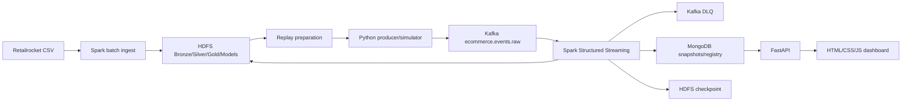
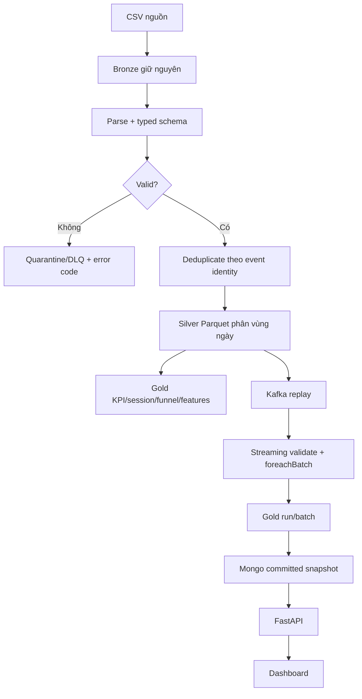

# Báo cáo audit tổng hợp dự án

**Dự án:** E-commerce User Behavior Analytics Platform  
**Ngày audit:** 22/10/2026  
**Phạm vi:** mã nguồn, cấu hình Docker Compose, tài liệu, artifact runtime và dashboard HTML/CSS/JS.

## Cách đọc báo cáo

Mỗi kết luận được phân loại như sau:

| Trạng thái         | Ý nghĩa                                                           |
| ------------------ | ----------------------------------------------------------------- |
| Đã triển khai      | Có mã nguồn hoặc cấu hình tương ứng trong repository.             |
| Đã kiểm chứng      | Có test, log hoặc artifact runtime xác nhận.                      |
| Chưa đủ bằng chứng | Thiết kế hoặc mã nguồn có, nhưng chưa có runtime evidence đầy đủ. |
| Khoảng trống       | Chưa triển khai hoặc cần cải thiện trong phiên bản tiếp theo.     |

Số liệu trong báo cáo được lấy từ mã nguồn, tài liệu và thư mục [`artifacts/`](../artifacts/). Các artifact cũ là bằng chứng của đúng phiên bản/run được ghi trong file, không tự động đại diện cho một lần chạy mới.

## 1. Giới thiệu

Đây là nền tảng phân tích hành vi người dùng thương mại điện tử theo mô hình batch và gần thời gian thực. Hệ thống nhận dữ liệu Retailrocket, chuẩn hóa và lưu trên HDFS, phát lại sự kiện qua Kafka, xử lý bằng Spark Structured Streaming, tổng hợp KPI/funnel, chạy mô hình ML, lưu snapshot vào MongoDB rồi cung cấp API và dashboard cho người dùng.

Chuỗi xử lý chính:

```text
Retailrocket CSV
  → Bronze/Silver trên HDFS
  → Kafka replay hoặc simulator
  → Spark Structured Streaming
  → Gold KPI, funnel, feature, prediction
  → MongoDB serving snapshot
  → FastAPI
  → HTML/CSS/JS dashboard
```

Hệ thống có hai bài toán ML:

1. **K-Means:** phân nhóm visitor theo mức độ và kiểu tương tác trong cửa sổ bảy ngày.
2. **Random Forest:** dự đoán visitor có phát sinh giao dịch trong 24 giờ sau thời điểm chốt hay không.

## 2. Mục tiêu

### 2.1. Mục tiêu nghiệp vụ

- Biết người dùng đang xem, thêm giỏ và mua ở đâu trong conversion funnel.
- Xác định sản phẩm có nhiều lượt xem nhưng rơi nhiều ở bước thêm giỏ hoặc mua.
- Phân khúc visitor để hỗ trợ phân tích hành vi.
- Xếp hạng visitor có dấu hiệu mua hàng để ưu tiên theo dõi hoặc thử nghiệm chăm sóc.
- Cho phép quan sát dữ liệu lịch sử và run streaming trên cùng dashboard.

### 2.2. Mục tiêu kỹ thuật

- Chứng minh pipeline Kafka → Spark → HDFS/MongoDB hoạt động.
- Xử lý event-time, duplicate, invalid, late event và DLQ.
- Có checkpoint, restart, retry và idempotent sink.
- Dùng chung hợp đồng feature giữa batch training và streaming inference.
- Lưu model/version/manifest có fingerprint để tái sử dụng.
- Có API đọc snapshot nhất quán và dashboard không truy cập trực tiếp MongoDB.

## 3. Hiện trạng và công nghệ

| Thành phần       | Cấu hình hiện tại                                                                             |
| ---------------- | --------------------------------------------------------------------------------------------- |
| Điều phối        | Docker Compose, Makefile                                                                      |
| Kafka            | Apache Kafka 3.9.1, KRaft, một broker                                                         |
| Spark            | Apache Spark 3.5.7, một master, hai worker                                                    |
| HDFS             | Hadoop 3.4.2, một NameNode, hai DataNode, replication 2                                       |
| Database serving | MongoDB 8.0, application account                                                              |
| API              | FastAPI chạy trên host, bind `127.0.0.1:8000`                                                 |
| Frontend         | HTML/CSS/JS thuần, VS Code Live Server                                                        |
| ML               | Spark MLlib K-Means và Random Forest                                                          |
| Runtime          | Python 3.11 trong job; Python 3.11+ cho API                                                   |
| Tài nguyên       | Khoảng 7 GiB giới hạn container thường trực; hai worker, mỗi worker một core/640 MiB executor |

Artifact [`artifacts/infra/versions.json`](../artifacts/infra/versions.json) ghi Docker 29.9.0, Compose 5.6.0 và image digest đã khóa.

## 4. Phân tích yêu cầu và thiết kế hệ thống

### 4.1. Yêu cầu chức năng

| ID  | Yêu cầu                                                  | Trạng thái                                             |
| --- | -------------------------------------------------------- | ------------------------------------------------------ |
| F01 | Nạp bốn file CSV và tạo Bronze/Silver                    | Đã kiểm chứng                                          |
| F02 | Chuẩn hóa schema, timestamp UTC, ID dạng chuỗi           | Đã kiểm chứng                                          |
| F03 | Loại duplicate, quarantine invalid và ghi quality report | Đã kiểm chứng                                          |
| F04 | Replay/simulator event vào Kafka                         | Đã triển khai; replay ML đã kiểm chứng                 |
| F05 | Spark đọc Kafka, validate và ghi checkpoint              | Đã kiểm chứng                                          |
| F06 | Tính KPI, timeseries, session và funnel                  | Đã kiểm chứng                                          |
| F07 | Huấn luyện K-Means và Random Forest                      | Đã kiểm chứng bằng artifact                            |
| F08 | Scoring ML cho event mới theo micro-batch                | Đã kiểm chứng với replay/simulator                     |
| F09 | Cung cấp API đọc snapshot                                | Đã triển khai; HTTP/Mongo runtime cần chạy lại         |
| F10 | Dashboard ba màn hình                                    | Đã triển khai; browser headless đã kiểm chứng trước đó |
| F11 | Theo dõi backlog, batch, latency, scoring và resource    | Đã triển khai                                          |

### 4.2. Yêu cầu phi chức năng

- **Tái lập:** dataset/model/run có version, checksum và manifest.
- **Nhất quán:** API đọc `batch_id` đã commit, không đọc snapshot đang ghi dở.
- **Idempotency:** retry không cộng dồn event/KPI/prediction.
- **Chịu lỗi:** checkpoint, retry, DLQ, HDFS staging/rename và MongoDB upsert.
- **Hiệu năng mục tiêu:** p95 streaming sau warm-up ≤60 giây; backlog về 0 khi producer dừng.
- **Bảo mật:** cổng publish bind loopback; credential không đưa vào frontend; API chỉ có GET nghiệp vụ.
- **Giới hạn:** triển khai một máy, không phải HA toàn phần.

### 4.3. Use case

1. **Ingest lịch sử:** người vận hành chạy `make ingest`, kiểm tra manifest, quality report và Silver.
2. **Replay:** chuẩn bị một khoảng thời gian, chạy consumer trước rồi producer phát event theo tốc độ cấu hình.
3. **Theo dõi KPI:** xem event, visitor, buyer, transaction, timeseries và funnel.
4. **Phân khúc:** xem cluster count/share và feature trung bình.
5. **Ưu tiên visitor:** lọc cluster/label, sắp xếp `purchase_score`, tra visitor có leading zero.
6. **Theo dõi pipeline:** xem ACK, processed offset, backlog, batch duration, latency, worker và scoring.
7. **Phục hồi:** restart cùng checkpoint/run, kiểm tra fingerprint và không tạo duplicate.

### 4.4. Kiến trúc tổng thể



### 4.5. Luồng dữ liệu



### 4.6. Producer, Kafka topic và consumer

Producer gửi JSON vào `ecommerce.events.raw`, key là `visitor_id`, bật idempotence, `acks=all`, retry hữu hạn và chỉ lưu cursor sau ACK.

| Topic                  | Partition | Replication | Retention | Nội dung                         |
| ---------------------- | --------: | ----------: | --------: | -------------------------------- |
| `ecommerce.events.raw` |         3 |           1 |    48 giờ | Event hợp lệ/được replay         |
| `ecommerce.events.dlq` |         1 |           1 |    48 giờ | Invalid, late, foreign, conflict |

Spark đọc raw theo offset, ghi processed offsets trong checkpoint HDFS. Kafka consumer group không được dùng như bằng chứng duy nhất của nghiệp vụ; pipeline đối chiếu thêm ACK end offsets và processed offsets.

### 4.7. Event schema

```json
{
  "schema_version": 1,
  "dataset_version": "<sha256>",
  "run_id": "ml-replay-001",
  "event_id": "<sha256>",
  "source": "retailrocket",
  "visitor_id": "001",
  "item_id": "10",
  "event_type": "view",
  "transaction_id": null,
  "event_time": "2015-09-18T00:00:00.000Z",
  "emitted_at": "2026-10-18T03:00:00.000Z"
}
```

- ID giữ kiểu string, kể cả leading zero.
- `event_type`: `view`, `add_to_cart`, `purchase`.
- `transaction_id` bắt buộc với purchase.
- `event_time` là thời gian nghiệp vụ; `emitted_at` là thời gian phát.
- Schema, source, range, event ID và duplicate identity được validate trước khi tính KPI.

### 4.8. Storage và commit

```text
/ecommerce/bronze/retailrocket/<dataset_version>/
/ecommerce/silver/retailrocket/<dataset_version>/events-v1/
/ecommerce/replay/<run_id>/
/ecommerce/bronze/replay/<run_id>/<batch_id>/raw/
/ecommerce/silver/replay/<run_id>/<batch_id>/events/
/ecommerce/gold/replay/<run_id>/<batch_id>/
/ecommerce/checkpoints/replay/<run_id>/
/ecommerce/models/segments/<model_version>/
/ecommerce/models/purchases/<model_version>/
```

Mỗi snapshot dùng staging path, manifest, checksum, `_SUCCESS` và kiểm tra replica trước khi công bố. MongoDB chỉ trở thành snapshot hiện hành sau khi pointer đổi sang batch hoàn chỉnh.

### 4.9. Spark batch và streaming

- Batch ingest đọc CSV bằng schema tường minh, normalize, deduplicate và ghi Parquet.
- Streaming dùng trigger khoảng 15 giây, parse JSON, validate, phân loại accepted/duplicate/invalid/late/foreign.
- Session gap là 30 phút; funnel yêu cầu cùng session, cùng sản phẩm và đúng thứ tự.
- Event trễ quá 10 phút bị cách ly; event được nhận vẫn dùng event-time nghiệp vụ.
- Callback sink lỗi sẽ fail batch để Spark retry.
- Retry dùng khóa `(run_id, batch_id)`, Mongo replace/upsert và fingerprint để tránh cộng dồn.

### 4.10. API và dashboard

API có các endpoint chính: `/health`, `/runs`, `/pipeline`, `/overview`, `/timeseries`, `/funnel`, `/segments`, `/predictions`, `/visitors/{visitor_id}`, `/models`.

Dashboard gồm:

1. **Tổng quan:** KPI, timeseries, funnel và top sản phẩm.
2. **Phân khúc & dự đoán:** cluster, feature, bảng visitor, model metrics và threshold.
3. **Theo dõi pipeline:** producer/consumer/scoring, backlog, batch, latency, worker và snapshot.

API bind loopback, CORS chỉ cho HTTP localhost/127.0.0.1, không truyền credential xuống frontend.

## 5. Dữ liệu và tiền xử lý

### 5.1. Nguồn và quy mô

Nguồn được repo ghi nhận là Retailrocket Ecommerce Dataset trên Kaggle. License chưa được lưu đầy đủ trong repository; báo cáo cần giữ nguyên trích dẫn nguồn và bổ sung license chính thức khi đóng gói học thuật.

| File                        | Kích thước byte |
| --------------------------- | --------------: |
| `events.csv`                |      94.237.913 |
| `category_tree.csv`         |          14.454 |
| `item_properties_part1.csv` |     484.315.749 |
| `item_properties_part2.csv` |     408.929.907 |

Baseline `events.csv`:

| Chỉ số           |                   Giá trị |
| ---------------- | ------------------------: |
| Dòng nguồn       |                 2.756.101 |
| View             |                 2.664.312 |
| Add to cart      |                    69.332 |
| Purchase event   |                    22.457 |
| Duplicate rows   |                       460 |
| Invalid rows     |                         0 |
| Silver rows      |                 2.755.641 |
| Khoảng thời gian | 03/05/2015–18/09/2015 UTC |

### 5.2. Data Dictionary

| Trường                  | Kiểu                 | Ý nghĩa                            |
| ----------------------- | -------------------- | ---------------------------------- |
| `timestamp`             | integer milliseconds | Thời gian event nguồn              |
| `visitorid`             | string số            | Visitor ẩn danh                    |
| `event`                 | enum                 | `view`, `addtocart`, `transaction` |
| `itemid`                | string số            | Sản phẩm                           |
| `transactionid`         | nullable string số   | Mã giao dịch                       |
| `event_time`            | UTC timestamp        | Silver/Kafka event time            |
| `visitor_id`, `item_id` | string               | ID sau chuẩn hóa                   |
| `transaction_id`        | nullable string      | Transaction sau chuẩn hóa          |

`category_tree.csv` có `categoryid,parentid`. Item properties có `timestamp,itemid,property,value`; hiện được giữ Bronze, chưa dùng toàn bộ để tạo feature.

### 5.3. EDA và chất lượng

- Dữ liệu lệch mạnh về view; purchase là nhóm nhỏ.
- Một transaction có thể có nhiều purchase event theo item.
- Dataset chưa sắp thời gian; replay mới sắp theo `(event_time,event_id)`.
- Duplicate được định nghĩa theo event identity, không theo vị trí dòng.
- Dòng lỗi được phân loại bằng `MALFORMED_CSV`, `FIELD_COUNT_MISMATCH`, `INVALID_TIMESTAMP`, thiếu ID, event type lạ hoặc transaction ID sai.

### 5.4. Feature và leakage

Cửa sổ feature là `[AS_OF - 7 ngày, AS_OF)`. Tám feature gồm view, cart, distinct transaction, unique item, active days, recency và hai ratio. ID, audit timestamp, label, cluster và event tương lai không vào vector.

Random Forest dùng temporal split:

| Split      | Cutoff           |       Mẫu | Positive |
| ---------- | ---------------- | --------: | -------: |
| Train      | 11/05–15/07/2015 | 5.196.014 |    1.750 |
| Validation | 17/07–15/08/2015 | 2.560.155 |      729 |
| Test       | 17/08–17/09/2015 | 2.380.550 |      726 |

Negative sampling chỉ áp dụng train. Validation/test giữ phân bố thật.

## 6. Xây dựng và đánh giá ML

### 6.1. K-Means

- K ứng viên: 2, 3, 4, 5.
- Seed: 42.
- Preprocessing: `log1p` count → VectorAssembler → StandardScaler.
- Chọn silhouette cao nhất; hòa chọn K nhỏ hơn.
- Lưu PipelineModel, assignment, profile, centroid và model version.

### 6.2. Random Forest

- Target: `purchase_in_next_24h`.
- Candidate: 50/100 trees và depth 5/8.
- Chọn theo validation PR-AUC.
- Threshold được chọn trên validation trước khi khóa test.
- Score trong `[0,1]`, chưa phải xác suất đã calibration.

Artifact RF ghi nhận model 50 trees/depth 5, threshold 0,93, PR-AUC test khoảng 0,181722, ROC-AUC khoảng 0,915084, precision 43,63%, recall 21,21%, F1 khoảng 0,28545 và confusion matrix TP=154, FP=199, FN=572, TN=2.379.625.

Policy precision ghi nhận threshold 0,96, precision 73,88%, recall 13,64%, `eligible=true`. Đây là reassessment trên test đã quan sát, `fresh_holdout=false`.

## 7. Audit dashboard và so sánh các lần chạy

### 7.1. Kết quả run thực tế

| Run             | Nguồn     | Event | Visitor |  View | Cart | Purchase | Buyer rate | Batch | Backlog |     P95 |
| --------------- | --------- | ----: | ------: | ----: | ---: | -------: | ---------: | ----: | ------: | ------: |
| `ml-sim-001`    | Simulator |     9 |       3 |     5 |    2 |        2 |     66,67% |     4 |       0 | 28,303s |
| `ml-replay-001` | Replay    | 1.528 |   1.016 | 1.479 |   34 |       15 |     0,787% |    10 |       0 | 41,888s |

`ml-sim-001` có 3 session, 1 cart session và 1 purchase session. `ml-replay-001` có 1.037 view session, 14 cart session và 7 purchase session. Hai run đều có `batch_reconciled=true`, hai Spark worker, replication tối thiểu 2, không OOM/restart và scoring ready.

### 7.2. Browser verification

Artifact [`fetch-browser-check.json`](../artifacts/serving/fetch-browser-check.json) ghi Chrome headless đã kiểm tra:

- Run list thật và CORS.
- Overview simulator 9 event/3 visitor.
- Prediction và lookup leading-zero visitor.
- Pipeline screen.
- Cả ba màn hình với replay 1.528 event/1.016 visitor.
- Đổi run và reset filter.
- Refresh thủ công và tự động.

Artifact [`verification.json`](../artifacts/live/verification.json) ghi browser fixture đã kiểm tra:

- Tách ACK feed khỏi processed event.
- KPI tăng sau committed snapshot.
- Giữ snapshot cũ khi run mới chưa commit.
- Tự chuyển sang run con sau commit.
- Chọn lịch sử thì tắt follow live.
- Layout viewport 390px không overflow.

### 7.3. Trạng thái endpoint local trong lượt audit này

Tại thời điểm audit, `http://127.0.0.1:5500/web/` và API `http://127.0.0.1:8000` không duy trì listener ổn định; HEAD trước đó trả 200 nhưng GET tiếp theo không kết nối được. Vì vậy đây là bằng chứng artifact đã lưu, không phải một browser run mới trong phiên audit hiện tại.

Các mục cần chạy lại khi API/Live Server hoạt động:

- Layout desktop/mobile thật.
- API reconnect sau khi tắt/bật API.
- Dashboard khi batch đang tiến.
- MongoDB runtime test và smoke fingerprint.
- Đo RAM API host.

## 8. Kiểm thử và nghiệm thu toàn hệ thống

Đã có các lớp kiểm thử:

- Infrastructure/configuration tests.
- Ingestion fixture và quality reconciliation.
- Kafka/Spark checkpoint/recovery.
- Session/funnel fixture.
- K-Means và Random Forest fixture/live artifacts.
- Streaming ML replay/simulator.
- FastAPI offline tests.
- JavaScript/dashboard tests.
- Browser headless verification trước đó.

> Các mục chưa đủ bằng chứng mới: RF full-source reuse, browser runtime mới trong phiên audit này, benchmark 50/100 event/s, so sánh single-worker/multi-worker và HA khi mất cả máy.

## 9. Kết luận

Dự án đã triển khai được chuỗi end-to-end từ dữ liệu hành vi đến dashboard, có xử lý batch/streaming, storage phân tầng, ML segmentation/prediction, API snapshot và cơ chế retry/checkpoint/idempotency. Các artifact streaming ML và browser cho thấy kết quả giữa simulator và replay có thể được quan sát trực quan, đồng thời dashboard giữ được ngữ cảnh run/batch.

Giới hạn chính là topology một broker/một NameNode/một MongoDB, dữ liệu không có doanh thu/churn, prediction score chưa calibration và một số bằng chứng runtime cần chạy lại trên máy có Docker/API/browser đầy đủ.

## 10. Hướng phát triển

- Kafka nhiều broker và replication lớn hơn 1.
- Schema Registry và version compatibility policy.
- HA cho NameNode/MongoDB và orchestration bằng Kubernetes.
- Feature store/model registry tập trung.
- Fresh holdout, calibration, drift monitoring và A/B testing.
- Anomaly detection và cảnh báo KPI.
- Khai thác `category_tree` và item properties.
- Benchmark có kiểm soát theo partition/worker.
- Browser E2E tự động trên desktop/mobile và API reconnect.

## 11. Bản đồ bằng chứng

| Nhóm       | Tài liệu/artifact chính                                                                                                                                                                                        |
| ---------- | -------------------------------------------------------------------------------------------------------------------------------------------------------------------------------------------------------------- |
| Kiến trúc  | [`docs/diagrams/README.md`](diagrams/README.md), [`docs/infra/01-architecture.md`](infra/01-architecture.md)                                                                                                   |
| Dữ liệu    | [`docs/data/01-data-dictionary.md`](data/01-data-dictionary.md), [`docs/data/04-data-quality.md`](data/04-data-quality.md)                                                                                     |
| Streaming  | [`docs/streaming/01-architecture.md`](streaming/01-architecture.md), [`docs/streaming/02-contract-and-kpi.md`](streaming/02-contract-and-kpi.md)                                                               |
| Analytics  | [`docs/analytics/01-contract.md`](analytics/01-contract.md)                                                                                                                                                    |
| ML         | [`docs/ml/01-features.md`](ml/01-features.md), [`docs/ml/06-random-forest.md`](ml/06-random-forest.md)                                                                                                         |
| Serving    | [`docs/serving/01-architecture.md`](serving/01-architecture.md), [`docs/serving/02-api.md`](serving/02-api.md)                                                                                                 |
| Browser    | [`artifacts/serving/fetch-browser-check.json`](../artifacts/serving/fetch-browser-check.json), [`artifacts/live/verification.json`](../artifacts/live/verification.json)                                       |
| Runtime ML | [`artifacts/streaming-ml/ml-sim-001/report.json`](../artifacts/streaming-ml/ml-sim-001/report.json), [`artifacts/streaming-ml/ml-replay-001/report.json`](../artifacts/streaming-ml/ml-replay-001/report.json) |
| Hạ tầng    | [`artifacts/infra/smoke.json`](../artifacts/infra/smoke.json), [`artifacts/infra/versions.json`](../artifacts/infra/versions.json)                                                                             |
