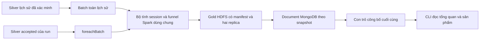

# 02 — Kiến trúc và mã nguồn

[← Mục lục](README.md)

## 1. Luồng xử lý

Spark dùng `lag`, điểm tách phiên và tổng tích lũy theo visitor; sau đó dùng các mốc thời gian để xác định chuỗi theo session–item. Các bảng trung gian dùng `DISK_ONLY`, được unpersist khi kết thúc. Không dùng pandas hoặc collect lịch sử về driver. Chỉ overview nhỏ và iterator sản phẩm có giới hạn bộ đệm đi qua driver.

Batch dùng Silver đã xác minh checksum, schema, marker và replica. Streaming dùng Silver accepted hiện có; quyết định dedup/lateness và DLQ giữ nguyên. Prepare bổ sung tham chiếu Python từ JSONL replay có tối đa 10.000 event, độc lập với thuật toán Spark.

## 2. Vai trò mã nguồn

| Module | Công dụng |
| --- | --- |
| [contracts.py](../../app/ecommerce_behavior/contracts.py) | Phiên bản, ngưỡng 30 phút, ID xác định, công thức, kiểm tra counts/rates, fingerprint và oracle Python có giới hạn |
| [pipeline.py](../../app/ecommerce_behavior/pipeline.py) | Session hóa phân tán, bảng session–item, funnel và ghi Parquet/JSON cùng báo cáo đối soát |
| [store.py](../../app/ecommerce_behavior/store.py) | Ghi sản phẩm theo lô, xác minh MongoDB, chặn thay đổi snapshot và đọc trang kết quả |
| [historical.py](../../app/ecommerce_behavior/historical.py) | Xác minh Silver lịch sử, tạo identity, materialize/reuse Gold và công bố registry |
| [integration.py](../../app/ecommerce_behavior/integration.py) | Fixture thật Spark/HDFS/MongoDB, đối chiếu oracle, fault injection và cleanup UUID |
| [streaming manager](../../app/streaming_manage.py) | Lệnh Make, spec qua stdin, khóa, cancel, monitor, artifact host và con trỏ lịch sử mới nhất |
| [runtime dispatcher](../../app/jobs/streaming.py) | Kiểm tra ZIP/code SHA rồi chạy Spark hoặc truy vấn MongoDB không tạo SparkContext |

`ecommerce_streaming.batch` ghi hành vi trong Gold của batch; `Store.publish` công bố funnel và KPI trước một con trỏ chung; `stream.final_report` đối chiếu cả hai với prepared reference. Package builder thêm `ecommerce_behavior` vào profile streaming, không đổi các byte package ingestion.

## 3. Lưu trữ HDFS

Lịch sử nằm dưới `/ecommerce/gold/behavior/history/<analysis_id>/`. `analysis_id` là SHA-256 identity gồm request và checksum manifest Silver. Request gắn dataset, source path, code SHA, phiên bản hành vi và base namespace.

Streaming bổ sung dữ liệu vào Gold batch hiện có: `/ecommerce/gold/replay/<run_id>/<batch_id-20-digits>/`.

| Payload | Nội dung/công dụng |
| --- | --- |
| `sessions/` | Parquet session ID, visitor, start/end, số event từng loại và cờ đạt các bước |
| `session_items/` | Parquet session–item với `view_at`, `cart_at`, `purchase_at` và số event; dùng đối soát chuỗi |
| `funnel_products/` | Parquet tất cả sản phẩm, counts và tỷ lệ |
| `behavior.json` | Overview và fingerprint sản phẩm |
| `behavior-quality.json` | Đối soát số event giữa nguồn, session, session–item và sản phẩm |
| `manifest.json`, `_SUCCESS` | Identity, inventory, checksum và dấu công bố hoàn chỉnh |

Session và session–item phân vùng theo ngày bắt đầu phiên; việc session hóa diễn ra trước khi phân vùng. Không chia thư mục theo visitor/item. Gold streaming vẫn giữ `metrics.json` với cấu trúc KPI cũ.

Snapshot được xây trong staging UUID, đạt hai replica rồi rename không ghi đè. Retry xác minh và tái sử dụng; snapshot hỏng không được tự sửa hoặc overwrite. Những file rỗng không có data block; replica được kiểm tra trên các payload có block, gồm JSON tổng hợp.

## 4. MongoDB và tính nhất quán

| Collection | Khóa và vai trò |
| --- | --- |
| `behavior_runs` | `_id=analysis_id`, identity, trạng thái và đường dẫn lịch sử đã công bố |
| `funnel_overview` | `_id=snapshot_id`, overview bất biến |
| `funnel_products` | `_id=snapshot_id:item_id`, toàn bộ kết quả sản phẩm |

Snapshot ID lịch sử là `history:<analysis_id>`, streaming là `<run_id>:<batch_id>`. Document có ownership `analysis_id` hoặc `run_id`/`batch_id`. Index unique `(snapshot_id,item_id)` chặn trùng; index `(snapshot_id,view_sessions DESC,item_id ASC)` phục vụ trang 20 sản phẩm.

MongoDB ghi replace/upsert theo lô 100, không `$inc`. Đọc lại toàn bộ fingerprint/counts sản phẩm trước công bố. Lịch sử đặt registry `published` cuối; host thay `latest-analysis.json` sau khi job/monitor thành công. Streaming chỉ đổi `committed_batch_id` sau KPI, funnel và batch metadata. Reader ghim pointer một lần để tránh trộn batch.

Nếu chết sau Gold hoặc giữa MongoDB, dữ liệu chưa công bố có thể còn; chạy lại cùng identity tái sử dụng Gold và ghi hoàn tất. Nếu chết sau pointer, retry vẫn ghi cùng document ID/nội dung. Không có transaction chung giữa HDFS, Kafka và MongoDB.

## 5. Tài nguyên và tương thích

Giữ driver 512 MiB, executor 640 MiB, hai core tổng và bốn shuffle partition. Lịch sử và streaming chạy riêng bằng khóa driver, có monitor container khoảng mỗi năm giây. Không thêm container/dependency hay thay cấu hình Compose.

`stream-v2` yêu cầu `behavior_version=behavior-v1` và `expected_behavior` trong prepared config. Code fingerprint thay đổi nên run cũ không tiếp tục bằng mã mới. Giữ mã/archive tương ứng để phục hồi run cũ, hoặc chuẩn bị run mới. Ingestion vẫn có SHA archive `ae42a5981bc20e1295df1dabbfab7e553af0f133a39c97fb52fa795ceafcb554`.

Nguồn: [Spark Window](https://spark.apache.org/docs/3.5.7/api/python/reference/pyspark.sql/api/pyspark.sql.Window.html), [unix_millis](https://spark.apache.org/docs/3.5.7/api/python/reference/pyspark.sql/api/pyspark.sql.functions.unix_millis.html), [foreachBatch](https://spark.apache.org/docs/3.5.7/structured-streaming-programming-guide.html#foreachbatch), [MongoDB atomicity](https://www.mongodb.com/docs/manual/core/write-operations-atomicity/).
