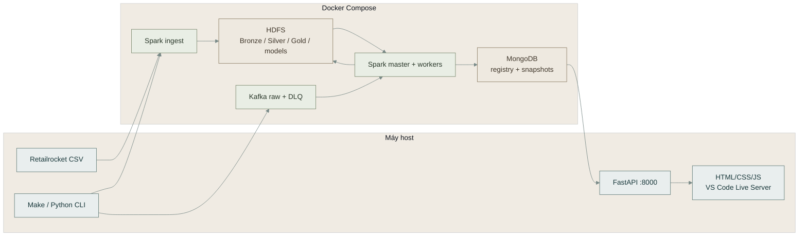
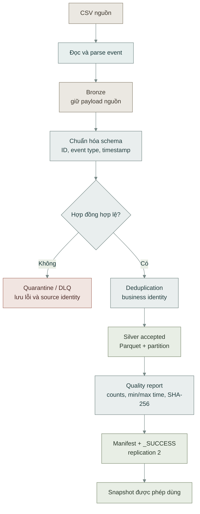
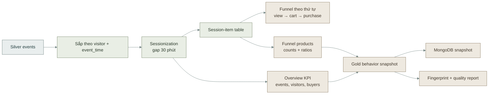
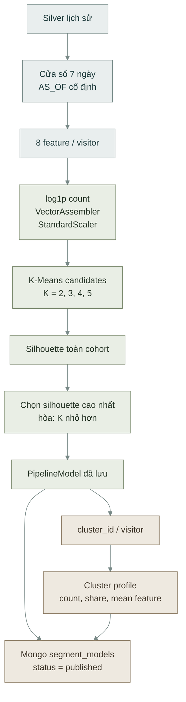
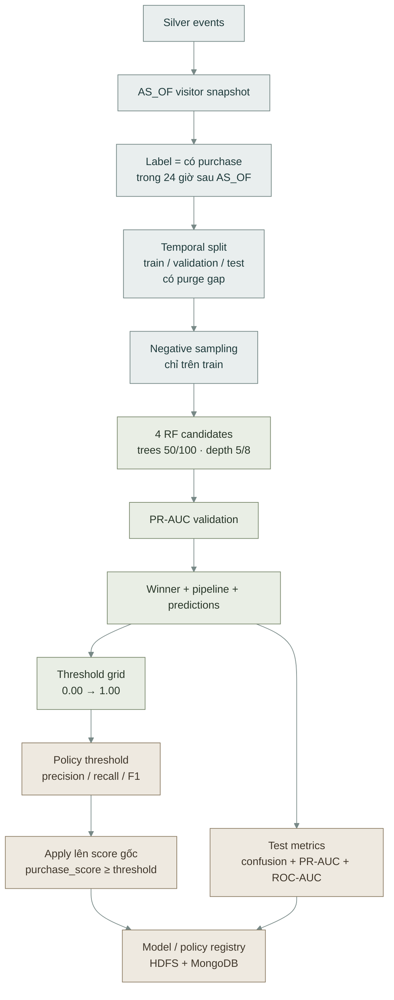
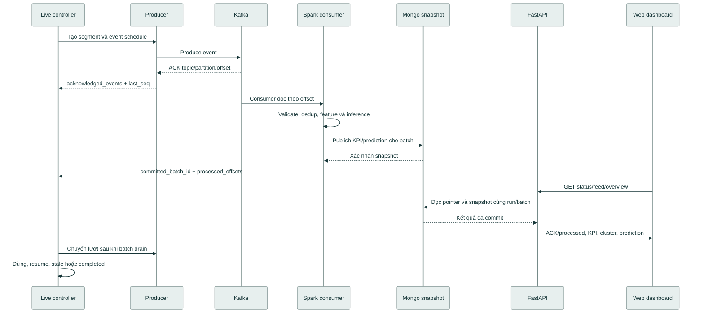
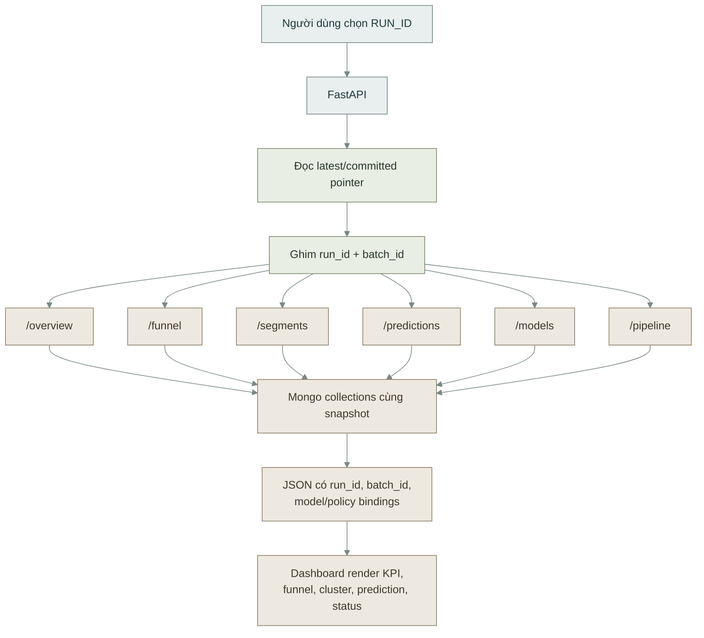
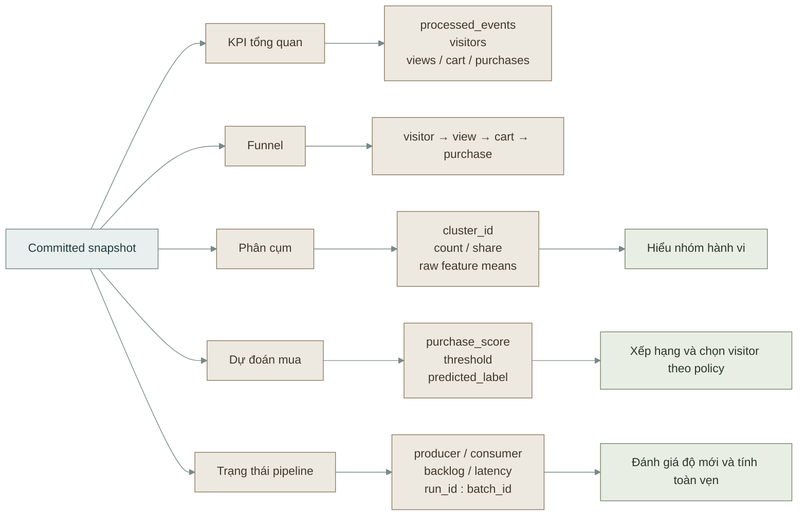
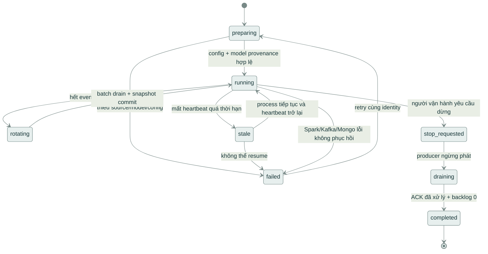

# Bản đồ trực quan của hệ thống

[← Mục lục tài liệu](../README.md) · [Chạy từ đầu](../GETTING_STARTED.md) · [ML](../ml/README.md) · [API và dashboard](../serving/README.md)

Tài liệu này gom các sơ đồ Mermaid của **E-commerce User Behavior Analytics Platform**. Sơ đồ mô tả cùng một hệ thống ở ba mức: kiến trúc, xử lý model và kết quả trên dashboard. Các mũi tên thể hiện dữ liệu; manifest, model version, policy version và snapshot là metadata dùng để chứng minh nguồn kết quả.

### Quy ước màu

| Nhóm màu | Ý nghĩa |
| --- | --- |
| Xanh xám dịu | Nguồn dữ liệu, event, input hoặc giao diện đọc |
| Xanh olive dịu | Xử lý, validation, training, model hoặc control flow |
| Be dịu | Kết quả, snapshot, registry và output |
| Đỏ đất nhạt | Error, quarantine hoặc DLQ |

Màu nền đã giảm độ bão hòa và dùng chữ tối để giữ độ tương phản khi xem trên nền sáng hoặc dark-mode preview có theme base.

## 1. Kiến trúc từ nguồn đến dashboard

**Cách đọc:** Spark thực hiện batch và streaming trong Compose; API và web chỉ đọc snapshot đã công bố. Model không được fit lại khi streaming inference chạy.

## 2. Vòng đời dữ liệu và kiểm tra chất lượng

Kết quả Silver chỉ được sử dụng khi quality report, manifest, checksum và completion marker khớp nhau. Event bị loại vẫn giữ source topic, partition, offset và error code để điều tra.

## 3. Session, funnel và analytics

Overview và product funnel dùng cùng snapshot. Tỷ lệ funnel không được trộn với `cart_view_ratio_7d` hoặc `transaction_view_ratio_7d`, vì hai ratio ML chỉ là feature đếm trong cửa sổ 7 ngày.

## 4. Feature và K-Means training

Tám feature theo đúng thứ tự hợp đồng là: `view_count_7d`, `cart_count_7d`, `transaction_count_7d`, `unique_items_7d`, `active_days_7d`, `recency_hours`, `cart_view_ratio_7d`, `transaction_view_ratio_7d`. `cluster_id` chỉ có ý nghĩa trong `model_version` tương ứng.

## 5. Nhãn mua hàng, Random Forest và policy

`purchase_score` là score dùng để xếp hạng và áp threshold. Nó không được đọc như xác suất mua đã hiệu chuẩn. Policy chỉ đổi `predicted_label`, giữ nguyên score, feature, model version và source fingerprint.

## 6. Streaming ML inference theo batch

```mermaid
%%{init: {"theme":"base","themeVariables":{"fontFamily":"Inter,Arial,sans-serif","primaryColor":"#e7efee","primaryTextColor":"#173638","primaryBorderColor":"#6f8583","lineColor":"#788987","secondaryColor":"#e9eee5","tertiaryColor":"#f0ebe3"}}}%%
flowchart LR
    PRODUCER["Replay / simulator / live producer"] --> KAFKA["Kafka raw topic"]
    KAFKA --> READ["Spark Structured Streaming"]
    READ --> VALIDATE{"Schema, source,<br/>range, duplicate, late?"}
    VALIDATE -- "Lỗi" --> DLQ["Kafka DLQ<br/>source topic/partition/offset"]
    VALIDATE -- "Accepted" --> BATCH["foreachBatch"]
    BATCH --> KPI["KPI + session + funnel"]
    BATCH --> FEAT["Feature 7 ngày"]
    FEAT --> MODELS["Frozen K-Means + RF + policy"]
    MODELS --> PRED["cluster_id<br/>purchase_score<br/>predicted_label"]
    KPI --> COMMIT["Gold batch snapshot"]
    PRED --> COMMIT
    COMMIT --> MONGO["Mongo published snapshot"]
    COMMIT --> CHECKPOINT["Spark checkpoint<br/>processed offsets"]
    MONGO --> POINTER["Committed run_id:batch_id"]
    CHECKPOINT --> POINTER
    classDef source fill:#e9eeee,stroke:#6f8381,color:#203c3d;
    classDef process fill:#e9eee5,stroke:#77866a,color:#293729;
    classDef result fill:#eee9e0,stroke:#8b7b63,color:#40372b;
    classDef error fill:#f1e5e1,stroke:#a66d62,color:#4a2925;
    class PRODUCER,KAFKA source;
    class READ,VALIDATE,BATCH,FEAT,MODELS process;
    class KPI,PRED,COMMIT,MONGO,CHECKPOINT,POINTER result;
    class DLQ error;
```

Một batch chỉ được coi là committed sau khi dữ liệu Gold và Mongo đã được kiểm tra. Checkpoint giúp retry lại batch; source identity và fingerprint giúp tránh ghi trùng khi retry.

## 7. Live demo: ACK, processed và chuyển lượt

`ACK` chỉ chứng minh Kafka đã nhận event. `processed` chỉ xuất hiện khi Spark đã xử lý và batch snapshot đã commit. Backlog bằng 0 là điều kiện drain của snapshot, không phải xác nhận Kafka consumer group lag.

## 8. Snapshot consistency từ API đến web

Dashboard không tự tính lại model. Nó đọc dữ liệu đã công bố và dùng cùng tọa độ snapshot để tránh trộn KPI của batch này với prediction của batch khác.

## 9. Bản đồ kết quả trên giao diện

| Khu vực | Câu hỏi trả lời | Nguồn chính |
| --- | --- | --- |
| KPI | Có bao nhiêu event, visitor và buyer? | `kpi_overview` |
| Funnel | Visitor rơi ở bước nào? | `funnel_overview`, `funnel_products` |
| Phân cụm | Các nhóm hành vi khác nhau thế nào? | `segment_profiles`, `visitor_segments` |
| Dự đoán | Visitor nào có score vượt policy threshold? | `stream_ml_predictions` hoặc purchase score snapshot |
| Pipeline | Dữ liệu đã ACK, processed và commit đến đâu? | run status, batch metadata, offsets |

## 10. Trạng thái run và khả năng phục hồi

Retry cùng identity phải kiểm tra snapshot, manifest, checkpoint và source fingerprint. Không dùng một trạng thái `completed` của run khác để thay thế cho run đang kiểm tra.

## Liên kết tới tài liệu chi tiết

- [Data contract và Silver](../data/README.md)
- [Analytics, session và funnel](../analytics/README.md)
- [Feature và K-Means](../ml/02-methodology-and-architecture.md)
- [Random Forest](../ml/06-random-forest.md)
- [Policy precision](../ml/09-purchase-policy.md)
- [Streaming ML](../ml/10-streaming-scoring.md)
- [Kiến trúc API/dashboard](../serving/01-architecture.md)
- [Hướng dẫn đọc kết quả trên web](../serving/06-web-user-guide.md)

## Quy ước cập nhật

Khi thay đổi contract, feature order, model version, policy, snapshot hoặc trạng thái live, cập nhật sơ đồ liên quan cùng pull request. Không ghi cứng `run_id`, số lượng event hoặc metric của một máy cụ thể vào sơ đồ kiến trúc; số liệu thực tế phải đọc từ report của run.
