# 02 — Phương pháp và kiến trúc

[← Mục lục ML](README.md)

## Luồng xử lý

```mermaid
flowchart LR
    S[Silver được kiểm tra] --> F[Feature 7 ngày]
    F --> G[HDFS feature snapshot]
    G --> P[log1p và StandardScaler]
    P --> K[K-Means K từ 2 đến 5]
    K --> E[Silhouette toàn cohort]
    E --> M[Pipeline thắng trên HDFS]
    M --> R[Tải lại và đối chiếu assignment]
    R --> D[Mongo assignments và profiles]
    D --> V[Registry published]
    V --> H[Host latest-model sau kiểm tra tài nguyên]
```



ML chạy batch độc lập dưới khóa Spark driver dùng chung ingestion/streaming/analytics. Không khởi động job huấn luyện trong lúc managed streaming đang chạy. Hạ tầng hiện tại tiếp tục có hai worker, hai DataNode và replication 2.

## Pipeline được lưu

Pipeline chỉ dùng stage có sẵn của Spark 3.5.7, lưu được bằng `PipelineModel.write()` và tải bằng `PipelineModel.load()`:

1. `SQLTransformer`: `log1p(x)` cho năm count đầu. Log giảm mức chi phối của đuôi count lớn; giữ nguyên recency và hai ratio.
2. `VectorAssembler`: nối đúng tám cột theo hợp đồng. Không tự sắp theo tên hoặc đưa cột audit vào.
3. `StandardScaler`: `withMean=True`, `withStd=True`, cân bằng thang đo các chiều. Feature phương sai bằng 0 được biến đổi thành 0 theo Spark.
4. `KMeansModel`: trả `cluster_id`.

Ba bước tiền xử lý được fit một lần cho toàn cohort. Dữ liệu đã scale được persist `DISK_ONLY`; các K được fit tuần tự và cuối cùng unpersist. Chỉ giữ pipeline thắng trên HDFS. Không thêm scikit-learn, pandas, UDF ML hoặc package tải từ mạng lúc chạy.

Image hiện tại chỉ cài Python client Kafka/MongoDB. API Python `pyspark.ml` cần NumPy; module `pyspark.ml.functions` còn import pandas. `native.py` gọi chính các stage JVM qua Py4J đã có trong PySpark, giữ vector UDT trong JVM và chỉ đưa cột scalar/array về Python. Vì vậy phần ML dùng được image hiện tại, không thêm dependency hoặc yêu cầu rebuild. Artifact vẫn là Spark PipelineModel chuẩn, có thể tải từ JVM hoặc từ PySpark ML trong môi trường đã cài đủ extra. Căn cứ: [Spark dependency matrix](https://spark.apache.org/docs/3.5.7/api/python/getting_started/install.html#dependencies) và [mã vector_to_array của Spark 3.5.7](https://github.com/apache/spark/blob/v3.5.7/python/pyspark/ml/functions.py).

StandardScaler tạo vector dense khi center; mỗi visitor chỉ có tám chiều. Giới hạn hiện tại: driver 512m, max result 128m; mỗi executor 640m/1 core, tổng 2 core, shuffle/default parallelism 4. Giữ nguyên giới hạn khoảng 7 GiB của Compose.

## Cách chọn K và đọc kết quả

| Thiết lập | Giá trị |
| --- | --- |
| K ứng viên | 2, 3, 4, 5 |
| Seed | 42 |
| Khởi tạo | `k-means||`, 2 bước |
| Số vòng tối đa / tol | 30 / `1e-4` |
| Khoảng cách / solver | `euclidean` / `row` |
| Silhouette | Toàn cohort, `squaredEuclidean` |

Chọn silhouette lớn nhất; nếu chênh không quá `1e-12`, chọn K nhỏ hơn. Candidate không đủ distinct vector, số dòng không lớn hơn K, có cụm rỗng hoặc metric không hợp lệ được đánh dấu invalid cùng lý do. Nếu không còn candidate hợp lệ thì fail và không công bố model. Lỗi Spark/HDFS thực tế làm job fail, không tự chuyển thành một candidate invalid để che lỗi vận hành.

Mỗi candidate có thời gian chạy; candidate đã fit có training cost, số vòng và kích thước cụm; candidate hợp lệ có silhouette. Không đặt trước K thắng hoặc một ngưỡng silhouette để công bố kết quả đẹp. Training cost dùng để chẩn đoán, không phải luật chọn K.

Report phân biệt centroid trong **không gian đã scale** với profile gồm **mean feature gốc**, count và share mỗi cụm. Label mặc định `Cụm 0`, `Cụm 1`… Diễn giải dựa vào profile thực tế; dữ liệu không cung cấp doanh thu hoặc bằng chứng churn. Cluster ID chỉ có ý nghĩa trong một `model_version`.

Seed cố định giúp tái lập thí nghiệm nhưng không cam kết fit mới luôn tạo byte/model ID cụm giống nhau khi môi trường hoặc cách chia partition thay đổi. Cơ chế reuse dùng đúng pipeline đã lưu và kiểm tra assignment, tránh refit tùy tiện. Silhouette chỉ đo độ tách cụm trên cohort này; không phải accuracy dự đoán mua hàng.

Nguồn tham khảo: [Spark KMeans](https://spark.apache.org/docs/3.5.7/api/python/reference/api/pyspark.ml.clustering.KMeans.html), [KMeansSummary](https://spark.apache.org/docs/3.5.7/api/python/reference/api/pyspark.ml.clustering.KMeansSummary.html), [StandardScaler](https://spark.apache.org/docs/3.5.7/ml-features.html#standardscaler), [ClusteringEvaluator](https://spark.apache.org/docs/3.5.7/api/python/reference/api/pyspark.ml.evaluation.ClusteringEvaluator.html), [PipelineModel](https://spark.apache.org/docs/3.5.7/api/python/reference/api/pyspark.ml.PipelineModel.html).

## Identity và HDFS

`feature_snapshot_id` là SHA-256 identity: feature version, lookback 7, AS_OF, dataset version, Silver path, Silver manifest SHA và ML code SHA. `model_version` là SHA-256 identity: model contract version, feature snapshot/path/manifest SHA, code SHA, Spark version, AS_OF và toàn bộ tham số/thứ tự feature.

```text
/ecommerce/gold/features/<feature_snapshot_id>/
  features/                 Parquet: audit + tám feature gốc
  quality.json              Số đếm và fingerprint
  manifest.json             Identity, inventory, SHA từng file, replica
  _SUCCESS

/ecommerce/models/segments/<model_version>/
  pipeline/                 PipelineModel đầy đủ, gồm scaler và KMeansModel
  assignments/              Parquet: feature gốc + cluster_id
  quality.json              Candidate metrics, profiles, centroids, fingerprint
  manifest.json
  _SUCCESS
```

Ghi vào staging UUID; kiểm tra hai replica payload, tạo manifest/marker rồi rename không ghi đè. `_SUCCESS` chỉ kết hợp với identity/checksum mới chứng minh snapshot hoàn chỉnh. Snapshot có sẵn phải được kiểm tra lại. File thiếu, bị đổi, sai version/identity khiến job dừng; không ghi đè hoặc tự sửa snapshot hỏng.

Model được tải lại từ staging và đối chiếu toàn bộ assignment trước rename. Sau commit, tải lại từ đường dẫn cuối và đối chiếu tiếp. Khi reuse, xác minh source features, assignment cohort/fingerprint/profiles và pipeline transform; không fit lại. Tính tổng/mean qua Spark; chỉ collect các tập nhỏ như tối đa năm profile hoặc ba event type.

## Công bố MongoDB

| Collection | Khóa và nội dung | Công dụng |
| --- | --- | --- |
| `segment_models` | `_id=model_version`; identity, path, status, report | Registry và điểm công bố model |
| `segment_profiles` | `_id=model_version:cluster_id` | Count/share/mean feature để diễn giải |
| `visitor_segments` | `_id=model_version:visitor_id` | Assignment và tám feature gốc để tra một visitor |

Registry bắt đầu `prepared`. Assignment upsert theo lô 100 với ID cố định; profile ghi theo model/cluster. Đọc lại theo thứ tự visitor, kiểm tra fingerprint/count và coverage profile. Chỉ sau đó cập nhật registry `published`. Status từ chối model chưa published, trả metadata/profile/metrics và chỉ tra visitor nếu được yêu cầu.

Lỗi giữa MongoDB để lại dữ liệu prepared chưa được CLI công bố. Retry cùng identity dùng lại Gold và điền đủ các ID còn thiếu, không cộng dồn. Phiên bản published được kiểm tra khi retry và không bị sửa lại. Không có transaction chung HDFS/MongoDB; registry là điểm hiển thị, HDFS là artifact để phục hồi có kiểm soát.

Host chỉ cập nhật latest pointer khi job đã trả kết quả và monitor xác nhận không OOM/restart, có quan sát tài nguyên đầy đủ. Nếu remote đã published nhưng host bị ngắt, chạy lại cùng lệnh để xác minh rồi khôi phục report/pointer host.

## Bản đồ mã nguồn

| File | Làm gì |
| --- | --- |
| `app/ecommerce_ml/contracts.py` | Công thức/version/order, oracle nhỏ, validation, hash và chọn K |
| `app/ecommerce_ml/features.py` | Kiểm tra Silver, aggregate phân tán, feature snapshot/reuse |
| `app/ecommerce_ml/training.py` | Fit pipeline/candidate, đánh giá, profiles, save/load và assignment |
| `app/ecommerce_ml/native.py` | Cầu nối stage/pipeline JVM, chuyển vector thành array trước khi đọc bằng Python, dùng image hiện tại |
| `app/ecommerce_ml/store.py` | Mongo registry, upsert, kiểm tra và status |
| `app/ecommerce_ml/integration.py` | Fixture thật và fault/cleanup trên Spark/HDFS/Mongo |
| `app/ml_manage.py` | CLI host, chọn artifact, driver lock và latest pointer |
| `app/jobs/ml.py` | Dispatcher trong container, kiểm tra code ZIP, tạo/dừng Spark |
| `app/streaming_manage.py::launch` | Launcher chung có tham số profile/entry/result prefix/Spark/monitor; mặc định cũ giữ nguyên |
| `app/run_job.py`, `app/streaming_monitor.py` | Cancel process group có kiểm tra ownership, timeout và theo dõi container |
| `app/package_code.py` | Profile `ml` chỉ chứa `ecommerce_analytics` và `ecommerce_ml` |

Không sửa module ingestion/streaming/behavior trong archive cũ. Hai SHA regression được kiểm tra trong offline test, giúp run streaming hiện tại tiếp tục nhận đúng code fingerprint.
