# Báo cáo audit tổng hợp và tài liệu dự án hợp nhất

**Dự án:** E-commerce User Behavior Analytics Platform
**Ngày cập nhật tài liệu:** 23/10/2026
**Phạm vi:** audit dự án, kiến trúc, hạ tầng, dữ liệu, streaming, analytics, machine learning, API, dashboard, runbook, sơ đồ, kiểm thử và bằng chứng runtime.

## Cách sử dụng tài liệu này

Đây là bản tài liệu độc lập. Nội dung audit và toàn bộ tài liệu Markdown của repository đã được gộp trong cùng một file theo thứ tự từ tổng quan đến triển khai, vận hành và nghiệm thu. Các tham chiếu trước đây được giữ dưới dạng tên file, đường dẫn hoặc tên mục dạng chữ; file này không phụ thuộc vào liên kết Markdown để đọc nội dung.

Các số liệu runtime vẫn giữ ngày, run ID, model version và trạng thái của lần chạy gốc. Artifact được mô tả bằng đường dẫn chữ để truy xuất khi cần; nội dung giải thích và tiêu chí nghiệm thu nằm ngay trong tài liệu này.

## Giới thiệu về dự án

### Dự án hướng về gì?

E-commerce User Behavior Analytics Platform là nền tảng phân tích hành vi người dùng trong thương mại điện tử. Dự án biến các sự kiện tương tác rời rạc như xem sản phẩm, thêm vào giỏ và mua hàng thành thông tin có thể dùng để trả lời các câu hỏi nghiệp vụ:

- Người dùng đang tương tác với sản phẩm nào và ở bước nào của conversion funnel?
- Sản phẩm hoặc nhóm sản phẩm nào thu hút nhiều lượt xem nhưng mất người dùng ở bước thêm giỏ hoặc mua?
- Các visitor có những kiểu hành vi nào khi quan sát trong cùng một khoảng thời gian?
- Visitor nào có tín hiệu mua hàng trong 24 giờ tiếp theo để ưu tiên theo dõi hoặc thử nghiệm chăm sóc?
- Pipeline dữ liệu có đang xử lý đúng, đủ, kịp thời và có thể phục hồi sau lỗi hay không?

Nền tảng kết hợp xử lý batch với xử lý gần thời gian thực. Dữ liệu lịch sử được chuẩn hóa và lưu trên HDFS, sự kiện được phát lại qua Kafka, Spark Structured Streaming tính KPI và feature theo từng micro-batch, kết quả được công bố vào MongoDB, sau đó FastAPI và dashboard HTML/CSS/JS cung cấp một lớp đọc thống nhất cho người dùng.

### Mục tiêu tối thượng

Mục tiêu tối thượng của dự án là xây dựng một chuỗi phân tích có thể tái lập, kiểm chứng và vận hành được từ dữ liệu thô đến quyết định nghiệp vụ. Một kết quả chỉ được xem là hoàn chỉnh khi hệ thống có thể:

1. Tiếp nhận dữ liệu lịch sử và sự kiện mới bằng hợp đồng dữ liệu rõ ràng.
2. Giữ đúng ý nghĩa nghiệp vụ của event-time, visitor, item, transaction, session và funnel.
3. Phát hiện dữ liệu sai, dữ liệu trùng, dữ liệu đến muộn và cách ly chúng thay vì để chúng làm sai KPI.
4. Tạo feature không sử dụng dữ liệu tương lai, huấn luyện mô hình có version và đánh giá trên các mốc thời gian phù hợp.
5. Xử lý lại hoặc khởi động lại mà không tạo duplicate hoặc làm hỏng snapshot đã công bố.
6. Đưa kết quả đến dashboard theo một snapshot đã commit, có thể giải thích nguồn gốc và trạng thái nghiệm thu.

Vì vậy, dự án không chỉ nhằm tạo biểu đồ hoặc một mô hình dự đoán. Trọng tâm là chứng minh một pipeline dữ liệu và ML hoàn chỉnh, trong đó chất lượng dữ liệu, khả năng phục hồi, tính nhất quán và khả năng giải thích được xem là một phần của sản phẩm.

### Bộ dữ liệu sử dụng

Dự án sử dụng Retailrocket Ecommerce Dataset, một bộ dữ liệu hành vi ẩn danh của website thương mại điện tử. Bộ dữ liệu gồm bốn file CSV chính:

| File                        | Nội dung                                                              |
| --------------------------- | --------------------------------------------------------------------- |
| `events.csv`                | Sự kiện `view`, `addtocart` và `transaction` của visitor đối với item |
| `category_tree.csv`         | Quan hệ giữa danh mục và danh mục cha                                 |
| `item_properties_part1.csv` | Các thuộc tính của item theo thời điểm                                |
| `item_properties_part2.csv` | Phần tiếp theo của dữ liệu thuộc tính item                            |

Trong phạm vi triển khai hiện tại, `events.csv` là nguồn chính cho ingestion, session/funnel, feature, K-Means, Random Forest và replay streaming. Ba file còn lại vẫn được giữ trong Bronze để bảo toàn nguồn và sẵn sàng cho các mở rộng về danh mục, thuộc tính sản phẩm hoặc phân tích nội dung item.

Baseline `events.csv` được ghi nhận gồm khoảng 2,76 triệu dòng nguồn, trong đó phần lớn là lượt xem, số lượt thêm giỏ nhỏ hơn nhiều và purchase là nhóm hiếm. Dữ liệu không chứa giá, doanh thu, thông tin định danh thật hoặc bước thanh toán; vì vậy hệ thống hiện đo hành trình `xem → thêm giỏ → mua`, không suy ra doanh thu hay churn.

### Xử lý và tiền xử lý dữ liệu

Chuỗi xử lý dữ liệu được thực hiện theo các bước sau:

1. **Tiếp nhận nguồn:** đọc bốn CSV bằng schema tường minh, ghi manifest, checksum, kích thước và phiên bản dataset.
2. **Bronze:** lưu bản dữ liệu nguồn gần nguyên bản trên HDFS để có thể truy vết và chạy lại.
3. **Chuẩn hóa:** đổi tên trường về schema thống nhất, chuyển timestamp milliseconds thành UTC timestamp, giữ `visitor_id`, `item_id` và `transaction_id` ở dạng chuỗi để không làm mất leading zero.
4. **Kiểm tra hợp lệ:** kiểm tra số cột, timestamp, ID bắt buộc, event type, transaction ID của purchase và các ràng buộc schema.
5. **Cách ly dữ liệu lỗi:** ghi mã lỗi cho dòng malformed, thiếu trường, timestamp sai, ID thiếu hoặc event type lạ vào quarantine/DLQ; các dòng này không được tính vào KPI hợp lệ.
6. **Loại trùng:** deduplicate theo event identity thay vì theo vị trí dòng, đồng thời ghi số dòng duplicate vào quality report.
7. **Silver:** ghi event đã chuẩn hóa dưới dạng Parquet, phân vùng theo ngày event-time để phục vụ truy vấn và replay.
8. **Phân tích lịch sử:** tính session với khoảng cách không hoạt động 30 phút, funnel theo cùng session/sản phẩm và các KPI tổng hợp.
9. **Tạo feature:** dùng cửa sổ bảy ngày trước `AS_OF`; tính count, distinct count, active days, recency và ratio; không đưa label, cluster, audit timestamp hoặc event tương lai vào vector.
10. **Chuẩn bị streaming:** sắp xếp event theo event-time và event identity, tạo payload Kafka có schema version, dataset version, run ID, event ID và emitted time.
11. **Kiểm tra streaming:** Spark tiếp tục validate event, phân loại accepted/duplicate/invalid/late/foreign, tính KPI theo micro-batch và ghi checkpoint.
12. **Công bố kết quả:** dùng staging path, manifest, checksum, `_SUCCESS` và batch commit trước khi đổi pointer MongoDB sang snapshot mới nhất.

Kết quả của chuỗi này là một pipeline trong đó dữ liệu thô vẫn được bảo toàn, dữ liệu đã chuẩn hóa có thể tái sử dụng, dữ liệu lỗi có thể kiểm tra riêng, còn KPI và model output chỉ được công bố sau khi đã qua bước đối soát.

## Mục lục dạng chữ

1. Audit tổng quan và kết luận hiện trạng.
2. Tài liệu gốc `README.md`.
3. Kế hoạch triển khai `IMPLEMENTATION_PLAN.md`.
4. Hướng dẫn chạy toàn bộ dự án từ máy mới.
5. Bản đồ sơ đồ trực quan.
6. Hạ tầng và vòng đời Docker/Kafka/HDFS/Spark/MongoDB.
7. Dữ liệu lịch sử, ingestion và chất lượng dữ liệu.
8. Replay Kafka, streaming KPI và phục hồi.
9. Session, funnel và analytics.
10. Feature, K-Means, Random Forest, policy và ML streaming.
11. FastAPI, dashboard và live demo.
12. Phụ lục nguồn tài liệu đã hợp nhất.

## 1. Audit tổng quan hiện trạng

**Dự án:** E-commerce User Behavior Analytics Platform
**Ngày audit:** 22/10/2026
**Phạm vi:** mã nguồn, cấu hình Docker Compose, tài liệu, artifact runtime và dashboard HTML/CSS/JS.

### Cách đọc báo cáo

Mỗi kết luận được phân loại như sau:

| Trạng thái         | Ý nghĩa                                                           |
| ------------------ | ----------------------------------------------------------------- |
| Đã triển khai      | Có mã nguồn hoặc cấu hình tương ứng trong repository.             |
| Đã kiểm chứng      | Có test, log hoặc artifact runtime xác nhận.                      |
| Chưa đủ bằng chứng | Thiết kế hoặc mã nguồn có, nhưng chưa có runtime evidence đầy đủ. |
| Khoảng trống       | Chưa triển khai hoặc cần cải thiện trong phiên bản tiếp theo.     |

Số liệu trong báo cáo được lấy từ mã nguồn, tài liệu và thư mục `artifacts/` (tham chiếu `../artifacts/`). Các artifact cũ là bằng chứng của đúng phiên bản/run được ghi trong file, không tự động đại diện cho một lần chạy mới.

### 1. Giới thiệu

Đây là nền tảng phân tích hành vi người dùng thương mại điện tử theo mô hình batch và gần thời gian thực. Hệ thống nhận dữ liệu Retailrocket, chuẩn hóa và lưu trên HDFS, phát lại sự kiện qua Kafka, xử lý bằng Spark Structured Streaming, tổng hợp KPI/funnel, chạy mô hình ML, lưu snapshot vào MongoDB rồi cung cấp API và dashboard cho người dùng.

Chuỗi xử lý chính:

```text
Retailrocket CSV
  → Bronze/Silver trên HDFS
  → Kafka replay hoặc simulator
  → Spark Structured Streaming
  → Gold KPI, funnel, feature, prediction
  → MongoDB serving snapshot
  → FastAPI
  → HTML/CSS/JS dashboard
```

Hệ thống có hai bài toán ML:

1. **K-Means:** phân nhóm visitor theo mức độ và kiểu tương tác trong cửa sổ bảy ngày.
2. **Random Forest:** dự đoán visitor có phát sinh giao dịch trong 24 giờ sau thời điểm chốt hay không.

### 2. Mục tiêu

#### 2.1. Mục tiêu nghiệp vụ

- Biết người dùng đang xem, thêm giỏ và mua ở đâu trong conversion funnel.
- Xác định sản phẩm có nhiều lượt xem nhưng rơi nhiều ở bước thêm giỏ hoặc mua.
- Phân khúc visitor để hỗ trợ phân tích hành vi.
- Xếp hạng visitor có dấu hiệu mua hàng để ưu tiên theo dõi hoặc thử nghiệm chăm sóc.
- Cho phép quan sát dữ liệu lịch sử và run streaming trên cùng dashboard.

#### 2.2. Mục tiêu kỹ thuật

- Chứng minh pipeline Kafka → Spark → HDFS/MongoDB hoạt động.
- Xử lý event-time, duplicate, invalid, late event và DLQ.
- Có checkpoint, restart, retry và idempotent sink.
- Dùng chung hợp đồng feature giữa batch training và streaming inference.
- Lưu model/version/manifest có fingerprint để tái sử dụng.
- Có API đọc snapshot nhất quán và dashboard không truy cập trực tiếp MongoDB.

### 3. Hiện trạng và công nghệ

| Thành phần       | Cấu hình hiện tại                                                                             |
| ---------------- | --------------------------------------------------------------------------------------------- |
| Điều phối        | Docker Compose, Makefile                                                                      |
| Kafka            | Apache Kafka 3.9.1, KRaft, một broker                                                         |
| Spark            | Apache Spark 3.5.7, một master, hai worker                                                    |
| HDFS             | Hadoop 3.4.2, một NameNode, hai DataNode, replication 2                                       |
| Database serving | MongoDB 8.0, application account                                                              |
| API              | FastAPI chạy trên host, bind `127.0.0.1:8000`                                                 |
| Frontend         | HTML/CSS/JS thuần, VS Code Live Server                                                        |
| ML               | Spark MLlib K-Means và Random Forest                                                          |
| Runtime          | Python 3.11 trong job; Python 3.11+ cho API                                                   |
| Tài nguyên       | Khoảng 7 GiB giới hạn container thường trực; hai worker, mỗi worker một core/640 MiB executor |

Artifact `artifacts/infra/versions.json` (tham chiếu `../artifacts/infra/versions.json`) ghi Docker 29.9.0, Compose 5.6.0 và image digest đã khóa.

### 4. Phân tích yêu cầu và thiết kế hệ thống

#### 4.1. Yêu cầu chức năng

| ID  | Yêu cầu                                                  | Trạng thái                                             |
| --- | -------------------------------------------------------- | ------------------------------------------------------ |
| F01 | Nạp bốn file CSV và tạo Bronze/Silver                    | Đã kiểm chứng                                          |
| F02 | Chuẩn hóa schema, timestamp UTC, ID dạng chuỗi           | Đã kiểm chứng                                          |
| F03 | Loại duplicate, quarantine invalid và ghi quality report | Đã kiểm chứng                                          |
| F04 | Replay/simulator event vào Kafka                         | Đã triển khai; replay ML đã kiểm chứng                 |
| F05 | Spark đọc Kafka, validate và ghi checkpoint              | Đã kiểm chứng                                          |
| F06 | Tính KPI, timeseries, session và funnel                  | Đã kiểm chứng                                          |
| F07 | Huấn luyện K-Means và Random Forest                      | Đã kiểm chứng bằng artifact                            |
| F08 | Scoring ML cho event mới theo micro-batch                | Đã kiểm chứng với replay/simulator                     |
| F09 | Cung cấp API đọc snapshot                                | Đã triển khai; HTTP/Mongo runtime cần chạy lại         |
| F10 | Dashboard ba màn hình                                    | Đã triển khai; browser headless đã kiểm chứng trước đó |
| F11 | Theo dõi backlog, batch, latency, scoring và resource    | Đã triển khai                                          |

#### 4.2. Yêu cầu phi chức năng

- **Tái lập:** dataset/model/run có version, checksum và manifest.
- **Nhất quán:** API đọc `batch_id` đã commit, không đọc snapshot đang ghi dở.
- **Idempotency:** retry không cộng dồn event/KPI/prediction.
- **Chịu lỗi:** checkpoint, retry, DLQ, HDFS staging/rename và MongoDB upsert.
- **Hiệu năng mục tiêu:** p95 streaming sau warm-up ≤60 giây; backlog về 0 khi producer dừng.
- **Bảo mật:** cổng publish bind loopback; credential không đưa vào frontend; API chỉ có GET nghiệp vụ.
- **Giới hạn:** triển khai một máy, không phải HA toàn phần.

#### 4.3. Use case

1. **Ingest lịch sử:** người vận hành chạy `make ingest`, kiểm tra manifest, quality report và Silver.
2. **Replay:** chuẩn bị một khoảng thời gian, chạy consumer trước rồi producer phát event theo tốc độ cấu hình.
3. **Theo dõi KPI:** xem event, visitor, buyer, transaction, timeseries và funnel.
4. **Phân khúc:** xem cluster count/share và feature trung bình.
5. **Ưu tiên visitor:** lọc cluster/label, sắp xếp `purchase_score`, tra visitor có leading zero.
6. **Theo dõi pipeline:** xem ACK, processed offset, backlog, batch duration, latency, worker và scoring.
7. **Phục hồi:** restart cùng checkpoint/run, kiểm tra fingerprint và không tạo duplicate.

#### 4.4. Kiến trúc tổng thể

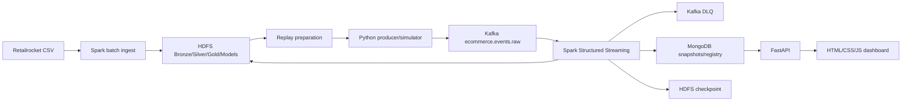

#### 4.5. Luồng dữ liệu

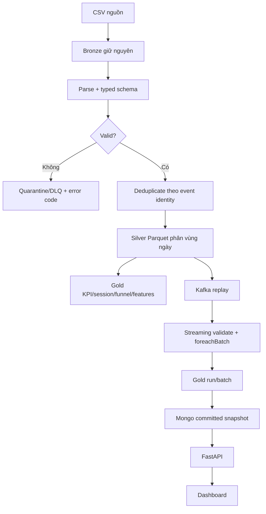

#### 4.6. Producer, Kafka topic và consumer

Producer gửi JSON vào `ecommerce.events.raw`, key là `visitor_id`, bật idempotence, `acks=all`, retry hữu hạn và chỉ lưu cursor sau ACK.

| Topic                  | Partition | Replication | Retention | Nội dung                         |
| ---------------------- | --------: | ----------: | --------: | -------------------------------- |
| `ecommerce.events.raw` |         3 |           1 |    48 giờ | Event hợp lệ/được replay         |
| `ecommerce.events.dlq` |         1 |           1 |    48 giờ | Invalid, late, foreign, conflict |

Spark đọc raw theo offset, ghi processed offsets trong checkpoint HDFS. Kafka consumer group không được dùng như bằng chứng duy nhất của nghiệp vụ; pipeline đối chiếu thêm ACK end offsets và processed offsets.

#### 4.7. Event schema

```json
{
  "schema_version": 1,
  "dataset_version": "<sha256>",
  "run_id": "ml-replay-001",
  "event_id": "<sha256>",
  "source": "retailrocket",
  "visitor_id": "001",
  "item_id": "10",
  "event_type": "view",
  "transaction_id": null,
  "event_time": "2015-09-18T00:00:00.000Z",
  "emitted_at": "2026-10-18T03:00:00.000Z"
}
```

- ID giữ kiểu string, kể cả leading zero.
- `event_type`: `view`, `add_to_cart`, `purchase`.
- `transaction_id` bắt buộc với purchase.
- `event_time` là thời gian nghiệp vụ; `emitted_at` là thời gian phát.
- Schema, source, range, event ID và duplicate identity được validate trước khi tính KPI.

#### 4.8. Storage và commit

```text
/ecommerce/bronze/retailrocket/<dataset_version>/
/ecommerce/silver/retailrocket/<dataset_version>/events-v1/
/ecommerce/replay/<run_id>/
/ecommerce/bronze/replay/<run_id>/<batch_id>/raw/
/ecommerce/silver/replay/<run_id>/<batch_id>/events/
/ecommerce/gold/replay/<run_id>/<batch_id>/
/ecommerce/checkpoints/replay/<run_id>/
/ecommerce/models/segments/<model_version>/
/ecommerce/models/purchases/<model_version>/
```

Mỗi snapshot dùng staging path, manifest, checksum, `_SUCCESS` và kiểm tra replica trước khi công bố. MongoDB chỉ trở thành snapshot hiện hành sau khi pointer đổi sang batch hoàn chỉnh.

#### 4.9. Spark batch và streaming

- Batch ingest đọc CSV bằng schema tường minh, normalize, deduplicate và ghi Parquet.
- Streaming dùng trigger khoảng 15 giây, parse JSON, validate, phân loại accepted/duplicate/invalid/late/foreign.
- Session gap là 30 phút; funnel yêu cầu cùng session, cùng sản phẩm và đúng thứ tự.
- Event trễ quá 10 phút bị cách ly; event được nhận vẫn dùng event-time nghiệp vụ.
- Callback sink lỗi sẽ fail batch để Spark retry.
- Retry dùng khóa `(run_id, batch_id)`, Mongo replace/upsert và fingerprint để tránh cộng dồn.

#### 4.10. API và dashboard

API có các endpoint chính: `/health`, `/runs`, `/pipeline`, `/overview`, `/timeseries`, `/funnel`, `/segments`, `/predictions`, `/visitors/{visitor_id}`, `/models`.

Dashboard gồm:

1. **Tổng quan:** KPI, timeseries, funnel và top sản phẩm.
2. **Phân khúc & dự đoán:** cluster, feature, bảng visitor, model metrics và threshold.
3. **Theo dõi pipeline:** producer/consumer/scoring, backlog, batch, latency, worker và snapshot.

API bind loopback, CORS chỉ cho HTTP localhost/127.0.0.1, không truyền credential xuống frontend.

### 5. Dữ liệu và tiền xử lý

#### 5.1. Nguồn và quy mô

Nguồn được repo ghi nhận là Retailrocket Ecommerce Dataset trên Kaggle. License chưa được lưu đầy đủ trong repository; báo cáo cần giữ nguyên trích dẫn nguồn và bổ sung license chính thức khi đóng gói học thuật.

| File                        | Kích thước byte |
| --------------------------- | --------------: |
| `events.csv`                |      94.237.913 |
| `category_tree.csv`         |          14.454 |
| `item_properties_part1.csv` |     484.315.749 |
| `item_properties_part2.csv` |     408.929.907 |

Baseline `events.csv`:

| Chỉ số           |                   Giá trị |
| ---------------- | ------------------------: |
| Dòng nguồn       |                 2.756.101 |
| View             |                 2.664.312 |
| Add to cart      |                    69.332 |
| Purchase event   |                    22.457 |
| Duplicate rows   |                       460 |
| Invalid rows     |                         0 |
| Silver rows      |                 2.755.641 |
| Khoảng thời gian | 03/05/2015–18/09/2015 UTC |

#### 5.2. Data Dictionary

| Trường                  | Kiểu                 | Ý nghĩa                            |
| ----------------------- | -------------------- | ---------------------------------- |
| `timestamp`             | integer milliseconds | Thời gian event nguồn              |
| `visitorid`             | string số            | Visitor ẩn danh                    |
| `event`                 | enum                 | `view`, `addtocart`, `transaction` |
| `itemid`                | string số            | Sản phẩm                           |
| `transactionid`         | nullable string số   | Mã giao dịch                       |
| `event_time`            | UTC timestamp        | Silver/Kafka event time            |
| `visitor_id`, `item_id` | string               | ID sau chuẩn hóa                   |
| `transaction_id`        | nullable string      | Transaction sau chuẩn hóa          |

`category_tree.csv` có `categoryid,parentid`. Item properties có `timestamp,itemid,property,value`; hiện được giữ Bronze, chưa dùng toàn bộ để tạo feature.

#### 5.3. EDA và chất lượng

- Dữ liệu lệch mạnh về view; purchase là nhóm nhỏ.
- Một transaction có thể có nhiều purchase event theo item.
- Dataset chưa sắp thời gian; replay mới sắp theo `(event_time,event_id)`.
- Duplicate được định nghĩa theo event identity, không theo vị trí dòng.
- Dòng lỗi được phân loại bằng `MALFORMED_CSV`, `FIELD_COUNT_MISMATCH`, `INVALID_TIMESTAMP`, thiếu ID, event type lạ hoặc transaction ID sai.

#### 5.4. Feature và leakage

Cửa sổ feature là `[AS_OF - 7 ngày, AS_OF)`. Tám feature gồm view, cart, distinct transaction, unique item, active days, recency và hai ratio. ID, audit timestamp, label, cluster và event tương lai không vào vector.

Random Forest dùng temporal split:

| Split      | Cutoff           |       Mẫu | Positive |
| ---------- | ---------------- | --------: | -------: |
| Train      | 11/05–15/07/2015 | 5.196.014 |    1.750 |
| Validation | 17/07–15/08/2015 | 2.560.155 |      729 |
| Test       | 17/08–17/09/2015 | 2.380.550 |      726 |

Negative sampling chỉ áp dụng train. Validation/test giữ phân bố thật.

### 6. Xây dựng và đánh giá ML

#### 6.1. K-Means

- K ứng viên: 2, 3, 4, 5.
- Seed: 42.
- Preprocessing: `log1p` count → VectorAssembler → StandardScaler.
- Chọn silhouette cao nhất; hòa chọn K nhỏ hơn.
- Lưu PipelineModel, assignment, profile, centroid và model version.

#### 6.2. Random Forest

- Target: `purchase_in_next_24h`.
- Candidate: 50/100 trees và depth 5/8.
- Chọn theo validation PR-AUC.
- Threshold được chọn trên validation trước khi khóa test.
- Score trong `[0,1]`, chưa phải xác suất đã calibration.

Artifact RF ghi nhận model 50 trees/depth 5, threshold 0,93, PR-AUC test khoảng 0,181722, ROC-AUC khoảng 0,915084, precision 43,63%, recall 21,21%, F1 khoảng 0,28545 và confusion matrix TP=154, FP=199, FN=572, TN=2.379.625.

Policy precision ghi nhận threshold 0,96, precision 73,88%, recall 13,64%, `eligible=true`. Đây là reassessment trên test đã quan sát, `fresh_holdout=false`.

### 7. Audit dashboard và so sánh các lần chạy

#### 7.1. Kết quả run thực tế

| Run             | Nguồn     | Event | Visitor |  View | Cart | Purchase | Buyer rate | Batch | Backlog |     P95 |
| --------------- | --------- | ----: | ------: | ----: | ---: | -------: | ---------: | ----: | ------: | ------: |
| `ml-sim-001`    | Simulator |     9 |       3 |     5 |    2 |        2 |     66,67% |     4 |       0 | 28,303s |
| `ml-replay-001` | Replay    | 1.528 |   1.016 | 1.479 |   34 |       15 |     0,787% |    10 |       0 | 41,888s |

`ml-sim-001` có 3 session, 1 cart session và 1 purchase session. `ml-replay-001` có 1.037 view session, 14 cart session và 7 purchase session. Hai run đều có `batch_reconciled=true`, hai Spark worker, replication tối thiểu 2, không OOM/restart và scoring ready.

#### 7.2. Browser verification

Artifact `fetch-browser-check.json` (tham chiếu `../artifacts/serving/fetch-browser-check.json`) ghi Chrome headless đã kiểm tra:

- Run list thật và CORS.
- Overview simulator 9 event/3 visitor.
- Prediction và lookup leading-zero visitor.
- Pipeline screen.
- Cả ba màn hình với replay 1.528 event/1.016 visitor.
- Đổi run và reset filter.
- Refresh thủ công và tự động.

Artifact `verification.json` (tham chiếu `../artifacts/live/verification.json`) ghi browser fixture đã kiểm tra:

- Tách ACK feed khỏi processed event.
- KPI tăng sau committed snapshot.
- Giữ snapshot cũ khi run mới chưa commit.
- Tự chuyển sang run con sau commit.
- Chọn lịch sử thì tắt follow live.
- Layout viewport 390px không overflow.

#### 7.3. Trạng thái endpoint local trong lượt audit này

Tại thời điểm audit, `http://127.0.0.1:5500/web/` và API `http://127.0.0.1:8000` không duy trì listener ổn định; HEAD trước đó trả 200 nhưng GET tiếp theo không kết nối được. Vì vậy đây là bằng chứng artifact đã lưu, không phải một browser run mới trong phiên audit hiện tại.

Các mục cần chạy lại khi API/Live Server hoạt động:

- Layout desktop/mobile thật.
- API reconnect sau khi tắt/bật API.
- Dashboard khi batch đang tiến.
- MongoDB runtime test và smoke fingerprint.
- Đo RAM API host.

### 8. Kiểm thử và nghiệm thu toàn hệ thống

Đã có các lớp kiểm thử:

- Infrastructure/configuration tests.
- Ingestion fixture và quality reconciliation.
- Kafka/Spark checkpoint/recovery.
- Session/funnel fixture.
- K-Means và Random Forest fixture/live artifacts.
- Streaming ML replay/simulator.
- FastAPI offline tests.
- JavaScript/dashboard tests.
- Browser headless verification trước đó.

> Các mục chưa đủ bằng chứng mới: RF full-source reuse, browser runtime mới trong phiên audit này, benchmark 50/100 event/s, so sánh single-worker/multi-worker và HA khi mất cả máy.

### 9. Kết luận

Dự án đã triển khai được chuỗi end-to-end từ dữ liệu hành vi đến dashboard, có xử lý batch/streaming, storage phân tầng, ML segmentation/prediction, API snapshot và cơ chế retry/checkpoint/idempotency. Các artifact streaming ML và browser cho thấy kết quả giữa simulator và replay có thể được quan sát trực quan, đồng thời dashboard giữ được ngữ cảnh run/batch.

Giới hạn chính là topology một broker/một NameNode/một MongoDB, dữ liệu không có doanh thu/churn, prediction score chưa calibration và một số bằng chứng runtime cần chạy lại trên máy có Docker/API/browser đầy đủ.

### 10. Hướng phát triển

- Kafka nhiều broker và replication lớn hơn 1.
- Schema Registry và version compatibility policy.
- HA cho NameNode/MongoDB và orchestration bằng Kubernetes.
- Feature store/model registry tập trung.
- Fresh holdout, calibration, drift monitoring và A/B testing.
- Anomaly detection và cảnh báo KPI.
- Khai thác `category_tree` và item properties.
- Benchmark có kiểm soát theo partition/worker.
- Browser E2E tự động trên desktop/mobile và API reconnect.

### 11. Bản đồ bằng chứng

| Nhóm       | Tài liệu/artifact chính                                                                                                                                                                                                                |
| ---------- | -------------------------------------------------------------------------------------------------------------------------------------------------------------------------------------------------------------------------------------- |
| Kiến trúc  | `docs/diagrams/README.md` (tham chiếu `diagrams/README.md`), `docs/infra/01-architecture.md` (tham chiếu `infra/01-architecture.md`)                                                                                                   |
| Dữ liệu    | `docs/data/01-data-dictionary.md` (tham chiếu `data/01-data-dictionary.md`), `docs/data/04-data-quality.md` (tham chiếu `data/04-data-quality.md`)                                                                                     |
| Streaming  | `docs/streaming/01-architecture.md` (tham chiếu `streaming/01-architecture.md`), `docs/streaming/02-contract-and-kpi.md` (tham chiếu `streaming/02-contract-and-kpi.md`)                                                               |
| Analytics  | `docs/analytics/01-contract.md` (tham chiếu `analytics/01-contract.md`)                                                                                                                                                                |
| ML         | `docs/ml/01-features.md` (tham chiếu `ml/01-features.md`), `docs/ml/06-random-forest.md` (tham chiếu `ml/06-random-forest.md`)                                                                                                         |
| Serving    | `docs/serving/01-architecture.md` (tham chiếu `serving/01-architecture.md`), `docs/serving/02-api.md` (tham chiếu `serving/02-api.md`)                                                                                                 |
| Browser    | `artifacts/serving/fetch-browser-check.json` (tham chiếu `../artifacts/serving/fetch-browser-check.json`), `artifacts/live/verification.json` (tham chiếu `../artifacts/live/verification.json`)                                       |
| Runtime ML | `artifacts/streaming-ml/ml-sim-001/report.json` (tham chiếu `../artifacts/streaming-ml/ml-sim-001/report.json`), `artifacts/streaming-ml/ml-replay-001/report.json` (tham chiếu `../artifacts/streaming-ml/ml-replay-001/report.json`) |
| Hạ tầng    | `artifacts/infra/smoke.json` (tham chiếu `../artifacts/infra/smoke.json`), `artifacts/infra/versions.json` (tham chiếu `../artifacts/infra/versions.json`)                                                                             |

## 2. Nội dung tài liệu nguồn đã hợp nhất

## 2.1. Nguồn tài liệu: `README.md`

## E-commerce User Behavior Analytics Platform

Nền tảng phân tích hành vi thương mại điện tử trên Kafka, Spark, HDFS và MongoDB. Mã hiện tại gồm hạ tầng Docker, ingestion Retailrocket CSV → Bronze → Silver, replay Kafka, streaming KPI, session/funnel, feature 7 ngày/K-Means, Random Forest batch và ML streaming có policy precision. FastAPI chạy trên host, dashboard HTML/CSS/JS mở bằng Live Server; đã đọc được kết quả thật và có nghiệm thu live hữu hạn hai lượt. Trạng thái kiểm thử và giới hạn live liên tục ở serving (tham chiếu `docs/serving/README.md`).

**Developer mới:** dùng hướng dẫn chạy từ đầu đến dashboard (tham chiếu `docs/GETTING_STARTED.md`), gồm Ubuntu/Arch, Windows qua WSL2, dataset, cấu hình, từng lệnh, tiêu chí đạt và phục hồi.

**Người sử dụng ứng dụng:** dùng hướng dẫn thao tác web và đọc kết quả (tham chiếu `docs/serving/06-web-user-guide.md`), gồm lựa chọn phiên/run/batch, feed, KPI/funnel, phân cụm, dự đoán mua hàng, pipeline và bài thực hành.

Kế hoạch sản phẩm đầy đủ: IMPLEMENTATION_PLAN.md (tham chiếu `IMPLEMENTATION_PLAN.md`).

Mục lục tài liệu: docs/README.md (tham chiếu `docs/README.md`). Bản đồ sơ đồ trực quan (tham chiếu `docs/diagrams/README.md`). Hướng dẫn hạ tầng: docs/infra/README.md (tham chiếu `docs/infra/README.md`). Ingestion: docs/data/README.md (tham chiếu `docs/data/README.md`). Replay/KPI: docs/streaming/README.md (tham chiếu `docs/streaming/README.md`). Session/funnel: docs/analytics/README.md (tham chiếu `docs/analytics/README.md`).

Machine Learning: docs/ml/README.md (tham chiếu `docs/ml/README.md`).

### Yêu cầu

- Linux `amd64`, CPU hỗ trợ AVX, tối thiểu bốn CPU logic cho Docker.
- Docker Engine đang chạy, Docker Compose hỗ trợ `up --wait` và plugin Docker Buildx cho BuildKit cache. Trên Arch Linux: `sudo pacman -S docker-buildx`.
- Python 3.11+ và GNU Make trên máy chủ để chạy toàn bộ ứng dụng gồm API; hạ tầng cũ vẫn nhận Python 3.10. Job trong container dùng Python 3.11.
- Khoảng **7 GiB RAM khả dụng** trước khi khởi động toàn bộ cụm; chín container có tổng giới hạn 6,25 GiB, cộng tối đa 704 MiB cho ba job init, tổng 6,94 GiB. Docker daemon và hệ điều hành cần RAM riêng. Xem ngân sách RAM (tham chiếu `docs/infra/10-memory-budget.md`).
- Ít nhất 30 GiB trống trên phân vùng chứa Docker data; nên dành thêm dung lượng khi nạp dataset.
- Internet trong lần build đầu để tải base image, binary Apache và dependency.

Kiểm tra daemon trong terminal dùng để chạy dự án:

```bash
docker info
docker compose version
docker buildx version
```

Nếu không truy cập được daemon, kiểm tra Docker context, trạng thái dịch vụ và quyền socket của môi trường đó. Script không tự thay quyền socket, thay nhóm người dùng hoặc dừng container dự án khác.

Dataset dự kiến có bốn file tại `Dataset/retailrocket-recommender-system-dataset/`: `events.csv`, `category_tree.csv`, `item_properties_part1.csv`, `item_properties_part2.csv`. Có thể đổi `DATASET_PATH` trong cấu hình local. Dataset chỉ được mount read-only vào container chạy job và không được đóng gói vào image.

### Khởi động

Chạy tại thư mục gốc dự án:

```bash
make setup
make build
make up
make doctor
make smoke
```

- `setup` tạo `.env` với quyền `0600`, sinh hai mật khẩu độc lập và Kafka cluster ID. Chạy lại giữ nguyên file hiện có; file thiếu cấu hình sẽ được báo lỗi để sửa thủ công.
- `build` kiểm tra Buildx, tải image Kafka/MongoDB theo digest và build Hadoop/Spark. Binary Spark khoảng 382 MiB được tải từ mirror Huawei; Hadoop lean khoảng 489 MiB từ CDN Apache, có nguồn dự phòng. BuildKit cache lưu binary đã xác minh và file tải dở để dùng lại. Xem tối ưu build (tham chiếu `docs/infra/09-build-optimization.md`).
- `up` kiểm tra môi trường, khởi động các image đã build, đợi healthcheck và xác nhận ba tác vụ init hoàn tất.
- `doctor` kiểm tra daemon, dataset, tài nguyên, cổng và readiness của cụm nếu đã khởi tạo.
- `smoke` chạy kiểm tra dữ liệu thật giữa các dịch vụ, không tác động topic nghiệp vụ.

Cấu hình Compose có thể kiểm tra mà không cần daemon:

```bash
make config
make test
```

`make test` có 38 test hạ tầng và 211 test ứng dụng ở commit được đối chiếu; 24 test live offline nằm trong suite ứng dụng. Phiên sandbox có 7 HTTP skipped vì cấm socket loopback. Serving có 23 test API offline và 15 test JavaScript riêng. Số lượng có thể tăng theo commit; đọc tổng kết/exit code của suite. Không cần cài PySpark trên host. Các kiểm tra này không thay thế smoke hoặc kiểm thử dữ liệu trên cụm đang chạy.

### Nạp dữ liệu lịch sử

Sau khi image đã có, chạy lần lượt:

```bash
make up
make doctor
make smoke
make test-data
make ingest
```

`make up` áp dụng mount mã ứng dụng vào Spark client; thay đổi ứng dụng này không cần build lại image. `test-data` chạy fixture trên Spark/HDFS thật và dọn namespace kiểm thử riêng. `ingest` giữ nguyên bốn CSV trong Bronze, chuyển `events.csv` thành Parquet Silver phân vùng theo ngày UTC, kèm quarantine, duplicate audit và quality report.

Chạy lại `make ingest` với cùng dữ liệu và mã biến đổi sẽ xác minh rồi dùng lại snapshot. Job từ chối snapshot thiếu marker, sai checksum hoặc khác phiên bản mã; không tự ghi đè dữ liệu đã công bố. Báo cáo host nằm trong `artifacts/data/`. Xem cách chạy và xử lý lỗi (tham chiếu `docs/data/03-ingestion.md`).

Artifact hiện có xác nhận smoke, chín test dữ liệu và ingest lần đầu thành công. Lần ingest xác nhận reuse và các lệnh runtime mới cần chạy trên terminal có quyền Docker; phiên công cụ bị từ chối Docker socket. Xem nghiệm thu dữ liệu (tham chiếu `docs/data/05-testing.md`).

### Replay và streaming KPI

Sau khi Silver lịch sử đã sẵn sàng:

```bash
make test-stream
make prepare-demo RUN_ID=demo-001
```

Terminal A chạy `make stream RUN_ID=demo-001`. Khi có `STREAM_READY`, terminal B chạy `make replay RUN_ID=demo-001`; dùng `make stream-status RUN_ID=demo-001` để xem KPI và tiến độ. Streaming tự kết thúc sau khi mọi offset đã ACK được xử lý, checkpoint đã commit và số liệu đã đối soát.

Nguồn mặc định là 2.692 event trong `[10:00,16:00) UTC ngày 10/09/2015`, tốc độ 10 event/giây. Mỗi run giới hạn 10.000 event, giữ ngân sách container khoảng 7 GiB; tính năng này không cần image/service mới. Source và checkpoint cũ được giữ để tiếp tục. Chi tiết: vận hành streaming (tham chiếu `docs/streaming/03-operations.md`).

Artifact hiện tại xác nhận 10/10 test streaming đạt, cleanup/monitor thành công. Run `behavior-demo-001` đã xử lý 2.692 event, backlog 0, p95 37,287 giây và hai worker/hai replica. Dùng RUN_ID mới khi chuẩn bị demo khác. ML có archive riêng, giữ nguyên fingerprint streaming. Xem kiểm thử và phục hồi (tham chiếu `docs/streaming/04-testing-and-recovery.md`).

### Session và funnel

Với Silver đã sẵn sàng và không có Spark driver khác đang chạy:

```bash
make test-behavior
make analyze-behavior
make behavior-status
make behavior-status ITEM_ID=355908
```

Batch phân tích toàn bộ lịch sử. Streaming tính cùng quy tắc trên accepted event của từng run: ngắt phiên khi không hoạt động quá 30 phút, funnel đúng thứ tự và cùng sản phẩm. Gold giữ session/session–item; MongoDB giữ funnel tổng quan và toàn bộ sản phẩm, công bố theo snapshot cùng KPI. `make behavior-status RUN_ID=...` đọc kết quả demo. Chi tiết: hợp đồng, vận hành và nghiệm thu (tham chiếu `docs/analytics/README.md`).

Artifact đã xác nhận 6/6 test behavior đạt và phân tích lịch sử có 2.755.641 event, 1.761.675 session; lần chạy lại `reused=true`.

### Feature và K-Means lịch sử

Sau khi Silver đã sẵn sàng, chạy tuần tự:

```bash
make test-ml
make build-features
make train-segments
make segment-status
```

Build mặc định chốt lúc `2015-07-15T00:00:00.000Z`, tạo tám feature trên bảy ngày trước đó. Train thử K=2..5 tuần tự, chọn silhouette tốt nhất, lưu/tải lại pipeline và công bố assignment/profile vào MongoDB. Report ở `artifacts/ml/`, hướng dẫn đầy đủ tại docs/ml/ (tham chiếu `docs/ml/README.md`). Không cần build lại image hoặc tăng ngân sách RAM.

Artifact người dùng đã chạy xác nhận 6/6 test ML đạt, feature khớp CSV, 99.038 visitor, K=2 và silhouette 0,853847. Full-source build/train lần hai reuse cùng manifest/quality, không fit mới; monitor đủ, không OOM/restart. Xem bằng chứng K-Means (tham chiếu `docs/ml/04-testing.md`).

### Dự đoán mua hàng theo batch

Với Silver đã sẵn sàng, chạy tuần tự từ terminal có quyền Docker:

```bash
make test-purchase
make build-purchase-data
make train-purchase
make purchase-status
make score-purchases
make purchase-score-status
```

Dataset có 128 cutoff hằng ngày, feature bảy ngày và nhãn mua trong 24 giờ tiếp theo; chia train/validation/test theo thời gian với khoảng nghỉ. Builder chạy 20 chặng có thể resume. RF dùng 36.750 mẫu train đã sampling, thử bốn cấu hình tuần tự, chọn mô hình/ngưỡng trên validation rồi đánh giá test nguyên bản. Score lịch sử mặc định ngày 18/09/2015; tham chiếu CSV có 69.052 visitor. Có thể tra một visitor bằng `make purchase-score-status VISITOR_ID=001`.

Artifact người dùng đã chạy xác nhận RF gốc thành công lần đầu: 7/7 test, đủ 128 ngày, model 50 cây/depth 5/ngưỡng 0,93, PR-AUC test 0,18172, precision 43,63%, recall 21,21%; score 69.052 visitor. Full-source reuse còn chờ kiểm chứng. Report ở `artifacts/prediction/`; xem dữ liệu (tham chiếu `docs/ml/05-purchase-data.md`), phương pháp (tham chiếu `docs/ml/06-random-forest.md`), vận hành (tham chiếu `docs/ml/07-purchase-operations.md`) và nghiệm thu (tham chiếu `docs/ml/08-purchase-testing.md`).

Đã thêm policy ưu tiên precision ≥70%, recall ≥10% (tham chiếu `docs/ml/09-purchase-policy.md`), dùng predictions đã lưu và giữ nguyên dataset/model/score gốc:

```bash
make test-purchase-policy
make tune-purchase-policy
make purchase-policy-status
```

Chỉ khi `eligible=true`, chạy `make apply-purchase-policy`; lệnh in ID mới để dùng với `purchase-score-status SCORE_RUN_ID=...`. Không cần build dataset, fit RF hoặc build image lại. Artifact người dùng tạo đã xác nhận 5/5 live test policy, sáu fault scenario, cleanup/monitor đạt; ngưỡng 0,96 có precision test 73,88%, recall 13,64%, `eligible=true`. Apply đủ 69.052 visitor, bốn predicted positive; lần hai `reused=true`, cùng fingerprint, không duplicate. Đây là đánh giá lại ngưỡng trên test đã từng được xem, không phải fresh holdout. Máy mới phải kiểm tra report/eligibility riêng; xem runbook (tham chiếu `docs/GETTING_STARTED.md#policy`).

### ML streaming và simulator

Sau khi K-Means, RF và policy eligible đã published, không có driver khác:

```bash
make test-stream-ml
make prepare-ml-demo RUN_ID=ml-replay-001
```

Terminal A chạy `make stream-ml RUN_ID=ml-replay-001`; đợi `STREAM_ML_READY`, terminal B chạy `make replay-ml RUN_ID=ml-replay-001`. Theo dõi bằng `make stream-ml-status RUN_ID=ml-replay-001`. Replay mặc định ngày 18/09/2015 `[00:00,03:00)` UTC có 1.528 event/1.016 visitor; seed chỉ chứa bảy ngày trước START, event mới chỉ tham gia feature sau khi accepted qua Kafka.

Simulator dùng RUN_ID khác: `make prepare-ml-demo RUN_ID=ml-sim-001 DEMO_SOURCE=simulator`, terminal A chạy `stream-ml`, terminal B chạy `make simulate-ml RUN_ID=ml-sim-001` sau READY. Ba visitor mới phát chín event qua ba đợt; mỗi đợt chờ prediction được committed. Score không bắt buộc tăng sau mỗi hành động.

Profile `streaming-ml` khóa model/policy/checksum riêng, giữ nguyên năm archive cũ; không thêm image/service hoặc fit lại model nguồn thật. Artifact đã xác nhận 7/7 live test, replay 1.528 event/1.016 visitor, simulator 9 event/3 visitor và hai lượt completed reuse giữ nguyên fingerprint. Replay p95 41,888 giây; simulator 28,303 giây. Xem vận hành, retry và nghiệm thu streaming ML (tham chiếu `docs/ml/10-streaming-scoring.md`).

### Dashboard HTML/CSS/JS và API local

Sau khi đã có run ML, từ root (API cần Python 3.11+):

```bash
make api-setup
make api-indexes
make api
```

Giữ terminal API hoạt động. Mở `web/index.html` trong VS Code → **Open with Live Server**. Chọn RUN_ID để xem tổng quan/funnel, phân khúc/prediction hoặc pipeline. Trang tự cập nhật mỗi năm giây và khóa cùng snapshot giữa các request.

Frontend dùng HTML/CSS/JS và SVG thuần; không cần Node/npm để chạy. FastAPI bind `127.0.0.1:8000`, đọc MongoDB qua cổng host hiện có. Virtualenv riêng ở `services/.venv/`; không thêm container/image hoặc thay Compose. Tài liệu cài đặt, API, source guide, test và xử lý lỗi: docs/serving/ (tham chiếu `docs/serving/README.md`).

`make test-web` chạy 15 test JS (cần Node 18+); `make test-api-offline` chạy 23 test HTTP offline. `make test-api` chạy thêm 23 case Mongo thật; `make smoke-web RUN_ID=...` đối chiếu API với một run đã hoàn tất.

Demo nhiều dữ liệu và chạy đến khi dừng: `make live-demo LIVE_ID=onboarding-live-001 RATE=5`. Một lệnh quản lý consumer/producer, mặc định 1.000 event/lượt và tối đa 200 visitor/100 sản phẩm. Web có feed Kafka ACK mỗi giây, theo dõi run con và snapshot Spark; Ctrl+C một lần yêu cầu dừng/drain, resume cần cùng mã/config. Xem nghiệm thu hữu hạn rồi chạy liên tục (tham chiếu `docs/GETTING_STARTED.md#live-demo`) và cách đọc web (tham chiếu `docs/serving/06-web-user-guide.md`). Artifact thực tế xác nhận `live-check-002` passed 240 event/hai lượt; `demo-live-002` hoàn tất lượt đầu nhưng gián đoạn ở lượt 2, nên stop/resume liên tục cần kiểm chứng riêng. ID khóa mã cũ cần phiên bản gốc hoặc ID mới khi cập nhật mã.

### Dịch vụ và phiên bản

| Service                            | Vai trò                                                |        Bộ nhớ tối đa |
| ---------------------------------- | ------------------------------------------------------ | -------------------: |
| `kafka`                            | Kafka 3.9.1, KRaft broker/controller                   |              768 MiB |
| `namenode`                         | Hadoop 3.4.2 NameNode                                  |              512 MiB |
| `datanode-1`, `datanode-2`         | HDFS DataNodes, replication 2                          |     384 MiB mỗi node |
| `spark-master`                     | Spark 3.5.7 Standalone master                          |              384 MiB |
| `spark-worker-1`, `spark-worker-2` | Hai worker, một core và heap executor 640 MiB mỗi node | 1.280 MiB mỗi worker |
| `spark-client`                     | Python 3.11 / Java 17, chạy driver                     |              896 MiB |
| `mongodb`                          | MongoDB 8.0, authentication bật                        |              512 MiB |

Ba job chạy một lần là `kafka-init`, `hdfs-init`, `mongo-init`. Init phải thoát với mã 0; `Exited (0)` là trạng thái đúng cho các job này.

Image Hadoop dùng Java 11; image Spark dùng Java 17. Spark master, workers và client dùng cùng image. Các tiến trình custom chạy bằng user `analytics` UID/GID 1000; volume Hadoop được chuẩn bị quyền ghi trong image.

Base image Kafka, MongoDB, Python và Java được khóa bằng SHA-256 digest. Binary Apache và bốn JAR connector được kiểm tra SHA-512. Các thư viện Python được khóa phiên bản. Package hệ điều hành được cài từ repository của base distribution lúc build; đây không phải bản build hermetic từng byte.

Sau `make build`, manifest image ID/digest và phiên bản Docker/Compose nằm ở `artifacts/infra/versions.json`. Có thể cập nhật manifest bằng `make versions`.

### Endpoint

| Thành phần           | Từ container                | Từ máy chủ                           |
| -------------------- | --------------------------- | ------------------------------------ |
| Kafka                | `kafka:9092`                | `127.0.0.1:19092`                    |
| HDFS                 | `hdfs://namenode:9000`      | Chạy qua `spark-client`              |
| NameNode UI          | `namenode:9870`             | `http://127.0.0.1:9870`              |
| Spark master         | `spark://spark-master:7077` | Chạy qua `spark-client`              |
| Spark master UI      | `spark-master:18080`        | `http://127.0.0.1:18080`             |
| Worker 1 UI          | `spark-worker-1:18081`      | `http://127.0.0.1:18081`             |
| Worker 2 UI          | `spark-worker-2:18082`      | `http://127.0.0.1:18082`             |
| Spark application UI | `spark-client:14040`        | `http://127.0.0.1:14040`, khi có job |
| MongoDB              | `mongodb:27017`             | `127.0.0.1:27018`                    |

Cổng publish chỉ bind `127.0.0.1`. Các số cổng host có thể đổi trong `.env`; dùng trực tiếp URL mới khi đổi cổng. `localhost` trong container không phải máy chủ hoặc container khác.

MongoDB dùng database `ecommerce`, app user `analytics`, `authSource=ecommerce`. Mật khẩu lấy từ `.env`; root account chỉ dùng cho khởi tạo/healthcheck. `spark-client` không nhận root password. Cổng `27018` giúp tránh MongoDB sẵn có trên cổng `27017`.

### Khởi tạo và lưu trữ

Kafka tạo hai topic nghiệp vụ, không tự tạo topic từ request producer:

| Topic                  | Partitions | Replication | Retention |
| ---------------------- | ---------: | ----------: | --------: |
| `ecommerce.events.raw` |          3 |           1 |    48 giờ |
| `ecommerce.events.dlq` |          1 |           1 |    48 giờ |

Listener Kafka riêng cho network Docker và host. Kafka cluster ID được giữ nguyên trong `.env`; startup từ chối khi ID khác với metadata trong volume.

HDFS dùng hai volume DataNode độc lập. NameNode chỉ format khi volume rỗng; nếu metadata không khớp thì startup thất bại thay vì xóa dữ liệu. Init đợi đủ hai DataNode và safe mode OFF rồi tạo:

```text
/ecommerce/bronze
/ecommerce/silver
/ecommerce/gold
/ecommerce/models
/ecommerce/checkpoints
/ecommerce/spark-events
/ecommerce/_smoke
```

Healthcheck NameNode chỉ kiểm tra NameNode, không chờ DataNode, để tránh dependency vòng. Spark client chỉ sẵn sàng sau khi init hoàn tất, hai Spark worker hoạt động, các topic tồn tại và app account đọc được bootstrap metadata.

Log container có rotation 10 MiB × 3 file. Spark event logs được giữ trên HDFS. Thư mục scratch của executor là dữ liệu tạm; không dùng nó làm nơi lưu model hoặc checkpoint lâu dài.

### Chạy job

```bash
docker compose exec spark-client bash
docker compose exec -T spark-client python3 /opt/infra/smoke/readiness.py
```

Driver chạy ở `spark-client`, executor kết nối về các cổng nội bộ cố định. Chỉ chạy một Spark driver tại một thời điểm với cấu hình hiện tại. Smoke, persistence-test, ingest, test-data, prepare-demo, stream và test-stream dùng chung khóa. Producer replay là Python, dùng khóa riêng để chạy cùng streaming.

Ứng dụng được mount read-only từ `app/` vào `/opt/app`; CLI đóng gói dependency Python thành ZIP và phân phối đến executor bằng `spark-submit --deploy-mode client --py-files`. Không dùng `local[*]` để chứng minh xử lý trên hai worker. Kafka connector đã có trong image, không thêm `--packages` tải dependency lúc demo.

### Kiểm thử tích hợp

```bash
make smoke
make persistence-test
```

Smoke test:

1. Tạo topic `infra-smoke-<uuid>` riêng, gửi sáu event và kiểm tra nội dung bằng consumer.
2. Xác nhận task chạy trên cả hai worker và kiểm tra tổng phân tán của dãy 0..999.999.
3. Structured Streaming đọc Kafka, ghi Parquet và checkpoint trên HDFS.
4. Chạy lại cùng checkpoint, xác nhận vẫn có đúng sáu event và các block Parquet có hai replica đang hoạt động.
5. Executor ghi MongoDB hai lần bằng upsert; xác nhận chỉ có sáu document đúng nội dung.
6. Dọn topic, dữ liệu HDFS và document chỉ thuộc lần smoke test đó.

Kết quả và log nằm trong `artifacts/infra/smoke.json` và `smoke.log`. Nếu cần giữ artifact để xem block replica:

```bash
docker compose exec -T spark-client timeout 600s spark-submit /opt/infra/smoke/pipeline.py --keep
docker compose exec -T namenode hdfs fsck /ecommerce/_smoke -files -blocks -locations
```

Chế độ `--keep` chủ động giữ topic/document/thư mục của run được in ra; xóa riêng run đó sau khi xem, không xóa toàn bộ dữ liệu nghiệp vụ.

Persistence test tạo marker riêng trong Kafka, HDFS và MongoDB, thực hiện Compose `down` rồi `up`, xác nhận cả ba marker còn nguyên và dọn marker. Bài kiểm tra này tạm dừng cụm của project; không chạy trong lúc đang xử lý job nghiệp vụ. Nếu thất bại, token và log trong `artifacts/infra/` giúp kiểm tra lại.

Các kiểm tra persistence/replication trên một máy không chứng minh HA khi máy chủ hoặc ổ đĩa vật lý bị hỏng.

### Vận hành

```bash
make ps
make logs
make down
make up
```

`down` giữ named volume và cấu hình local. Khi muốn xóa toàn bộ dữ liệu của riêng Compose project:

```bash
make reset CONFIRM=delete-project-data
```

Lệnh reset không gọi `docker system prune`, không xóa dataset và không xóa container/volume của project khác.

### Xử lý lỗi

- **Daemon không truy cập được:** kiểm tra `docker info` tại terminal thực thi. Một số môi trường agent chỉ cho phép một phần lệnh Docker; kiểm tra offline vẫn chạy được nhưng build/runtime cần quyền daemon thực tế.
- **Thiếu RAM:** mặc định cần 7 GiB khả dụng lúc chưa có container project chạy; tổng limit gồm init là 6,94 GiB. Đóng bớt ứng dụng rồi chạy lại `make up`. Không chỉ hạ ngưỡng môi trường xuống dưới tổng limit. Preflight trừ ngân sách container của project đã chạy để cho phép gọi `up` lại. Không tự giảm worker hoặc replication.
- **Thiếu image:** chạy `make build`; `make up` không tự tải dependency hoặc build lại.
- **Cổng bị chiếm:** đổi biến cổng host tương ứng trong `.env`; không dừng dịch vụ đang giữ cổng.
- **Sai cluster ID:** khôi phục `.env` khớp volume; startup không tự format/xóa dữ liệu.
- **Sai mật khẩu sau khi đổi `.env`:** MongoDB giữ tài khoản trong volume. Khôi phục mật khẩu cũ hoặc đổi mật khẩu trong database một cách tường minh; đổi env không phải thao tác rotate mật khẩu.
- **Init thất bại:** dùng `make logs` hoặc `docker compose logs hdfs-init kafka-init mongo-init`, sửa nguyên nhân rồi chạy lại `make up`.
- **Không đủ worker/DataNode:** kiểm tra UI và log; trạng thái container `running` chưa có nghĩa là cluster đã sẵn sàng.
- **Phân vùng Docker không thấy từ môi trường hiện tại:** preflight thông báo không thể xác minh dung lượng; kiểm tra trực tiếp phân vùng chứa Docker data trên máy chạy daemon.

### Nguồn cấu hình

- Docker Compose startup order (tham chiếu `https://docs.docker.com/compose/how-tos/startup-order/`)
- Kafka 3.9.1 Docker example (tham chiếu `https://github.com/apache/kafka/blob/3.9.1/docker/examples/docker-compose-files/single-node/plaintext/docker-compose.yml`)
- Spark 3.5.7 Standalone (tham chiếu `https://spark.apache.org/docs/3.5.7/spark-standalone.html`)
- Spark Kafka integration (tham chiếu `https://spark.apache.org/docs/3.5.7/structured-streaming-kafka-integration.html`)
- HDFS architecture (tham chiếu `https://hadoop.apache.org/docs/r3.4.2/hadoop-project-dist/hadoop-hdfs/HdfsDesign.html`)

## 2.2. Nguồn tài liệu: `IMPLEMENTATION_PLAN.md`

## Kế hoạch triển khai E-commerce User Behavior Analytics Platform trong 7 ngày

> Cập nhật 20/10/2026: theo yêu cầu mới, dashboard dùng **HTML/CSS/JS thuần qua VS Code Live Server**, FastAPI chạy trực tiếp trên host, không đóng gói web container. Mã/API/ba màn hình, test offline và tài liệu serving (tham chiếu `docs/serving/README.md`) đã có; test Mongo thật/browser/smoke serving còn pending. Các artifact ML đã được nghiệm thu gồm 7/7 live test, replay, simulator và hai lượt completed replay reuse. Lựa chọn UI local này thay cho Streamlit/Plotly trong lộ trình gốc bên dưới; xem runbook để chạy bản hiện tại.

> Cập nhật 18/10/2026: đã triển khai ML streaming có replay và simulator (tham chiếu `docs/ml/10-streaming-scoring.md`), khóa model/policy hiện có, giữ nguyên năm archive cũ và ngân sách 7 GiB. Có 26 offline test mới đạt; live suite/replay/simulator mới chưa nghiệm thu vì phiên công cụ bị từ chối Docker socket. Tổng offline 34 hạ tầng + 187 ứng dụng, 214 đạt/7 HTTP skipped. API/dashboard là giai đoạn tiếp theo. Trạng thái 17/10 bên dưới là mốc lịch sử của pipeline batch.

> Cập nhật triển khai 17/10/2026: hạ tầng, ingestion, replay/KPI, session/funnel và K-Means đã có artifact nghiệm thu; RF batch đã chạy thành công lần đầu (7 test, 128 cutoff, model 50 cây/depth 5/ngưỡng 0,93, PR-AUC test 0,18172, score 69.052 visitor), còn chờ full-source reuse. **Policy precision ≥70%, recall ≥10%** có 26 offline test mới và artifact 5/5 live test đạt; ngưỡng 0,96 đạt precision test 73,88%/recall 13,64%, apply/reuse thành công trên 69.052 visitor, bốn predicted positive. Đây là reassessment trên test đã từng xem; full-source tune reuse chưa nghiệm thu. Scoring streaming/API/dashboard để sau. Ngân sách khoảng **7 GiB**, toàn bộ offline đã có lượt 188 test đạt, 7 HTTP skipped do giới hạn socket. Bắt đầu bằng runbook máy mới (tham chiếu `docs/GETTING_STARTED.md`); xem tài liệu hiện hành (tham chiếu `docs/README.md`), K-Means (tham chiếu `docs/ml/04-testing.md`), RF (tham chiếu `docs/ml/08-purchase-testing.md`) và policy (tham chiếu `docs/ml/09-purchase-policy.md`). Các mốc ngày và hiện trạng ban đầu bên dưới là lộ trình gốc, không phải báo cáo hoàn thành.

### 1. Mục tiêu, hiện trạng và phạm vi đã chốt

Xây dựng đồ án chạy được toàn bộ chuỗi **dữ liệu hành vi → Kafka → Spark → HDFS → Machine Learning → MongoDB → API → dashboard**, có kiểm thử và bằng chứng xử lý phân tán.

Kế hoạch dựa trên đoạn chat bạn cung cấp (tham chiếu `https://chatgpt.com/share/6ad1cfcb-59c8-83ec-87da-893fb55e5214`), dữ liệu đã có trong workspace và các lựa chọn đã xác nhận:

| Nội dung                 | Phương án chốt                                   |
| ------------------------ | ------------------------------------------------ |
| Nhân lực                 | Một người                                        |
| Thời gian                | Bảy ngày, khoảng 56 giờ làm việc                 |
| Môi trường               | Máy hiện tại, dành khoảng 10 GB RAM cho hệ thống |
| Lưu trữ phân tán         | HDFS: một NameNode, hai DataNode                 |
| Xử lý phân tán           | Spark Standalone: một master, hai worker         |
| Machine Learning         | K-Means và Random Forest bằng Spark MLlib        |
| Dự đoán trên sự kiện mới | Có, theo micro-batch                             |
| Giao diện                | FastAPI + Streamlit + Plotly                     |
| Triển khai               | Docker Compose trên một máy                      |

**Mục đích cao nhất của đề tài là biến dữ liệu hành vi mua sắm thành thông tin giúp doanh nghiệp hiểu khách hàng và quyết định nên cải thiện việc bán hàng ở đâu.**

Cụ thể, hệ thống cần trả lời ba câu hỏi:

1. **Khách hàng đang làm gì và dừng ở đâu?**
   Sản phẩm nào được quan tâm? Bao nhiêu người đi từ **xem → thêm giỏ → mua**? Bước nào mất nhiều khách nhất?
2. **Có những nhóm khách hàng với hành vi khác nhau nào?**
   Dùng K-Means để phân nhóm theo mức độ tương tác, tần suất hoạt động và hành vi giỏ hàng, giúp người vận hành hiểu từng nhóm.
3. **Khách nào có dấu hiệu sẽ mua trong 24 giờ tiếp theo?**
   Dùng Random Forest để tạo điểm dự đoán, hỗ trợ xác định nhóm khách cần ưu tiên theo dõi hoặc thử nghiệm chăm sóc.

Ví dụ: dashboard cho thấy một sản phẩm được xem rất nhiều nhưng ít được thêm vào giỏ. Người vận hành có cơ sở chọn sản phẩm đó để kiểm tra trang sản phẩm và thử cải thiện trải nghiệm. Hệ thống giúp **xác định vấn đề cần điều tra**; hiệu quả cải thiện vẫn cần đo lường bằng thực nghiệm.

Ở góc độ **đồ án Big Data**, bạn cần chứng minh toàn bộ chuỗi hoạt động được: tiếp nhận sự kiện, xử lý phân tán, lưu trữ, phân tích, dự đoán và hiển thị kết quả cập nhật trên dashboard. Kafka, Spark, HDFS và Docker phục vụ chuỗi này.

#### Hiện trạng đã kiểm tra

Workspace mới có dữ liệu, chưa có mã nguồn ứng dụng. Máy có 12 CPU logic, khoảng 16 GB RAM và 373 GB dung lượng trống; đã có Docker, Docker Compose, Python và Java.

Kết quả kiểm tra trực tiếp events.csv (tham chiếu `Dataset/retailrocket-recommender-system-dataset/events.csv`):

| Chỉ số                           |               Kết quả |
| -------------------------------- | --------------------: |
| Tổng dòng sự kiện                |             2.756.101 |
| Xem sản phẩm                     |             2.664.312 |
| Thêm giỏ                         |                69.332 |
| Sự kiện mua                      |                22.457 |
| Visitor khác nhau                |             1.407.580 |
| Visitor có mua                   |                11.719 |
| Mã giao dịch khác nhau           |                17.672 |
| Dòng trùng hoàn toàn             |                   460 |
| Sự kiện sau loại trùng hoàn toàn |             2.755.641 |
| Thời gian quan sát theo UTC      | 03/05/2015–18/09/2015 |

Các dòng hiện chưa được sắp theo timestamp. Hai file thuộc tính sản phẩm có tổng cộng 20.275.902 dòng; cây danh mục có 1.669 dòng.

Các thông tin tài nguyên và dữ liệu trên được kiểm tra ngày 16/10/2026; dung lượng trống và RAM khả dụng có thể thay đổi khi triển khai.

#### Những điểm cần điều chỉnh từ kế hoạch trong chat

- Funnel chính thức chỉ có **xem → thêm giỏ → mua**. Retailrocket không cung cấp bước bắt đầu thanh toán.
- Tách **số sự kiện mua** và **số giao dịch**; một giao dịch có thể chứa nhiều sản phẩm.
- Đồ án phân khúc theo hành vi; chưa đủ căn cứ để gọi các cụm là “giá trị cao”, “sắp rời bỏ” hoặc tính doanh thu.
- Định nghĩa thống nhất bài toán Random Forest: **visitor có phát sinh giao dịch trong 24 giờ tiếp theo hay không**.
- Huấn luyện và dự đoán phải dùng chung định nghĩa feature.
- Hai DataNode và hai Spark worker trên một máy chứng minh cơ chế phân tán giữa các tiến trình; khả năng chịu lỗi khi cả máy hỏng nằm ngoài phạm vi.

Nguồn dữ liệu chính thức là Retailrocket trên Kaggle (tham chiếu `https://www.kaggle.com/datasets/retailrocket/ecommerce-dataset`). V1 sử dụng `events.csv` cho phân tích và ML; các file còn lại được lưu ở Bronze và mô tả trong tài liệu dữ liệu. Việc khai thác toàn bộ thuộc tính sản phẩm được để sau tuần đầu.

**Điều kiện hoàn thành:** chạy lại được từ hướng dẫn, dashboard hiển thị dữ liệu thật, sự kiện mới làm cập nhật cả KPI và kết quả dự đoán, có báo cáo đánh giá mô hình cùng kết quả kiểm thử lỗi/restart.

### 2. Kiến trúc, dữ liệu và cơ chế vận hành

#### 2.1. Kiến trúc tổng thể

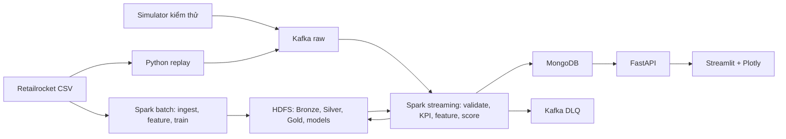

Batch và streaming dùng chung module chuẩn hóa, tính feature và tải model. Chạy huấn luyện tách thời điểm với streaming để phù hợp ngân sách RAM.

#### 2.2. Công nghệ và cấu hình nền

| Thành phần            | Cấu hình triển khai                        |
| --------------------- | ------------------------------------------ |
| Runtime ứng dụng      | Python 3.11 trong container                |
| Kafka                 | `apache/kafka:3.9.1`, KRaft, một broker    |
| Spark                 | Spark 3.5.7, Scala 2.12, Java 17           |
| Spark–Kafka connector | `spark-sql-kafka-0-10_2.12:3.5.7`          |
| HDFS                  | Hadoop 3.4.2, Java 11 trong container HDFS |
| MongoDB               | Nhánh 8.0, một instance                    |
| API và dashboard      | FastAPI, Streamlit, Plotly                 |
| Điều phối             | Docker Compose và các lệnh Makefile        |

Khóa phiên bản dependency và image digest sau smoke test ngày đầu. Đóng gói sẵn connector trong image để buổi demo không phụ thuộc tải Maven.

Các phiên bản và cơ chế tích hợp được đối chiếu với Spark 3.5.7 (tham chiếu `https://spark.apache.org/docs/3.5.7/`), Spark–Kafka (tham chiếu `https://spark.apache.org/docs/3.5.7/structured-streaming-kafka-integration.html`), Kafka Docker/KRaft (tham chiếu `https://kafka.apache.org/39/getting-started/quickstart/`) và Hadoop Java Versions (tham chiếu `https://cwiki.apache.org/confluence/spaces/HADOOP/pages/100827883/Hadoop+Java+Versions`).

Ngân sách bộ nhớ ban đầu:

| Nhóm dịch vụ               |    RAM dự kiến |
| -------------------------- | -------------: |
| Kafka                      |           1 GB |
| NameNode và hai DataNode   |        1,75 GB |
| Spark master và hai worker |        4,25 GB |
| Spark driver               |        1,25 GB |
| MongoDB                    |         0,5 GB |
| API, dashboard, producer   |           1 GB |
| Tổng                       | Khoảng 9,75 GB |

Mỗi Spark worker có hai core, một executor khoảng 1 GB heap. Giới hạn container phải chừa thêm bộ nhớ cho Python và JVM overhead. Không chạy thêm Grafana, Airflow hoặc các giao diện quản trị riêng trong tuần đầu.

HDFS đặt replication factor bằng 2 và dùng volume riêng cho từng DataNode. Cơ chế replication của HDFS (tham chiếu `https://hadoop.apache.org/docs/r3.4.2/hadoop-project-dist/hadoop-hdfs/HdfsDesign.html`) là cơ sở để kiểm tra việc đọc dữ liệu khi một DataNode dừng.

#### 2.3. Hợp đồng sự kiện

Producer gửi JSON có cấu trúc:

```json
{
  "schema_version": 1,
  "run_id": "replay-001",
  "event_id": "sha256-or-deterministic-id",
  "source": "retailrocket",
  "visitor_id": "257597",
  "item_id": "355908",
  "event_type": "view",
  "transaction_id": null,
  "event_time": "2015-09-10T10:00:00.000Z",
  "emitted_at": "2026-10-16T07:00:00.000Z"
}
```

Quy tắc cố định:

- ID được biểu diễn bằng chuỗi.
- Chuẩn hóa `view → view`, `addtocart → add_to_cart`, `transaction → purchase`.
- `event_time` giữ thời gian nghiệp vụ gốc; `emitted_at` ghi thời gian producer phát.
- Event Retailrocket có ID xác định từ phiên bản dataset và năm trường gốc. Dòng trùng hoàn toàn sinh cùng ID.
- Simulator dùng seed và số thứ tự để tái lập được sự kiện.
- Mỗi lần chạy có `run_id`; lịch sử, replay và simulator được phân biệt rõ.
- Không yêu cầu `session_id` ở đầu vào; session được suy ra trong bước phân tích.

Kiểm tra schema, trường bắt buộc, timestamp, loại sự kiện và mã giao dịch của sự kiện mua. Bản ghi lỗi phải có mã nguyên nhân cụ thể.

#### 2.4. Kafka

V1 sử dụng hai topic:

| Topic                  | Partitions | Key              | Nội dung                         |
| ---------------------- | ---------: | ---------------- | -------------------------------- |
| `ecommerce.events.raw` |          3 | `visitor_id`     | Event từ replay/simulator        |
| `ecommerce.events.dlq` |          1 | ID bản ghi nguồn | Event lỗi và thông tin chẩn đoán |

Cả hai có replication factor bằng 1; raw giữ dữ liệu 48 giờ. Producer bật idempotence, `acks=all`, retry hữu hạn và báo lỗi khi gửi thất bại.

Chưa cần topic trung gian cho KPI hoặc prediction: Spark ghi các kết quả đó trực tiếp vào MongoDB.

#### 2.5. Các tầng lưu trữ

| Tầng        | Nội dung                                                      |
| ----------- | ------------------------------------------------------------- |
| Bronze      | Bốn CSV gốc; payload Kafka và metadata topic/partition/offset |
| Silver      | Event chuẩn hóa, loại trùng, có nguồn và thời gian UTC        |
| Gold        | KPI, funnel, feature và kết quả đánh giá                      |
| Models      | Spark PipelineModel, metadata, schema feature và metrics      |
| Checkpoints | Tiến độ Structured Streaming theo từng run                    |

Parquet là định dạng dữ liệu xử lý chính. Dữ liệu lịch sử phân vùng theo ngày sự kiện; dữ liệu streaming lưu theo run và micro-batch. Có bước gom file sau khi kết thúc run demo.

MongoDB chỉ lưu dữ liệu phục vụ giao diện:

- KPI tổng quan và chuỗi thời gian.
- Funnel đã tính.
- Hồ sơ feature mới nhất của visitor.
- Phân khúc và prediction.
- Thông tin model.
- Tiến độ pipeline và offset đã xử lý.

#### 2.6. Luồng batch

1. Lưu CSV gốc lên HDFS, ghi manifest và checksum.
2. Đọc `events.csv` bằng schema tường minh.
3. Chuẩn hóa event, timestamp và kiểu dữ liệu.
4. Loại trùng theo ID đã định nghĩa.
5. Ghi Silver theo ngày.
6. Tạo Gold cho phân tích lịch sử và dữ liệu huấn luyện.
7. Huấn luyện, đánh giá và lưu model.
8. Xuất một đoạn dữ liệu đã sắp thời gian cho producer replay.

Không đưa toàn bộ dataset vào pandas hoặc bộ nhớ driver.

#### 2.7. Luồng streaming và phục hồi

Dùng Structured Streaming đọc raw với trigger khởi đầu **15 giây**, xử lý trong `foreachBatch`:

1. Lưu payload gốc vào Bronze.
2. Parse, validate và nhận diện bản ghi trùng.
3. Phân loại sự kiện đến trễ.
4. Commit Silver hợp lệ.
5. Tính lại các cửa sổ KPI bị ảnh hưởng.
6. Tính feature cho visitor có thay đổi.
7. Áp dụng hai model đã tải.
8. Upsert kết quả vào MongoDB và ghi tiến độ hoàn thành.

Cơ chế bảo đảm:

- Mỗi micro-batch có khóa `(run_id, batch_id)`.
- Ghi Parquet vào thư mục tạm rồi rename để commit trên HDFS.
- Khi retry, tái sử dụng batch đã commit.
- MongoDB dùng khóa duy nhất và replace/upsert giá trị tổng hợp; tránh cộng dồn lại khi retry.
- DLQ giữ định danh nguồn; consumer kiểm thử loại được bản tin gửi lại.
- Lỗi sink phải làm batch thất bại để Spark retry.
- Đặt checkpoint trên HDFS và giữ lại khi restart.

`foreachBatch` mặc định có ngữ nghĩa ghi ít nhất một lần; tính đúng khi retry cần được xây dựng ở sink. Kế hoạch này kiểm thử từng sink, không giả định có transaction chung giữa Kafka, HDFS và MongoDB. Tham khảo Structured Streaming (tham chiếu `https://spark.apache.org/docs/3.5.7/structured-streaming-programming-guide.html`).

Ngưỡng đến trễ ban đầu là **10 phút theo event-time**. Lưu mốc event-time đã xử lý của run; bản ghi quá ngưỡng vẫn được giữ trong Bronze và vùng cách ly. Trong v1, quy tắc này được thực hiện tường minh trong micro-batch, tránh ghép nhiều phép toán streaming có trạng thái.

### 3. Phân tích, Machine Learning và giao diện

#### 3.1. KPI và funnel

| Chỉ số            | Định nghĩa                                             |
| ----------------- | ------------------------------------------------------ |
| Processed events  | Số event hợp lệ, duy nhất                              |
| Views             | Số event `view`                                        |
| Add to cart       | Số event `add_to_cart`                                 |
| Purchase events   | Số event `purchase`                                    |
| Transactions      | Số `transaction_id` khác nhau                          |
| Active visitors   | Visitor khác nhau trong năm phút event-time gần nhất   |
| Buyer rate        | Visitor có mua / visitor có tương tác trong khoảng lọc |
| Events per minute | Event hợp lệ theo cửa sổ một phút                      |

Không cộng số visitor hoặc giao dịch khác nhau của từng phút để suy ra tổng toàn khoảng.

Funnel được tính riêng:

- Session là chuỗi tương tác của cùng visitor, ngắt khi không hoạt động quá 30 phút.
- Chuỗi chuyển đổi phải có thứ tự thời gian **view → add_to_cart → purchase**, cùng sản phẩm và cùng session.
- Mỗi session được tính tối đa một lần ở mỗi bước.
- Giao dịch thiếu bước xem/thêm giỏ vẫn nằm trong KPI mua hàng; không được tự bổ sung bước funnel.
- Funnel của phiên đang diễn ra hiển thị trạng thái tạm tính.

Giá trị ứng dụng cần thể hiện trên dashboard: nhận diện sản phẩm được quan tâm, mức rơi giữa các bước và nhóm visitor cần ưu tiên theo dõi.

#### 3.2. Feature dùng chung

Định nghĩa một hàm tính feature từ các event trong cửa sổ **bảy ngày trước thời điểm `t`**, tức `[t − 7 ngày, t)`.

Các feature v1:

| Feature                     | Ý nghĩa                                   |
| --------------------------- | ----------------------------------------- |
| `view_count_7d`             | Lượt xem                                  |
| `cart_count_7d`             | Lượt thêm giỏ                             |
| `transaction_count_7d`      | Giao dịch khác nhau                       |
| `unique_items_7d`           | Sản phẩm tương tác khác nhau              |
| `active_days_7d`            | Ngày có tương tác theo UTC                |
| `recency_hours`             | Khoảng cách từ tương tác gần nhất đến `t` |
| `cart_view_ratio_7d`        | Số thêm giỏ / số xem                      |
| `transaction_view_ratio_7d` | Số giao dịch / số xem                     |

Mẫu số bằng 0 cho kết quả 0. Hai tỷ lệ cuối là tỷ số hành vi, không được trình bày như funnel có thứ tự.

Quy tắc triển khai:

- Tính distinct trên toàn cửa sổ, không cộng distinct từng ngày.
- Không đưa visitor ID, item ID hoặc nhãn tương lai vào vector.
- Lưu `feature_version`, thứ tự cột và quy tắc biến đổi.
- Cùng một tập event và thời điểm `t` phải cho cùng feature trong batch và streaming.

#### 3.3. K-Means

Mục tiêu là nhóm visitor theo mức độ và kiểu tương tác.

- Tập huấn luyện: visitor hoạt động trong bảy ngày trước `2015-07-15T00:00:00Z`.
- Biến đổi `log1p` cho biến đếm, sau đó chuẩn hóa.
- Thử `K ∈ {2, 3, 4, 5}`, seed cố định bằng 42.
- Chọn K có silhouette cao nhất; nếu bằng nhau chọn K nhỏ hơn.
- Lưu pipeline, tâm cụm, silhouette, số lượng và thống kê feature từng cụm.

Tên cụm được đặt sau khi đọc kết quả, ví dụ “chủ yếu xem” hoặc “tương tác giỏ hàng nhiều”. Không áp đặt trước rằng dữ liệu phải tạo ra một số nhóm kinh doanh nhất định.

Khả năng K-Means và đánh giá phân cụm được mô tả trong Spark MLlib Clustering (tham chiếu `https://spark.apache.org/docs/3.5.7/ml-clustering.html`).

#### 3.4. Random Forest

**Đơn vị dự đoán:** một visitor tại thời điểm chốt feature.

**Nhãn:** `purchase_in_next_24h = 1` nếu visitor có ít nhất một giao dịch trong `[t, t + 24 giờ)`; ngược lại là 0. Chỉ tạo mẫu khi có đủ cửa sổ quan sát tương lai.

Tạo snapshot hằng ngày lúc 00:00 UTC cho visitor có tương tác trong bảy ngày trước đó:

| Tập        | Ngày chốt feature     |
| ---------- | --------------------- |
| Train      | 11/05/2015–15/07/2015 |
| Validation | 17/07/2015–15/08/2015 |
| Test       | 17/08/2015–17/09/2015 |

Khoảng cách tại ranh giới giúp nhãn 24 giờ của tập trước không chồng sang thời điểm bắt đầu tập sau. Toàn bộ bước fit và chọn tham số chỉ dùng train/validation.

Cấu hình thí nghiệm:

- Baseline dự đoán không mua và baseline hằng theo tỷ lệ dương của train.
- Random Forest với `numTrees ∈ {50, 100}`, `maxDepth ∈ {5, 8}`.
- Train giữ toàn bộ mẫu dương, lấy mẫu âm xác định theo hash với tỷ lệ mục tiêu tối đa 20 âm/1 dương.
- Validation và test giữ tỷ lệ lớp thật.
- Chọn cấu hình theo PR-AUC validation.
- Chọn ngưỡng nhãn theo F1 của lớp mua trên validation; nếu bằng nhau chọn ngưỡng có precision cao hơn.
- Đánh giá test sau khi khóa cấu hình.

Báo cáo:

- Tỷ lệ lớp và số mẫu từng tập.
- PR-AUC, ROC-AUC.
- Precision, recall, F1 của lớp mua.
- Confusion matrix.
- Precision trong nhóm 1% visitor có score cao nhất.
- Feature importance và thời gian huấn luyện.

Trả kết quả dưới tên `purchase_score` trong khoảng `[0,1]`. Vì có lấy mẫu âm và chưa hiệu chỉnh xác suất, giao diện không diễn giải score thành phần trăm xác suất mua đã được kiểm chứng.

Thuật toán được triển khai bằng Spark Random Forest (tham chiếu `https://spark.apache.org/docs/3.5.7/ml-classification-regression.html`).

#### 3.5. Dự đoán cho luồng mới

Mỗi micro-batch thực hiện:

1. Xác định visitor vừa có event hợp lệ.
2. Đặt `t` bằng thời gian event lớn nhất đã chấp nhận cộng một mili giây.
3. Lấy lịch sử bảy ngày trước `t`.
4. Tính feature bằng hàm dùng trong huấn luyện.
5. Chạy K-Means và Random Forest.
6. Lưu feature, cluster, score, nhãn và phiên bản model.

Đối với replay:

- Seed lịch sử chỉ được lấy trước thời điểm bắt đầu replay.
- Các event trong đoạn replay được bổ sung khi thực sự đi qua Kafka.
- Không truy cập phần lịch sử tương lai để tính feature.
- Độ trễ dùng `emitted_at` và thời gian xử lý thực tế; biểu đồ nghiệp vụ dùng `event_time`.

Đối với simulator:

- Chạy bằng run riêng.
- Có visitor mới chưa tồn tại trong lịch sử.
- Có kịch bản chỉ xem, xem rồi thêm giỏ, và phát sinh mua.
- Kiểm tra feature/prediction được cập nhật; không ép score phải tăng sau mọi hành động.

Model được tải một lần khi khởi động ứng dụng streaming. Nếu thiếu model hoặc sai schema feature, hiển thị trạng thái scoring chưa sẵn sàng, không tạo kết quả giả.

#### 3.6. API

API dùng tiền tố `/api/v1`. Các API nghiệp vụ phải nhận `run_id` để tránh trộn các lần chạy.

| Endpoint                     | Nội dung                                 |
| ---------------------------- | ---------------------------------------- |
| `GET /health`                | Trạng thái API và kết nối MongoDB        |
| `GET /runs`                  | Danh sách run, nguồn và khoảng thời gian |
| `GET /overview`              | KPI trong khoảng lọc                     |
| `GET /timeseries`            | Chuỗi thời gian một phút                 |
| `GET /funnel`                | Funnel và trạng thái tạm tính/hoàn tất   |
| `GET /segments`              | Quy mô và đặc điểm cụm                   |
| `GET /predictions`           | Visitor được xếp theo score              |
| `GET /visitors/{visitor_id}` | Feature và prediction mới nhất           |
| `GET /models`                | Phiên bản, tham số và metrics            |
| `GET /pipeline`              | Tiến độ, độ trễ, lỗi và backlog          |

Prediction trả tối thiểu:

`visitor_id`, `cluster_id`, `purchase_score`, `predicted_label`, `threshold`, `feature_version`, `model_version`, `as_of_event_time`, `scored_at`.

Quy tắc chung:

- Thời gian đầu vào có múi giờ, chuẩn hóa về UTC.
- Danh sách mặc định 50 dòng, tối đa 200.
- Dữ liệu chưa sẵn sàng có trạng thái rõ; không thay bằng số 0 gây hiểu nhầm.
- Dashboard đọc qua API; không truy vấn trực tiếp MongoDB.

#### 3.7. Dashboard ba màn hình

| Màn hình                | Thành phần                                                                                             |
| ----------------------- | ------------------------------------------------------------------------------------------------------ |
| Tổng quan và hành trình | KPI, biểu đồ theo phút, funnel, sản phẩm được tương tác nhiều                                          |
| Phân khúc và dự đoán    | Quy mô cụm, đặc trưng cụm, bảng score, chi tiết visitor, metrics mô hình                               |
| Theo dõi pipeline       | Tốc độ vào/xử lý, backlog, batch duration, lỗi/trùng/trễ, trạng thái scoring và liên kết Spark/HDFS UI |

Dashboard tự cập nhật mỗi năm giây, có bộ chọn run và hiển thị rõ chế độ lịch sử/replay/simulator. Ngày mặc định lấy từ run, tránh mở vào ngày hiện tại rồi không thấy dữ liệu năm 2015.

Backlog được tính từ **Kafka end offsets trừ offsets của batch đã hoàn thành theo từng partition**. Spark không commit consumer offsets theo cách consumer thông thường, nên không chỉ dựa vào báo cáo consumer group để suy ra lag. Tham khảo Spark Kafka Integration (tham chiếu `https://spark.apache.org/docs/3.5.7/structured-streaming-kafka-integration.html`).

### 4. Lịch thực hiện bảy ngày và sản phẩm bàn giao

#### Ngày 1 — Nền tảng và cụm dịch vụ · 8 giờ

**Công việc**

- Tạo cấu trúc module cho producer, batch, streaming, ML, API, dashboard và tests.
- Tạo cấu hình môi trường, event schema, Dockerfile và Compose.
- Dựng Kafka, HDFS, Spark và MongoDB.
- Thiết lập volume, network, resource limit và healthcheck.
- Khóa dependency sau smoke test.

**Đầu ra nghiệm thu**

- Hai DataNode và hai Spark worker được nhận diện.
- Spark ghi/đọc được Parquet trên HDFS.
- Producer/consumer gửi nhận được JSON.
- API kết nối được MongoDB.

**Mốc bắt buộc:** hoàn thành đọc/ghi xuyên dịch vụ trong ngày đầu.

#### Ngày 2 — Dữ liệu lịch sử và nguồn sự kiện · 8 giờ

**Công việc**

- Lập data dictionary và báo cáo chất lượng dữ liệu.
- Lưu CSV gốc lên HDFS.
- Xây batch chuẩn hóa và loại trùng.
- Ghi Silver theo ngày.
- Xuất replay đã sắp thời gian.
- Viết producer có tốc độ tùy chỉnh và simulator có seed.

**Đầu ra nghiệm thu**

- Silver lịch sử có 2.755.641 event sau loại trùng hoàn toàn, nếu không phát hiện thêm lỗi hợp lệ cần loại.
- Manifest giải thích được mọi chênh lệch raw/Silver.
- Replay phát đúng thứ tự thời gian và schema.

#### Ngày 3 — Streaming, KPI và phục hồi · 8 giờ

**Công việc**

- Hoàn thiện `foreachBatch`, Bronze/Silver và checkpoint.
- Xử lý schema lỗi, trùng và sự kiện đến trễ.
- Tính KPI theo phút và active visitors.
- Ghi MongoDB bằng upsert.
- Kiểm tra retry sau lỗi sink và restart Spark.
- Tạo Gold funnel cho lịch sử và run demo.

**Đầu ra nghiệm thu**

- Event qua Kafka làm thay đổi KPI trong MongoDB.
- Event lỗi có mặt trong DLQ.
- Retry/restart không tăng sai tổng event, giao dịch hoặc visitor.

#### Ngày 4 — Feature và hai mô hình · 9 giờ

**Công việc**

- Viết hàm feature dùng chung và kiểm thử biên thời gian.
- Tạo snapshot, nhãn và chia tập.
- Chạy K-Means, chọn K và diễn giải cụm.
- Chạy baseline và bốn cấu hình Random Forest.
- Chọn ngưỡng bằng validation, đánh giá test.
- Lưu model và metadata.

**Đầu ra nghiệm thu**

- Có hai Spark PipelineModel tải lại được.
- Có bảng metrics thực tế và so sánh baseline.
- Có bằng chứng feature không dùng dữ liệu sau thời điểm chốt.

#### Ngày 5 — Scoring luồng mới và API · 8 giờ

**Công việc**

- Tải model vào streaming.
- Kết hợp lịch sử trước replay và event mới.
- Tính feature cho visitor thay đổi rồi cập nhật prediction.
- Kiểm tra visitor hoàn toàn mới.
- Hoàn thiện API và index MongoDB.
- Ghi offset, latency và trạng thái model.

**Đầu ra nghiệm thu**

- Event mới làm cập nhật hồ sơ feature và prediction.
- Feature batch/stream khớp trên fixture kiểm thử.
- API trả đủ KPI, cluster, prediction và metrics.

#### Ngày 6 — Dashboard và kiểm thử toàn hệ thống · 8 giờ

**Công việc**

- Hoàn thiện ba màn hình.
- Chạy replay và simulator xuyên suốt hệ thống.
- Đối chiếu API/dashboard với Gold.
- Đo tải 10, 50 và 100 event/giây.
- So sánh một và hai Spark worker bằng cùng một job batch.
- Kiểm tra dừng DataNode, Spark worker và restart Kafka.

**Đầu ra nghiệm thu**

- Dashboard sử dụng dữ liệu thật.
- Có bảng throughput, latency, backlog và tài nguyên.
- Có log/ảnh chứng minh replication và phân phối task.

#### Ngày 7 — Báo cáo, đóng gói và diễn tập · 7 giờ

**Công việc**

- Hoàn thiện báo cáo kỹ thuật và kết quả ML.
- Chuẩn bị slide và kịch bản demo.
- Chạy lại theo README từ các artifact đã chuẩn bị.
- Xuất bản sao model, metrics và bằng chứng kiểm thử.
- Dành hai giờ trong ngày để sửa lỗi tích hợp còn lại.

**Đầu ra nghiệm thu**

- Người khác có thể chạy theo hướng dẫn.
- Demo hoàn thành trong khoảng 10 phút.
- Báo cáo ghi rõ kết quả đạt được và giới hạn.

#### Các lệnh vận hành cần cung cấp

| Lệnh                  | Mục đích                           |
| --------------------- | ---------------------------------- |
| `make up`             | Khởi động hạ tầng                  |
| `make doctor`         | Kiểm tra dịch vụ và dependency     |
| `make ingest`         | Tạo Bronze/Silver lịch sử          |
| `make build-features` | Feature 7 ngày lịch sử             |
| `make train-segments` | K-Means và đánh giá silhouette     |
| `make segment-status` | Đọc model/profile hoặc một visitor |
| `make test-ml`        | Kiểm thử ML trên cụm thật          |
| `make prepare-demo`   | Chuẩn bị lịch sử và dữ liệu replay |
| `make stream`         | Chạy xử lý và scoring              |
| `make replay`         | Phát dữ liệu demo                  |
| `make simulate`       | Chạy kịch bản dữ liệu giả lập      |
| `make test`           | Chạy kiểm thử                      |
| `make down`           | Dừng dịch vụ, giữ dữ liệu          |

Các lệnh tái lập artifact phải kiểm tra phiên bản/manifest và tránh âm thầm nhân đôi dữ liệu. Thao tác xóa volume chỉ nằm trong lệnh reset riêng.

Sản phẩm bàn giao gồm mã nguồn, cấu hình triển khai, schema/data dictionary, kết quả ML, báo cáo hiệu năng, bộ kiểm thử, README, slide và kịch bản demo.

### 5. Kiểm thử, tiêu chí nghiệm thu và giới hạn

#### 5.1. Bộ kiểm thử bắt buộc

| Nhóm         | Tình huống và kết quả mong đợi                                                       |
| ------------ | ------------------------------------------------------------------------------------ |
| Schema       | Thiếu ID, event type lạ, JSON hỏng, timestamp sai → có lỗi rõ và bản ghi DLQ         |
| Timestamp    | Chuyển Unix milliseconds đúng UTC; không nhầm giây/mili giây                         |
| Trùng lặp    | Trùng trong batch, giữa hai batch và khi retry → chỉ tính một lần                    |
| Giao dịch    | Một transaction có nhiều item → tổng giao dịch vẫn bằng một                          |
| Distinct     | Visitor/item xuất hiện nhiều ngày → distinct bảy ngày không bị cộng lặp              |
| Funnel       | Khác thứ tự, khác item hoặc khác session → không tính nhầm chuỗi chuyển đổi          |
| Feature      | Event đúng mốc `t` và `t−7d` được xử lý đúng khoảng đã định nghĩa                    |
| Nhãn         | Có mua trong 24 giờ, mua ngoài 24 giờ, thiếu quan sát tương lai → nhãn/loại mẫu đúng |
| Leakage      | Thêm event sau `t` không làm thay đổi feature tại `t`                                |
| Batch/stream | Cùng input và `t` → cùng vector feature                                              |
| Visitor mới  | Chưa có lịch sử vẫn tạo feature hợp lệ và prediction                                 |
| Restart      | Lỗi sau commit HDFS hoặc giữa các bước ghi MongoDB → retry không cộng dồn sai        |
| Event trễ    | Trong ngưỡng được cập nhật; quá ngưỡng được cách ly và ghi nhận                      |
| Phân tán     | Dừng một worker/DataNode → quan sát được xử lý phục hồi trong phạm vi đã cấu hình    |

Tests dùng dữ liệu nhỏ có kết quả biết trước. Full dataset được kiểm tra bằng thống kê đối soát và manifest.

#### 5.2. Mục tiêu hiệu năng

Mức nghiệm thu ban đầu:

- Duy trì **10 event/giây trong ít nhất năm phút**, bật KPI và scoring.
- Mục tiêu độ trễ p95 từ phát event đến dữ liệu phục vụ API **không quá 60 giây**, sau giai đoạn khởi động.
- Khi dừng producer, backlog giảm về 0.
- Không mất event hợp lệ so với tập đầu vào duy nhất.
- Không có container bị OOM.

Các mức 50 và 100 event/giây là thí nghiệm xác định giới hạn. Báo cáo phải ghi kết quả thực tế; không coi các mức này là cam kết trước khi đo.

So sánh một/hai worker phải dùng cùng dữ liệu và cấu hình job. Chỉ kết luận tăng tốc nếu số đo chứng minh được.

#### 5.3. Kịch bản demo khoảng 10 phút

1. **Một phút:** trình bày kiến trúc, Spark workers và HDFS DataNodes.
2. **Một phút:** mở thống kê dữ liệu và kết quả huấn luyện đã lưu.
3. **Năm phút:** replay đoạn `10:00–16:00 UTC ngày 10/09/2015` ở 10 event/giây. Đoạn này đã kiểm tra có khoảng 2.692 event, gồm xem, thêm giỏ và mua.
4. Trong lúc replay, quan sát KPI, chọn visitor để xem feature và prediction cập nhật.
5. **Một phút:** gửi event lỗi và kiểm tra DLQ.
6. **Hai phút:** trình bày kết quả kiểm thử restart/replication và kết luận từ mô hình.

Huấn luyện được chạy trước buổi bảo vệ; demo sử dụng model artifact thật. Kiểm thử dừng DataNode thực hiện trước và lưu bằng chứng, vì thời gian phát hiện node lỗi có thể dài hơn thời lượng trình diễn.

#### 5.4. Giả định và giới hạn đã chọn

- Một tuần tương ứng khoảng 56 giờ làm việc; dành lại tài nguyên máy trước khi chạy cụm.
- V1 tập trung vào dữ liệu sự kiện và tám feature hành vi đã chốt.
- Dự đoán luồng mới chạy theo micro-batch 15 giây; không có huấn luyện lại liên tục.
- Score là điểm mô hình, chưa phải xác suất đã hiệu chỉnh.
- Một broker Kafka, một NameNode và một MongoDB tạo ra các điểm lỗi đơn; không tuyên bố hệ thống có HA toàn phần.
- Chưa triển khai frontend riêng, đăng nhập, cloud, Kubernetes, Deep Learning, recommendation engine hoặc khai thác toàn bộ thuộc tính sản phẩm.
- Nếu tiến độ trễ, giảm trang trí giao diện và số biểu đồ; giữ các hạng mục cốt lõi: Kafka, HDFS nhiều node, Spark nhiều worker, hai mô hình, scoring sự kiện mới và kiểm thử đúng dữ liệu.
- Kết quả ML được đánh giá bằng số đo thật. Trường hợp mô hình chưa vượt baseline phải được phân tích và báo cáo rõ, thay vì đặt trước một mức accuracy để đạt.

## 2.3. Nguồn tài liệu: `docs/README.md`

## Tài liệu dự án

Tài liệu cho **E-commerce User Behavior Analytics Platform** được tổ chức theo từng phần của hệ thống.

| Tài liệu                                                               | Nội dung                                                                                                                                                                               |
| ---------------------------------------------------------------------- | -------------------------------------------------------------------------------------------------------------------------------------------------------------------------------------- |
| Chạy toàn bộ trên máy mới (tham chiếu `GETTING_STARTED.md`)            | Từ clone GitHub, Ubuntu/Arch hoặc Windows/WSL2, dataset và Docker Compose đến ingest, train, policy, API/Live Server, replay và live nhiều lượt; output, nghiệm thu, retry và cleanup. |
| Sử dụng web và đọc kết quả (tham chiếu `serving/06-web-user-guide.md`) | Thao tác từng màn hình, phiên/run/batch, feed, KPI/funnel, phân cụm, score/nhãn, metrics lịch sử, ví dụ thực tế và lỗi thường gặp.                                                     |
| Hạ tầng (tham chiếu `infra/README.md`)                                 | Docker Compose, Kafka, HDFS, Spark, MongoDB; cấu hình, khởi tạo, vận hành, kiểm thử, xử lý lỗi, tối ưu build và ngân sách RAM.                                                         |
| Dữ liệu lịch sử (tham chiếu `data/README.md`)                          | Data dictionary, hợp đồng sự kiện, Bronze/Silver, chuẩn hóa, loại trùng, quarantine, chất lượng và kiểm thử ingestion.                                                                 |
| Replay và streaming KPI (tham chiếu `streaming/README.md`)             | Producer Kafka, Structured Streaming, KPI MongoDB, checkpoint/retry, DLQ, vận hành demo và nghiệm thu.                                                                                 |
| Session và funnel (tham chiếu `analytics/README.md`)                   | Phân tích lịch sử và streaming, phiên 30 phút, funnel tổng quan/sản phẩm, snapshot HDFS/MongoDB, vận hành và kiểm thử.                                                                 |
| Machine Learning (tham chiếu `ml/README.md`)                           | Feature 7 ngày, K-Means; nhãn 24 giờ, RF batch/policy, ML streaming với replay/simulator, snapshot và nghiệm thu.                                                                      |
| API và dashboard local (tham chiếu `serving/README.md`)                | FastAPI trên host; HTML/CSS/JS qua Live Server; ba màn hình, demo liên tục, feed mỗi giây, snapshot và kiểm thử.                                                                       |
| Bản đồ sơ đồ trực quan (tham chiếu `diagrams/README.md`)               | Sơ đồ Mermaid về kiến trúc, dữ liệu, training K-Means/RF, streaming ML, live demo, snapshot API và cách đọc kết quả.                                                                   |
| Báo cáo audit tổng hợp (tham chiếu `PROJECT_AUDIT.md`)                 | Audit yêu cầu, kiến trúc, dữ liệu, Big Data pipeline, ML, API/dashboard, kiểm thử, artifact runtime và so sánh các lần chạy.                                                           |
| Kế hoạch triển khai tổng thể (tham chiếu `../IMPLEMENTATION_PLAN.md`)  | Mục tiêu, luồng dữ liệu, phân tích hành vi, Machine Learning, API/dashboard và các mốc triển khai.                                                                                     |

Bắt đầu từ hướng dẫn máy mới (tham chiếu `GETTING_STARTED.md`) để chạy đầy đủ; khi đã mở được ứng dụng, chuyển sang hướng dẫn web (tham chiếu `serving/06-web-user-guide.md`). README gốc (tham chiếu `../README.md`) dành cho tra cứu nhanh; mục lục hạ tầng (tham chiếu `infra/README.md`) giải thích sâu về dựng/vận hành cụm.

Tài liệu hạ tầng nằm trong `docs/infra/`, ingestion trong `docs/data/`, replay/streaming trong `docs/streaming/`, phân tích hành vi trong `docs/analytics/`, Machine Learning trong `docs/ml/`, API/dashboard trong `docs/serving/`. Lệnh trong tài liệu được chạy từ thư mục gốc repository, trừ khi có hướng dẫn khác.

## 2.4. Nguồn tài liệu: `docs/GETTING_STARTED.md`

## Hướng dẫn chạy toàn bộ dự án trên máy mới

← Mục lục tài liệu (tham chiếu `README.md`) · README dự án (tham chiếu `../README.md`) · Bản đồ sơ đồ (tham chiếu `diagrams/README.md`) · Sử dụng web và đọc kết quả (tham chiếu `serving/06-web-user-guide.md`)

Tài liệu này dành cho developer nhận repository và tự chạy từ đầu: cài công cụ, chuẩn bị Retailrocket, dựng Docker Compose, ingest, phân tích lịch sử/streaming, K-Means, Random Forest, policy precision, ML streaming có simulator và dashboard HTML/CSS/JS qua Live Server. Không cần `.env`, model, volume hoặc thư mục `artifacts/` của người bàn giao.

Đối chiếu mã nguồn và artifact đến **20/10/2026**. Đã có bằng chứng ingestion/ML, replay/simulator, browser trên run hoàn tất và live hữu hạn hai lượt. Live liên tục đã hoàn tất một lượt 1.000 event nhưng bị gián đoạn ở lượt thứ hai; dừng/drain/resume thật còn cần kiểm chứng. Các lệnh ứng dụng bên dưới chạy trong **Bash trên Linux hoặc Ubuntu WSL2**, tại thư mục gốc repository. Các khối PowerShell chỉ dùng để chuẩn bị Windows. Chạy từng giai đoạn và kiểm tra kết quả trước khi chuyển bước.

Tài liệu này hướng dẫn **tạo ra dữ liệu và chạy ứng dụng**. Sau khi mở được dashboard, dùng hướng dẫn sử dụng web (tham chiếu `serving/06-web-user-guide.md`) để đọc từng KPI, phân cụm, prediction và trạng thái pipeline. Ví dụ số liệu của máy bàn giao được ghi riêng; developer mới phải kiểm tra report trên chính máy mình.

### Mục lục

1. Phạm vi và luồng dữ liệu (mục `#scope`)
2. Yêu cầu máy và công cụ (mục `#requirements`)
3. Cài môi trường Linux hoặc Windows/WSL2 (mục `#os`)
4. Clone và chuẩn bị dataset (mục `#source`)
5. Tạo cấu hình local (mục `#configuration`)
6. Kiểm thử offline, build và khởi động (mục `#infrastructure`)
7. Ingest Bronze/Silver (mục `#ingestion`)
8. Phân tích lịch sử và demo streaming (mục `#behavior`)
9. Feature và K-Means (mục `#segments`)
10. Random Forest và batch scoring (mục `#prediction`)
11. Policy precision và score mới (mục `#policy`)
12. ML streaming: replay và simulator (mục `#streaming-ml`)
    - API local và dashboard Live Server (mục `#serving`)
    - Live nhiều lượt và nghiệm thu ứng dụng (mục `#live-demo`)
13. Đọc artifact, selector và theo dõi (mục `#artifacts`)
14. Nghiệm thu chạy lại (mục `#reuse`)
15. Khởi động lại, ngắt job và xử lý lỗi (mục `#recovery`)
16. Dừng và dọn dữ liệu (mục `#cleanup`)
17. Checklist bàn giao (mục `#handoff`)

### 1. Phạm vi và luồng dữ liệu

Mục tiêu là biến hành vi xem sản phẩm, thêm giỏ và mua thành số liệu giúp hiểu khách hàng: họ dừng ở đâu trong funnel, có những nhóm hành vi nào và ai có dấu hiệu mua trong 24 giờ tiếp theo.

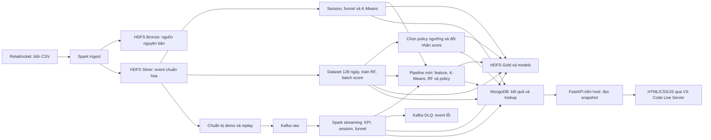

| Thành phần         | Công dụng                                                                                  |
| ------------------ | ------------------------------------------------------------------------------------------ |
| Docker Compose     | Khởi tạo network, volume, giới hạn tài nguyên, healthcheck và thứ tự init trên một máy.    |
| Kafka              | Nhận event replay, giữ offset và tách event lỗi sang DLQ.                                  |
| HDFS               | Lưu nguồn, Parquet, snapshot, checkpoint và model; hai DataNode giữ replication 2.         |
| Spark              | Xử lý batch/streaming và ML phân tán qua hai worker.                                       |
| MongoDB            | Giữ kết quả đã công bố, metadata và lookup theo visitor/sản phẩm.                          |
| Make và Python CLI | Kiểm tra điều kiện, điều phối job, khóa driver, ghi log và report.                         |
| FastAPI trên host  | Đọc kết quả MongoDB qua HTTP, kiểm tra run/batch/model của snapshot.                       |
| Web và Live Server | Hiển thị feed, KPI, phân khúc, dự đoán và tiến độ; người vận hành phát stream từ terminal. |

Đã có ingestion, KPI streaming, session/funnel lịch sử và streaming, K-Means lịch sử, RF batch/policy và ML streaming. FastAPI/dashboard đã đọc được dữ liệu thật; xem phạm vi nghiệm thu tại serving (tham chiếu `serving/README.md`). Spark/HDFS UI là giao diện vận hành. Retailrocket không có giá/doanh thu hoặc bước bắt đầu thanh toán; funnel hiện tại là **xem → thêm giỏ → mua**. Hai worker/DataNode cùng một máy không bảo vệ khi cả máy hoặc ổ đĩa hỏng.

Các nhánh phụ thuộc như sau; thứ tự trong tài liệu là một lộ trình chạy đầy đủ:

| Giai đoạn                                 | Cần có trước                                                                             |
| ----------------------------------------- | ---------------------------------------------------------------------------------------- |
| Hạ tầng                                   | Công cụ, bốn CSV, `.env`, image đã build                                                 |
| Ingest                                    | Hạ tầng healthy, smoke đạt                                                               |
| Behavior lịch sử, demo streaming, K-Means | Silver đã ingest đạt chất lượng                                                          |
| RF                                        | Silver; không cần dùng cluster K-Means làm feature                                       |
| Policy                                    | RF published và validation/test predictions; apply cần thêm original batch score         |
| ML streaming                              | Silver, K-Means, RF và policy eligible đã published; không cần tạo batch score mới       |
| API và dashboard                          | MongoDB đang chạy, API đã cài; muốn xem kết quả cần có run ML nghiệp vụ                  |
| Live nhiều lượt                           | Cùng nguồn/model/policy như ML streaming; một driver/producer được quản lý bởi lệnh live |

#### 1.1. Chọn đúng lộ trình

- **Máy mới, nghiệm thu đầy đủ:** thực hiện mục 2–12 theo thứ tự, sau đó 12A–12B. Có cả kiểm thử tích hợp và các pipeline lịch sử.
- **Chỉ cần chuẩn bị đủ điều kiện cho dashboard:** vẫn cần hạ tầng, ingest, K-Means, RF và policy eligible. Phân tích toàn lịch sử và demo KPI v2 ở mục 8 là nhánh phân tích/nghiệm thu bổ sung; dashboard hiện đọc run ML `stream-ml-v1`, không đọc trực tiếp kết quả v2 hoặc batch lịch sử.
- **Máy đã dựng xong:** dùng khởi động lại (mục `#recovery`), rồi mở ứng dụng (mục `#serving`). Không chạy lại cả quá trình huấn luyện mỗi lần muốn xem web.

Huấn luyện lần đầu là phần tốn thời gian nhất: build purchase data tham chiếu 45–55 phút, train RF khoảng 30 phút, chưa kể build image, ingest và các test. Thời gian thực tế phụ thuộc máy/mạng; theo dõi tiến độ và exit code thay vì coi đây là thời hạn bắt buộc.

#### 1.2. Quy ước terminal và ID

Mỗi terminal Bash đều mở **cùng clone và cùng thư mục root**. Trong các mục demo v2/ML, terminal consumer và producer được ghi riêng. Khi tới dashboard/live, dùng:

| Terminal        | Chạy gì                                                        | Khi nào giữ mở                                 |
| --------------- | -------------------------------------------------------------- | ---------------------------------------------- |
| A — API         | `make api`                                                     | Suốt thời gian sử dụng web                     |
| B — job         | Một job Spark, hoặc `make live-demo`                           | Đến khi job hoàn tất hoặc live dừng/drain xong |
| C — điều khiển  | Health/status; hoặc producer khi dùng replay/simulator kiểu cũ | Theo từng lệnh                                 |
| VS Code/browser | Live Server và dashboard                                       | Suốt buổi xem kết quả                          |

Một Spark driver phục vụ hai worker. API và Live Server chạy cùng driver được; không chạy smoke, test tích hợp, train hoặc consumer thứ hai trong lúc live đang giữ driver. `make live-demo` đã có producer bên trong, không chạy thêm `simulate-ml` cho phiên đó.

ID trong các lệnh là tên ví dụ. Lần đầu dùng đúng tên trong tài liệu; khi tạo kịch bản khác hoặc đổi mã/config, chọn tên mới. Chạy tiếp cùng ID chỉ khi giữ nguyên mã, nguồn, model và cấu hình đã khóa. Không lấy ID SHA model của máy tác giả điền vào máy mới.

### 2. Yêu cầu máy và công cụ

| Hạng mục              | Yêu cầu thực tế                                                                                                               |
| --------------------- | ----------------------------------------------------------------------------------------------------------------------------- |
| Hệ điều hành chạy CLI | Linux `amd64`; Windows dùng Ubuntu WSL2, Linux containers                                                                     |
| CPU                   | `x86_64`, hỗ trợ AVX, Docker thấy ít nhất 4 CPU logic                                                                         |
| RAM                   | Khoảng **7 GiB khả dụng** trước khi dựng cả cụm; khuyến nghị máy có ít nhất 16 GB để còn RAM cho OS/Docker                    |
| Dung lượng            | Preflight yêu cầu ít nhất **30 GiB trống ở Docker data**; nên dành 50–60 GiB trở lên và theo dõi khi lưu nhiều snapshot/model |
| Công cụ host          | Git, GNU Make, Python **3.11+** và venv/pip cho toàn bộ lộ trình có API; Bash, curl, unzip, GNU coreutils                     |
| Giao diện             | VS Code, extension Live Server (`ritwickdey.LiveServer`) và trình duyệt hỗ trợ ES modules                                     |
| Test web, tùy chọn    | Node 18+ cho `make test-web`; frontend chạy không cần npm/Node                                                                |
| Docker                | Daemon truy cập được, Compose hỗ trợ `up --wait`, Buildx plugin hoạt động                                                     |
| Mạng                  | Lần build đầu cần tải image, binary Apache, Python dependencies và dataset                                                    |

Tổng limit chín service thường trực là **6,25 GiB**. Ba init job có thể thêm 704 MiB, tổng tối đa **6,94 GiB**; bộ nhớ hệ điều hành, daemon, API, VS Code và browser nằm ngoài số này. Driver dùng heap 512 MiB, mỗi executor 640 MiB và một core. Chỉ chạy **một Spark driver tại một thời điểm**, kể cả smoke và integration test. Producer replay có thể chạy đồng thời với streaming theo hướng dẫn riêng.

Java, Spark, Hadoop, PySpark và các dependency ứng dụng được cài trong image; không cần cài chúng bằng pip hoặc Java trên host. Không giả định chạy được trên ARM/Apple Silicon hoặc Windows native. Chi tiết: ngân sách RAM (tham chiếu `infra/10-memory-budget.md`).

### 3. Cài môi trường: chọn đúng một nhánh

#### 3.1. Ubuntu 24.04 trên Linux

Chạy tại terminal của **máy Linux**, không áp dụng nhánh này trong WSL đang dùng Docker Desktop. Với máy đã có Docker hoạt động, kiểm tra ở mục 3.4 và bỏ qua cài lại. Máy có Docker/containerd cũ cần đối chiếu các package xung đột trước khi đổi bộ cài; tham khảo hướng dẫn Ubuntu chính thức của Docker (tham chiếu `https://docs.docker.com/engine/install/ubuntu/`).

Cài công cụ và đăng ký repository Docker:

```bash
sudo apt update
sudo apt install -y ca-certificates curl git make python3 python3-venv python3-pip unzip
sudo install -m 0755 -d /etc/apt/keyrings
sudo curl -fsSL https://download.docker.com/linux/ubuntu/gpg -o /etc/apt/keyrings/docker.asc
sudo chmod a+r /etc/apt/keyrings/docker.asc
sudo tee /etc/apt/sources.list.d/docker.sources >/dev/null <<EOF
Types: deb
URIs: https://download.docker.com/linux/ubuntu
Suites: $(. /etc/os-release && echo "${UBUNTU_CODENAME:-$VERSION_CODENAME}")
Components: stable
Architectures: $(dpkg --print-architecture)
Signed-By: /etc/apt/keyrings/docker.asc
EOF
sudo apt update
sudo apt install -y docker-ce docker-ce-cli containerd.io docker-buildx-plugin docker-compose-plugin
sudo systemctl enable --now docker
sudo groupadd --force docker
sudo usermod -aG docker "$USER"
```

Đăng xuất và đăng nhập lại để nhận group mới, rồi kiểm tra mục 3.4. Quyền group Docker cho phép điều khiển daemon; chỉ cấp cho người dùng được phép vận hành máy. Không đổi socket sang `chmod 777` hoặc chạy toàn bộ Make bằng `sudo`. Xem Linux post-install (tham chiếu `https://docs.docker.com/engine/install/linux-postinstall/`).

#### 3.2. Arch Linux

Chạy trong terminal Arch:

```bash
sudo pacman -Syu --needed docker docker-compose docker-buildx git make python python-pip curl unzip
sudo systemctl enable --now docker
sudo groupadd --force docker
sudo usermod -aG docker "$USER"
```

Đăng xuất/đăng nhập lại. Trên Arch, **Buildx là package riêng**; chỉ có `docker` và `docker-compose` chưa đủ cho `make build`. Tên package đối chiếu từ repository Arch: docker (tham chiếu `https://archlinux.org/packages/extra/x86_64/docker/`), docker-compose (tham chiếu `https://archlinux.org/packages/extra/x86_64/docker-compose/`), docker-buildx (tham chiếu `https://archlinux.org/packages/extra/x86_64/docker-buildx/`).

#### 3.3. Windows 11 x64, Ubuntu 24.04 WSL2 và Docker Desktop

Nhánh này dùng Docker Desktop làm daemon. Các bước chuẩn bị theo tài liệu chính thức; dự án **chưa có lượt nghiệm thu runtime riêng trên Windows/WSL2**.

1. Bật virtualization trong BIOS/UEFI nếu chưa có. Mở **PowerShell Administrator**, cài WSL và Ubuntu:

```powershell
wsl --install -d Ubuntu-24.04
```

2. Khởi động lại Windows khi được yêu cầu. Mở Ubuntu, tạo Linux username/password. Trong PowerShell, cập nhật và kiểm tra:

```powershell
wsl --update
wsl --version
wsl --list --verbose
```

Ubuntu phải có `VERSION 2`. Nếu bản đã cài còn là WSL1, chuyển trước khi chạy dự án:

```powershell
wsl --set-version Ubuntu-24.04 2
```

Tên distro phải khớp `wsl --list --verbose`. Xem Microsoft: cài WSL (tham chiếu `https://learn.microsoft.com/en-us/windows/wsl/install`). Docker yêu cầu WSL tối thiểu 2.1.5 và khuyến nghị cập nhật; kiểm tra theo Docker Desktop WSL2 (tham chiếu `https://docs.docker.com/desktop/features/wsl/`).

3. Cài Docker Desktop for Windows (tham chiếu `https://docs.docker.com/desktop/setup/install/windows-install/`), mở ứng dụng. Chọn **Use the WSL 2 based engine**, bật **Resources → WSL Integration → Ubuntu-24.04**, Apply/Restart. Dùng **Linux containers**. Không cài thêm Docker Engine/CLI bằng apt trong Ubuntu này vì có thể xung đột với Desktop.
4. Trước khi chạy job, cấp đủ tài nguyên cho WSL. Ví dụ máy Windows có ít nhất 16 GB RAM: sửa hoặc tạo `%UserProfile%\.wslconfig` bằng Windows editor, giữ các tùy chỉnh khác nếu file đã tồn tại:

```ini
[wsl2]
memory=10GB
processors=4
swap=4GB
```

Đây là trần VM dùng chung cho WSL2, khác tổng limit container. Swap không thay thế yêu cầu RAM khả dụng. Khi không còn công việc trong các distro, thoát Docker Desktop rồi áp dụng từ PowerShell:

```powershell
wsl --shutdown
```

Mở lại Docker Desktop và Ubuntu. Lệnh trên dừng **mọi distro WSL đang chạy**; thực hiện trước khi có pipeline. Cơ chế cấu hình: Microsoft `.wslconfig` (tham chiếu `https://learn.microsoft.com/en-us/windows/wsl/wsl-config`).

5. Từ đây dùng **terminal Ubuntu/Bash**, cài công cụ host:

```bash
sudo apt update
sudo apt install -y git make python3 python3-venv python3-pip curl unzip ca-certificates
```

Clone repository và lưu CSV trong filesystem Linux, ví dụ `~/workspace/`, để bind mount có hiệu năng tốt. Tránh đặt workspace/dataset dưới `/mnt/c`. Có thể mở `explorer.exe .` từ Ubuntu để chép ZIP vào thư mục Linux. Giữ file shell ở newline **LF**. Xem Docker WSL best practices (tham chiếu `https://docs.docker.com/desktop/features/wsl/best-practices/`).

#### 3.4. Kiểm tra trước khi clone

Trong Bash Linux/Ubuntu WSL của chính người sẽ chạy dự án:

```bash
uname -m
nproc
python3 --version
make --version
docker context show
docker info
docker compose version
docker buildx version
free -h
df -h .
```

Đạt khi kiến trúc `x86_64`, Docker báo Linux/amd64 và ít nhất bốn CPU, Python ≥3.11 cho cả API, không lỗi socket/daemon, Compose và Buildx in phiên bản. Hạ tầng cũ nhận Python 3.10 nhưng API cần 3.11+; nếu dùng interpreter khác, chỉ rõ `PYTHON=python3.11 make api-setup`. Preflight dự án còn kiểm tra AVX và tài nguyên. Trên WSL, cần đủ RAM khả dụng **bên trong Linux**, đồng thời đủ dung lượng ổ Windows chứa virtual disk của Docker Desktop; `df -h .` một mình không xác nhận ổ Docker còn trống.

Nếu Docker chưa truy cập được: Linux kiểm tra service/group và đăng nhập lại; WSL kiểm tra Desktop đang mở, Linux containers và integration đúng distro. Chưa chuyển sang build khi bước này còn lỗi.

### 4. Clone repository và chuẩn bị Retailrocket

#### 4.1. Lấy đúng mã nguồn

Trong Bash, chọn workspace của mình. Ví dụ này dùng `~/workspace/` nhất quán cho mọi terminal:

```bash
mkdir -p ~/workspace
cd ~/workspace
git clone --branch dev https://github.com/quangnhathung/E-commerce-User-Behavior-Analytics-Platform.git
cd E-commerce-User-Behavior-Analytics-Platform
git status --short
git branch --show-current
git rev-parse HEAD
```

Nhánh hiện hành là `dev`. Khi bàn giao một phiên bản cố định, dùng commit/tag đã được nhóm thống nhất thay vì tự lấy mã mới giữa các job. Ghi lại commit vào biên bản; nó giúp giải thích khác biệt identity và model giữa hai máy. Nếu chọn đường dẫn workspace khác, thay `cd` ở các terminal trong tài liệu tương ứng.

Mở folder repository bằng **File → Open Folder** trong VS Code, hoặc `code .` nếu đã có CLI. Cài Live Server của Ritwick Dey (tham chiếu `https://marketplace.visualstudio.com/items?itemName=ritwickdey.LiveServer`) qua Extensions (`Ctrl+Shift+X`), tìm đúng extension ID `ritwickdey.LiveServer` rồi Install. Trên WSL mở workspace bằng Remote WSL và cài extension vào môi trường workspace. Phần chạy web ở mục 12A (mục `#serving`).

#### 4.2. Tải và giải nén dataset

Tải ZIP từ Retailrocket recommender system dataset trên Kaggle (tham chiếu `https://www.kaggle.com/datasets/retailrocket/ecommerce-dataset`), đăng nhập Kaggle nếu trang yêu cầu. Ví dụ lưu ZIP đã tải thành `~/Downloads/retailrocket.zip` **bên trong Linux/WSL**. Không cần đưa Kaggle token vào `.env` hoặc Git.

Từ thư mục gốc repository, kiểm tra ZIP:

```bash
DATASET_ARCHIVE="$HOME/Downloads/retailrocket.zip"
test -f "$DATASET_ARCHIVE"
unzip -l "$DATASET_ARCHIVE"
```

Sửa giá trị biến nếu file tải có tên khác. Sau khi kiểm tra, giải nén vào thư mục mới:

```bash
mkdir -p Dataset/retailrocket-recommender-system-dataset
unzip "$DATASET_ARCHIVE" -d Dataset/retailrocket-recommender-system-dataset
```

Nếu ZIP có thư mục cha, sắp lại để **bốn CSV nằm trực tiếp** như sau, không lồng thêm một tầng:

```text
Dataset/retailrocket-recommender-system-dataset/
  events.csv
  category_tree.csv
  item_properties_part1.csv
  item_properties_part2.csv
```

| File                                                     | Header bắt buộc, đúng thứ tự                     |
| -------------------------------------------------------- | ------------------------------------------------ |
| `events.csv`                                             | `timestamp,visitorid,event,itemid,transactionid` |
| `category_tree.csv`                                      | `categoryid,parentid`                            |
| `item_properties_part1.csv`, `item_properties_part2.csv` | `timestamp,itemid,property,value`                |

Kiểm tra đủ file và header từ host; chưa cần Docker:

```bash
PYTHONPATH=app python3 - <<'PY'
import csv
from pathlib import Path
from ecommerce_analytics.contracts import HEADERS
root = Path("Dataset/retailrocket-recommender-system-dataset")
for name, expected in sorted(HEADERS.items()):
    path = root / name
    with path.open(encoding="utf-8", newline="") as source:
        actual = next(csv.reader(source), None)
    if actual != expected:
        raise SystemExit(f"Sai header: {path}: {actual}")
    print(f"OK {path}: {path.stat().st_size:,} bytes")
PY
```

Đạt khi cả bốn file được đọc và header khớp. File thiếu/sai header phải sửa trước. Dataset không được Git theo dõi hoặc đóng gói vào image; Compose mount nguồn **read-only**. Không sửa CSV trong khi job đang hash/đọc. Có thể dùng vị trí khác qua `DATASET_PATH` ở bước cấu hình, đồng thời đổi đường dẫn trong kiểm tra header.

Host đọc được chưa chắc container UID/GID 1000 đọc được. Với bộ dữ liệu công khai này, có thể cấp quyền đọc CSV và quyền đi qua **các thư mục dataset liên quan** cho runtime; kiểm tra lại trong container ở mục 6. Không đổi toàn bộ home hoặc dùng `chmod 777`.

### 5. Tạo và kiểm tra cấu hình local

**Nơi chạy:** thư mục gốc trong Bash. **Cần có:** công cụ và dataset đã sẵn sàng.

```bash
make setup
```

Lệnh tạo `.env` từ template (tham chiếu `../.env.example`), quyền `0600`, sinh hai mật khẩu Mongo độc lập và Kafka cluster ID. Chạy lại giữ file có sẵn. Sửa `.env` bằng editor local nếu cần:

| Biến                                                                       | Mặc định / tác dụng                                                      |
| -------------------------------------------------------------------------- | ------------------------------------------------------------------------ |
| `COMPOSE_PROJECT_NAME`                                                     | `ecommerce-analytics`; namespace container/network/volume của stack      |
| `DATASET_PATH`                                                             | `./Dataset/retailrocket-recommender-system-dataset`; đường dẫn trên host |
| `MIN_AVAILABLE_RAM_GIB`                                                    | `7`; gate bộ nhớ, không phải lệnh cấp RAM cho Docker                     |
| `MIN_DOCKER_DISK_GIB`                                                      | `30`; gate dung lượng Docker data                                        |
| `KAFKA_CLUSTER_ID`, `HDFS_CLUSTER_ID`                                      | Danh tính dữ liệu bền vững trong volume; giữ ổn định khi khởi động lại   |
| `MONGO_*`                                                                  | Database, app/root account; password đã sinh chỉ lưu local               |
| `KAFKA_HOST_PORT`, `MONGO_HOST_PORT`                                       | `19092`, `27018`; endpoint host                                          |
| `HDFS_UI_PORT`                                                             | `9870`                                                                   |
| `SPARK_MASTER_UI_PORT`, `SPARK_WORKER_1_UI_PORT`, `SPARK_WORKER_2_UI_PORT` | `18080`, `18081`, `18082`                                                |
| `SPARK_APPLICATION_UI_PORT`                                                | `14040`, dùng khi driver đang chạy                                       |

Các cổng host phải khác nhau, trong khoảng 1024–65535 và không bị ứng dụng khác chiếm. Đổi trước khi `make up`; dùng cổng mới khi mở UI. Giá trị có khoảng trắng phải được quote đúng theo cấu hình (tham chiếu `infra/03-configuration.md`). Cấu hình hạ tầng lấy từ `.env`; đừng chỉ `export DATASET_PATH=...` rồi mong manager thay cấu hình file.

```bash
make config
```

Đạt khi Compose render hợp lệ. Output có thể chứa giá trị nhạy cảm đã resolve; không đưa nguyên output hoặc `.env` vào ticket/commit. Render thành công chưa chứng minh đủ RAM, dataset đọc được hay dịch vụ healthy.

Không tạo lại `.env` khi volume đang giữ dữ liệu. Đổi password trong file không tự đổi account đã tồn tại; đổi cluster ID có thể bị từ chối khi mount volume cũ. Giữ bản sao `.env` an toàn cùng kế hoạch backup volume. Xem khởi tạo và vòng đời (tham chiếu `infra/04-bootstrap-and-lifecycle.md`).

### 6. Kiểm thử offline, build và khởi động hạ tầng

#### 6.1. Kiểm thử local

**Cần có:** cấu hình và các công cụ đã cài; không cần cụm chạy.

```bash
make test
```

Bộ được đối chiếu ngày 20/10 có 38 test hạ tầng và 211 test ứng dụng; 24 test live offline nằm trong suite ứng dụng. Trên máy bình thường kỳ vọng các suite kết thúc `OK`, không failure/error. Phiên sandbox trước có 7 HTTP skipped vì cấm loopback socket; đó **không phải số skip bắt buộc trên máy mới**. Serving có 23 test API offline và 15 test JS qua các lệnh riêng sau khi cài API/Node. Số test có thể tăng theo commit; exit code và tổng kết suite của mã đang dùng mới là bằng chứng. Test offline không chứng minh Spark/HDFS/Mongo/Kafka thực sự hoạt động. Nếu lỗi thiếu Compose/Bash/curl, sửa công cụ host rồi chạy lại.

#### 6.2. Build image lần đầu

**Cần có:** Docker/Buildx, bốn CSV và `.env`; preflight build vẫn kiểm tra dataset.

```bash
make build
```

Build kéo Kafka/Mongo theo digest, dựng Hadoop/Spark và connector, ghi `artifacts/infra/versions.json`. Các bản chính: Kafka 3.9.1, Hadoop 3.4.2/Java 11, Spark 3.5.7/Java 17, Python 3.11 và MongoDB 8.0. Xác nhận exit code 0 và manifest được tạo.

Lần đầu tải binary Spark khoảng 382 MiB, Hadoop lean khoảng 489 MiB cộng base image/dependency; có thể lâu tùy mạng. Các dòng `Adding debian:...pem` là cập nhật CA. BuildKit cache giữ download đã kiểm checksum và phần tải dở. Khi mạng lỗi/ngắt, chạy lại `make build`; không prune cache trước khi retry. Lệnh build lại sử dụng cache nhưng cache vẫn chiếm disk. Nếu `docker: unknown command: docker buildx`, cài plugin ở đúng nhánh OS rồi kiểm tra `docker buildx version` trong cùng terminal. Xem tối ưu build (tham chiếu `infra/09-build-optimization.md`).

#### 6.3. Khởi động và smoke

**Cần có:** build đạt, đủ RAM/disk/cổng; chưa có Spark driver khác.

```bash
make up
make doctor
make smoke
```

Chạy từng lệnh; nếu một lệnh lỗi thì dừng ở đó. `make up` dùng image có sẵn, chờ healthcheck và init; không tự build image thiếu. Đạt khi có:

```text
Infrastructure ready: nine healthy services and three completed init jobs.
```

Readiness phải xác nhận hai Spark worker, hai HDFS DataNode, hai topic nghiệp vụ và app Mongo authentication. `kafka-init`, `hdfs-init`, `mongo-init` ở trạng thái `Exited (0)` là đúng; chín service còn lại phải healthy. Có thể xem lại bằng `make ps`.

Smoke tạo dữ liệu riêng để kiểm Kafka → Spark → HDFS/Mongo, hai worker, hai replica, checkpoint restart và upsert lặp. Đạt khi exit 0 và có `artifacts/infra/smoke.json`; xem `smoke.log` nếu lỗi. Smoke không ingest CSV và không đánh giá chất lượng ML. Cách đọc từng field: kiểm thử hạ tầng (tham chiếu `infra/06-testing.md`).

Kiểm tra quyền đọc dataset từ chính runtime sau khi cụm lên:

```bash
docker compose exec -T spark-client bash -lc 'id; for f in /opt/dataset/events.csv /opt/dataset/category_tree.csv /opt/dataset/item_properties_part1.csv /opt/dataset/item_properties_part2.csv; do test -r "$f" || exit 1; done'
```

Nếu lỗi quyền, kiểm tra file và quyền đi qua các thư mục của `DATASET_PATH`, chỉnh đúng phạm vi rồi thử lại; không sửa mount thành writable.

**Tùy chọn trước ingest:** khi không có job, chạy `make persistence-test`. Nó tạo marker riêng, thực hiện `down/up` giữ volume, xác minh Kafka/HDFS/Mongo rồi dọn marker. Vì có restart cả stack, không chạy giữa demo hoặc training. Báo cáo `persistence-create`, `persistence-verify`, `persistence-clean` nằm ở `artifacts/infra/`.

### 7. Ingest dữ liệu lịch sử vào Bronze/Silver

**Nơi chạy:** root repository, một terminal Bash. **Cần có:** doctor/smoke đạt, bốn CSV ổn định, không có Spark driver khác.

```bash
make test-data
make ingest
```

`test-data` chạy fixture tích hợp thật và dọn namespace riêng. `ingest` fingerprint bốn nguồn, lưu bản nguyên gốc vào Bronze, chuẩn hóa `events.csv`, tách dòng lỗi/quarantine, loại trùng hoàn toàn và ghi Silver Parquet theo ngày UTC. File thuộc tính/cây danh mục được giữ trong Bronze; chưa dùng toàn bộ thuộc tính cho ML.

**Đầu ra:** `artifacts/data/test-data.json`, `artifacts/data/latest-ingest.json`, `<dataset_version>/events-v1/{result,quality,manifest,bronze-manifest}.json` và `runs/<UUID>.log` trong `artifacts/data/`.

**Đạt khi:** test-data đạt cả chín test, cleanup thành công; ingest exit 0, `quality_status=passed`, hai worker/hai replica theo report. Với Retailrocket nguyên bản, có **2.756.101 event đầu vào, 460 dòng trùng và 2.755.641 event Silver**. Thời gian dữ liệu là năm 2015; không đổi cutoff sang ngày hiện tại.

```bash
python3 -m json.tool artifacts/data/latest-ingest.json
```

Nếu thiếu file/sai header, sửa nguồn rồi chạy lại. Nếu snapshot thiếu marker/sai checksum, dừng để kiểm tra log và snapshot; job không tự ghi đè bản published. Chạy lại cùng dữ liệu/mã sẽ xác minh Bronze/Silver trước khi reuse; hai cờ tương ứng là `bronze_reused` và `silver_reused` trong `result.json`. Xem ingestion (tham chiếu `data/03-ingestion.md`) và tiêu chí dữ liệu (tham chiếu `data/05-testing.md`).

### 8. Phân tích lịch sử và demo streaming

#### 8.1. Kiểm thử và phân tích toàn bộ lịch sử

**Cần có:** Silver passed, không có job Spark khác. Chạy lần lượt:

```bash
make test-stream
make test-behavior
make analyze-behavior
make behavior-status
make behavior-status ITEM_ID=355908
```

`test-stream` kiểm replay, validation, duplicate/late event, DLQ, checkpoint và retry. `test-behavior` kiểm quy tắc session/funnel. Batch `analyze-behavior` tính session với khoảng bất hoạt **quá 30 phút**, funnel đúng thứ tự và cùng sản phẩm; Mongo công bố snapshot đã đối soát với HDFS Gold.

**Đầu ra:** `artifacts/streaming/test-stream.json`, `artifacts/analytics/test-behavior.json`, `artifacts/analytics/latest-analysis.json` và report/status theo analysis ID.

**Đạt khi:** 10 test streaming và 6 test behavior đạt, cleanup/resource đạt; phân tích lịch sử published. Cùng nguồn chuẩn có **2.755.641 event, 1.761.675 session và 235.061 sản phẩm**. `behavior-status` không truyền `RUN_ID` đọc phân tích lịch sử; truyền `RUN_ID` sẽ chọn kết quả demo tương ứng.

Test fault injection cố ý làm query lỗi để kiểm tra phục hồi. Ví dụ `RuntimeError: injected before Spark checkpoint commit` có thể xuất hiện giữa log dù suite đạt. Kết luận dựa trên **exit code, `OK`, JSON cuối `passed=true`, cleanup và monitor**, không dựa riêng vào chữ `ERROR`. Nếu cuối cùng `FAILED` hoặc exit khác 0, mở đúng log suite và sửa trước khi chạy dữ liệu chính.

#### 8.2. Chuẩn bị demo mới

Chọn RUN_ID chưa dùng. Ví dụ xuyên suốt dưới đây là `onboarding-demo-001`; nếu đã có run này, thay bằng tên mới ở **mọi lệnh/mọi terminal**.

```bash
make prepare-demo RUN_ID=onboarding-demo-001
```

Mặc định lấy event trong `[2015-09-10T10:00:00.000Z, 2015-09-10T16:00:00.000Z)`, sắp theo hợp đồng replay, tốc độ 10 event/giây, giới hạn 10.000 event. Nguồn chuẩn có **2.692 event**; producer mất khoảng 4,5 phút chỉ để phát số event này ở tốc độ mặc định, chưa gồm thời gian drain.

Đầu ra là `artifacts/streaming/onboarding-demo-001/` với config, manifest và source snapshot, cùng pointer `latest-run.json`. Có thể đổi `START`, `END`, `RATE` ngay khi prepare; khi retry phải giữ nguyên config. Không dùng RUN_ID cũ cho một demo có mã/cửa sổ khác.

#### 8.3. Terminal A: chạy consumer streaming trước

Mở Bash thứ nhất, vào cùng clone:

```bash
cd ~/workspace/E-commerce-User-Behavior-Analytics-Platform
make stream RUN_ID=onboarding-demo-001
```

Giữ terminal mở. Đợi có dòng **`STREAM_READY=onboarding-demo-001`** rồi mới replay. Consumer đọc Kafka, validate/dedup, cập nhật KPI/session/funnel, lưu checkpoint HDFS và snapshot Mongo.

#### 8.4. Terminal B: phát replay

Mở Bash thứ hai, cùng thư mục và RUN_ID:

```bash
cd ~/workspace/E-commerce-User-Behavior-Analytics-Platform
make replay RUN_ID=onboarding-demo-001
```

Producer in `REPLAY_PROGRESS`, ghi ACK/end offsets và kết thúc với `status=completed`. Consumer ở terminal A sẽ drain đến các offset đã ACK, commit checkpoint, đối soát rồi tự kết thúc. **Producer xong chưa đủ để chạy job Spark khác**; đợi cả terminal A trả về prompt.

#### 8.5. Theo dõi và nghiệm thu demo

Có thể dùng terminal thứ ba cho các lệnh status:

```bash
cd ~/workspace/E-commerce-User-Behavior-Analytics-Platform
make stream-status RUN_ID=onboarding-demo-001
make behavior-status RUN_ID=onboarding-demo-001
make behavior-status RUN_ID=onboarding-demo-001 ITEM_ID=355908
```

**Đạt khi:** replay completed, streaming exit 0, backlog 0, kết quả cuối được đánh dấu final và report/resource đủ; số accepted/invalid/duplicate/late được giải thích. Artifact tham chiếu demo chuẩn có 2.692 event, 1.893 session, funnel 1.882 → 35 → 9. Latency phụ thuộc máy, không yêu cầu khớp số đo của máy bàn giao.

Nếu ngắt giữa chừng, giữ source/checkpoint/ACK và chạy lại stream/replay **cùng RUN_ID, cùng mã và tham số** theo thứ tự trên. Replay completed không phát lại cả nguồn. Muốn demo lần mới, chuẩn bị RUN_ID mới. Không xóa checkpoint để né lỗi. Xem vận hành streaming (tham chiếu `streaming/03-operations.md`), phục hồi (tham chiếu `streaming/04-testing-and-recovery.md`) và session/funnel (tham chiếu `analytics/03-operations.md`).

### 9. Feature bảy ngày và K-Means lịch sử

**Cần có:** Silver passed và mọi stream đã kết thúc. Chạy tuần tự trong root:

```bash
make test-ml
make build-features
make train-segments
make segment-status
```

Builder lấy tám feature trên bảy ngày trước **`2015-07-15T00:00:00.000Z`**, không dùng sự kiện tại/sau cutoff. Pipeline biến đổi feature và StandardScaler, thử K=2..5, chọn silhouette tốt nhất, lưu/tải lại model và công bố assignment/profile theo visitor.

**Đầu ra:** `artifacts/ml/test-ml.json`, `latest-features.json`, `latest-model.json`, report theo snapshot/model và status. **Đạt khi:** 6 test tích hợp/cleanup đạt, feature/model published, fingerprint/replica/resource khớp. Với cửa sổ mặc định có **99.038 visitor**. Lượt tham chiếu chọn K=2, silhouette khoảng 0,853847; đây là kết quả đã đo, không phải con số cần hardcode vào code hay kỳ vọng mọi phiên bản môi trường cho ra tuyệt đối giống nhau.

Có thể tra visitor:

```bash
make segment-status VISITOR_ID=001
```

Visitor ID là chuỗi: `001` khác `1`; kết quả null có thể đúng nếu visitor không nằm trong cohort. Không gán tên “khách giá trị cao” cho cụm khi chưa có dữ liệu doanh thu/cơ sở đánh giá.

Nếu chưa có feature pointer, chạy `build-features` trước; `train-segments` không tự dựng nguồn thiếu. Nếu code hash/snapshot khác, xem report và phiên bản mã trước khi chọn lại ID. Xem vận hành ML (tham chiếu `ml/03-operations.md`) và kiểm thử K-Means (tham chiếu `ml/04-testing.md`).

### 10. Random Forest và batch scoring mua hàng

#### 10.1. Kiểm thử và tạo dữ liệu huấn luyện

**Cần có:** Silver passed, không có driver khác; giữ nguyên mã/CSV trong suốt quá trình.

```bash
make test-purchase
make build-purchase-data
```

`test-purchase` chạy bảy test tích hợp RF với fixture nhỏ, gồm fit/save/load và sáu fault scenario. Builder thật tạo feature bảy ngày và nhãn **visitor có mua trong 24 giờ tiếp theo** ở 128 cutoff hằng ngày. Một visitor có thể có nhiều mẫu ở các cutoff khác nhau; tổng dưới đây không phải số người duy nhất.

| Split      | Cutoff UTC, hai đầu bao gồm | Số ngày |     Số mẫu | Positive |
| ---------- | --------------------------- | ------: | ---------: | -------: |
| Train      | 11/05–15/07/2015            |      66 |  5.196.014 |    1.750 |
| Validation | 17/07–15/08/2015            |      30 |  2.560.155 |      729 |
| Test       | 17/08–17/09/2015            |      32 |  2.380.550 |      726 |
| Tổng       | 128 cutoff                  |     128 | 10.136.719 |    3.205 |

Ngày 16/07 và 16/08 là khoảng nghỉ giữa split. Validation/test giữ nguyên cohort, không downsample. Các mốc đã cố định theo dữ liệu 2015 để kiểm soát dữ liệu tương lai; đừng thay bằng ngày chạy máy.

Builder chạy **20 chặng tuần tự**, thường tối đa bảy ngày/chặng và tạo một Spark application mỗi chặng. Theo dõi `PURCHASE_BUILD_CHUNK=9/20`, `PURCHASE_DAY` và `artifacts/prediction/<purchase_dataset_id>/progress.json`. Mỗi ngày đã commit được reuse khi retry; index cuối chỉ published khi đủ ngày. Chạy lại có thể đếm tiến độ host từ 0 nhưng vẫn dùng các daily snapshot hợp lệ trong HDFS.

Lượt build tham chiếu mất khoảng 45–55 phút; đây không phải cam kết thời gian. Mỗi Spark child có timeout 1.800 giây, **không phải toàn bộ lệnh đa chặng giới hạn 30 phút**. Không chạy thêm job để “tận dụng thời gian”; hai worker đang phục vụ cùng một driver. Nếu log vẫn tiến từng ngày/chặng, đây là công việc bình thường. Xem dữ liệu prediction (tham chiếu `ml/05-purchase-data.md`) và vận hành/progress (tham chiếu `ml/07-purchase-operations.md`).

**Đạt khi:** test passed/cleaned/resource đạt; đủ 128 ngày/20 chặng, counts khớp; có `latest-purchase-data.json` và report dataset. Nếu ngắt, chạy lại đúng `make build-purchase-data` với cùng mã/nguồn; không reset volume hoặc xóa ngày đã commit.

#### 10.2. Train và đánh giá RF gốc

```bash
make train-purchase
make purchase-status
```

Train giữ toàn bộ 1.750 positive và lấy 35.000 negative theo quy tắc sampling, tổng **36.750 mẫu**. Thử bốn cấu hình gồm 50/100 cây × depth 5/8 tuần tự; chọn candidate bằng PR-AUC validation, chọn threshold bằng F1 validation, khóa selection trước khi đánh giá test. Không dùng K-Means cluster hoặc visitor ID làm feature.

**Đầu ra:** `latest-purchase-model.json`, model report/status, `training.json`, `progress.json` và candidate logs dưới `artifacts/prediction/`. **Đạt khi:** model published, đủ bốn candidate, số mẫu đúng, model reload/fingerprint và monitor đạt. Lượt train toàn nguồn tham chiếu mất khoảng 30 phút; đọc tiến độ thay vì suy luận chỉ từ thời gian chờ.

Kết quả tham chiếu RF gốc: 50 cây/depth 5/ngưỡng 0,93; PR-AUC test 0,18172, precision **43,63%**, recall **21,21%**. Phần lớn mẫu là negative nên accuracy đơn lẻ không phản ánh khả năng tìm người mua. Precision thấp dẫn tới bước policy ở mục 11; không chỉnh threshold theo test để làm đẹp kết quả.

Nếu thiếu dataset pointer/report thì quay lại builder. Nếu một candidate lỗi, xem log/resources của đúng child rồi retry cùng phiên bản; candidate published được xác minh trước reuse. Xem phương pháp RF (tham chiếu `ml/06-random-forest.md`).

#### 10.3. Score một cohort lịch sử

```bash
make score-purchases
make purchase-score-status
make purchase-score-status VISITOR_ID=001
```

Score mặc định chốt **`2015-09-18T00:00:00.000Z`**, tính feature bảy ngày trước đó, dùng RF published và ghi Gold/Mongo. Cohort này không có nhãn mua tương lai đầy đủ để đánh giá lại precision như tập test.

**Đầu ra:** `latest-purchase-score.json` chọn score gốc; report/status theo `score_run_id`. **Đạt khi:** published, đủ **69.052 visitor**, mỗi visitor đúng một record, score/feature/fingerprint/Mongo count khớp, hai replica và resource đạt. Lượt tham chiếu có 10 predicted positive ở ngưỡng 0,93; số người được gắn nhãn này không phải số người chắc chắn sẽ mua.

Không có visitor lookup có thể là kết quả hợp lệ. Nếu score cutoff khác, truyền `AS_OF` có chủ đích và không dùng count 69.052 làm chuẩn cho cửa sổ mới. Không truyền MODEL_VERSION K-Means sang RF; các selector dùng registry/pointer khác nhau. Chi tiết nghiệm thu: kiểm thử prediction (tham chiếu `ml/08-purchase-testing.md`).

### 11. Policy ưu tiên precision và score run mới

**Cần có:** RF gốc published, saved validation/test predictions, original batch score; không có driver khác. Không cần build lại dataset, fit lại RF hoặc build image.

#### 11.1. Kiểm thử và đánh giá policy

```bash
make test-purchase-policy
make tune-purchase-policy
make purchase-policy-status
```

Policy xét lưới ngưỡng 0..1, bước 0,01, chọn bằng validation để đạt **precision ≥70%, recall ≥10%**, ưu tiên recall cao nhất theo tie rule đã định. Selection được lưu trước khi đánh giá test ở đúng ngưỡng đã chọn. Test không đạt thì không tìm ngưỡng thay thế bằng test.

**Đầu ra:** `artifacts/prediction/policies/test-purchase-policy.json`, `latest-policy.json`, `<policy_version>/report.json` và `status.json`.

**Kiểm tra bắt buộc trước apply:**

- Test suite đạt 5 test, cleanup và sáu fault scenario; các resource flag đạt.
- Lệnh tune exit 0 và `passed=true`: tác vụ kỹ thuật thành công.
- Đọc **`eligible`** và phần `report.evaluation`: chỉ `eligible=true` mới được áp dụng. `passed=true` hoặc policy `published` riêng lẻ chưa chứng minh mục tiêu đạt.

Nếu `eligible=false`, lưu report/lý do, giữ original score và **dừng phần apply**. Đây là một kết quả đánh giá hợp lệ; không bỏ gate, chọn lại theo test hoặc coi onboarding bị lỗi kỹ thuật. Điều tra dữ liệu/model và thiết kế thí nghiệm cải tiến riêng.

Artifact tham chiếu đã xác nhận ngưỡng **0,96**, validation precision 79,65%/recall 12,35%, test precision **73,88%**/recall **13,64%** (TP=99, FP=35, FN=627, TN=2.379.789), `eligible=true`. Máy mới phải kiểm tra report của mình. Policy ghi `evaluation_kind=posthoc_threshold_reassessment`, `fresh_holdout=false` vì test đã từng được xem; chưa phải kiểm chứng độc lập bằng dữ liệu tương lai mới.

`purchase_score` chưa hiệu chuẩn sau negative sampling: điểm 0,96 **không có nghĩa xác suất mua 96%**. Đổi ngưỡng giữ nguyên điểm/xếp hạng và PR-AUC/ROC-AUC; nó thay nhóm gắn nhãn, tăng precision và giảm recall trong kết quả tham chiếu.

#### 11.2. Apply khi policy đủ điều kiện

Chỉ chạy khối sau sau khi đã đọc `eligible=true`:

```bash
make apply-purchase-policy
```

Lệnh đọc **original score run của cùng RF**, tạo ID/snapshot mới, giữ toàn bộ visitor, raw feature và purchase score, chỉ đổi nhãn theo ngưỡng policy. Không truyền score đã áp policy làm nguồn cho lần apply khác.

Lấy score ID **của máy mình** từ pointer mới, rồi status đúng ID:

```bash
POLICY_SCORE_RUN_ID="$(python3 -c 'import json; print(json.load(open("artifacts/prediction/policies/latest-policy-score.json"))["score_run_id"])')"
make purchase-score-status SCORE_RUN_ID="$POLICY_SCORE_RUN_ID"
make purchase-score-status SCORE_RUN_ID="$POLICY_SCORE_RUN_ID" VISITOR_ID=001
```

Biến shell này chỉ tồn tại ở terminal hiện tại; mở terminal mới thì đọc lại pointer. **Không truyền `SCORE_RUN_ID` thì status vẫn đọc score gốc**, vì apply không sửa `latest-purchase-score.json`. Không hardcode ID dài từ máy bàn giao.

**Đạt khi:** policy score published, count vẫn **69.052**, score-only fingerprint không đổi, nhãn đúng ngưỡng, Mongo/HDFS đối soát và monitor đạt. Lượt tham chiếu có **4 predicted positive** sau policy; đây là nhãn batch, không phải precision test trên bốn người. Apply lần hai đã được xác nhận `reused=true`, cùng ID/fingerprint, không duplicate. Máy mới cần kiểm riêng bước reuse ở mục 14.

Nếu model/source/code/Spark version không khớp, đọc đúng log và selector; không sửa pointer bằng tay để ép apply. Xem policy: quy tắc, báo cáo và phục hồi (tham chiếu `ml/09-purchase-policy.md`).

### 12. ML streaming: replay và simulator

**Cần có:** Silver, K-Means, RF và policy eligible đã published, mọi Spark driver trước đã kết thúc. Không build image hoặc fit lại model nguồn thật. Pipeline mới có namespace/checkpoint riêng; các lệnh ở mục 8 vẫn chạy KPI/funnel v2 độc lập.

Kiểm thử và chuẩn bị replay mới, từ root:

```bash
make test-stream-ml
make prepare-ml-demo RUN_ID=ml-replay-001
```

Suite phải đạt bảy test, bảy fault scenario, cleanup và resource acceptance. Artifact bàn giao đã xác nhận các tiêu chí này; máy mới cần chạy lại để nghiệm thu riêng. Prepare khóa model/policy từ latest pointer và seed bảy ngày **trước START**, không dùng phần replay chưa qua Kafka để tính feature.

Replay ML mặc định ngày **18/09/2015 `[00:00,03:00)` UTC**, 10 event/giây, có 1.528 event và 1.016 visitor. Ngày bắt đầu đã nằm sau cửa sổ nhãn test của policy hiện có; không dùng mặc định v2 ngày 10/09 cho policy này. Cửa sổ demo tối đa 24 giờ/10.000 event.

Terminal A, Bash cùng clone:

```bash
cd ~/workspace/E-commerce-User-Behavior-Analytics-Platform
make stream-ml RUN_ID=ml-replay-001
```

Đợi `STREAM_ML_READY=ml-replay-001`, terminal B:

```bash
cd ~/workspace/E-commerce-User-Behavior-Analytics-Platform
make replay-ml RUN_ID=ml-replay-001
```

Terminal khác có thể chạy `make stream-ml-status RUN_ID=ml-replay-001`. Đợi consumer tự kết thúc trước bước tiếp. Mỗi snapshot tính feature tại max accepted event-time +1 ms, transform bằng hai model đã tải và gắn nhãn theo policy. Đạt khi backlog 0, `batch_reconciled=true`, đủ 1.528 event/1.016 prediction, checkpoint/resource/hai worker/hai replica đạt; đọc mục tiêu latency riêng trong report.

Sau đó chuẩn bị simulator bằng RUN_ID khác:

```bash
make prepare-ml-demo RUN_ID=ml-sim-001 DEMO_SOURCE=simulator
```

Terminal A chạy `make stream-ml RUN_ID=ml-sim-001`; đợi READY, terminal B chạy `make simulate-ml RUN_ID=ml-sim-001`. Ba visitor mới phát chín event qua ba đợt; producer đợi snapshot trước committed rồi phát tiếp. Có visitor chỉ xem, visitor xem → giỏ → mua và visitor thêm giỏ trước lượt xem, giữ leading zero.

```bash
make stream-ml-status RUN_ID=ml-sim-001
make stream-ml-status RUN_ID=ml-sim-001 VISITOR_ID=000099000000003
```

Đạt khi đủ ba visitor/chín event, feature cập nhật ba đợt, final snapshot được đối soát và monitor đạt. Không ép score/label phải tăng. Các run mới nằm ở `artifacts/streaming-ml/`; không thay các pointer batch gốc. Retry cùng RUN_ID/mã/config, giữ seed/checkpoint; muốn đổi model hoặc nguồn thì prepare RUN_ID mới. Chi tiết field, selector, timeout, fault và cleanup: ML streaming (tham chiếu `ml/10-streaming-scoring.md`).

### 12A. API local và dashboard Live Server

#### 12A.1. Cần có gì trước khi mở web?

Cần MongoDB đang chạy, `.env` của máy này và Python 3.11+ với venv/pip. Hoàn tất mục 12 để có run ML nghiệp vụ xem được; API vẫn có thể khởi động trước khi có run, nhưng dashboard chưa có số liệu. Không dùng run KPI v2 ở mục 8 để kỳ vọng có bảng prediction.

Frontend dùng HTML/CSS/JS thuần qua Live Server. API là tiến trình host; dữ liệu/model/Kafka/HDFS/MongoDB vẫn ở Docker. Không có bước npm install, build frontend hoặc container web.

#### 12A.2. Cài API và indexes một lần

Tại root repository, khi MongoDB đã healthy:

```bash
make api-setup
make api-indexes
```

| Lệnh          | Công dụng                                                              | Dấu hiệu đạt                                             |
| ------------- | ---------------------------------------------------------------------- | -------------------------------------------------------- |
| `api-setup`   | Tạo `services/.venv/`, cài dependency khóa phiên bản, chạy `pip check` | Exit 0; `No broken requirements found`                   |
| `api-indexes` | Tạo/kiểm tra indexes cho run, minute, prediction và feed live          | `Serving indexes verified; no snapshot content changed.` |

`api-indexes` không mở HTTP server. Dòng pip thông báo có bản mới không phải lỗi cài đặt. Nếu Python mặc định quá cũ, dùng interpreter 3.11+ cho `api-setup`; sau đó manager gọi interpreter trong virtualenv. Không copy `services/.venv/` từ máy khác.

#### 12A.3. Terminal A: giữ API hoạt động

```bash
cd ~/workspace/E-commerce-User-Behavior-Analytics-Platform
make api
```

Đợi `Uvicorn running on `http://127.0.0.1:8000``. Giữ terminal này mở. Từ terminal C:

```bash
curl -sS http://127.0.0.1:8000/api/v1/health
```

Kỳ vọng `{"status":"ready","mongodb":true}`. Mở Swagger API (tham chiếu `http://127.0.0.1:8000/docs`) để kiểm tra các GET endpoint. API lấy application credentials từ `.env`, không cần root Mongo; không đưa mật khẩu/URI Mongo vào JS.

Nếu `make api` đã thoát hoặc bạn bấm Ctrl+C, HTTP server đã dừng dù trước đó có dòng startup thành công. Giữ API chạy độc lập khi mở web hoặc phát live.

#### 12A.4. Mở frontend bằng VS Code

1. Mở đúng folder root repository trong VS Code.
2. Mở `web/index.html` trong Explorer.
3. Chuột phải → **Open with Live Server**; có thể dùng lệnh tương ứng trong Command Palette.
4. Mở URL extension cung cấp. Với root repository và cổng mặc định: `http://127.0.0.1:5500/web/` (tham chiếu `http://127.0.0.1:5500/web/`) hoặc `/web/index.html`.
5. Kiểm tra `web/config.js` có `apiBaseUrl: "`http://127.0.0.1:8000"`` trùng API đang chạy. Nếu Live Server chọn cổng khác, dùng đúng URL in ở VS Code.
6. Chọn `ml-replay-001` hoặc `ml-sim-001` đã chạy ở mục 12. Thu gọn **Xem event mới nhất** nếu khung feed che khu vực bên dưới.

Đạt khi trạng thái báo dữ liệu đã kết nối, RUN_ID hiện đúng, có batch đã commit và các màn hình **Tổng quan**, **Phân khúc & dự đoán**, **Theo dõi pipeline** đọc được dữ liệu. Run đang chuẩn bị có thể chưa có batch; chọn một run completed để kiểm tra ban đầu.

Nếu mở riêng folder `web` trong VS Code, URL có thể là `/index.html`. Không mở bằng `file://`. Trên WSL, mở workspace qua Remote WSL và kiểm tra URL health từ chính browser trước; localhost forwarding phải hoạt động. Hướng dẫn extension chính thức (tham chiếu `https://marketplace.visualstudio.com/items?itemName=ritwickdey.LiveServer`) mô tả các cách mở/dừng Live Server.

#### 12A.5. Đọc dữ liệu đầu tiên và đổi cổng

Tại **Phân khúc & dự đoán**, đọc biểu đồ cluster và bảng **Visitor ưu tiên theo điểm mô hình**. Giữ nhãn lọc **Tất cả visitor**; lọc **Dự đoán mua** có thể rỗng nếu không ai vượt ngưỡng. Precision/recall ở cuối trang là metrics lịch sử của model/policy, chưa phải chất lượng dự đoán stream đang xem.

Nếu 8000 đã có ứng dụng khác, đặt `API_HOST_PORT=8001` trong `.env`, dừng API cũ rồi chạy `make api`. Sửa `web/config.js` tương ứng:

```js
window.ECOMMERCE_CONFIG = {
  apiBaseUrl: "http://127.0.0.1:8001",
  refreshMs: 5000,
  sparkUiPort: 18080,
  hdfsUiPort: 9870,
};
```

Kiểm tra health tại cổng mới, tải lại browser; thay cổng trong các ví dụ curl bên dưới. Live Server có cổng riêng. CORS chấp nhận origin HTTP localhost/127.0.0.1 với các cổng; không cần thay Mongo host port chỉ vì đổi API port.

#### 12A.6. Kiểm thử lớp application

Giữ API chạy, dùng terminal C. Chạy từng lệnh và kiểm tra tổng kết:

```bash
make test-api-offline
make test-api
make smoke-web RUN_ID=ml-replay-001
```

- `test-api-offline`: kiểm thử HTTP với adapter, không chứng minh Mongo thật.
- `test-api`: chạy thêm fixture Mongo thật, cần đủ suite và cleanup; report `artifacts/serving/test-api.json`.
- `smoke-web`: cần run `ml-replay-001` đã **completed** và API hoạt động. Đối chiếu KPI/funnel/cluster/model, đọc hết prediction và fingerprint; đo p95 100 request overview, mục tiêu ≤1 giây. Report `artifacts/serving/smoke-web-ml-replay-001.json` phải `passed=true`.

Kịch bản smoke trong tài liệu dùng replay đã hoàn tất hoặc simulator nhỏ chín event `ml-sim-001`. Không thay bằng run con live sinh ngẫu nhiên: smoke hiện có lookup visitor riêng cho simulator nhỏ. Để nghiệm thu live, dùng quy trình mục 12B và report/API của đúng run.

Nếu muốn chạy test frontend, cài Node 18+ từ package manager trước. Ubuntu/WSL: `sudo apt install -y nodejs`; Arch: `sudo pacman -S --needed nodejs`. Sau khi `node --version` đáp ứng yêu cầu:

```bash
make test-web
```

Kỳ vọng 15 test JS theo commit đang đối chiếu; không cần npm install. Dashboard vẫn hoạt động khi chưa cài Node. Test Node dùng adapter/logic, không xác nhận đầy đủ layout hoặc cập nhật trên browser thật.

Hướng dẫn thao tác từng màn hình, định nghĩa mọi chỉ số, cách lọc/tra visitor và tình huống lỗi: Sử dụng web và đọc kết quả (tham chiếu `serving/06-web-user-guide.md`).

### 12B. Live nhiều lượt và nghiệm thu ứng dụng

#### 12B.1. Điều kiện và kiểm tra nhanh

Hoàn tất Silver, K-Means, RF và policy eligible, API indexes và Live Server. API có thể đọc dữ liệu đồng thời; cần kết thúc các job Spark trước. Khi cụm đang idle, kiểm tra `make doctor`, rồi:

```bash
make test-live
```

Đây là 24 test offline theo commit được đối chiếu, bao gồm pacing, ACK/cursor, chuyển lượt và pause/resume giả lập. Kết quả offline không thay thế hai lượt Kafka/Spark thật bên dưới.

#### 12B.2. Terminal B: nghiệm thu hữu hạn trước

Trong cùng root repository:

```bash
make live-demo LIVE_ID=onboarding-live-check-001 RATE=5 LIVE_EVENTS=120 LIVE_VISITORS=24 LIVE_ITEMS=12 LIVE_SEGMENTS=2
```

Lệnh tự chuẩn bị seed, tải hai model một lần, tạo run con và chạy consumer/producer. Đợi `LIVE_SEGMENT_READY=onboarding-live-check-001-000001`. Trên web chọn phiên `onboarding-live-check-001`, bật **Theo dõi live** và **Tự cập nhật KPI**. Quan sát feed ACK, rồi snapshot Spark và chuyển sang run con `-000002`.

Không mở thêm consumer/producer. API ở terminal A và Live Server vẫn giữ mở. Chờ lệnh terminal B tự kết thúc sau hai lượt; không dùng Ctrl+C để thay cho hoàn tất kịch bản hữu hạn.

Kiểm tra report từ terminal C:

```bash
python3 -m json.tool artifacts/live/onboarding-live-check-001/report.json
python3 -m json.tool artifacts/live/onboarding-live-check-001/resources.json
make live-status LIVE_ID=onboarding-live-check-001
```

**Đạt khi:** `passed=true`, `status=completed`, `completed_segments=2`, `completed_events=240`, hai resource flags true; từng `LIVE_SEGMENT_RESULT` có `passed=true`, `batch_reconciled=true`, backlog 0. API phải trả tổng ACK/processed 240; cluster/prediction của từng run con thuộc đúng batch đã commit. Số giao dịch, cluster distribution và predicted positive phụ thuộc nguồn/model; không bắt buộc có người được dự đoán mua.

#### 12B.3. Terminal B: demo liên tục

Sau khi lượt hữu hạn kết thúc, dùng **LIVE_ID mới** vì tham số được khóa:

```bash
make live-demo LIVE_ID=onboarding-live-001 RATE=5
```

Mặc định mỗi lượt 1.000 event, 200 visitor, 100 sản phẩm; tiếp tục nhiều lượt cho đến khi yêu cầu dừng. Chọn `onboarding-live-001` trong **Phiên live**, bật hai checkbox theo dõi/KPI. Run con có dạng `onboarding-live-001-000001`, `-000002`… Mỗi lượt có cohort visitor mới; KPI chính thuộc run con đang được xem, tổng trong panel live thuộc toàn phiên.

| Tham số khi tạo phiên | Mặc định | Ý nghĩa/giới hạn                              |
| --------------------- | -------: | --------------------------------------------- |
| `RATE`                |        5 | Event/giây; >0 và ≤10                         |
| `LIVE_EVENTS`         |    1.000 | Event mỗi lượt, 12..1.000                     |
| `LIVE_VISITORS`       |      200 | 3..200 và không quá nửa event mỗi lượt        |
| `LIVE_ITEMS`          |      100 | 3..100                                        |
| `LIVE_SEGMENTS`       |        0 | 0 là liên tục; số dương giới hạn tổng số lượt |

Seed nguồn được giữ theo phiên; đổi LIVE_ID sinh kịch bản khác. Ngày nghiệp vụ vẫn là 2015 theo cutoff model, còn giờ phát là giờ hiện tại UTC. Thêm dữ liệu không buộc score, nhãn hoặc số người mua phải tăng.

Feed kiểm tra khoảng một giây, KPI có nhịp đọc dự phòng năm giây và theo pointer mới. Spark trigger 15 giây nhưng batch có thể xử lý lâu hơn; Kafka ACK trước khi Spark commit là bình thường. Producer chờ khi backlog đạt 200. Khi chuyển lượt, web giữ snapshot hoàn chỉnh trước cho tới khi lượt mới có batch công bố.

#### 12B.4. Dừng, kiểm tra và tiếp tục

Nhấn **Ctrl+C một lần** tại terminal B, giữ terminal mở để producer ngừng gửi và Spark drain phần đã ACK, tối đa 180 giây theo runtime. Hoặc từ terminal C:

```bash
make live-stop LIVE_ID=onboarding-live-001
```

`stop_requested=true` chỉ xác nhận yêu cầu dừng đã được ghi, chưa chứng minh drain thành công. Chờ terminal B trả kết quả rồi kiểm tra:

```bash
make live-status LIVE_ID=onboarding-live-001
python3 -m json.tool artifacts/live/onboarding-live-001/report.json
```

Sau khi xác nhận driver đã dừng, cùng mã và cấu hình:

```bash
make live-demo LIVE_ID=onboarding-live-001
```

Tiếp tục từ ACK cursor/checkpoint; không đổi RATE hoặc tham số nguồn để resume. Khi code hash thay đổi, chọn LIVE_ID mới hoặc trở về đúng mã cũ; không sửa request/checkpoint để bỏ kiểm tra. Chạy tiếp tới một lượt hoàn tất và đối chiếu tổng không cộng trùng. Phiên dừng giữa lượt có thể được công nhận vòng đời dừng/drain thành công, nhưng `completed_segments` chỉ đếm lượt đã đối soát đủ nguồn.

Nếu `stale`, `failed`, còn ACK chưa commit hoặc có guard unconfirmed, giữ log/report và kiểm tra phục hồi (mục `#recovery`), live runbook (tham chiếu `serving/05-live-demo.md`). Không coi consumer `running` đã lưu trong registry là bằng chứng job còn chạy; kiểm tra heartbeat và Spark UI. Lượt thực tế `demo-live-002` từng dừng với 1.035 ACK/1.000 processed dù lượt đầu thành công, nên quy trình stop/resume phải nghiệm thu riêng trên máy mới.

#### 12B.5. Điểm kết thúc của lộ trình

Ứng dụng sẵn sàng để bàn giao khi developer có thể tự làm đủ các việc sau:

- Hạ tầng healthy, ingest/model/policy đã published và có report hợp lệ trên chính máy mình.
- Health API ready; web mở qua Live Server, không có banner kết nối lỗi.
- Chọn run completed và đọc được KPI/funnel, cluster/prediction, pipeline cùng snapshot.
- Live hữu hạn hoàn tất hai lượt và đối soát đúng 240 event, resource đầy đủ, không OOM/restart.
- Trên browser quan sát ACK tăng, processed tăng sau commit và tự chuyển snapshot sang run con tiếp theo.
- Nếu cần vận hành liên tục, đã kiểm tra dừng/drain/resume riêng; ghi pending nếu chưa đạt.

Tài liệu web có bài thực hành và checklist (tham chiếu `serving/06-web-user-guide.md#walkthrough`) để người nhận tự xác nhận các thao tác này. Kết thúc demo giữ kết quả xem lại, dừng live trước, dừng API/Live Server riêng; dùng `make down` khi muốn dừng cả hạ tầng nhưng giữ volume.

### 13. Đọc artifact, selector và theo dõi

#### 13.1. File nào dùng để làm gì?

`artifacts/` được tạo khi chạy, không nằm trong Git. HDFS/Mongo giữ dữ liệu và registry; file host là log, bản sao report và pointer cho CLI. Pointer `latest-*` chỉ chọn một phiên bản thành công gần nhất, không phải toàn bộ lịch sử. Khi job mới fail, pointer cũ vẫn có thể tồn tại; đối chiếu log/exit code/thời điểm attempt mới.

| Thư mục/pointer dưới `artifacts/`                        | Nội dung và lúc tạo                                                                            |
| -------------------------------------------------------- | ---------------------------------------------------------------------------------------------- |
| `infra/versions.json`                                    | Image IDs/digests, phiên bản Docker/Compose sau build hoặc `make versions`                     |
| `infra/smoke.log`, `infra/smoke.json`                    | Log và kết quả smoke; có thể chỉ có log khi fail                                               |
| `data/latest-ingest.json`                                | Dataset version, quality status và Bronze/Silver paths sau ingest                              |
| `streaming/latest-run.json`, `streaming/<RUN_ID>/`       | Source/config, ACK, producer, report, status, checkpoint references và logs demo               |
| `analytics/latest-analysis.json`                         | Chọn kết quả session/funnel lịch sử                                                            |
| `ml/latest-features.json`, `ml/latest-model.json`        | Feature snapshot và model K-Means                                                              |
| `prediction/latest-purchase-data.json`                   | Dataset RF đã đủ ngày, không chọn dataset partial                                              |
| `prediction/latest-purchase-model.json`                  | Model RF đã công bố                                                                            |
| `prediction/latest-purchase-score.json`                  | Original batch score; giữ nguyên khi apply policy                                              |
| `prediction/policies/latest-policy.json`                 | Policy đánh giá gần nhất, có thể `eligible=false`                                              |
| `prediction/policies/latest-policy-score.json`           | Score run mới được apply policy                                                                |
| `streaming-ml/latest-run.json`, `streaming-ml/<RUN_ID>/` | Config/model binding, seed/source references, ACK, report/status và resources của ML streaming |
| `live/<LIVE_ID>/`                                        | Request/config đã khóa, report/status, resources, log từng attempt và kết quả các run con      |
| `serving/`                                               | Report/log test API và smoke HTTP theo RUN_ID; khác report latency Spark                       |

Live quản lý log/report ở cấp LIVE_ID; không giả định mỗi run con có thư mục host `streaming-ml/`. Run con và snapshot vẫn ở registry/HDFS. Không đưa `live/<LIVE_ID>/control.json` chứa owner token vào log công khai.

Các lệnh ứng dụng dùng ID để ghi `report.json`, `status.json`, log/resource hoặc attempt log trong namespace tương ứng; đường dẫn log chính xác thường nằm trong field `log` của report. Có thể đọc JSON mà không cần cài `jq`:

```bash
python3 -m json.tool artifacts/prediction/latest-purchase-model.json
python3 -m json.tool artifacts/prediction/policies/latest-policy.json
```

Hai file trên chỉ tồn tại **sau bước tạo tương ứng**; file không có trên fresh clone là bình thường. Muốn đọc policy report mới nhất sau tune:

```bash
python3 - <<'PY'
import json
from pathlib import Path
base = Path("artifacts/prediction/policies")
key = json.loads((base / "latest-policy.json").read_text())["policy_version"]
report = json.loads((base / key / "report.json").read_text())
print(json.dumps(report, indent=2, ensure_ascii=False))
PY
```

#### 13.2. Selector và identity

| Tham số Make                                                             | Dùng cho                                                                                     |
| ------------------------------------------------------------------------ | -------------------------------------------------------------------------------------------- |
| `RUN_ID`, `START`, `END`, `RATE`                                         | Demo streaming; cấu hình chuẩn bị run, status/replay dùng cùng RUN_ID                        |
| `ITEM_ID`                                                                | Lookup funnel sản phẩm                                                                       |
| `AS_OF`                                                                  | Cutoff feature/K-Means hoặc original RF scoring, tùy lệnh; policy lấy cutoff từ source score |
| `FEATURE_SNAPSHOT_ID`                                                    | Chọn feature snapshot K-Means khi train                                                      |
| `MODEL_VERSION`                                                          | Model K-Means với lệnh segments, model RF với lệnh purchase/policy; không tráo ID            |
| `PURCHASE_DATASET_ID`                                                    | Chọn dataset khi train RF                                                                    |
| `SCORE_RUN_ID`                                                           | Status một score cụ thể; khi apply là **original source score**                              |
| `POLICY_VERSION`                                                         | Chọn policy đã đánh giá                                                                      |
| `VISITOR_ID`                                                             | Lookup ID chuỗi, giữ leading zero                                                            |
| `DEMO_SOURCE`, `SEGMENT_MODEL_VERSION`, `PURCHASE_MODEL_VERSION`         | Chọn replay/simulator và model riêng khi prepare ML streaming; policy dùng `POLICY_VERSION`  |
| `LIVE_ID`, `LIVE_EVENTS`, `LIVE_VISITORS`, `LIVE_ITEMS`, `LIVE_SEGMENTS` | Phiên live, quy mô mỗi lượt và giới hạn tổng lượt; cấu hình bị khóa khi tạo phiên            |

Dùng assignment trên từng lệnh, ví dụ `make behavior-status RUN_ID=onboarding-demo-001`, thay vì export selector dài hạn làm các giai đoạn sau đọc nhầm registry. ID model/snapshot phụ thuộc dữ liệu, mã, tham số và phiên bản; không lấy ID máy khác để điền trên máy mới. Không tự sửa JSON pointer hoặc snapshot đã published.

Ứng dụng bind mount `app/` vào `/opt/app`; sửa app thường không cần image rebuild. Tuy vậy archive code hash là một phần hợp đồng snapshot/run. Đổi package có thể buộc tạo identity mới hoặc từ chối tiếp tục run cũ. Giữ nguyên commit để resume; thay Dockerfile/dependency thì mới build lại image và áp dụng `make up` khi không có job.

#### 13.3. Dịch vụ và quan sát

| Endpoint mặc định từ host                          | Công dụng                                                              |
| -------------------------------------------------- | ---------------------------------------------------------------------- |
| `http://127.0.0.1:9870`                            | NameNode UI, dung lượng/block/DataNodes                                |
| `http://127.0.0.1:18080`                           | Spark master, worker/application                                       |
| `http://127.0.0.1:18081`, `http://127.0.0.1:18082` | Hai Spark worker                                                       |
| `http://127.0.0.1:14040`                           | Spark application UI khi driver còn chạy                               |
| `127.0.0.1:19092`                                  | Kafka host client                                                      |
| `127.0.0.1:27018`                                  | Mongo host client; database/authSource `ecommerce`, app user từ `.env` |
| `http://127.0.0.1:8000/docs`                       | API host, Swagger; health ở `/api/v1/health`                           |
| `http://127.0.0.1:5500/web/`                       | Dashboard nếu Live Server mở root repository ở cổng mặc định           |

Publish bind `127.0.0.1`; không tự mở ra Internet. Trên Windows/WSL thử các URL localhost từ browser Windows; nếu forwarding không hoạt động thì kiểm tra Desktop/WSL trước khi đổi network. Trong container dùng `kafka:9092`, `mongodb:27017`, `hdfs://namenode:9000`, `spark://spark-master:7077`; localhost của container không trỏ sang dịch vụ khác.

Terminal quan sát, không tạo thêm Spark driver:

```bash
make ps
docker stats --no-stream
docker compose logs --tail=100 kafka spark-master spark-client
```

`make logs` theo dõi log service liên tục; Ctrl+C chỉ kết thúc việc xem log. Job logs chứa kết quả chi tiết hơn log container. Resource acceptance cần `no_oom_or_restart=true`, `memory_observations_complete=true` với các job có monitor, cùng hai worker/hai replica theo report. Chỉ nhìn một lần `docker stats` không đủ chứng minh toàn job không OOM. Không gửi log/config chứa mật khẩu vào Git hoặc kênh công khai.

### 14. Nghiệm thu chạy lại, không cần dựng lại máy

Sau lượt đầu thành công, lưu report/log/resources và commit dùng để chạy. Lặp từng lệnh dưới đây **tuần tự, cùng nguồn/mã/tham số**, khi không còn driver khác. Các bước reuse vẫn phải đọc và xác minh snapshot, có thể mất vài phút hoặc lâu hơn; đây là phần nghiệm thu bổ sung, không bắt buộc lặp mỗi lần mở máy.

| Lệnh chạy lại                                    | Bằng chứng cần kiểm                                                                                                |
| ------------------------------------------------ | ------------------------------------------------------------------------------------------------------------------ |
| `make ingest`                                    | Cùng dataset/manifest, `bronze_reused=true`, `silver_reused=true`                                                  |
| `make analyze-behavior`                          | Cùng analysis ID/manifest/counts, `reused=true`                                                                    |
| `make build-features`, rồi `make train-segments` | Cùng feature/model ID và fingerprint, `reused=true`, không fit mới                                                 |
| `make build-purchase-data`                       | Daily snapshots/index cùng ID/counts, `reused=true` sau đủ chặng                                                   |
| `make train-purchase`                            | Sample/candidates/model reuse, cùng selection/metrics, không fit mới                                               |
| `make score-purchases`                           | Cùng score ID/fingerprint, không thêm Mongo duplicate                                                              |
| `make tune-purchase-policy`                      | Cùng policy/selection/evaluation, `reused=true`; không chọn ngưỡng lại                                             |
| `make apply-purchase-policy` nếu eligible        | Cùng policy score ID, `reused=true`, Mongo count/fingerprint không đổi                                             |
| `make stream-ml RUN_ID=...` sau completed        | Cùng config/model, checkpoint cuối và ML fingerprint, `reused=true`, không phát lại event hoặc thêm row trùng      |
| `make live-demo LIVE_ID=...` sau dừng/drain      | Cùng mã/config/seed, tiếp tục đúng cursor/checkpoint, tổng phiên không cộng trùng; nghiệm thu riêng với run còn dở |

Sau apply lại, đọc lại `latest-policy-score.json` và chạy `purchase-score-status SCORE_RUN_ID=...` bằng cách ở mục 11. Original pointer vẫn phải giữ nguyên. Với cùng identity, retry snapshot published chỉ xác minh; không âm thầm chữa payload hỏng.

Bằng chứng hiện có của máy bàn giao đã xác nhận behavior/K-Means full-source reuse và policy **apply reuse**. RF gốc build/train/score toàn nguồn và full-source tune-policy reuse chưa có đủ bằng chứng chạy lặp; live fixture đã kiểm các nhánh reuse nhưng không thay thế nghiệm thu trên toàn nguồn. Người nhận đánh dấu theo kết quả máy mình, không kế thừa dấu đạt chỉ từ tài liệu.

### 15. Khởi động lại, ngắt job và xử lý lỗi

#### 15.1. Sau reboot hoặc ngày làm việc mới

Mở Docker daemon/Desktop; trên WSL mở Ubuntu đã bật integration. Tại **cùng clone**, dùng `.env` và volume cũ:

```bash
cd ~/workspace/E-commerce-User-Behavior-Analytics-Platform
docker info
docker compose version
docker buildx version
make up
make doctor
```

Không cần chạy lại setup/build/ingest/train nếu image, cấu hình và dữ liệu còn nguyên. Có thể chạy smoke trước khi tiếp tục kiểm thử; chỉ khi không có job khác. Dùng status của giai đoạn đã hoàn thành, hoặc retry đúng job bị ngắt. `docker compose up -d` có cú pháp đúng nhưng `make up` là entrypoint khuyến nghị vì có preflight/readiness bổ sung; `docker compose-up -d` là sai cú pháp.

Muốn mở ứng dụng: terminal A chạy `make api`, mở lại Live Server rồi chọn RUN_ID cũ. Muốn dữ liệu mới: terminal B chạy live/replay theo mục 12B (mục `#live-demo`). Chỉ xem lại kết quả không cần phát lại event. Chạy `api-setup` khi venv chưa có hoặc dependency thay đổi, `api-indexes` khi cần áp dụng indexes mới.

#### 15.2. Ctrl+C và khóa driver

Các manager batch/replay áp timeout **1.800 giây mỗi child**, gửi cancel theo UUID và xác nhận remote job đã dừng khi ngắt. Riêng `live-demo` dùng wrapper không có timeout 30 phút để chạy liên tục; vẫn có drain/cancel và gate dung lượng trước mỗi lượt. Smoke/persistence giới hạn **600 giây mỗi child**. Chờ lệnh trả về và đọc thông báo trước khi mở job mới; kill Docker exec client không luôn đồng nghĩa driver trong container đã dừng.

Nếu thấy `Another managed Spark job is running`, xác định job/terminal hiện tại và chờ hoặc ngắt đúng terminal. Không xóa `driver.lock` để ép chạy chồng. Lock chỉ điều phối cùng workspace; một clone khác hoặc spark-submit thủ công có thể xung đột cổng driver dù không thấy lock này.

Nếu có `artifacts/infra/driver-unconfirmed.json`, đọc marker, log UUID và kiểm tra Spark UI/process trong client. Manager đang chặn vì chưa xác nhận remote driver dừng. Chỉ gỡ marker sau khi đã xác nhận **đúng job ghi trong marker** dừng; xem phục hồi streaming (tham chiếu `streaming/04-testing-and-recovery.md`). Không coi xóa marker là cách dừng job.

Live có cả guard producer `artifacts/streaming/producer-unconfirmed.json` khi cancel chưa xác nhận. Đợi drain bằng Ctrl+C một lần; bấm lần hai có thể kích hoạt force cancel. `stop_requested=true` hoặc `no_oom_or_restart=true` riêng lẻ chưa đủ công nhận stop/resume: cần snapshot/offset, trạng thái cuối và quan sát tài nguyên đầy đủ.

Snapshot đã commit được giữ để retry; phần staging chưa published không được coi là kết quả. Không đổi branch, sửa package hoặc sửa CSV giữa lần bị ngắt và lần resume.

#### 15.3. Bảng xử lý nhanh

| Triệu chứng                                      | Kiểm tra và hành động                                                                                                                |
| ------------------------------------------------ | ------------------------------------------------------------------------------------------------------------------------------------ |
| Không kết nối Docker / permission denied         | Đúng context, daemon/Desktop đang mở, Linux group hoặc WSL integration; chạy lại `docker info` trong chính terminal dùng Make.       |
| `unknown command: docker buildx` sau reboot      | Kiểm tra plugin thực sự được cài, PATH/context và cùng môi trường CLI; Arch cài `docker-buildx`, WSL dùng CLI từ Desktop.            |
| Thiếu khoảng 7 GiB khả dụng                      | Đóng ứng dụng/stack khác; WSL cấp đủ VM RAM và restart có kiểm soát; không hạ gate để vượt qua khi máy thiếu RAM thật.               |
| Không đủ 30 GiB Docker disk                      | Kiểm tra Docker data/virtual disk, image/cache/volume đang chiếm; chỉ dọn phần đã xác định không dùng.                               |
| Cổng bị chiếm                                    | Đổi cổng host tương ứng trong `.env` trước start hoặc xử lý đúng tiến trình đang dùng; không dừng stack khác tùy tiện.               |
| CSV thiếu/sai header/permission                  | Kiểm tra đúng `DATASET_PATH`, bốn file trực tiếp và runtime UID 1000 đọc được; không giải nén thêm tầng thư mục.                     |
| `Application source is not mounted`              | Khi không có job, chạy `make up` để áp bind mount ứng dụng.                                                                          |
| Init `Exited (0)`                                | Bình thường; chỉ lỗi khi exit khác 0 hoặc service thường trực không healthy.                                                         |
| Kafka `NOT_LEADER_FOR_PARTITION`                 | Mã hiện tại có refresh/retry; nếu lặp đến fail, xem broker/readiness/log mới và tài nguyên, không dùng script cũ trong clone khác.   |
| `Broker handle destroyed`                        | Kiểm tra đang chạy commit có sửa lifecycle AdminClient; xem log Kafka và smoke. Không reset volume để chữa lỗi lifecycle client.     |
| `injected ... checkpoint commit` rồi suite `OK`  | Fault test chủ động; đọc kết quả cuối và resource/cleanup. `FAILED` hoặc exit khác 0 vẫn là lỗi phải xử lý.                          |
| Build purchase lâu ở chặng 9/20                  | Xem `PURCHASE_DAY`, `progress.json`, Spark UI và resources; builder có 20 Spark chặng. Retry reuse ngày đã commit.                   |
| Code SHA/Spark version khác snapshot             | Trở về mã/môi trường gốc để resume hoặc chủ động tạo identity/run mới; không sửa manifest/checkpoint để vượt check.                  |
| Thiếu `_SUCCESS`, checksum/count/fingerprint sai | Giữ log, xác định snapshot hỏng và khôi phục đúng bản; không tự xóa cả data lake hoặc overwrite published.                           |
| Status trả score gốc sau apply                   | Đọc `policies/latest-policy-score.json`, truyền chính xác `SCORE_RUN_ID` mới.                                                        |
| Policy passed nhưng eligible false               | Tác vụ chạy đúng nhưng mục tiêu không đạt; giữ score gốc và không apply.                                                             |
| API indexes đã verified nhưng web không kết nối  | Chạy và giữ `make api`; kiểm tra URL health/cổng, indexes không mở server.                                                           |
| Thiếu venv/pip hoặc Python quá cũ                | Dùng Python 3.11+ cho API; Ubuntu cài `python3-venv`/`python3-pip`; xem interpreter của `services/.venv/`.                           |
| Web không thấy cluster/prediction                | Chọn Phân khúc & dự đoán, thu gọn feed, chọn run ML có committed batch; dùng hướng dẫn web.                                          |
| Lọc nhãn Dự đoán mua rỗng                        | So score với ngưỡng policy, bỏ lọc để đọc toàn bộ visitor; không phải bằng chứng pipeline chưa score.                                |
| `sleep length must be non-negative` trong live   | Bản hiện tại sửa pacing và có test hồi quy. Cập nhật đúng mã; phiên khóa code cũ cần ID mới, không build/train lại.                  |
| Live stale, registry vẫn running                 | Đối chiếu heartbeat, ACK/processed, stop request, Spark active application, report/log/resources; trạng thái registry có thể đã cũ.  |
| Live dừng ở lượt 2, lượt 1 đã completed          | Giữ snapshot lượt 1; đối soát ACK còn dở ở lượt 2 và điều tra job trước khi resume; không đánh dấu toàn phiên passed từ một run con. |

Chi tiết thêm: hạ tầng (tham chiếu `infra/07-troubleshooting.md`), ingestion (tham chiếu `data/03-ingestion.md`), prediction (tham chiếu `ml/07-purchase-operations.md`).

### 16. Dừng và dọn dữ liệu đúng phạm vi

Trước khi dừng/reset, kết thúc job ở terminal đang chạy và xác nhận remote driver đã dừng. Chọn thao tác theo mục đích:

Dừng live/drain trước; Ctrl+C terminal API và Stop Live Server riêng. `make down` chỉ quản lý Docker, không dừng hai tiến trình host này. Không có image/container/volume web riêng để dọn.

| Thao tác                                 | Container/network project | Named volumes           | Images/cache          | Host `.env`, CSV, `artifacts/` |
| ---------------------------------------- | ------------------------- | ----------------------- | --------------------- | ------------------------------ |
| `make down`                              | Dừng/gỡ                   | Giữ                     | Giữ                   | Giữ                            |
| Reboot rồi `make up`                     | Tạo/chạy lại khi cần      | Dùng lại                | Dùng lại              | Dùng lại                       |
| `make reset CONFIRM=delete-project-data` | Dừng/gỡ                   | **Xóa dữ liệu project** | Giữ                   | Giữ                            |
| Dọn image hoặc BuildKit cache riêng      | Phụ thuộc thao tác        | Không tự xóa            | Xóa đúng phần đã chọn | Giữ                            |

Dừng cuối ngày, giữ kết quả để dùng tiếp:

```bash
make down
```

**Chỉ khi chủ động muốn xóa toàn bộ Kafka/HDFS/Mongo của project**, đã lưu các kết quả/backup cần thiết, dùng riêng lệnh phá hủy sau:

```bash
make reset CONFIRM=delete-project-data
```

Reset không xóa nguồn CSV, `.env`, image hoặc artifact host. Vì volume đã rỗng, những pointer/model ID cũ trong `artifacts/` không còn chứng minh dữ liệu tồn tại. Khi muốn dựng lại sạch từ đầu, sau reset có thể **di chuyển** artifact cũ ra ngoài workspace để lưu bằng chứng trước khi tạo lượt mới:

```bash
ARTIFACT_BACKUP_DIR="../ecommerce-artifacts-backup-$(date +%Y%m%d-%H%M%S)"
if [ -d artifacts ]; then
  mv artifacts "$ARTIFACT_BACKUP_DIR"
fi
```

Sau đó `make up`, doctor, smoke rồi chạy lại ingest và các bước cần thiết. Không cần build lại nếu image còn. Việc tái tạo RF full history tốn thời gian như lượt đầu.

Nếu muốn thu hồi cả image/cache: xem vòng đời hạ tầng (tham chiếu `infra/04-bootstrap-and-lifecycle.md`) và build/cache (tham chiếu `infra/09-build-optimization.md`), kiểm tra `docker system df` và danh sách image trước. Hadoop/Spark image được nhiều service dùng chung; Kafka/Mongo và BuildKit cache cũng có thể được project khác dùng. Chỉ xóa image ID/cache đã xác định không cần; tránh `docker system prune --all --volumes` như một bước mặc định. Không xóa cache tải dở trong lúc muốn tiếp tục build.

### 17. Checklist bàn giao trên máy người nhận

Điền theo lượt chạy thực tế, giữ commit, phiên bản image, report/log/resources và ghi rõ mục chưa chạy. Không đưa password hoặc toàn bộ `.env` vào biên bản công khai.

- [ ] Linux/Ubuntu WSL Bash, amd64/AVX, ≥4 CPU, đủ RAM và disk; Docker/Compose/Buildx hoạt động.
- [ ] Clone đúng commit; bốn CSV đúng header/layout và runtime đọc được; `.env` tạo riêng cho máy.
- [ ] `make config`, `make test`, build đạt; versions manifest đã lưu.
- [ ] Up/doctor: chín service healthy, ba init exit 0, hai worker/hai DataNode và app Mongo auth.
- [ ] Smoke đạt; persistence-test nếu đã chọn chạy phải có verify/cleanup thành công.
- [ ] Test-data 9 test đạt; Silver 2.755.641 event, quality passed; Bronze/Silver paths và manifest hợp lệ.
- [ ] Test-stream 10 test, test-behavior 6 test và cleanup đạt; history 1.761.675 session/235.061 sản phẩm.
- [ ] Demo mới: 2.692 event ở cửa sổ mặc định, replay completed, consumer kết thúc, backlog 0, snapshot final.
- [ ] Test-ml 6 test đạt; 99.038 visitor feature, model/assignment K-Means published.
- [ ] Test-purchase 7 test đạt; dataset RF 128 ngày/20 chặng, split counts/positive đúng; đủ bốn candidate.
- [ ] RF/model status published, metrics/confusion đã đọc; original score/status đủ 69.052 visitor.
- [ ] Test-purchase-policy 5 test/sáu fault/cleanup đạt; policy report đã đọc cả `passed` và `eligible`.
- [ ] Nếu eligible: apply/status theo ID mới, đủ 69.052 visitor, raw score giữ nguyên, nhãn đúng ngưỡng, original pointer giữ nguyên.
- [ ] Nếu không eligible: ghi lý do/mục tiêu không đạt, giữ original score, đánh dấu apply không thực hiện.
- [ ] Test-stream-ml bảy test/bảy fault/cleanup đạt; replay 1.528 event/1.016 visitor và simulator chín event/ba visitor đạt, batch reconciliation/resource đầy đủ; đánh dấu pending nếu chưa chạy.
- [ ] API venv/indexes sẵn sàng, health ready, `.env`/cổng đúng; API được giữ chạy riêng.
- [ ] Mở Live Server, chọn run completed, xem đủ ba màn hình; hiểu scope live/run/batch, feature/score/ngưỡng và metrics lịch sử.
- [ ] Test API/Mongo và smoke HTTP của replay completed được chạy/ghi nhận riêng; test JS cần Node và không thay browser acceptance.
- [ ] Live hữu hạn hai lượt: 240 ACK/processed, report passed, batch reconciliation/resource đạt và web theo đúng snapshot.
- [ ] Live liên tục: dừng/drain/resume không cộng trùng đã kiểm tra riêng; ghi pending nếu thiếu bằng chứng.
- [ ] Các bước reuse ở mục 14 được đánh dấu riêng theo bằng chứng; policy apply lần hai cùng ID/count/fingerprint và ML streaming completed reuse.
- [ ] Job có monitor đủ quan sát, không OOM/restart, hai worker/hai replica; không còn remote driver bị bỏ lại.
- [ ] Biết cách reboot/start, đọc log, resume, `down` giữ volume và reset phá hủy dữ liệu.

Các counts nêu trên áp dụng **đúng Retailrocket nguyên bản và cutoff mặc định**. Metric, latency, duration và ID trong artifact tham chiếu không phải cam kết cho máy/commit khác. Chất lượng mô hình cần được đánh giá lại từ report của người nhận, đặc biệt nếu đổi dataset, feature, sampling hoặc version runtime.

Tra cứu sâu theo phần: hạ tầng (tham chiếu `infra/README.md`), dữ liệu (tham chiếu `data/README.md`), streaming (tham chiếu `streaming/README.md`), session/funnel (tham chiếu `analytics/README.md`), ML và policy (tham chiếu `ml/README.md`), sử dụng web và đọc kết quả (tham chiếu `serving/06-web-user-guide.md`). Kế hoạch tổng thể (tham chiếu `../IMPLEMENTATION_PLAN.md`) còn mô tả các mục tiêu tương lai; dùng runbook này và mã hiện tại để xác định những gì đã chạy được.

## 2.5. Nguồn tài liệu: `docs/diagrams/README.md`

## Bản đồ trực quan của hệ thống

← Mục lục tài liệu (tham chiếu `../README.md`) · Chạy từ đầu (tham chiếu `../GETTING_STARTED.md`) · ML (tham chiếu `../ml/README.md`) · API và dashboard (tham chiếu `../serving/README.md`)

Tài liệu này gom các sơ đồ Mermaid của **E-commerce User Behavior Analytics Platform**. Sơ đồ mô tả cùng một hệ thống ở ba mức: kiến trúc, xử lý model và kết quả trên dashboard. Các mũi tên thể hiện dữ liệu; manifest, model version, policy version và snapshot là metadata dùng để chứng minh nguồn kết quả.

#### Quy ước màu

| Nhóm màu       | Ý nghĩa                                              |
| -------------- | ---------------------------------------------------- |
| Xanh xám dịu   | Nguồn dữ liệu, event, input hoặc giao diện đọc       |
| Xanh olive dịu | Xử lý, validation, training, model hoặc control flow |
| Be dịu         | Kết quả, snapshot, registry và output                |
| Đỏ đất nhạt    | Error, quarantine hoặc DLQ                           |

Màu nền đã giảm độ bão hòa và dùng chữ tối để giữ độ tương phản khi xem trên nền sáng hoặc dark-mode preview có theme base.

### 1. Kiến trúc từ nguồn đến dashboard

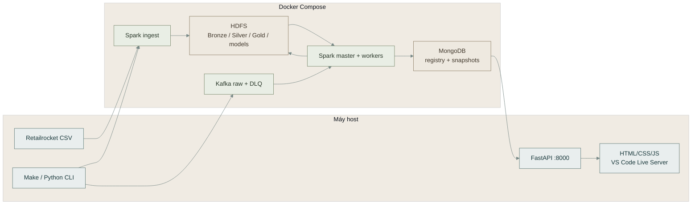

**Cách đọc:** Spark thực hiện batch và streaming trong Compose; API và web chỉ đọc snapshot đã công bố. Model không được fit lại khi streaming inference chạy.

### 2. Vòng đời dữ liệu và kiểm tra chất lượng

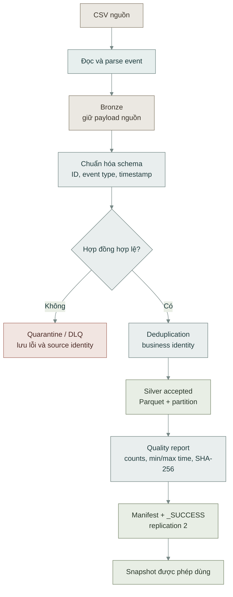

Kết quả Silver chỉ được sử dụng khi quality report, manifest, checksum và completion marker khớp nhau. Event bị loại vẫn giữ source topic, partition, offset và error code để điều tra.

### 3. Session, funnel và analytics

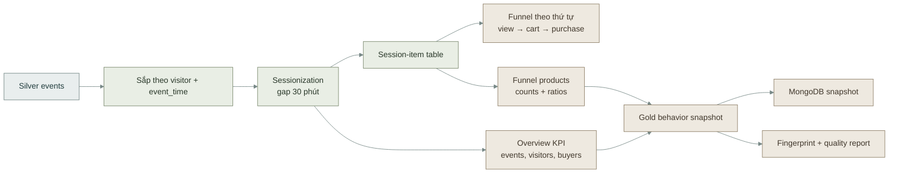

Overview và product funnel dùng cùng snapshot. Tỷ lệ funnel không được trộn với `cart_view_ratio_7d` hoặc `transaction_view_ratio_7d`, vì hai ratio ML chỉ là feature đếm trong cửa sổ 7 ngày.

### 4. Feature và K-Means training

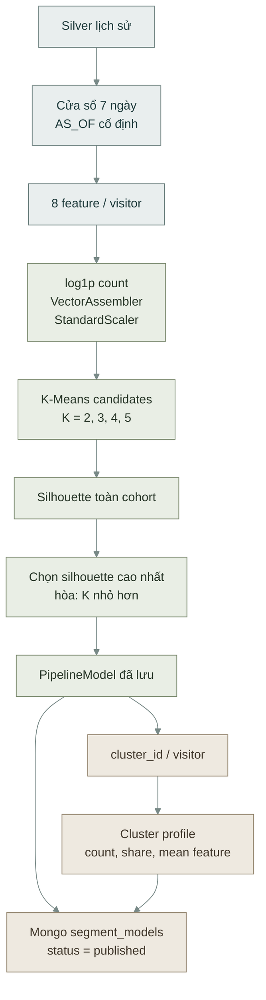

Tám feature theo đúng thứ tự hợp đồng là: `view_count_7d`, `cart_count_7d`, `transaction_count_7d`, `unique_items_7d`, `active_days_7d`, `recency_hours`, `cart_view_ratio_7d`, `transaction_view_ratio_7d`. `cluster_id` chỉ có ý nghĩa trong `model_version` tương ứng.

### 5. Nhãn mua hàng, Random Forest và policy

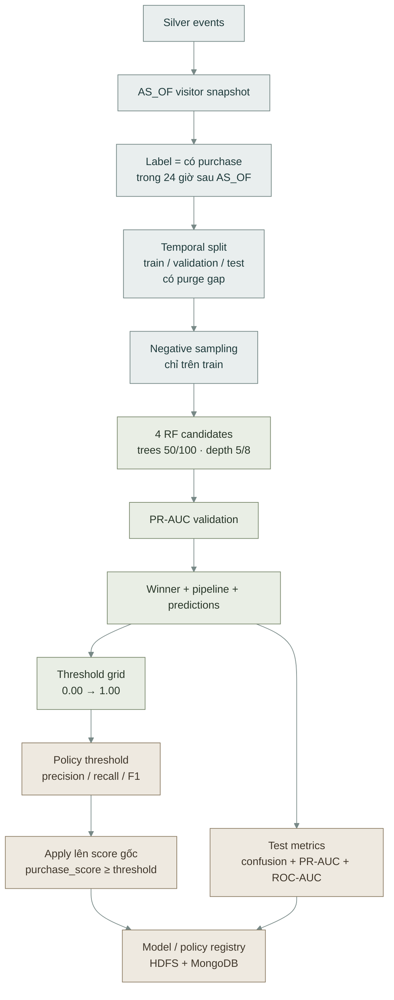

`purchase_score` là score dùng để xếp hạng và áp threshold. Nó không được đọc như xác suất mua đã hiệu chuẩn. Policy chỉ đổi `predicted_label`, giữ nguyên score, feature, model version và source fingerprint.

### 6. Streaming ML inference theo batch

```mermaid
%%{init: {"theme":"base","themeVariables":{"fontFamily":"Inter,Arial,sans-serif","primaryColor":"#e7efee","primaryTextColor":"#173638","primaryBorderColor":"#6f8583","lineColor":"#788987","secondaryColor":"#e9eee5","tertiaryColor":"#f0ebe3"}}}%%
flowchart LR
    PRODUCER["Replay / simulator / live producer"] --> KAFKA["Kafka raw topic"]
    KAFKA --> READ["Spark Structured Streaming"]
    READ --> VALIDATE{"Schema, source,<br/>range, duplicate, late?"}
    VALIDATE -- "Lỗi" --> DLQ["Kafka DLQ<br/>source topic/partition/offset"]
    VALIDATE -- "Accepted" --> BATCH["foreachBatch"]
    BATCH --> KPI["KPI + session + funnel"]
    BATCH --> FEAT["Feature 7 ngày"]
    FEAT --> MODELS["Frozen K-Means + RF + policy"]
    MODELS --> PRED["cluster_id<br/>purchase_score<br/>predicted_label"]
    KPI --> COMMIT["Gold batch snapshot"]
    PRED --> COMMIT
    COMMIT --> MONGO["Mongo published snapshot"]
    COMMIT --> CHECKPOINT["Spark checkpoint<br/>processed offsets"]
    MONGO --> POINTER["Committed run_id:batch_id"]
    CHECKPOINT --> POINTER
    classDef source fill:#e9eeee,stroke:#6f8381,color:#203c3d;
    classDef process fill:#e9eee5,stroke:#77866a,color:#293729;
    classDef result fill:#eee9e0,stroke:#8b7b63,color:#40372b;
    classDef error fill:#f1e5e1,stroke:#a66d62,color:#4a2925;
    class PRODUCER,KAFKA source;
    class READ,VALIDATE,BATCH,FEAT,MODELS process;
    class KPI,PRED,COMMIT,MONGO,CHECKPOINT,POINTER result;
    class DLQ error;
```

Một batch chỉ được coi là committed sau khi dữ liệu Gold và Mongo đã được kiểm tra. Checkpoint giúp retry lại batch; source identity và fingerprint giúp tránh ghi trùng khi retry.

### 7. Live demo: ACK, processed và chuyển lượt

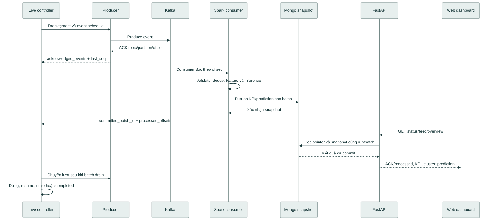

`ACK` chỉ chứng minh Kafka đã nhận event. `processed` chỉ xuất hiện khi Spark đã xử lý và batch snapshot đã commit. Backlog bằng 0 là điều kiện drain của snapshot, không phải xác nhận Kafka consumer group lag.

### 8. Snapshot consistency từ API đến web

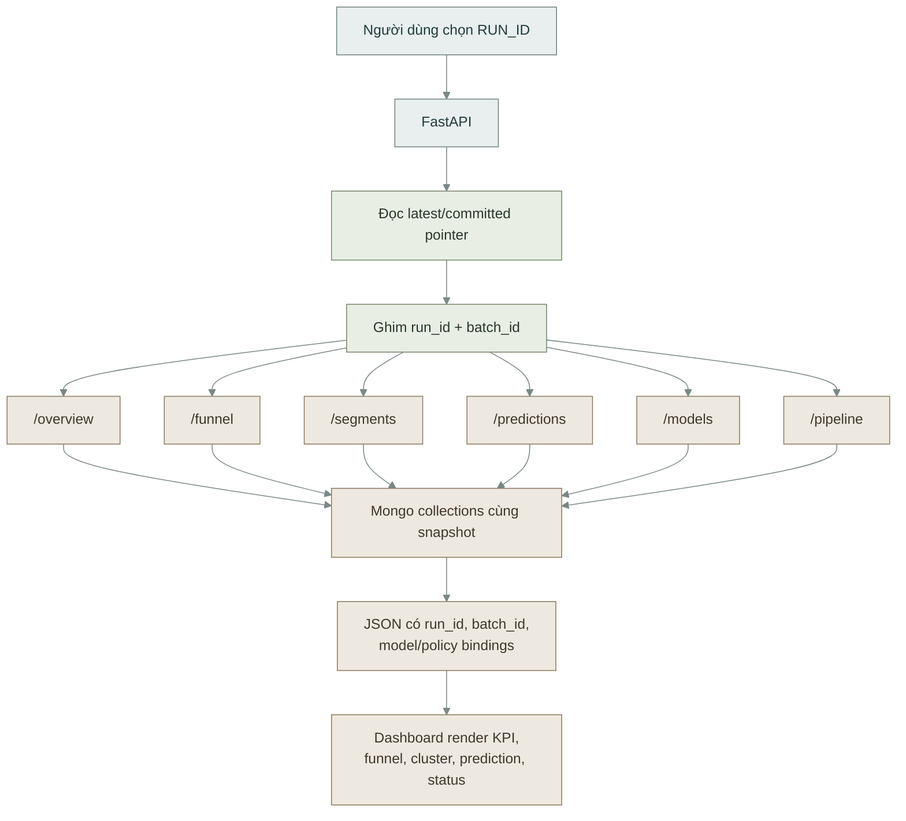

Dashboard không tự tính lại model. Nó đọc dữ liệu đã công bố và dùng cùng tọa độ snapshot để tránh trộn KPI của batch này với prediction của batch khác.

### 9. Bản đồ kết quả trên giao diện

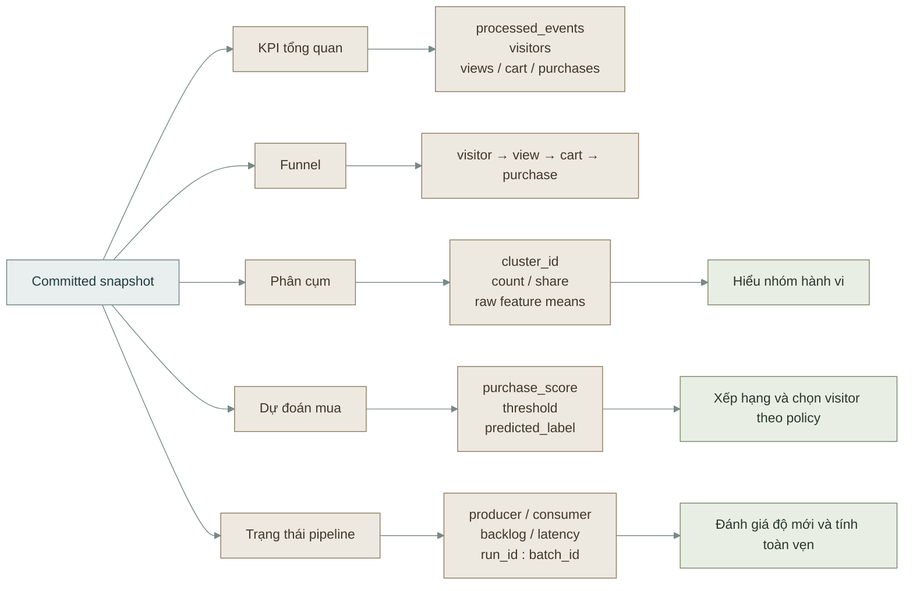

| Khu vực  | Câu hỏi trả lời                              | Nguồn chính                                          |
| -------- | -------------------------------------------- | ---------------------------------------------------- |
| KPI      | Có bao nhiêu event, visitor và buyer?        | `kpi_overview`                                       |
| Funnel   | Visitor rơi ở bước nào?                      | `funnel_overview`, `funnel_products`                 |
| Phân cụm | Các nhóm hành vi khác nhau thế nào?          | `segment_profiles`, `visitor_segments`               |
| Dự đoán  | Visitor nào có score vượt policy threshold?  | `stream_ml_predictions` hoặc purchase score snapshot |
| Pipeline | Dữ liệu đã ACK, processed và commit đến đâu? | run status, batch metadata, offsets                  |

### 10. Trạng thái run và khả năng phục hồi

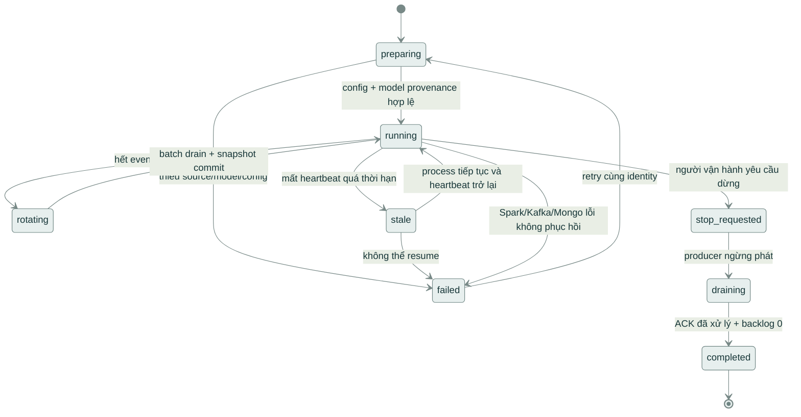

Retry cùng identity phải kiểm tra snapshot, manifest, checkpoint và source fingerprint. Không dùng một trạng thái `completed` của run khác để thay thế cho run đang kiểm tra.

### 11. Đánh giá mô hình ML và biểu đồ trên web

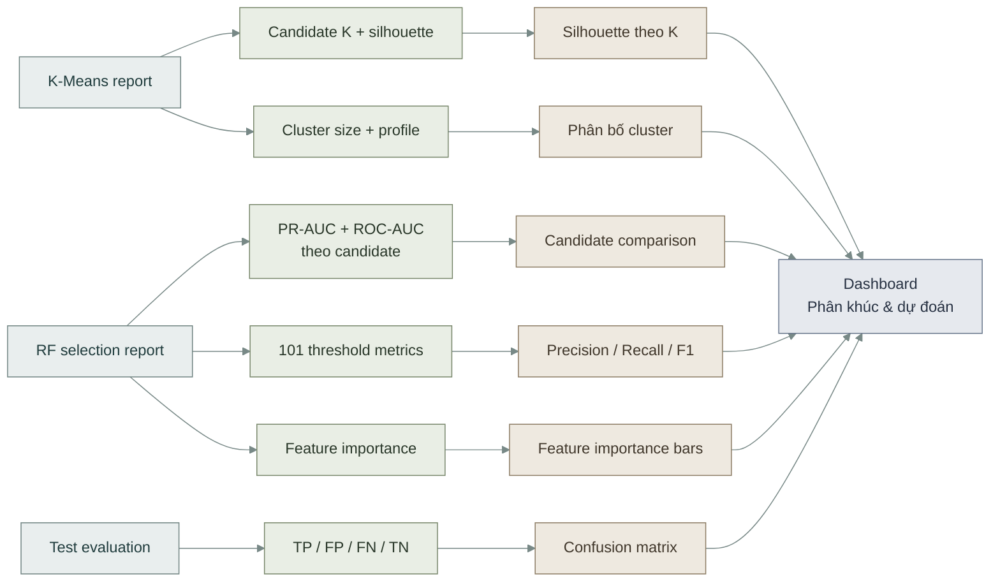

| Biểu đồ             | Dữ liệu                                          | Ý nghĩa đọc kết quả                                                                           |
| ------------------- | ------------------------------------------------ | --------------------------------------------------------------------------------------------- |
| Silhouette theo K   | `segments.report.candidates`                     | K được chọn có silhouette cao nhất theo contract; silhouette không phải accuracy dự đoán mua. |
| Candidate AUC       | `purchase.report.selection.candidates`           | So sánh khả năng xếp hạng của bốn cấu hình RF trên validation.                                |
| Threshold trade-off | `selection.threshold_grid`                       | Thấy precision, recall và F1 thay đổi khi đổi threshold; marker tách RF gốc và policy.        |
| Feature importance  | `selection.feature_importance`                   | Cho biết feature đóng góp tương đối vào winner; không phải quan hệ nhân quả.                  |
| Confusion matrix    | `policy.report.evaluation.test` hoặc test RF gốc | Đối chiếu TP, FP, FN, TN tại threshold đang đánh giá.                                         |
| Cluster size        | `/segments`                                      | Cho biết số visitor trong mỗi cụm của snapshot hiện tại.                                      |

Các biểu đồ test/policy là metric lịch sử từ cohort đã có nhãn. Prediction live chỉ có `purchase_score`, `cluster_id` và `predicted_label`; không dùng cohort live để tự suy ra precision/recall khi chưa có nhãn tương lai. `purchase_score` cũng không phải xác suất mua đã hiệu chuẩn.

### Liên kết tới tài liệu chi tiết

- Data contract và Silver (tham chiếu `../data/README.md`)
- Analytics, session và funnel (tham chiếu `../analytics/README.md`)
- Feature và K-Means (tham chiếu `../ml/02-methodology-and-architecture.md`)
- Random Forest (tham chiếu `../ml/06-random-forest.md`)
- Policy precision (tham chiếu `../ml/09-purchase-policy.md`)
- Streaming ML (tham chiếu `../ml/10-streaming-scoring.md`)
- Kiến trúc API/dashboard (tham chiếu `../serving/01-architecture.md`)
- Hướng dẫn đọc kết quả trên web (tham chiếu `../serving/06-web-user-guide.md`)

### Quy ước cập nhật

Khi thay đổi contract, feature order, model version, policy, snapshot hoặc trạng thái live, cập nhật sơ đồ liên quan cùng pull request. Không ghi cứng `run_id`, số lượng event hoặc metric của một máy cụ thể vào sơ đồ kiến trúc; số liệu thực tế phải đọc từ report của run.

## 2.6. Nguồn tài liệu: `docs/infra/README.md`

## Tài liệu hạ tầng

← Tài liệu dự án (tham chiếu `../README.md`)

Bộ tài liệu này giải thích phần hạ tầng Docker đã được xây dựng cho **E-commerce User Behavior Analytics Platform**: từng thành phần làm gì, vì sao cần có, phối hợp như thế nào và cách vận hành.

Developer mới dùng runbook từ khởi tạo đến policy precision (tham chiếu `../GETTING_STARTED.md`), gồm Linux và Windows/WSL2. Đọc kế hoạch sản phẩm (tham chiếu `../../IMPLEMENTATION_PLAN.md`) để xem mục tiêu đồ án tổng thể. Các giá trị và hành vi của bản triển khai hiện tại được xác định bởi Compose (tham chiếu `../../compose.yaml`), template môi trường (tham chiếu `../../.env.example`) và mã nguồn hạ tầng (tham chiếu `../../infra/`), thay vì các lựa chọn dự kiến trong kế hoạch.

### Thứ tự đọc

| Tài liệu                                                               | Trả lời câu hỏi                                                                          |
| ---------------------------------------------------------------------- | ---------------------------------------------------------------------------------------- |
| 01 — Kiến trúc (tham chiếu `01-architecture.md`)                       | Toàn bộ hệ thống hoạt động thế nào? Docker, Kafka, Spark, HDFS và MongoDB có vai trò gì? |
| 02 — Dịch vụ (tham chiếu `02-services.md`)                             | Mỗi container chạy gì, cần ai và cung cấp gì?                                            |
| 03 — Cấu hình (tham chiếu `03-configuration.md`)                       | Mỗi biến, cổng, giới hạn RAM/CPU và vùng lưu trữ có ý nghĩa gì?                          |
| 04 — Khởi tạo và vòng đời (tham chiếu `04-bootstrap-and-lifecycle.md`) | Từ setup đến sẵn sàng có những bước nào? Chạy lại có giữ dữ liệu không?                  |
| 05 — Vận hành (tham chiếu `05-operations.md`)                          | Dùng lệnh nào, khi nào dùng, kết quả và tác động ra sao?                                 |
| 06 — Kiểm thử (tham chiếu `06-testing.md`)                             | Mỗi phép kiểm tra chứng minh điều gì? Đọc kết quả ở đâu?                                 |
| 07 — Xử lý lỗi (tham chiếu `07-troubleshooting.md`)                    | Khi một bước thất bại thì kiểm tra và khắc phục thế nào?                                 |
| 08 — Bản đồ mã nguồn (tham chiếu `08-source-code-guide.md`)            | Cần đọc hoặc sửa file/hàm nào để hiểu một chức năng?                                     |
| 09 — Tối ưu build (tham chiếu `09-build-optimization.md`)              | Nguyên nhân tải chậm, Buildx, nguồn tải, cache và cách build tiếp.                       |
| 10 — Ngân sách RAM (tham chiếu `10-memory-budget.md`)                  | Phân bổ 7 GiB, cách áp dụng và theo dõi memory/OOM.                                      |

Người mới nên đọc 01 → 02 → 03 → 04. Khi chạy thực tế, dùng 05; khi đối chiếu kết quả, dùng 06; khi có lỗi, dùng 07. Tài liệu 08 dành cho người phát triển.

### Những gì đã được tạo

- Một Kafka broker kiêm KRaft controller và hai topic nghiệp vụ.
- Một HDFS NameNode, hai DataNode và các thư mục nền cho Data Lake.
- Một Spark master, hai worker và một container chạy driver/job.
- Một MongoDB instance với root account và application account riêng.
- Ba job khởi tạo chạy một lần.
- Dockerfile, cấu hình mạng, volume, giới hạn tài nguyên, healthcheck và script điều phối.
- Bộ kiểm thử offline, smoke test xuyên dịch vụ và kiểm tra dữ liệu qua vòng dừng/khởi động lại.

Tổng cộng **chín service thường trực** và **ba job init**. Trạng thái kỳ vọng sau khởi động là chín service `healthy` và ba init job `Exited (0)`.

### Ứng dụng trên hạ tầng và phần còn lại

- Dataset và mã ứng dụng được mount read-only vào Spark client. Job batch Bronze/Silver, validation, quarantine và quality report đã có artifact runtime xác nhận; xem tài liệu dữ liệu (tham chiếu `../data/README.md`).
- Các thư mục Bronze/Silver/Gold được init chuẩn bị; việc tạo thư mục không đồng nghĩa đã có dữ liệu nghiệp vụ.
- Topic raw và DLQ được dùng bởi replay/streaming KPI (tham chiếu `../streaming/README.md`), có validation, loại trùng và cách ly/DLQ; live suite và demo đã có artifact xác nhận.
- Smoke test độc lập với ứng dụng; session/funnel có kiểm thử riêng (tham chiếu `../analytics/04-testing.md`), feature/K-Means/RF và policy có tài liệu ML (tham chiếu `../ml/README.md`).
- Đã có huấn luyện K-Means/Random Forest, batch score/policy và pipeline ML streaming (tham chiếu `../ml/10-streaming-scoring.md`) có artifact nghiệm thu. FastAPI host + dashboard HTML/CSS/JS (tham chiếu `../serving/README.md`) chạy riêng bằng virtualenv/Live Server, không thêm container hạ tầng; serving thật còn chờ nghiệm thu.
- Spark UI và HDFS UI là giao diện quản trị kỹ thuật, không phải dashboard phân tích thương mại điện tử.

### Trạng thái kiểm chứng

Đối chiếu artifact đến **17/10/2026**; đây là bằng chứng lượt chạy trên máy bàn giao, không thay thế kiểm tra máy mới:

| Hạng mục                  | Bằng chứng/trạng thái                                                                                           |
| ------------------------- | --------------------------------------------------------------------------------------------------------------- |
| Kiểm tra cấu hình Compose | Đã đạt trong phiên triển khai                                                                                   |
| Kiểm thử offline hạ tầng  | 27 kiểm tra đã đạt; 7 test HTTP skipped vì môi trường cấm socket                                                |
| Cú pháp Python và Bash    | Đã kiểm tra                                                                                                     |
| Build image               | Có versions manifest và artifact runtime của cụm đã build                                                       |
| Smoke trên cụm thật       | Artifact smoke hiện có xác nhận sáu event, hai worker, checkpoint và Mongo upsert                               |
| Persistence trên cụm thật | Chưa có kết quả chạy xác nhận                                                                                   |
| Artifact runtime          | Có smoke, test-data/ingest, streaming, behavior, K-Means, RF và policy; trạng thái reuse từng phần ở runbook/ML |

Mô tả “kết quả mong đợi” trong các tài liệu là tiêu chí để đối chiếu khi thực thi. JSON minh họa không phải bằng chứng hệ thống đã chạy thành công.

### Quy ước đọc

- Lệnh được chạy từ **thư mục gốc repository**.
- `host` là môi trường chạy Docker CLI; container liên lạc bằng service name trong Docker network.
- Địa chỉ và thông số trong tài liệu là giá trị mặc định. Nếu đổi cấu hình local, cần dùng giá trị mới.
- Không đưa mật khẩu thật, nội dung cấu hình local hoặc credential vào tài liệu và ảnh chụp.
- Khi gặp khác biệt giữa tài liệu và bản kế hoạch cũ, đối chiếu mã nguồn và cấu hình hiện tại trước.

## 2.7. Nguồn tài liệu: `docs/infra/01-architecture.md`

## 01 — Kiến trúc và công dụng các công nghệ

← Mục lục (tham chiếu `README.md`)

### 1. Mục đích của phần hạ tầng

Hạ tầng tạo môi trường để dữ liệu sự kiện có thể đi từ nguồn phát đến hệ thống xử lý và lưu trữ. Mục tiêu trước mắt là chứng minh các thành phần kết nối đúng và có thể giữ dữ liệu qua lần khởi động lại; các bài toán phân tích và ML được xây tiếp trên môi trường này.

Một ví dụ trong bộ kiểm thử là gửi sáu event JSON vào Kafka, dùng Spark đọc thành DataFrame, ghi Parquet lên HDFS rồi đưa dữ liệu sang MongoDB. Nhờ đó, lỗi kết nối được phát hiện trước khi triển khai nghiệp vụ phức tạp.

### 2. Docker và Docker Compose

| Khái niệm      | Là gì?                                                                       | Công dụng trong dự án                                                  |
| -------------- | ---------------------------------------------------------------------------- | ---------------------------------------------------------------------- |
| Docker image   | Gói môi trường có filesystem, chương trình và dependency                     | Giữ phiên bản Java/Python/Spark/Hadoop nhất quán                       |
| Container      | Một tiến trình hoặc nhóm tiến trình chạy từ image với môi trường được cô lập | Chạy từng broker, node lưu trữ hoặc worker độc lập                     |
| Dockerfile     | Công thức build image                                                        | Cài Hadoop/Spark, thư viện và chuẩn bị quyền thư mục                   |
| Docker Compose | Khai báo và điều phối nhiều service                                          | Khởi động toàn cụm, nối mạng, gắn volume và quản lý dependency         |
| Docker network | Mạng kết nối các container                                                   | Cho phép truy cập `kafka`, `namenode`, `mongodb` bằng DNS service name |
| Named volume   | Vùng dữ liệu do Docker quản lý, tách khỏi vòng đời container                 | Giữ log Kafka, metadata/block HDFS và database MongoDB                 |
| Bind mount     | Gắn đường dẫn của host vào container                                         | Cung cấp cấu hình, script và dataset; bản hiện tại mount read-only     |

Container không phải một máy ảo độc lập. Hai DataNode trong Compose vẫn dùng tài nguyên của cùng máy vật lý.

### 3. Vai trò từng hệ thống

| Công nghệ      | Trách nhiệm                                           | Ví dụ                                              |
| -------------- | ----------------------------------------------------- | -------------------------------------------------- |
| Kafka          | Nhận, phân vùng và lưu event theo topic               | Producer gửi JSON; Spark đọc lại theo offset       |
| Spark          | Thực thi phép xử lý trên nhiều executor               | Parse JSON, cộng tổng, đọc/ghi DataFrame           |
| HDFS           | Lưu file thành block và quản lý bản sao trên DataNode | Lưu Parquet, checkpoint và Spark event log         |
| MongoDB        | Lưu document để ứng dụng truy vấn                     | Lưu record kết quả theo khóa, cập nhật bằng upsert |
| Python runtime | Chạy driver, client và script kiểm tra                | Gửi Kafka, kiểm tra MongoDB, nộp PySpark job       |

Kafka lưu event theo retention và offset; HDFS lưu file dài hạn theo đường dẫn; MongoDB phục vụ truy vấn document. Mỗi thành phần có mô hình dữ liệu và nhiệm vụ riêng.

### 4. Cấu trúc chạy thực tế

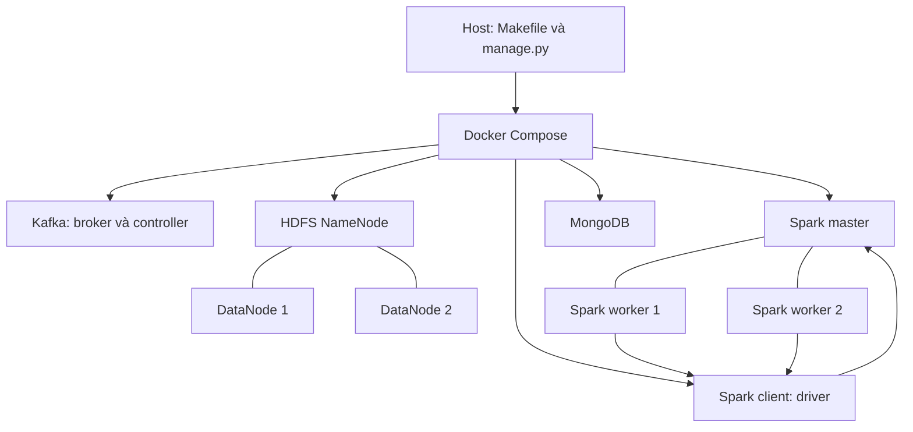

Compose quản lý vòng đời container. Spark master quản lý tài nguyên Spark bên trong cụm. Đây là hai tầng điều phối khác nhau.

### 5. Luồng dữ liệu được kiểm tra

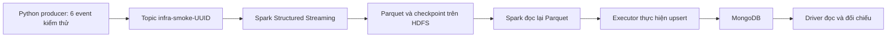

Các bước do smoke pipeline (tham chiếu `../../infra/smoke/pipeline.py`) thực hiện. Topic kiểm thử khác hai topic nghiệp vụ; dữ liệu được gắn run ID để có thể dọn riêng.

Checkpoint giữ tiến độ streaming. Trong kiểm thử, chạy lại cùng checkpoint phải giữ số record Parquet bằng sáu. Điều này chỉ xác minh kịch bản file sink đã viết trong test, không tự chứng minh mọi sink hoặc pipeline nghiệp vụ đều có ngữ nghĩa exactly-once.

### 6. Spark master, worker, driver và executor

- **Master:** nhận đăng ký worker, biết tổng core/bộ nhớ và phân phối tài nguyên cho ứng dụng.
- **Worker:** quản lý tiến trình executor trên node của nó.
- **Driver:** chạy chương trình điều khiển, tạo SparkSession và xây dựng kế hoạch thực thi.
- **Executor:** thực hiện task và giữ dữ liệu trung gian của ứng dụng.

Driver chạy trong `spark-client` bằng `spark-submit --deploy-mode client`. Hai worker có thể cấp hai executor, mỗi executor một core và heap 640 MiB. Việc có hai worker trong UI chỉ chứng minh đăng ký tài nguyên; smoke test còn kiểm tra hostname thực thi task để xác nhận cả hai thực sự được dùng.

### 7. HDFS NameNode và DataNode

NameNode biết tên file, thư mục và vị trí block. Nội dung block nằm trên DataNode. Client hỏi NameNode về metadata rồi trao đổi dữ liệu với DataNode.

`dfs.replication=2` yêu cầu hai bản sao block. Hai DataNode có volume riêng, vì vậy dừng/recreate một container không đồng nghĩa xóa cả hai vùng block.

NameNode có metadata riêng trên volume. Nếu mất metadata NameNode thì việc còn các file block chưa đủ để tự khôi phục toàn bộ namespace.

### 8. Những khái niệm dễ nhầm

| Khái niệm         | Ý nghĩa                                                                  |
| ----------------- | ------------------------------------------------------------------------ |
| Kafka partition   | Phần của log topic; thứ tự/offset được xác định trong từng partition     |
| Spark partition   | Phần dữ liệu được xử lý bởi task; không mặc định bằng số Kafka partition |
| HDFS block        | Đơn vị lưu trữ file của HDFS                                             |
| HDFS replica      | Bản sao block trên DataNode                                              |
| Healthcheck       | Kiểm tra một service theo phép thử đã khai báo                           |
| Cluster readiness | Kiểm tra các service và cấu hình cần thiết có phối hợp đúng chưa         |

Ba partition trên một Kafka broker không tạo ra ba broker hoặc khả năng chịu lỗi broker. Hai bản sao HDFS trên cùng một máy không bảo vệ khỏi mất cả máy hoặc ổ đĩa chung. Bản triển khai hiện tại không cấu hình Kafka, NameNode, Spark master hoặc MongoDB ở chế độ HA.

### 9. Nguồn đối chiếu

- Compose và topology (tham chiếu `../../compose.yaml`)
- Cấu hình Hadoop (tham chiếu `../../infra/config/hadoop/hdfs-site.xml`)
- Cấu hình Spark (tham chiếu `../../infra/config/spark/spark-defaults.conf`)
- Chi tiết từng service (tham chiếu `02-services.md`)
- Ý nghĩa kiểm thử (tham chiếu `06-testing.md`)

## 2.8. Nguồn tài liệu: `docs/infra/02-services.md`

## 02 — Chức năng từng service

← Mục lục (tham chiếu `README.md`)

Tên dưới đây là **service name** trong Compose (tham chiếu `../../compose.yaml`), không phải tên container cố định. Compose thêm namespace project vào tên tài nguyên.

### 1. Tổng quan tài nguyên

| Service          | Bộ nhớ container | CPU tối đa | Tiến trình/nhiệm vụ                      |
| ---------------- | ---------------: | ---------: | ---------------------------------------- |
| `kafka`          |          768 MiB |       0,75 | Kafka broker và KRaft controller         |
| `namenode`       |          512 MiB |        0,5 | HDFS NameNode                            |
| `datanode-1`     |          384 MiB |        0,5 | HDFS DataNode                            |
| `datanode-2`     |          384 MiB |        0,5 | HDFS DataNode                            |
| `spark-master`   |          384 MiB |       0,25 | Spark Standalone master                  |
| `spark-worker-1` |        1.280 MiB |          1 | Worker và executor của nó                |
| `spark-worker-2` |        1.280 MiB |          1 | Worker và executor của nó                |
| `spark-client`   |          896 MiB |          1 | Container công cụ và driver khi chạy job |
| `mongodb`        |          512 MiB |        0,5 | MongoDB server                           |
| `kafka-init`     |          256 MiB |       0,25 | Tạo/kiểm tra topic                       |
| `hdfs-init`      |          256 MiB |       0,25 | Đợi HDFS và tạo thư mục                  |
| `mongo-init`     |          192 MiB |       0,25 | Tạo application account và marker        |

Chín service đầu chạy thường trực. Ba init job chạy rồi thoát. Tổng giới hạn thường trực là 6,25 GiB và sáu CPU logic; init bổ sung tối đa 704 MiB và 0,75 CPU khi cùng chạy. Tổng cộng 7.104 MiB (6,9375 GiB), dưới ngân sách 7 GiB. Xem ngân sách RAM (tham chiếu `10-memory-budget.md`).

### 2. Kafka

**Công dụng:** giữ event để consumer đọc theo offset; nguồn và bộ xử lý không phải thực thi cùng một tiến trình.

- Dùng image Kafka 3.9.1 khóa digest.
- Một process thực hiện cả vai trò broker và KRaft controller; không cần ZooKeeper.
- Listener `INTERNAL` ở `kafka:9092` cho container.
- Listener `HOST` được quảng bá bằng địa chỉ loopback/cổng host.
- Controller dùng `9093` trong network.
- Log dữ liệu nằm ở `/var/lib/kafka/data` trên volume `kafka-data`.
- Startup guard so cluster ID trong metadata với cấu hình trước khi gọi launcher chính thức.
- Heap server khởi đầu 128 MiB, tối đa 384 MiB; heap khác giới hạn container.

Healthcheck gọi Kafka API versions, không chỉ kiểm tra cổng TCP. Khi broker dừng, producer/consumer và job liên quan không thể trao đổi dữ liệu cho đến khi broker phục hồi. Bản hiện tại không có broker dự phòng.

```bash
docker compose logs --tail 100 kafka
docker compose exec -T kafka /opt/kafka/bin/kafka-topics.sh --bootstrap-server kafka:9092 --list
```

Kỳ vọng khi init hoàn tất: có `ecommerce.events.raw` và `ecommerce.events.dlq`.

### 3. HDFS NameNode

**Công dụng:** quản lý namespace, metadata file và thông tin block của DataNode.

- Dùng image Hadoop tự build, Java 11.
- Chạy `hdfs namenode` ở foreground.
- Metadata nằm ở `/var/lib/hadoop/name` trên volume riêng.
- RPC `9000`; UI/JMX `9870`.
- Heap tối đa 256 MiB trong container 512 MiB.
- Startup chỉ format khi thư mục metadata rỗng; metadata không khớp sẽ làm startup thất bại.

Healthcheck gọi JMX của chính NameNode. Nó không chờ đủ hai DataNode, vì DataNode lại phụ thuộc NameNode sẵn sàng.

Khi NameNode dừng, client không thực hiện được các thao tác namespace thông thường, dù block vẫn còn trên DataNode.

```bash
docker compose logs --tail 100 namenode
docker compose exec -T namenode hdfs dfsadmin -report
```

Kỳ vọng sau bootstrap: report hiển thị hai live DataNode.

### 4. Hai HDFS DataNode

**Công dụng:** lưu block và cung cấp nội dung file cho client; thực hiện sao chép block theo chỉ dẫn HDFS.

- Cùng image Hadoop nhưng khác hostname và volume.
- Chạy `hdfs datanode`.
- Dữ liệu ở `/var/lib/hadoop/data`.
- Heap tối đa 192 MiB trong container 384 MiB.
- Cổng nội bộ: transfer `9866`, IPC `9867`, HTTP/JMX `9864`.
- Đợi NameNode healthy trước khi khởi chạy.
- Healthcheck kiểm tra JMX DataNode; số node đã đăng ký được kiểm tra thêm ở init/readiness.

Dừng một DataNode làm mất tạm thời một nơi chứa replica; mức đọc/ghi còn thực hiện được phụ thuộc block và trạng thái HDFS. Readiness của bản triển khai yêu cầu đủ hai node. Nếu NameNode khởi động lại khi chỉ còn một node, cấu hình safe mode tối thiểu hai DataNode có thể ngăn cụm ra khỏi safe mode.

```bash
docker compose logs --tail 100 datanode-1 datanode-2
docker compose exec -T namenode hdfs fsck /ecommerce -files -blocks -locations
```

### 5. Spark master

**Công dụng:** quản lý danh sách worker và phân phối tài nguyên cho ứng dụng Spark.

- Dùng image Spark 3.5.7, Scala 2.12, Java 17, Python 3.11.
- Khởi động class `org.apache.spark.deploy.master.Master`.
- RPC `7077`; UI/JSON `18080`.
- Heap daemon 128 MiB; container 384 MiB.
- Không trực tiếp đảm nhiệm các task xử lý dữ liệu của executor.
- Healthcheck đọc JSON UI. Readiness kiểm tra thêm hai worker ở trạng thái `ALIVE`.

Khi master dừng, việc đăng ký và phân phối tài nguyên mới bị ảnh hưởng. Bản hiện tại không cấu hình master dự phòng.

```bash
docker compose logs --tail 100 spark-master
docker compose exec -T spark-client python3 /opt/infra/smoke/readiness.py --once
```

### 6. Hai Spark worker

**Công dụng:** tạo và quản lý executor dùng để thực thi task.

- Mỗi worker quảng bá một core, 640 MiB executor memory.
- Container giới hạn 1.280 MiB để chừa phần cho worker daemon, Python và overhead. Hai worker chạy tối đa hai task đồng thời.
- Heap worker daemon 128 MiB.
- UI lần lượt `18081` và `18082`.
- Scratch/work directory ở `/tmp/spark-local` và `/tmp/spark-work`.
- Healthcheck gọi JSON UI; master xác nhận worker đã đăng ký.

Scratch không phải vùng lưu trữ lâu dài. Khi worker mất, task của ứng dụng có thể cần thực thi lại; đây không phải kiểm thử phục hồi ứng dụng nghiệp vụ đã được xác nhận.

```bash
docker compose logs --tail 100 spark-worker-1 spark-worker-2
```

Mở master UI để xem worker đăng ký; dùng smoke test để xác nhận task chạy trên cả hai.

### 7. Spark client

**Công dụng:** cung cấp môi trường chạy Python, Kafka client, MongoDB client và Spark driver.

- Khi chưa chạy job, command là `sleep infinity` để có thể dùng `docker compose exec`.
- Nhận cấu hình Hadoop/Spark, script smoke và dataset mount read-only.
- Nhận application credential MongoDB; không nhận root password.
- Driver bind `0.0.0.0`, quảng bá `spark-client`, dùng cổng RPC `39001` và driver block manager `39002`.
- UI ứng dụng ở `14040` chỉ xuất hiện khi có ứng dụng chạy.
- Heap driver 512 MiB; container 896 MiB. Giới hạn tổng kết quả serialize trả về driver là 128 MiB.
- Chỉ khởi chạy sau ba job init thành công và hai worker healthy.
- Healthcheck xác nhận topology, topic và khả năng đọc bootstrap metadata MongoDB.

Driver điều phối ứng dụng đang chạy; dừng client trong lúc có job có thể làm ứng dụng đó thất bại. Mất client không tự xóa dữ liệu trong HDFS/Kafka/MongoDB.

```bash
docker compose exec spark-client bash
docker compose exec -T spark-client python3 --version
```

### 8. MongoDB

**Công dụng:** lưu document để truy vấn bằng khóa và cập nhật kết quả.

- Image nhánh 8.0 được khóa bằng digest.
- Chạy `mongod` với WiredTiger cache 0,25 GiB.
- Dữ liệu ở `/data/db` trên volume `mongodb-data`.
- Cổng container `27017`, cổng host mặc định `27018`.
- Authentication bật qua root account khi khởi tạo.
- Application account chỉ có `readWrite` trên database `ecommerce`.
- Healthcheck dùng `mongosh` xác thực root rồi ping; password lấy từ environment, không đưa vào command argument.

Bộ kiểm thử dùng các collection `infra_metadata`, `infra_smoke` và `infra_persistence`. Chưa có collection kết quả ML nghiệp vụ.

Khi MongoDB dừng, lưu/truy vấn document thất bại; Kafka và HDFS có vùng dữ liệu riêng, nhưng job nào cần MongoDB sẽ không hoàn tất đúng.

### 9. Ba job init

| Job          | Phụ thuộc                     | Làm gì?                                                            | Hành vi chạy lại                                    |
| ------------ | ----------------------------- | ------------------------------------------------------------------ | --------------------------------------------------- |
| `kafka-init` | Kafka healthy                 | Tạo hai topic nếu thiếu, kiểm tra partitions/RF/retention          | Giữ topic đúng; báo lỗi khi cấu hình quan trọng sai |
| `hdfs-init`  | NameNode và DataNodes healthy | Đợi hai live DataNode, safe mode OFF, tạo thư mục và đặt quyền gốc | Giữ thư mục/dữ liệu hiện có                         |
| `mongo-init` | MongoDB healthy               | Tạo app user nếu thiếu, tạo marker và xác nhận app login           | Giữ account; không tự rotate password               |

`Exited (0)` nghĩa là công việc đã hoàn tất thành công. `Exited` với mã khác 0 cần được chẩn đoán. Các job dùng `restart: "no"` để lỗi không bị che bằng vòng restart vô hạn.

```bash
docker compose logs --tail 100 kafka-init hdfs-init mongo-init
```

Đọc tiếp cấu hình (tham chiếu `03-configuration.md`) và vòng đời khởi tạo (tham chiếu `04-bootstrap-and-lifecycle.md`).

## 2.9. Nguồn tài liệu: `docs/infra/03-configuration.md`

## 03 — Giải thích cấu hình

← Mục lục (tham chiếu `README.md`)

Nguồn giá trị là template môi trường (tham chiếu `../../.env.example`), Compose (tham chiếu `../../compose.yaml`), Hadoop XML (tham chiếu `../../infra/config/hadoop/`) và Spark defaults (tham chiếu `../../infra/config/spark/spark-defaults.conf`).

### 1. Cấu hình trên host và trong container

`.env.example` là template có thể đưa vào Git. `make setup` tạo cấu hình local với ID/mật khẩu thật; file local không được đưa vào Git.

Script quản lý (tham chiếu `../../infra/manage.py`) đọc và kiểm tra biến trước khi điều khiển Compose. Khi gọi tiến trình con, nó bỏ các biến project cùng tên khỏi environment kế thừa để cấu hình trong file local không bị shell cha ghi đè ngoài ý muốn. Các thiết lập Docker như `DOCKER_HOST` vẫn được giữ.

Quy tắc này áp dụng cho lệnh chạy qua Makefile/script quản lý. Nếu gọi trực tiếp `docker compose` thì cần lưu ý quy tắc ưu tiên biến của chính Compose.

Ví dụ không chứa credential thật:

```dotenv
COMPOSE_PROJECT_NAME=ecommerce-analytics
DATASET_PATH=./Dataset/retailrocket-recommender-system-dataset
MONGO_DATABASE=ecommerce
MONGO_USERNAME=analytics
```

Giữ nguyên mật khẩu/cluster ID đã sinh khi dùng lại volume hiện có. Không chạy shell `source` file cấu hình để “nạp” credential.

### 2. Danh mục biến môi trường

| Biến                        | Mặc định/template                                   | Công dụng và ảnh hưởng khi đổi                                                                                              |
| --------------------------- | --------------------------------------------------- | --------------------------------------------------------------------------------------------------------------------------- |
| `COMPOSE_PROJECT_NAME`      | `ecommerce-analytics`                               | Namespace container, network, volume và tên custom image; đổi tên tạo namespace khác, không tự chuyển dữ liệu cũ            |
| `DATASET_PATH`              | `./Dataset/retailrocket-recommender-system-dataset` | Nguồn bind mount dataset; phải tồn tại và chứa đủ bốn CSV                                                                   |
| `KAFKA_IMAGE`               | Kafka 3.9.1 kèm digest                              | Chọn đúng image Kafka; validator yêu cầu digest SHA-256                                                                     |
| `MONGO_IMAGE`               | MongoDB 8.0 kèm digest                              | Chọn đúng image MongoDB; tag và digest thật nằm trong template                                                              |
| `KAFKA_CLUSTER_ID`          | `__GENERATE__`                                      | Setup sinh UUID dạng Kafka một lần; phải khớp metadata đã lưu                                                               |
| `HDFS_CLUSTER_ID`           | `CID-ecommerce-analytics`                           | Định danh HDFS; startup đối chiếu với VERSION của storage đã khởi tạo                                                       |
| `MONGO_ROOT_USERNAME`       | `admin`                                             | Account bootstrap MongoDB                                                                                                   |
| `MONGO_ROOT_PASSWORD`       | `__GENERATE__`                                      | Setup sinh password root; đổi file không tự đổi account trong database                                                      |
| `MONGO_DATABASE`            | `ecommerce`                                         | Database của ứng dụng và nơi cấp quyền app user                                                                             |
| `MONGO_USERNAME`            | `analytics`                                         | Application account có quyền readWrite trên database ứng dụng                                                               |
| `MONGO_PASSWORD`            | `__GENERATE__`                                      | Password ứng dụng, độc lập với root password                                                                                |
| `KAFKA_HOST_PORT`           | `19092`                                             | Cổng Kafka trên host; được dùng cả khi quảng bá listener HOST                                                               |
| `MONGO_HOST_PORT`           | `27018`                                             | Cổng MongoDB trên host; cổng nội bộ vẫn là 27017                                                                            |
| `HDFS_UI_PORT`              | `9870`                                              | Cổng host cho NameNode UI                                                                                                   |
| `SPARK_MASTER_UI_PORT`      | `18080`                                             | Cổng host cho master UI                                                                                                     |
| `SPARK_WORKER_1_UI_PORT`    | `18081`                                             | Cổng host cho worker 1 UI                                                                                                   |
| `SPARK_WORKER_2_UI_PORT`    | `18082`                                             | Cổng host cho worker 2 UI                                                                                                   |
| `SPARK_APPLICATION_UI_PORT` | `14040`                                             | Cổng host cho driver UI, chỉ có khi ứng dụng chạy                                                                           |
| `MIN_AVAILABLE_RAM_GIB`     | `7`                                                 | Ngưỡng preflight; tổng giới hạn container gồm init không được vượt ngưỡng này; không trực tiếp cấu hình Docker memory limit |
| `MIN_DOCKER_DISK_GIB`       | `30`                                                | Ngưỡng dung lượng trống tại Docker data partition khi kiểm tra được                                                         |

Validator còn kiểm tra biến thiếu, giá trị chưa sinh, format project/cluster ID, cổng trong khoảng 1024–65535, cổng không trùng và image có digest.

Mặc định ngân sách 7 GiB bao phủ 6,25 GiB limit thường trực và 704 MiB init. Giảm biến môi trường không tự giảm các limit trong Compose; preflight sẽ báo lỗi nếu tổng limit lớn hơn ngân sách. Xem phân bổ RAM và cách áp dụng (tham chiếu `10-memory-budget.md`).

Setup dùng hai lần `secrets.token_hex(24)` để sinh hai password 48 ký tự hex độc lập. Tài liệu chỉ mô tả cách sinh, không ghi giá trị local.

### 3. Endpoint container và host

| Mục đích                  | Trong network                       | Host mặc định                       |
| ------------------------- | ----------------------------------- | ----------------------------------- |
| Kafka data                | `kafka:9092`                        | `127.0.0.1:19092`                   |
| Kafka controller          | `kafka:9093`                        | Không publish                       |
| HDFS RPC                  | `namenode:9000`                     | Không publish                       |
| NameNode UI/JMX           | `namenode:9870`                     | `127.0.0.1:9870`                    |
| DataNode transfer/IPC/JMX | `9866 / 9867 / 9864` trên từng node | Không publish                       |
| Spark master RPC          | `spark-master:7077`                 | Không publish                       |
| Spark master UI           | `spark-master:18080`                | `127.0.0.1:18080`                   |
| Worker UI                 | `18081` hoặc `18082`                | Cùng số cổng mặc định trên loopback |
| Driver RPC                | `spark-client:39001`                | Không publish                       |
| Driver block manager      | `spark-client:39002`                | Không publish                       |
| Driver UI                 | `spark-client:14040`                | `127.0.0.1:14040`                   |
| MongoDB                   | `mongodb:27017`                     | `127.0.0.1:27018`                   |

`127.0.0.1` trong container là chính container đó. Ví dụ Spark không dùng Kafka host listener để kết nối nội bộ.

Đổi cổng publish không đổi cổng bên trong container. Khi đổi cổng UI host, mở URL mới trực tiếp; các liên kết UI quảng bá theo cổng nội bộ có thể không phản ánh cổng host đã đổi.

### 4. Cấu hình Kafka

- `process.roles=broker,controller`: một node đảm nhiệm cả hai vai trò.
- `node.id=1` và quorum voters `1@kafka:9093`: controller quorum một node.
- `INTERNAL`, `HOST`, `CONTROLLER`: tách địa chỉ cho client container, client host và điều khiển.
- `auto.create.topics.enable=false`: tên topic sai không âm thầm tạo topic mới.
- Topic nội bộ offsets/transaction có replication 1 để phù hợp một broker.
- `min.insync.replicas=1`: yêu cầu phù hợp topology một broker; không tạo thêm bản sao.
- Retention raw/DLQ là `172800000` ms, tương đương 48 giờ.
- Producer smoke bật idempotence và `acks=all`; broker đơn vẫn là điểm lỗi đơn.

Raw có ba partition; DLQ có một partition. Init kiểm tra cả partitions, replication factor và retention. Init báo lỗi khi topic hiện hữu sai cấu hình thay vì tự xóa topic.

### 5. Cấu hình Hadoop

| Thuộc tính                            | Giá trị                       | Công dụng                                                     |
| ------------------------------------- | ----------------------------- | ------------------------------------------------------------- |
| `fs.defaultFS`                        | `hdfs://namenode:9000`        | Filesystem mặc định cho đường dẫn HDFS                        |
| `dfs.replication`                     | `2`                           | Số replica mục tiêu khi tạo file                              |
| `dfs.namenode.name.dir`               | `file:///var/lib/hadoop/name` | Metadata NameNode                                             |
| `dfs.datanode.data.dir`               | `file:///var/lib/hadoop/data` | Block DataNode                                                |
| `dfs.client.use.datanode.hostname`    | `true`                        | Client kết nối DataNode qua hostname                          |
| `dfs.datanode.use.datanode.hostname`  | `true`                        | DataNode trao đổi với nhau qua hostname                       |
| `dfs.namenode.safemode.min.datanodes` | `2`                           | Yêu cầu tối thiểu hai DataNode để đáp ứng điều kiện safe mode |
| `hadoop.http.staticuser.user`         | `analytics`                   | User tĩnh cho truy cập HTTP không xác thực                    |

Đây là môi trường local chưa cấu hình Kerberos. Dịch vụ và Spark chạy bằng user `analytics`; `hdfs-init` tạo gốc `/ecommerce` với mode 750.

### 6. Cấu hình Spark

| Thuộc tính                                            | Giá trị                                       | Ý nghĩa                                                    |
| ----------------------------------------------------- | --------------------------------------------- | ---------------------------------------------------------- |
| `spark.master`                                        | `spark://spark-master:7077`                   | Nộp task lên cụm Standalone                                |
| `spark.submit.deployMode`                             | `client`                                      | Driver ở container nộp job                                 |
| `spark.cores.max`                                     | `2`                                           | Tổng số core tối đa cấp cho ứng dụng                       |
| `spark.executor.cores`                                | `1`                                           | Số task slot CPU trên mỗi executor                         |
| `spark.executor.memory`                               | `640m`                                        | Heap executor, không phải toàn bộ RSS của tiến trình       |
| `spark.driver.memory`                                 | `512m`                                        | Heap driver                                                |
| `spark.driver.maxResultSize`                          | `128m`                                        | Tổng kết quả serialize tối đa trả về driver cho mỗi action |
| `spark.sql.shuffle.partitions`                        | `4`                                           | Số partition mặc định cho nhiều phép shuffle SQL           |
| `spark.default.parallelism`                           | `4`                                           | Parallelism mặc định cho một số thao tác RDD               |
| `spark.dynamicAllocation.enabled`                     | `false`                                       | Không tự thay số executor theo tải                         |
| `spark.driver.host`                                   | `spark-client`                                | Địa chỉ executor gọi về driver                             |
| `spark.driver.bindAddress`                            | `0.0.0.0`                                     | Driver lắng nghe trên các interface container              |
| `spark.driver.port`                                   | `39001`                                       | RPC driver cố định                                         |
| `spark.driver.blockManager.port`                      | `39002`                                       | Cổng block manager của driver                              |
| `spark.ui.port`                                       | `14040`                                       | UI ứng dụng                                                |
| `spark.sql.session.timeZone`                          | `UTC`                                         | Quy ước timezone cho xử lý SQL                             |
| `spark.eventLog.enabled`                              | `true`                                        | Ghi event log ứng dụng                                     |
| `spark.eventLog.dir`                                  | `hdfs://namenode:9000/ecommerce/spark-events` | Nơi giữ event log                                          |
| `spark.pyspark.python`, `spark.pyspark.driver.python` | `/usr/local/bin/python3`                      | Đồng nhất Python driver/executor                           |

Mỗi worker quảng bá một core và 640 MiB executor memory, container được cấp 1.280 MiB. Phần chênh lệch còn cần cho worker daemon, Python, native buffer và JVM overhead; không nên tăng heap đến bằng container limit.

CPU quota container không phải thao tác ghim vào một core vật lý. Số core Spark cũng không có nghĩa tạo thêm CPU cho máy chủ.

### 7. Storage và vòng đời dữ liệu

| Vùng                         | Nội dung                               | Sau `down`                 | Sau `reset`                               |
| ---------------------------- | -------------------------------------- | -------------------------- | ----------------------------------------- |
| Năm named volume chính       | Kafka, NameNode, hai DataNode, MongoDB | Giữ                        | Xóa trong phạm vi project                 |
| Dataset bind mount           | CSV do người dùng cung cấp             | Giữ trên host              | Giữ trên host                             |
| Config/script bind mount     | Mã/cấu hình repository                 | Giữ                        | Giữ                                       |
| Scratch container            | Dữ liệu tạm executor                   | Không dùng làm dữ liệu bền | Không bảo đảm giữ                         |
| `artifacts/infra/` trên host | Log và báo cáo script                  | Giữ                        | Lệnh reset hiện tại không xóa thư mục này |

Image gốc có thể khai báo thêm anonymous volume cho đường dẫn phụ. Năm named volume trong Compose là các vùng dữ liệu chính được dự án chủ động định nghĩa.

#### Các thư mục HDFS

| Đường dẫn                 | Mục đích đã chuẩn bị                           |
| ------------------------- | ---------------------------------------------- |
| `/ecommerce/bronze`       | Snapshot bốn CSV Retailrocket nguyên bản       |
| `/ecommerce/silver`       | Event chuẩn hóa, quarantine và duplicate audit |
| `/ecommerce/gold`         | Aggregate/feature nghiệp vụ sau này            |
| `/ecommerce/models`       | Model artifact sau khi có training             |
| `/ecommerce/checkpoints`  | Checkpoint nghiệp vụ sau này                   |
| `/ecommerce/spark-events` | Event log Spark đã được bật trong cấu hình     |
| `/ecommerce/_smoke`       | Dữ liệu kiểm thử hạ tầng                       |

Smoke dùng checkpoint riêng trong thư mục của từng run dưới `_smoke`, không dùng gốc checkpoint nghiệp vụ.

Job ingestion tạo snapshot bên dưới Bronze/Silver khi chạy `make ingest`; xem layout dữ liệu (tham chiếu `../data/02-contract-and-storage.md`). `make test-data` dùng namespace UUID riêng dưới `/ecommerce/_tests/ingest`.

### 8. Khóa phiên bản và thay đổi cấu hình

Kafka/MongoDB được khóa image digest trong template; base Python/Java được khóa digest trong Dockerfile. Binary Hadoop/Spark và bốn JAR được kiểm tra SHA-512. Python dependency được khóa trong requirements (tham chiếu `../../infra/spark/requirements.txt`).

Package hệ điều hành được lấy từ repository lúc build; không tuyên bố build hermetic từng byte. Custom image local có image ID trong manifest sau khi build, nhưng có thể chưa có RepoDigest nếu chưa được đẩy lên registry.

| Loại thay đổi                                    | Cách áp dụng                                                           |
| ------------------------------------------------ | ---------------------------------------------------------------------- |
| Cổng publish hoặc cấu hình service trong Compose | Sửa cấu hình rồi `make up`; kiểm tra readiness                         |
| XML Hadoop hoặc Spark defaults bind mount        | Dừng/khởi động lại cụm để tiến trình đọc lại cấu hình                  |
| Dockerfile hoặc dependency                       | `make build` rồi `make up`                                             |
| MongoDB password đã tồn tại                      | Đổi account trong database tường minh hoặc khôi phục giá trị khớp      |
| Kafka/HDFS cluster ID đã tồn tại                 | Giữ/khôi phục ID khớp dữ liệu; không dùng thay đổi ID như cách restart |
| Project name                                     | Xem như namespace khác; cần kế hoạch riêng nếu muốn chuyển dữ liệu     |

Đọc tiếp vòng đời (tham chiếu `04-bootstrap-and-lifecycle.md`) và vận hành (tham chiếu `05-operations.md`).

## 2.10. Nguồn tài liệu: `docs/infra/04-bootstrap-and-lifecycle.md`

## 04 — Khởi tạo và vòng đời

← Mục lục (tham chiếu `README.md`)

Phần này giải thích những gì xảy ra bên trong lệnh vận hành, dựa trên script quản lý (tham chiếu `../../infra/manage.py`) và Compose (tham chiếu `../../compose.yaml`).

### 1. Toàn bộ quá trình

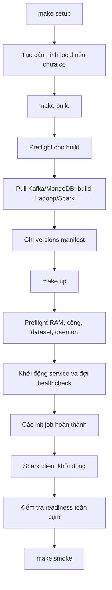

Mỗi bước có thể thất bại và trả mã khác 0. Không nên coi việc command trước đã được gõ là bằng chứng bước đó thành công.

### 2. Setup: tạo định danh một lần

`make setup`:

1. Đọc template.
2. Nếu file local đã tồn tại, validate rồi giữ nguyên.
3. Nếu chưa có, sinh Kafka UUID và hai password độc lập.
4. Tạo file với mode 0600 và cơ chế không ghi đè file đã tồn tại.
5. Validate nội dung đã tạo.

Nếu file hiện hữu thiếu biến hoặc còn `__GENERATE__`, setup báo lỗi. Nó không sửa âm thầm hoặc thay password/cluster ID.

Setup không truy cập daemon, chưa tạo container, topic hoặc thư mục HDFS.

### 3. Build: chuẩn bị phần mềm trong image

`make build` kiểm tra plugin Buildx và từ chối `DOCKER_BUILDKIT=0` trước khi pull image. Preflight build kiểm tra Docker/Compose, kiến trúc, CPU/AVX, dataset, cấu hình và disk khi thấy Docker data partition. Nó bỏ kiểm tra RAM khả dụng và xung đột cổng vì chưa khởi động toàn bộ cụm.

Sau đó:

- Pull image Kafka và MongoDB theo digest.
- Build image Hadoop qua service `namenode`.
- Build image Spark qua service `spark-master`.
- Các service cùng nhóm sử dụng lại image vừa build.
- Ghi image ID/digest và phiên bản Docker/Compose vào `artifacts/infra/versions.json`.

Hadoop build tải binary lean từ CDN Apache; Spark tải distribution từ mirror Huawei. Cả hai có nguồn dự phòng và kiểm tra SHA-512 đã khóa. Bước cài package được tách khỏi bước tải; binary và file tải dở nằm trong BuildKit cache. Spark cài Python dependency với pip cache rồi tải bốn JAR connector ở layer riêng. Xem cơ chế build và tải tiếp (tham chiếu `09-build-optimization.md`).

Build không ingest dataset hoặc chạy mô hình ML.

### 4. Preflight trước khi khởi động

Các kiểm tra của `make up`:

| Kiểm tra                  | Mục đích                                           |
| ------------------------- | -------------------------------------------------- |
| Docker daemon             | Xác nhận CLI có thể điều khiển môi trường thực thi |
| Linux amd64/CPU/AVX       | Phù hợp runtime và MongoDB                         |
| Bốn CSV tồn tại, đọc được | Tránh mount sai và bước job sau thất bại           |
| Compose hợp lệ            | Bắt biến thiếu hoặc cấu hình không parse được      |
| RAM                       | Đảm bảo ngân sách cho các container cần chạy thêm  |
| Docker data disk          | Kiểm tra tối thiểu 30 GiB nếu đường dẫn thấy được  |
| Cổng host                 | Tránh giành cổng của dịch vụ khác                  |

Preflight yêu cầu 7 GiB khi chưa có service project chạy, đồng thời kiểm tra tổng memory limit của toàn bộ service (kể cả init) không vượt ngân sách. Tổng limit hiện tại là 6,9375 GiB.

Khi gọi `up` lại, script trừ giới hạn bộ nhớ của các service project đã chạy khỏi ngưỡng cần bổ sung. Đây là phép tính ngân sách dựa trên cấu hình, không phải phép đo RSS thực tế từng container.

Cổng được publish bởi container đang chạy của chính project được nhận diện để không coi là xung đột. Nếu Docker data partition không nhìn thấy từ phiên hiện tại, script thông báo cần kiểm tra tại Docker host; không giả định dung lượng workspace chính là dung lượng Docker data.

### 5. Dependency và bootstrap

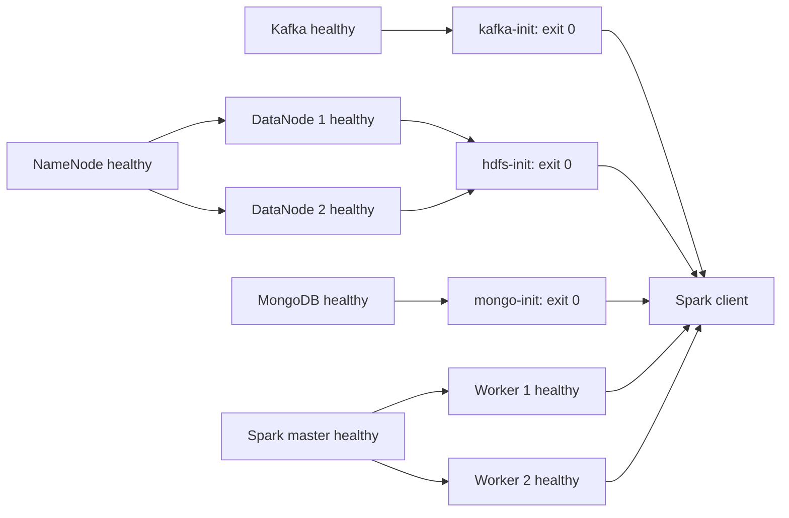

#### Kafka init

Tạo topic nếu thiếu rồi đọc lại partitions/RF/retention. Cấu hình đúng thì tiếp tục; sai thì thoát lỗi. Không xóa và tạo lại topic hiện có.

#### HDFS init

Đợi JMX báo đúng hai live DataNode và safe mode OFF. Tối đa 60 lần thử, nghỉ hai giây giữa các lần; thời gian thực tế còn cộng thời gian gọi network/CLI. Sau đó tạo bảy thư mục và đặt mode 750 cho gốc `/ecommerce`.

NameNode healthcheck chỉ kiểm tra chính NameNode. Nếu nó chờ đủ DataNode trong khi DataNode lại chờ NameNode healthy, bootstrap sẽ bị vòng chờ.

#### Mongo init

Kết nối root, tạo application user nếu thiếu, upsert marker bằng `$setOnInsert` rồi thử truy cập bằng app account.

Lỗi kết nối có retry hữu hạn; lỗi authentication/authorization được báo để sửa cấu hình. Account hiện có không tự bị đổi password.

### 6. Healthcheck và readiness

| Tầng                | Được kiểm tra như thế nào?                                                        |
| ------------------- | --------------------------------------------------------------------------------- |
| Kafka               | CLI truy vấn API của broker                                                       |
| NameNode/DataNode   | HTTP/JMX của process tương ứng                                                    |
| Spark master/worker | JSON UI trả lời được                                                              |
| MongoDB             | Root authentication và ping                                                       |
| Spark client        | Topology Spark/HDFS, Kafka topic metadata, đọc MongoDB bootstrap marker           |
| Sau `up`            | Script xác nhận chín service healthy, ba init exit 0, rồi chạy readiness có retry |

`docker compose up` dùng `--no-build --wait --wait-timeout 300`. Sau bước đợi này vẫn có kiểm tra cluster readiness riêng.

Healthcheck trả healthy chỉ chứng minh phép thử được định nghĩa đã thành công. Nó không chứng minh throughput, độ trễ nghiệp vụ hoặc chất lượng ML.

### 7. Định danh và dữ liệu khi restart

#### HDFS

NameNode có VERSION thì kiểm tra cluster ID; không có VERSION và thư mục rỗng mới được format. Không có VERSION nhưng thư mục không rỗng thì từ chối format.

DataNode có VERSION thì kiểm tra cluster ID trước khi gọi Hadoop. Việc khôi phục storage bị hỏng không được tự động hóa bằng thao tác xóa metadata.

#### Kafka

Khi `meta.properties` đã có, startup so sánh `cluster.id` với cấu hình. Không khớp thì dừng; giữ đúng ID là điều kiện để dùng lại dữ liệu.

#### MongoDB

Account nằm trong database volume. Các biến khởi tạo root không phải cơ chế cập nhật account đã tồn tại. Việc đổi file rồi restart có thể làm healthcheck không xác thực được.

### 8. Dừng, khởi động lại và reset

- `make down` dừng/gỡ container/network của project, giữ named volume.
- `make up` dựng lại từ image và volume hiện có; init được thực hiện theo cơ chế dependency.
- `make reset CONFIRM=delete-project-data` gọi Compose down có xóa volume của project.
- Reset không xóa dataset, source code hoặc artifact host.
- Các service thường trực dùng `unless-stopped`; init job dùng `restart: "no"`.
- Grace period dừng service là 60 giây; lệnh down cũng dùng timeout 60 giây.

Container bị `unhealthy` nhưng process vẫn chạy không tự được restart chỉ nhờ restart policy. Dependency trong Compose chủ yếu điều phối khởi động, không phải controller luôn tự sửa mọi lỗi runtime.

Nếu khởi động thất bại giữa chừng, một phần container có thể vẫn chạy. Xem trạng thái/log, xử lý nguyên nhân rồi gọi lại; không reset toàn bộ như bước chẩn đoán đầu tiên.

### 9. Vòng đời một job kiểm thử

Makefile gọi script quản lý; script lấy khóa file dùng chung cho smoke, persistence-test, ingest và test-data để ngăn các job được quản lý chạy chồng nhau. Sau đó chạy `spark-submit` trong client. Lệnh gọi Spark thủ công không tự lấy khóa này.

- Timeout mỗi lệnh job: 600 giây.
- Nếu quá hạn, `timeout` gửi tín hiệu dừng và có thời gian kill-after 15 giây.
- Log được lưu trên host.
- Chỉ khi process exit 0 và có dòng `INFRA_RESULT=...` mới ghi báo cáo JSON thành công.
- Khóa của manager không chặn job do người dùng tự gọi trực tiếp bằng Docker CLI.

Persistence test có ba lượt job create/verify/clean và một chu kỳ down/up; timeout một job không phải timeout tổng của toàn bộ phép thử.

Đọc tiếp các lệnh vận hành (tham chiếu `05-operations.md`).

## 2.11. Nguồn tài liệu: `docs/infra/05-operations.md`

## 05 — Hướng dẫn vận hành

← Mục lục (tham chiếu `README.md`)

Cấu hình RAM mặc định hiện là 7 GiB. Khi chuyển từ cấu hình cũ, chạy `make config`, `make test`, rồi `make up`, `make doctor`, `make smoke`; không cần build lại image. Chi tiết ngân sách và theo dõi OOM (tham chiếu `10-memory-budget.md`).

Tất cả lệnh bên dưới chạy từ thư mục gốc repository. Cấu hình local được tạo bởi `make setup`. Giá trị mong đợi là tiêu chí đối chiếu, không phải log đã đo trên cụm thật.

### 1. Khởi động lần đầu

```bash
docker info
docker compose version
make setup
make build
make up
make doctor
make smoke
```

Đọc lỗi ngay tại bước thất bại. `make up` không tự build; `make smoke` không tự khởi động cụm.

### 2. Toàn bộ lệnh Makefile

| Lệnh                                     | Điều kiện                                   | Các bước chính và tác động                                                  | Kết quả/artifact                                     |
| ---------------------------------------- | ------------------------------------------- | --------------------------------------------------------------------------- | ---------------------------------------------------- |
| `make setup`                             | Python; template có sẵn                     | Tạo hoặc validate file local, không gọi Docker                              | File local được giữ/sinh với ID và credential        |
| `make build`                             | File local hợp lệ; daemon và Internet       | Preflight build, pull Kafka/MongoDB, build Hadoop/Spark                     | Image local và `versions.json`                       |
| `make up`                                | Image đã có; đủ tài nguyên/cổng             | Preflight, up không build, chờ health/init, kiểm tra readiness              | Chín service healthy, ba init exit 0                 |
| `make doctor`                            | File local, daemon                          | Preflight; nếu có trạng thái container thì xác nhận toàn cụm                | Báo kết quả hoặc lỗi cụ thể                          |
| `make config`                            | File local và Compose CLI                   | Validate rồi gọi Compose config quiet                                       | Không tạo container, không in credential             |
| `make test`                              | Python, Docker Compose CLI                  | Chạy unittest offline                                                       | Kết quả test; không cần daemon                       |
| `make smoke`                             | Cụm healthy, driver không bận               | Gửi dữ liệu nhỏ, chạy Spark/HDFS/MongoDB, dọn run                           | `smoke.log` và `smoke.json` khi thành công           |
| `make persistence-test`                  | Cụm healthy, không có job cần tiếp tục chạy | Tạo marker, down/up, verify, clean                                          | Token và ba nhóm log/JSON                            |
| `make test-data`                         | Cụm healthy, mã ứng dụng được mount         | Fixture Spark/HDFS, fault/retry, kiểm tra chất lượng và dọn namespace riêng | `artifacts/data/test-data.json` khi thành công       |
| `make ingest`                            | Cụm healthy, đủ bốn CSV, driver không bận   | Snapshot Bronze/Silver, kiểm tra checksum, loại trùng và cách ly lỗi        | Manifest, quality và run log trong `artifacts/data/` |
| `make prepare-demo`                      | Có Silver lịch sử, driver rảnh              | Xuất replay, manifest, tham chiếu và offset đầu                             | `artifacts/streaming/<run_id>/`                      |
| `make stream`                            | Run đã chuẩn bị, driver rảnh                | Streaming KPI, checkpoint và tự kết thúc                                    | Report streaming và tài nguyên                       |
| `make replay`                            | Run đã chuẩn bị, producer rảnh              | Phát Kafka theo tốc độ, ACK/cursor                                          | Producer report và ACK local                         |
| `make stream-status`                     | Có client/MongoDB và config run             | Đọc trạng thái, KPI snapshot đã công bố                                     | Status JSON                                          |
| `make test-stream`                       | Cụm healthy, driver rảnh                    | Fixture và fault/restart trên namespace riêng                               | `artifacts/streaming/test-stream.json`               |
| `make ps`                                | File local, daemon                          | Compose ps all                                                              | Container đang chạy và init đã thoát                 |
| `make logs`                              | File local, daemon                          | Xem tối đa 100 dòng mỗi service                                             | Không follow liên tục                                |
| `make versions`                          | Image đã có, daemon                         | Inspect image và phiên bản công cụ                                          | `versions.json`                                      |
| `make down`                              | File local, daemon                          | Dừng/gỡ container/network; giữ named volume                                 | Cụm dừng, dữ liệu chính còn                          |
| `make reset CONFIRM=delete-project-data` | Cố ý xóa dữ liệu project                    | Down kèm xóa volume                                                         | Dữ liệu Kafka/HDFS/MongoDB của project bị xóa        |

`doctor` khi chưa có container sẽ báo chưa khởi động. Nếu còn container đã dừng, nó có thể báo service chưa healthy; khi đó dùng `ps` để xem và `up` để khởi động.

Mọi action qua manager ngoài `setup` đều yêu cầu cấu hình local hợp lệ. `make test` gọi unittest trực tiếp nên không cần file local; nó dùng template khi kiểm tra Compose.

`ingest` và `test-data` chạy qua manager ứng dụng (tham chiếu `../../app/manage.py`), dùng cùng cấu hình và khóa driver với smoke/persistence. Chi tiết đầu vào, tác động khi chạy lại và xử lý lỗi: vận hành ingestion (tham chiếu `../data/03-ingestion.md`).

Các lệnh replay/streaming dùng manager streaming (tham chiếu `../../app/streaming_manage.py`). Producer có khóa riêng, các Spark job dùng khóa driver chung. Cách chạy hai terminal và tham số RUN_ID/START/END/RATE: vận hành streaming (tham chiếu `../streaming/03-operations.md`).

### 3. Trạng thái và log

```bash
make ps
make logs
docker compose logs --tail 100 kafka
docker compose logs --tail 100 namenode datanode-1 datanode-2
docker compose logs --tail 100 spark-master spark-worker-1 spark-worker-2
docker compose logs --tail 100 kafka-init hdfs-init mongo-init
```

Kỳ vọng: chín service có trạng thái chạy và healthy. Init job phải có exit code 0. Thông tin `running` đơn lẻ không thay thế readiness.

Nếu muốn follow một service:

```bash
docker compose logs --follow --tail 100 kafka
```

Thoát follow log bằng Ctrl+C không phải thao tác dừng service.

### 4. Kiểm tra Kafka

```bash
docker compose exec -T kafka /opt/kafka/bin/kafka-topics.sh --bootstrap-server kafka:9092 --list
docker compose exec -T kafka /opt/kafka/bin/kafka-topics.sh --bootstrap-server kafka:9092 --describe --topic ecommerce.events.raw
docker compose exec -T kafka /opt/kafka/bin/kafka-configs.sh --bootstrap-server kafka:9092 --entity-type topics --entity-name ecommerce.events.raw --describe
```

Đối chiếu raw có ba partition, replication factor 1, retention `172800000` ms. Với DLQ, dùng cùng lệnh và thay tên topic; DLQ có một partition.

Trên host dùng `127.0.0.1:19092`; trong container dùng `kafka:9092`. Các lệnh ở trên là đọc metadata, không tự gửi event vào topic nghiệp vụ.

### 5. Kiểm tra HDFS

```bash
docker compose exec -T namenode hdfs dfsadmin -report
docker compose exec -T namenode hdfs dfsadmin -safemode get
docker compose exec -T namenode hdfs dfs -ls /ecommerce
docker compose exec -T namenode hdfs dfs -du -h /ecommerce
docker compose exec -T namenode hdfs fsck /ecommerce/_smoke -files -blocks -locations
```

Kỳ vọng: hai live DataNode, safe mode OFF, bảy thư mục nền. Nếu smoke đã dọn dữ liệu thì `_smoke` có thể không còn file kiểm thử. File cần tồn tại thì mới có block để quan sát replica.

Không format NameNode hoặc xóa VERSION để xử lý một lỗi kết nối.

### 6. Kiểm tra Spark và runtime

Mở UI:

- Master: `http://127.0.0.1:18080`.
- Worker 1: `http://127.0.0.1:18081`.
- Worker 2: `http://127.0.0.1:18082`.
- Ứng dụng: `http://127.0.0.1:14040` khi có job.

```bash
docker compose exec -T spark-client python3 /opt/infra/smoke/readiness.py --once
docker compose exec -T spark-client python3 --version
docker compose exec -T spark-client java -version
docker compose exec spark-client bash
```

Client có Python 3.11 và Java 17 theo image. Hadoop image dùng Java 11. UI app không truy cập được khi không có driver chạy là trạng thái bình thường.

Khi thêm source job nghiệp vụ, cần mount/đóng gói module trước rồi nộp bằng `spark-submit`. Không giả định file trên host tự xuất hiện trong client.

### 7. Kiểm tra MongoDB bằng app account

Lệnh dùng credential đã có trong environment của client; không in password:

```bash
docker compose exec -T spark-client python3 -c 'import os,sys; sys.path.insert(0,"/opt/infra/smoke"); from common import mongo; c=mongo(); print(c[os.environ["MONGO_DATABASE"]].infra_metadata.find_one({"_id":"bootstrap-v1"})); c.close()'
```

Kỳ vọng marker có `_id=bootstrap-v1` và `schema_version=1`. Khi dùng công cụ kết nối từ host, chọn host `127.0.0.1`, port `27018`, database/authSource `ecommerce` và application account local.

### 8. Kiểm tra offline trước khi có daemon

```bash
make config
make test
```

`make config` cần chạy setup trước. Cả hai vẫn cần Compose CLI; chỉ không cần quyền daemon.

Không dùng việc hai lệnh này đạt để kết luận image đã build hoặc các node đã kết nối.

### 9. Smoke test và giữ dữ liệu để quan sát

```bash
make smoke
```

Manager lưu log/JSON dưới `artifacts/infra/`. Chế độ mặc định dọn tài nguyên kiểm thử sau khi chạy.

Để chủ động giữ run và xem replica:

```bash
docker compose exec -T spark-client timeout 600s spark-submit /opt/infra/smoke/pipeline.py --keep
docker compose exec -T namenode hdfs fsck /ecommerce/_smoke -files -blocks -locations
```

Lệnh trực tiếp này không đi qua khóa của manager và không tự tạo `artifacts/infra/smoke.json` trên host. Dòng `INFRA_RESULT` xuất ở terminal chứa run ID, đường dẫn HDFS và `kept=true`.

Dọn thủ công phải nhắm đúng topic `infra-smoke-<uuid>`, thư mục của run đó và document `infra_smoke` có đúng `run_id`. Hiện chưa có lệnh Makefile riêng cho việc dọn một run giữ lại. Không xóa cả database hoặc thư mục nghiệp vụ để dọn một lần smoke.

### 10. Dữ liệu qua lần khởi động lại

```bash
make persistence-test
```

Lệnh tạm dừng cụm project. Nó không tiếp tục job nghiệp vụ đang chạy, vì vậy chỉ dùng khi cụm đang rảnh.

Nếu thất bại sau khi tạo marker, đọc token tại `artifacts/infra/persistence-token.txt`. Sau khi phục hồi cụm, có thể chạy lại phép verify bằng token đó:

```bash
INFRA_PERSIST_TOKEN="$(cat artifacts/infra/persistence-token.txt)"
docker compose exec -T spark-client timeout 600s spark-submit /opt/infra/smoke/persistence.py verify "$INFRA_PERSIST_TOKEN"
```

Khi verify xong và muốn dọn đúng marker:

```bash
docker compose exec -T spark-client timeout 600s spark-submit /opt/infra/smoke/persistence.py clean "$INFRA_PERSIST_TOKEN"
```

Token không phải credential, nhưng cần đúng token của lần thử. Không chạy lại `create` với cùng token đã có vì script dùng thao tác tạo marker, không thiết kế create chạy lặp.

### 11. Dừng, cập nhật và reset

Dừng cuối buổi, giữ dữ liệu:

```bash
make down
```

Khởi động lại:

```bash
make up
make doctor
```

Sau thay đổi Dockerfile/dependency:

```bash
make build
make up
make doctor
```

Sau thay đổi file Hadoop/Spark được mount, dùng chu kỳ down/up để tiến trình đọc lại cấu hình.

Reset chỉ khi muốn xóa dữ liệu hạ tầng của project:

```bash
make reset CONFIRM=delete-project-data
```

Reset giữ source, dataset và artifact host. Sau reset vẫn cần `make up` để dựng lại dịch vụ; chưa cần sinh lại credential/cluster ID nếu tiếp tục dùng file local hiện có.

Đọc thêm ý nghĩa các kiểm thử (tham chiếu `06-testing.md`) và xử lý lỗi (tham chiếu `07-troubleshooting.md`).

## 2.12. Nguồn tài liệu: `docs/infra/06-testing.md`

## 06 — Kiểm thử và cách hiểu kết quả

← Mục lục (tham chiếu `README.md`)

### 1. Ba tầng kiểm tra

| Tầng                 | Lệnh                                  | Cần daemon?                           | Chứng minh gì?                                               |
| -------------------- | ------------------------------------- | ------------------------------------- | ------------------------------------------------------------ |
| Cấu hình/offline     | `make config`, `make test`            | Không                                 | Cấu hình parse được và các ràng buộc bootstrap/topology đúng |
| Readiness            | `make doctor` hoặc readiness script   | Có, cụm phải chạy để kiểm tra toàn bộ | Service và topology hiện tại đáp ứng phép kiểm tra           |
| Tích hợp/persistence | `make smoke`, `make persistence-test` | Có                                    | Dữ liệu thật đi qua các dịch vụ và marker sống qua down/up   |

Không suy diễn kết quả tầng trước thành bằng chứng của tầng sau.

### 2. Kiểm thử offline

Nguồn: test_infrastructure.py (tham chiếu `../../infra/tests/test_infrastructure.py`), test_download.py (tham chiếu `../../infra/tests/test_download.py`) và test_kafka_admin.py (tham chiếu `../../infra/tests/test_kafka_admin.py`).

| Nhóm                     | Số test | Nội dung                                                                                                                                                                                  |
| ------------------------ | ------: | ----------------------------------------------------------------------------------------------------------------------------------------------------------------------------------------- |
| BootstrapTests           |       9 | Setup giữ credential/ID, quyền file 0600; không ghi đè file lỗi; từ chối cổng trùng/image không khóa; parse environment và ps; reset cần xác nhận; biến project không bị shell cha ghi đè |
| ComposeTests             |       8 | Đủ topology và ngân sách RAM; cổng loopback duy nhất; dependency không vòng; DataNode volume riêng và bind mount read-only; runtime nhất quán và client không nhận root credential        |
| HadoopConfigurationTests |       1 | Replication, hostname networking và số DataNode tối thiểu                                                                                                                                 |
| KafkaAdminTests          |       4 | Giữ AdminClient sống khi chờ Future tạo/xóa topic; truyền nguyên lỗi broker và timeout                                                                                                    |

Bổ sung ba test `CachedDownloadTests` kiểm tra cache/hash/atomic publication mà không cần socket; bảy test `DownloadTests` dùng curl thật và HTTP server loopback để kiểm tra cache, mất kết nối, SIGTERM, HTTP Range/416, checksum sai và fallback. Bổ sung hai test `SparkReadinessTests` xác nhận hai worker một core/640 MiB và từ chối worker thiếu tài nguyên. Các test Compose còn kiểm tra preflight với 8,3 GiB/thiếu RAM, credit đúng project và heap khớp tài nguyên quảng bá/container. Suite hạ tầng có 34 test. Nếu môi trường cấm tạo socket, bảy test HTTP được ghi rõ là skipped; các lỗi bind khác vẫn làm test thất bại. Cần Bash, curl và GNU coreutils trên host.

`make test` còn chạy 78 test ứng dụng (16 ingestion, 39 streaming và 23 test mới cho behavior), tổng cộng 112 test. Streaming có 12 test hồi quy về metadata/leader Kafka, đọc lại offset, deadline và chờ topic raw/DLQ. Hợp đồng sự kiện, snapshot, đóng gói và hủy job được mô tả trong kiểm thử dữ liệu (tham chiếu `../data/05-testing.md`). Fixture ingestion chạy riêng bằng `make test-data`; fixture streaming (tham chiếu `../streaming/04-testing-and-recovery.md`) chạy bằng `make test-stream`; session/funnel lịch sử (tham chiếu `../analytics/04-testing.md`) bằng `make test-behavior`.

Test Kafka dùng dependency giả lập và Future chỉ giữ weak reference tới client; ép garbage collection trước khi chờ kết quả. Các test đã tái hiện client bị giải phóng sớm trên mã cũ. Chúng không cần cài `confluent-kafka` hoặc `pymongo` trên host và không thay thế thao tác với broker thật trong smoke.

Các test Compose gọi CLI để expand cấu hình thành JSON từ template. Chúng không pull image, không tạo container hoặc truy cập daemon. Test setup dùng thư mục tạm; password được sinh trong test không được in ra.

`make config` riêng cần file local hợp lệ, nhưng chỉ chạy Compose config quiet nên không cần daemon và không in environment đầy đủ.

### 3. Readiness

Nguồn: readiness.py (tham chiếu `../../infra/smoke/readiness.py`).

Phép kiểm tra xác nhận:

1. Spark master JSON có đúng hai worker `ALIVE`.
2. Mỗi worker báo một core và ít nhất 640 MiB memory.
3. JMX HDFS báo đúng hai live DataNode.
4. Raw có ba partition, DLQ có một partition và mỗi partition có một replica.
5. Application account MongoDB đọc được marker bootstrap.

Readiness không tự sửa topology hoặc tạo lại dữ liệu. Init kiểm tra retention topic; readiness tập trung vào metadata/topology và truy cập account.

`--once` thử một lượt. Khi không có `--once`, script có ngân sách retry mặc định 120 giây; mỗi lượt còn có thời gian gọi I/O. Healthcheck client gọi `--once`; manager sau khi up gọi readiness có retry.

### 4. Smoke test xuyên dịch vụ

Nguồn: pipeline.py (tham chiếu `../../infra/smoke/pipeline.py`) và common.py (tham chiếu `../../infra/smoke/common.py`).

#### 4.1. Chuẩn bị

- Readiness phải đạt.
- Sinh run ID `infra-smoke-<uuid>`.
- Tạo topic riêng có ba partition, replication 1 và retention một giờ.
- Sinh sáu event `view` có visitor/event ID riêng, source `infra-smoke`.
- Producer chỉ định partition để phân phối qua ba partition; bật idempotence và acks all.
- Consumer đọc lại sáu record và đối chiếu tập event ID.

Đây là dữ liệu sinh bởi script, không lấy từ CSV Retailrocket. Phép thử không đánh giá tính đúng của label, feature hoặc funnel nghiệp vụ.

#### 4.2. Xử lý phân tán

Spark tạo RDD tám partition, lấy hostname nơi task thực thi và yêu cầu thấy cả `spark-worker-1` lẫn `spark-worker-2`.

Sau đó tính tổng dãy số từ 0 đến 999.999 trên tám partition. Kết quả biết trước là `499999500000`. Việc đối chiếu vừa xác nhận job thực thi được, vừa bắt kết quả tính sai.

Có hai worker đăng ký chưa đủ; kiểm tra hostname mới xác nhận task đã chạy trên cả hai trong kịch bản này.

#### 4.3. Streaming và checkpoint

- Đọc topic test với `startingOffsets=earliest`.
- Parse JSON bằng schema tường minh; trong fixture này trường thời gian được giữ dạng chuỗi.
- Dùng `availableNow=True` để xử lý lượng dữ liệu hiện có rồi kết thúc.
- Ghi Parquet và checkpoint trong thư mục run trên HDFS.
- Đọc lại Parquet, xác nhận đúng sáu event ID.
- Khởi chạy lần thứ hai với cùng checkpoint, xác nhận vẫn sáu event.
- Kiểm tra thư mục commit log của checkpoint tồn tại.

Test này không mô phỏng mọi thời điểm crash, event đến trễ hoặc payload lỗi. Những trường hợp nghiệp vụ đó cần bổ sung khi triển khai pipeline thật.

#### 4.4. MongoDB và replica HDFS

Executor upsert record vào MongoDB bằng khóa `run_id:event_id`. Thực hiện hai lần ghi rồi đọc lại: vẫn phải có sáu document đúng tập event ID.

Script còn hỏi HDFS về vị trí các block Parquet và yêu cầu mỗi block có hai host replica. Nó kiểm tra vị trí thực tế mà HDFS báo, không chỉ đọc giá trị cấu hình replication.

Hai lần upsert chỉ chứng minh tính lặp lại an toàn cho fixture/khóa này. Chưa có transaction toàn cục giữa Kafka, HDFS và MongoDB.

#### 4.5. Cleanup

Mặc định script:

- Xóa thư mục HDFS của run.
- Xóa document MongoDB có đúng run ID.
- Dừng SparkSession.
- Yêu cầu xóa topic test.

Nếu các assertion đạt nhưng cleanup thất bại, script vẫn báo lỗi. Khi dùng `--keep`, tài nguyên của run được giữ để xem và cần được dọn riêng sau đó. Spark event logs nằm ngoài thư mục run smoke và vẫn được giữ.

### 5. Báo cáo smoke

Khi chạy qua manager:

| Artifact host                 | Công dụng                                              |
| ----------------------------- | ------------------------------------------------------ |
| `artifacts/infra/smoke.log`   | Output của Spark job, gồm cả lỗi nếu có                |
| `artifacts/infra/smoke.json`  | Báo cáo được ghi khi job exit 0 và có INFRA_RESULT     |
| `artifacts/infra/driver.lock` | Khóa ngăn các job được manager quản lý chạy chồng nhau |

JSON dưới đây **chỉ minh họa schema**, không phải kết quả đo thực tế:

```json
{
  "spark_workers": 2,
  "hdfs_datanodes": 2,
  "kafka_topics": 2,
  "mongo_authenticated": true,
  "run_id": "infra-smoke-00000000000000000000000000000000",
  "records": 6,
  "executor_hosts": ["spark-worker-1", "spark-worker-2"],
  "aggregation_sum": 499999500000,
  "checkpoint_restart": true,
  "mongo_upsert_retry": true,
  "minimum_block_replicas": 2,
  "hdfs_path": "hdfs://namenode:9000/ecommerce/_smoke/infra-smoke-00000000000000000000000000000000",
  "kept": false
}
```

`kafka_topics=2` là hai topic nghiệp vụ được readiness kiểm tra; topic test là tài nguyên bổ sung tạm thời. Khi `kept=false`, đường dẫn trong report là định danh của run đã dọn, không có nghĩa file còn tồn tại.

`INFRA_RESULT=` là tiền tố manager dùng để tìm JSON trong stdout. Job không có dòng đó hoặc exit khác 0 không được coi là thành công.

### 6. Persistence test

Nguồn: persistence.py (tham chiếu `../../infra/smoke/persistence.py`) và action tương ứng trong manager (tham chiếu `../../infra/manage.py`).

#### Create

- Sinh token 32 ký tự hex và lưu trên host.
- Tạo topic `infra-persist-<token>` có một partition, retention một giờ.
- Gửi một record marker.
- Ghi token bằng Hadoop filesystem API vào HDFS.
- Thêm marker vào collection `infra_persistence`.

#### Down/up

Manager dừng/gỡ container nhưng giữ named volume, rồi khởi động lại và kiểm tra readiness. Đây là dừng có kiểm soát, không phải mô phỏng mất điện hoặc đĩa hỏng.

#### Verify

- Kafka trả lại đúng record marker.
- HDFS trả đúng token.
- MongoDB có đúng document marker.

#### Clean

Xóa topic, file marker và document tương ứng. Các action create/clean không được thiết kế để gọi lặp vô hạn trên marker đã có/đã xóa. Nếu một phần cleanup đã hoàn thành, cần xem lỗi và trạng thái từng nơi trước khi chạy lại.

Các artifact:

| File                          | Nội dung                           |
| ----------------------------- | ---------------------------------- |
| `persistence-token.txt`       | Token để tra cứu/phục hồi phép thử |
| `persistence-create.log/json` | Kết quả tạo marker                 |
| `persistence-verify.log/json` | Kết quả sau down/up                |
| `persistence-clean.log/json`  | Kết quả dọn marker                 |

Tất cả nằm dưới `artifacts/infra/`. Mỗi tên `.log` và `.json` là hai file riêng. Job thất bại có thể chỉ có log; JSON chỉ được ghi khi hoàn thành đúng. Artifact cùng tên được ghi đè ở lần chạy sau, nên lưu bản sao nếu cần giữ lịch sử.

### 7. Giới hạn thời gian và phạm vi

- Manager dùng timeout 600 giây cho mỗi lượt Spark job, kill-after 15 giây.
- Mỗi streaming query trong smoke có thời gian chờ 120 giây.
- Pipeline chạy hai query nối tiếp; persistence có ba lượt job và một chu kỳ down/up.
- Các khoảng chờ không phải số đo latency/throughput của sản phẩm.

Bộ kiểm thử hạ tầng không chứng minh HA vật lý, tải cao, khả năng phục hồi mọi lỗi giữa nhiều sink, chất lượng ML hoặc dữ liệu nghiệp vụ đã được ingest. Phần ingestion có tiêu chí nghiệm thu riêng (tham chiếu `../data/05-testing.md`).

### 8. Trạng thái thực tế đã biết

Phiên cập nhật ngân sách RAM đạt 23 test, với 7 test HTTP skipped vì sandbox cấm tạo socket. Compose config và cú pháp Python/Bash đã đạt. Các test HTTP cần chạy lại trên terminal host không bị giới hạn này. Build bị chặn ở truy cập Docker socket; khi rà soát tài liệu chưa có artifact runtime để xác nhận smoke/persistence.

Sau bản sửa vòng đời Kafka AdminClient, suite hạ tầng có 27 test đạt và 7 HTTP skipped; cộng 16 test ứng dụng thành 43 đạt/7 skipped. Bốn test Kafka mới thất bại trên mã cũ và đạt sau bản sửa. Log người dùng cung cấp đã xác nhận `make up` và `make doctor` đạt trên host, còn smoke trước sửa lỗi `_DESTROY` tại bước tạo topic. Lượt smoke sau sửa trong phiên công cụ bị chặn bởi quyền Docker socket, nên chưa có kết quả nghiệm thu bản sửa trên broker thật.

Sau khi chạy trên môi trường có daemon, dùng artifact thật để bổ sung bằng chứng. Không thay trạng thái “chưa xác minh” bằng “đạt” chỉ vì script đã được tạo.

Đọc tiếp xử lý lỗi (tham chiếu `07-troubleshooting.md`).

## 2.13. Nguồn tài liệu: `docs/infra/07-troubleshooting.md`

## 07 — Chẩn đoán và xử lý lỗi

← Mục lục (tham chiếu `README.md`)

### 1. Quy trình bắt đầu

1. Xác định lệnh nào thất bại: setup, build, up, readiness hay job.
2. Đọc dòng lỗi đầu tiên liên quan, không chỉ thông báo cuối của Make.
3. Xem `make ps` và log đúng service/job.
4. Đối chiếu cấu hình với bảng cấu hình (tham chiếu `03-configuration.md`).
5. Sửa nguyên nhân, chạy lại bước cần thiết rồi kiểm tra readiness.

Reset là thao tác xóa dữ liệu, không phải bước chẩn đoán mặc định.

### 2. Lỗi host và Docker

| Triệu chứng                             | Nguyên nhân có thể                                          | Kiểm tra                                                  | Khắc phục và dấu hiệu phục hồi                                                            |
| --------------------------------------- | ----------------------------------------------------------- | --------------------------------------------------------- | ----------------------------------------------------------------------------------------- |
| Permission denied với Docker socket     | Phiên không có quyền daemon hoặc socket không được cung cấp | `docker info`, `docker context show`, `docker context ls` | Chạy trong terminal/context được cấp quyền hợp lệ; phục hồi khi info trả thông tin server |
| CLI có nhưng không kết nối server       | Daemon chưa chạy, context/DOCKER_HOST sai                   | Kiểm tra context và Docker daemon tại máy thực thi        | Chọn đúng môi trường hoặc khởi động daemon theo cơ chế của máy; info phải đạt             |
| Chỉ một số lệnh Docker chạy được        | Giới hạn của môi trường thực thi/agent                      | Thử info tại terminal host có quyền                       | Không suy ra build sẽ chạy được từ việc ps thành công; kiểm thử runtime cần quyền thật    |
| Cổng đã bị chiếm                        | Dịch vụ khác đang publish cổng                              | `ss -ltnp`, đối chiếu biến cổng                           | Chọn cổng host khác trong cấu hình; không dừng dịch vụ khác chỉ để giải phóng cổng        |
| Không đủ RAM                            | Host đang dùng nhiều RAM hoặc Docker bị giới hạn            | RAM host và MemTotal trong docker info                    | Giải phóng RAM/cấp đủ cho Docker rồi chạy lại preflight                                   |
| Thiếu disk                              | Docker data partition đầy                                   | Xem DockerRootDir và dung lượng tại máy chạy daemon       | Giải phóng đúng vùng hoặc tăng dung lượng; không tự prune tài nguyên toàn máy             |
| Không thấy Docker data path trong phiên | Daemon ở filesystem/máy khác                                | Xác định context và máy chạy daemon                       | Kiểm tra trực tiếp tại Docker host; thông báo NOTE không phải bằng chứng disk đủ          |
| Sai kiến trúc/AVX                       | Máy không đáp ứng bản runtime này                           | Docker architecture và CPU flags                          | Dùng môi trường Linux amd64 hỗ trợ AVX; không đổi phiên bản MongoDB âm thầm               |
| Dataset missing/unreadable              | Sai đường dẫn, thiếu CSV, thiếu quyền đọc                   | Kiểm tra bốn file và DATASET_PATH                         | Sửa đường dẫn/quyền đúng thư mục, chạy lại preflight                                      |

Cấu hình dataset được preflight kiểm tra ngay cả trước build. Một clone repository không có CSV cần được cung cấp dataset trước; Git không lưu các file CSV/ZIP.

Cấu hình hiện tại cần 7 GiB khả dụng lúc chưa chạy cụm, với tổng memory limit 6,9375 GiB. Nếu vẫn thấy `need 10.0 GiB`, kiểm tra riêng `MIN_AVAILABLE_RAM_GIB` trong `.env` và đổi thành `7`; `make setup` giữ nguyên file đã có. Không hạ thấp hơn tổng limit để bỏ qua kiểm tra. Khi thấy `Configured container memory limits ... exceeding`, cần chỉnh đồng bộ Compose và ngân sách. Cách áp dụng và theo dõi OOM (tham chiếu `10-memory-budget.md`).

### 3. Lỗi setup và cấu hình

| Triệu chứng                              | Ý nghĩa                            | Hướng xử lý                                                   |
| ---------------------------------------- | ---------------------------------- | ------------------------------------------------------------- |
| Missing .env                             | Chưa setup                         | Chạy `make setup`                                             |
| Missing/uninitialized environment values | Thiếu biến hoặc còn placeholder    | Bổ sung theo template; setup không ghi đè file đã có          |
| Duplicate environment variable           | Trùng khóa trong file              | Giữ một định nghĩa rõ ràng cho mỗi biến                       |
| Quote values containing spaces           | Giá trị có khoảng trắng chưa quote | Quote đường dẫn/giá trị theo định dạng file môi trường        |
| Invalid project/cluster ID               | Không đúng định dạng validator     | Khôi phục giá trị đã sinh hoặc cấu hình hợp lệ phù hợp volume |
| Published host ports must be distinct    | Hai biến publish dùng cùng cổng    | Chọn các cổng khác nhau                                       |
| Image must be pinned by SHA-256 digest   | Đã bỏ digest khỏi image            | Dùng cấu hình image đã khóa và xác minh digest trước khi đổi  |

Không gửi nội dung file local có password vào issue/log chia sẻ. Chỉ trích tên biến và lỗi cần chẩn đoán.

### 4. Lỗi build và dependency

#### Tải rất chậm, bị ngắt hoặc thiếu Buildx

Xem hướng dẫn tối ưu build (tham chiếu `09-build-optimization.md`). Các dòng `Adding debian:...pem` là cập nhật CA bình thường; log curl cho biết bước tải binary. `make build` yêu cầu Buildx; trên Arch Linux dùng `sudo pacman -S docker-buildx`, kiểm tra `docker buildx version` rồi chạy lại.

Build mới lưu file tải dở trong cache của builder; Ctrl+C rồi chạy lại `make build` có thể tiếp tục nếu cache còn. File tải dở từ Dockerfile cũ không tự chuyển vào cache mới.

#### Tải binary/JAR hoặc checksum thất bại

Kiểm tra network đến `repo.huaweicloud.com`, `dlcdn.apache.org`, Apache Archive, Maven Central, PyPI và registry của base image. Downloader có hai lượt mỗi nguồn, phát hiện tốc độ thấp và ngân sách 30 phút mỗi binary; đọc log source/resume_bytes trước khi thử lại. Nếu là lỗi tạm thời, thử build lại. Nếu checksum không khớp, kiểm tra đúng version/artifact; không bỏ bước checksum để làm build “qua”.

#### Image local chưa có

`make up` chạy với `--no-build`. Chạy:

```bash
make build
make up
```

#### Không tìm được Kafka data source/JAR

Đối chiếu script JAR (tham chiếu `../../infra/spark/download_jars.py`), phiên bản Spark/Scala và các image đang dùng:

```bash
docker compose images
docker compose logs --tail 100 spark-client
```

Build lại image Spark và dựng lại các service dùng image đó. Việc cài package trên host không tự cài package vào executor.

### 5. Kafka và init topic

#### Broker chưa healthy

```bash
docker compose logs --tail 100 kafka
docker compose logs --tail 100 kafka-init
```

Đối chiếu listeners, metadata storage và cluster ID. Producer container phải dùng `kafka:9092`; client host dùng cổng external.

#### Cluster ID mismatch

Khôi phục cluster ID đúng với volume hiện tại hoặc khôi phục bộ cấu hình/volume khớp nhau. Không sửa metadata để ép một storage vào cluster khác.

#### Init báo sai partitions/replication/retention

Đọc metadata bằng các lệnh trong hướng dẫn vận hành (tham chiếu `05-operations.md`). Init cố ý báo lỗi, không tự xóa topic. Nếu thay đổi cấu hình topic là chủ ý, thực hiện thay đổi có kiểm soát rồi chạy lại init/up; việc thay replication hoặc partition có những ràng buộc riêng, không coi là đổi một biến host.

### 6. HDFS

#### Không đủ hai DataNode hoặc safe mode chưa OFF

```bash
docker compose exec -T namenode hdfs dfsadmin -report
docker compose exec -T namenode hdfs dfsadmin -safemode get
docker compose logs --tail 100 namenode datanode-1 datanode-2 hdfs-init
```

Kiểm tra node nào chưa đăng ký, DNS/network, volume và cluster ID. NameNode HTTP healthy nhưng HDFS chưa đủ điều kiện ghi là tình huống init/readiness được thiết kế để phát hiện.

Không dùng lệnh cưỡng bức rời safe mode để che việc node/replica chưa đủ. Phục hồi khi có hai live node và safe mode OFF.

#### VERSION hoặc cluster ID lỗi

NameNode từ chối format nếu storage không rỗng nhưng thiếu VERSION. Nếu VERSION tồn tại mà ID khác, kiểm tra có mount nhầm volume hoặc dùng nhầm cấu hình local không.

Bản hiện tại chưa có script tự động backup/restore namespace. Không xóa VERSION rồi format lại để “sửa nhanh” storage có dữ liệu cần giữ.

#### Permission denied

Đối chiếu UID/GID 1000 của image custom, owner volume và quyền thư mục HDFS. Init tạo gốc `/ecommerce` cho môi trường user `analytics`. Sửa đúng ownership/mount gây lỗi; không dùng chmod toàn bộ workspace như cách xử lý chung.

### 7. Spark

#### Master có UI nhưng không có hai worker

```bash
docker compose logs --tail 100 spark-master spark-worker-1 spark-worker-2
docker compose exec -T spark-client python3 /opt/infra/smoke/readiness.py --once
```

Nếu client chưa khởi động do dependency, mở master UI và xem log worker trực tiếp. Kiểm tra master URL và thông tin worker quảng bá.

#### Executor không gọi được driver

Driver phải nằm trong `spark-client`, bind `0.0.0.0` và quảng bá hostname `spark-client`. Kiểm tra cấu hình RPC 39001, driver block manager 39002 và network chung.

Chạy Spark job trên host bằng local mode không phải cách chứng minh worker trong Docker xử lý được job.

#### Job khác đang chạy hoặc cổng driver bận

Khóa manager chỉ bảo vệ các job chạy qua manager. Kiểm tra có lệnh `docker compose exec ... spark-submit` trực tiếp đang chạy không. Đợi/dừng đúng job trước khi nộp job tiếp; không chạy nhiều driver với cùng bộ cổng cố định.

#### Application UI không mở

Nếu chưa có ứng dụng chạy hoặc ứng dụng đã kết thúc, đây có thể là trạng thái đúng. Master/worker UI vẫn độc lập với application UI.

### 8. MongoDB

#### Authentication thất bại sau khi sửa cấu hình

Credential trong volume không tự thay đổi theo environment. Khôi phục credential khớp hoặc thực hiện rotate account trong MongoDB. Root account thuộc authSource `admin`; app account thuộc database cấu hình, mặc định `ecommerce`.

`mongo-init` không tự đổi password account đã tồn tại. Đọc log:

```bash
docker compose logs --tail 100 mongodb mongo-init
```

#### Đổi cổng host không sửa lỗi kết nối nội bộ

Client container vẫn dùng `mongodb:27017`. Cổng `27018` chỉ phục vụ truy cập từ host.

#### Không có collection kết quả nghiệp vụ

Bản hạ tầng hiện chỉ tạo metadata bootstrap và collection kiểm thử khi chạy test. Chưa có job ML/KPI để tạo kết quả phân tích.

### 9. Container running nhưng make up/doctor thất bại

Xem healthcheck và ba init job. Cụm yêu cầu mọi điều kiện readiness, không chỉ tiến trình tồn tại. Init `Exited (0)` là thành công, còn `Exited (1)` hoặc mã lỗi khác cần sửa.

Khi còn container của lần chạy lỗi, `doctor` có thể thất bại vì cụm chưa đầy đủ. Sau khi sửa nguyên nhân, chạy lại `make up`; không cần reset dữ liệu chỉ vì một init job thất bại.

### 10. Smoke/persistence thất bại

| Triệu chứng                                           | Chẩn đoán                                                                             |
| ----------------------------------------------------- | ------------------------------------------------------------------------------------- |
| Không có smoke.json                                   | Có thể job chưa chạy, exit khác 0 hoặc thiếu dòng INFRA_RESULT; đọc smoke.log         |
| `_DESTROY`, `Handle is terminating` khi tạo/xóa topic | Kiểm tra vòng đời Kafka AdminClient trong helper; xem giải thích bên dưới             |
| Expected execution on both workers                    | Task không được quan sát trên đủ hai hostname cấu hình; kiểm tra worker và tài nguyên |
| Parquet mismatch                                      | Đọc/ghi hoặc checkpoint không đúng kỳ vọng fixture; xem Spark log và run path         |
| Không đủ hai replica                                  | Kiểm tra block location, live DataNode và replication                                 |
| Mongo executor write/read mismatch                    | Kiểm tra app quyền, mạng từ executor và nội dung fixture                              |
| Cleanup failed                                        | Assertion có thể đã đạt nhưng dọn lỗi; dùng run ID để kiểm tra tài nguyên còn lại     |
| Persistence verify lỗi sau down/up                    | Kiểm tra namespace project, volume, identity và marker ở storage báo lỗi              |
| Clean lỗi vì tài nguyên đã mất                        | Cleanup có thể đã thành công một phần; xem trạng thái thực trước khi thử lại          |

Sau lỗi persistence, giữ token/log trước khi chạy test mới vì tên artifact sẽ được ghi đè. Cách verify/clean bằng token nằm trong hướng dẫn vận hành (tham chiếu `05-operations.md`).

#### Kafka `_DESTROY` tại bước tạo hoặc xóa topic

Nếu `make doctor` đạt nhưng smoke lỗi tại `create_topic()` với `Handle is terminating: Local: Broker handle destroyed`, kiểm tra common.py (tham chiếu `../../infra/smoke/common.py`). Cách gọi `kafka().create_topics(...)` hoặc `kafka().delete_topics(...)` tạo AdminClient tạm; client có thể bị giải phóng khi request bất đồng bộ vẫn còn chờ.

Helper đã được sửa để giữ `admin = kafka()` trong cùng hàm đến khi `Future.result(timeout=40)` hoàn tất. Request timeout vẫn là 30 giây; lỗi broker và timeout vẫn được truyền tới caller. Smoke và persistence dùng chung helper này. Readiness gọi `list_topics()` đồng bộ, nên có thể đạt trước khi smoke gặp lỗi vòng đời ở thao tác bất đồng bộ.

`infra/smoke/` được bind mount read-only vào Spark client. Sau khi cập nhật source, chạy trực tiếp:

```bash
make test
make smoke
```

Bản sửa này không cần build lại image, restart cụm hoặc reset dữ liệu. Nếu xuất hiện lỗi mới sau bước tạo topic, dùng traceback và `artifacts/infra/smoke.log` mới để xác định bước tiếp theo. Report JSON cũ có thể còn sau lần thất bại; chỉ nghiệm thu lượt mới khi command thoát mã 0 và report khớp run mới.

### 11. Xác nhận đã phục hồi

Sau khi sửa:

1. `make up` hoàn tất.
2. `make doctor` xác nhận topology và account.
3. `make smoke` tạo báo cáo thật.
4. Nếu kiểm tra giữ dữ liệu, chạy persistence khi cụm rảnh và lưu report.

Giữ các kết luận trong phạm vi phép kiểm tra thực sự đạt; không dùng smoke test để tuyên bố mô hình ML hoặc khả năng HA đã được kiểm chứng.

## 2.14. Nguồn tài liệu: `docs/infra/08-source-code-guide.md`

## 08 — Bản đồ mã nguồn và điểm mở rộng

← Mục lục (tham chiếu `README.md`)

Tài liệu này chỉ ra nơi hiện thực từng chức năng, để có thể đọc source theo dòng thực thi thay vì đọc ngẫu nhiên mọi file.

### 1. Bắt đầu từ đâu?

```text
Makefile
  → infra/manage.py
    → compose.yaml
      → image và entrypoint
      → config bind mount
      → init jobs
      → readiness
    → smoke/persistence jobs
    → artifact trên host
```

Bắt đầu từ Makefile (tham chiếu `../../Makefile`), xem action tương ứng trong manager (tham chiếu `../../infra/manage.py`), sau đó xem service trong Compose (tham chiếu `../../compose.yaml`).

### 2. Các file ở gốc

| File                                                               | Công dụng                                                                                     |
| ------------------------------------------------------------------ | --------------------------------------------------------------------------------------------- |
| Makefile (tham chiếu `../../Makefile`)                             | Giao diện lệnh nhất quán; action quản lý gọi Python, test gọi unittest trực tiếp              |
| compose.yaml (tham chiếu `../../compose.yaml`)                     | Topology, network, image/build, command, environment, port, volume, healthcheck và dependency |
| .env.example (tham chiếu `../../.env.example`)                     | Danh mục cấu hình công khai, image đã khóa, placeholder credential                            |
| .gitignore (tham chiếu `../../.gitignore`)                         | Loại cấu hình local, CSV/ZIP, cache và artifact phát sinh khỏi Git                            |
| .dockerignore (tham chiếu `../../.dockerignore`)                   | Loại dữ liệu/cấu hình không cần khỏi root build context nếu context đó được dùng              |
| README.md (tham chiếu `../../README.md`)                           | Hướng dẫn chạy nhanh và cửa vào tài liệu                                                      |
| IMPLEMENTATION_PLAN.md (tham chiếu `../../IMPLEMENTATION_PLAN.md`) | Kế hoạch sản phẩm đầy đủ, bao gồm các phần chưa được triển khai                               |

Build dùng chung context `infra/`, chọn Dockerfile Hadoop/Spark qua Compose. infra/.dockerignore (tham chiếu `../../infra/.dockerignore`) chỉ cho phép file build cần thiết; dataset, credentials và runtime config không được gửi vào context.

### 3. Host-side manager

File infra/manage.py (tham chiếu `../../infra/manage.py`) dùng thư viện chuẩn Python để điều khiển Docker CLI; không gọi Docker API trực tiếp.

| Hàm/nhóm              | Làm gì?                                                                                                  | Side effect hoặc đầu ra                              |
| --------------------- | -------------------------------------------------------------------------------------------------------- | ---------------------------------------------------- |
| `InfraError`          | Loại lỗi vận hành được main trình bày gọn                                                                | In lỗi và exit khác 0                                |
| `read_env`            | Parse assignment, bỏ comment, từ chối trùng khóa hoặc format sai                                         | Dictionary cấu hình                                  |
| `validate_env`        | Kiểm tra biến bắt buộc, ID, cổng, ngưỡng và image digest                                                 | Báo lỗi trước khi thao tác                           |
| `setup`               | Sinh file local nếu chưa có; giữ file hiện hữu hợp lệ                                                    | File credential/identity local                       |
| `child_environment`   | Loại biến project khỏi environment kế thừa                                                               | Giữ file local làm nguồn cấu hình cho tiến trình con |
| `execute`             | Gọi command với cwd cố định, timeout và xử lý exit code                                                  | Command thực tế và output khi cần                    |
| `compose`             | Xây danh sách argument Compose với project directory, env file và YAML tường minh                        | Không tự thực thi                                    |
| `parse_ps`            | Đọc output Compose ps dạng JSON array hoặc NDJSON                                                        | Danh sách trạng thái                                 |
| `configuration`       | Lấy Compose config dưới dạng JSON, giữ nội bộ                                                            | Cấu hình đã expand                                   |
| `statuses`            | Đọc trạng thái tất cả container project                                                                  | Danh sách service/health/exit code                   |
| `check_memory_budget` | Đối chiếu tổng limit kể cả init với ngân sách; trừ phần service project đã chạy rồi kiểm tra RAM còn cần | Báo lỗi trước khi up nếu vượt budget/thiếu RAM       |
| `preflight`           | Kiểm tra daemon, môi trường, dataset, disk, RAM và cổng tùy action                                       | Báo cáo điều kiện khởi động                          |
| `assert_services`     | Xác nhận chín service healthy, ba init exit 0 và readiness                                               | Không tự khởi tạo phần bị thiếu                      |
| `start`               | Preflight rồi Compose up có wait, sau đó assert                                                          | Khởi động cụm                                        |
| `driver_lock`         | Dùng flock để ngăn job manager chạy chồng                                                                | Lock file trên host                                  |
| `spark_job`           | Exec spark-submit có timeout, thu log và tìm INFRA_RESULT                                                | Log và JSON khi thành công                           |
| `versions`            | Inspect image ID/digest và phiên bản công cụ                                                             | versions.json; không dump runtime environment        |
| `main`                | Phân luồng action CLI                                                                                    | Xâu chuỗi đúng tác vụ và kiểm soát reset             |

`require_buildkit` kiểm tra plugin Buildx trước khi pull/build; chỉ áp dụng cho action build. `make build` bỏ kiểm tra RAM/cổng nhưng vẫn chạy các phần preflight khác. `make up` không build. `make persistence-test` gọi ba job và tự down/up giữa create và verify.

### 4. Hadoop image và entrypoint

- Dockerfile (tham chiếu `../../infra/hadoop/Dockerfile`): Java 11, Hadoop 3.4.2 lean, checksum, user analytics và thư mục có quyền ghi.
- Downloader dùng chung (tham chiếu `../../infra/build/download.sh`): SHA-512, cache hit, resume từng nguồn, retry/fallback và ngân sách thời gian.
- Entrypoint (tham chiếu `../../infra/hadoop/entrypoint.sh`): nhận vai trò namenode/datanode, kiểm tra cluster ID, xử lý format NameNode ban đầu rồi exec Hadoop.
- core-site.xml (tham chiếu `../../infra/config/hadoop/core-site.xml`): filesystem mặc định và static HTTP user.
- hdfs-site.xml (tham chiếu `../../infra/config/hadoop/hdfs-site.xml`): replication, địa chỉ, đường dẫn dữ liệu, hostname và safe mode.

Entrypoint dùng `exec` để tiến trình Hadoop nhận tín hiệu dừng. Nó không chạy cụm bằng SSH hoặc script daemon background.

### 5. Spark image và dependency

- Dockerfile (tham chiếu `../../infra/spark/Dockerfile`): Python 3.11, Java 17, Spark 3.5.7, user và thư mục scratch; cài dependency lúc build.
- Dockerignore dùng chung (tham chiếu `../../infra/.dockerignore`): allowlist cho hai Dockerfile và script/dependency cần thiết.
- requirements.txt (tham chiếu `../../infra/spark/requirements.txt`): confluent-kafka, pymongo, dnspython đã khóa phiên bản.
- download_jars.py (tham chiếu `../../infra/spark/download_jars.py`): tải bốn JAR theo SHA-512; kiểm tra dependency được Spark distribution cung cấp sẵn.
- spark-defaults.conf (tham chiếu `../../infra/config/spark/spark-defaults.conf`): master/driver/executor, network, parallelism, timezone và event log.

Bốn JAR bổ sung là Kafka SQL connector, Kafka token provider, kafka-clients và commons-pool2. Hadoop runtime, spark-tags, jsr305, SLF4J và thư viện nén dùng từ bản Spark đã tải để tránh cài lặp phiên bản khác.

Master, worker và client chạy khác command nhưng dùng cùng image. Mongo init cũng tận dụng Python/pymongo trong image này; nó không khởi động SparkSession.

### 6. Startup và init scripts

| File                                                               | Công dụng và điểm quan trọng                                         |
| ------------------------------------------------------------------ | -------------------------------------------------------------------- |
| kafka-start.sh (tham chiếu `../../infra/scripts/kafka-start.sh`)   | So cluster ID khi metadata tồn tại rồi gọi launcher chính thức Kafka |
| kafka-init.sh (tham chiếu `../../infra/scripts/kafka-init.sh`)     | Tạo topic nếu thiếu, đọc lại và kiểm tra partitions/RF/retention     |
| hdfs-init.sh (tham chiếu `../../infra/scripts/hdfs-init.sh`)       | Đợi hai DataNode/safe mode OFF, tạo thư mục HDFS                     |
| mongo-health.js (tham chiếu `../../infra/scripts/mongo-health.js`) | Xác thực root từ environment và ping trong healthcheck               |
| mongo_init.py (tham chiếu `../../infra/scripts/mongo_init.py`)     | Tạo app user nếu thiếu, marker bootstrap và xác minh app credential  |

Những script này tạo nền tảng, không xử lý event thương mại điện tử.

### 7. Runtime kiểm thử

#### Common helpers

common.py (tham chiếu `../../infra/smoke/common.py`):

| Hàm              | Vai trò                                                           |
| ---------------- | ----------------------------------------------------------------- |
| `mongo_settings` | Tạo connection settings từ application environment                |
| `mongo`          | Tạo MongoClient app account                                       |
| `kafka`          | Tạo Kafka AdminClient                                             |
| `create_topic`   | Tạo topic kiểm thử, replication 1 và retention một giờ            |
| `delete_topic`   | Yêu cầu xóa topic được truyền vào                                 |
| `publish`        | Gửi JSON, kiểm tra callback/flush để phát hiện delivery lỗi       |
| `consume`        | Đọc số record mong đợi, không auto-commit, giới hạn thời gian chờ |

Caller chịu trách nhiệm truyền topic kiểm thử đúng; helper delete không phải CLI dọn toàn bộ project.

#### Readiness

readiness.py (tham chiếu `../../infra/smoke/readiness.py`):

- `get_json` đọc endpoint JSON với timeout.
- `check` kiểm tra Spark, HDFS, Kafka và MongoDB.
- `main` hỗ trợ một lần thử hoặc retry hữu hạn.

#### Smoke pipeline

pipeline.py (tham chiếu `../../infra/smoke/pipeline.py`):

- `executor_hostname` chạy ở executor để thu hostname thực thi task.
- `main` tạo fixture, kiểm tra Kafka, nộp Spark job, đọc/ghi HDFS, upsert MongoDB, kiểm tra replica và cleanup.
- `--keep` bỏ cleanup tài nguyên run để kiểm tra thủ công.
- Dòng `INFRA_RESULT` là giao diện kết quả giữa job và manager.

#### Persistence

persistence.py (tham chiếu `../../infra/smoke/persistence.py`):

- Action `create` ghi marker vào ba storage.
- Action `verify` đọc và đối chiếu token.
- Action `clean` dọn đúng marker/topic/file.
- Token được kiểm tra theo format 32 ký tự hex.
- Manager thực hiện down/up; script persistence chỉ thực hiện action đã nhận.

### 8. Test source

test_infrastructure.py (tham chiếu `../../infra/tests/test_infrastructure.py`) có bốn class: BootstrapTests, ComposeTests, HadoopConfigurationTests và SparkReadinessTests. Các test này không nộp Spark job hoặc gọi MongoDB.

Đọc tài liệu kiểm thử (tham chiếu `06-testing.md`) để biết từng nhóm chứng minh điều gì và những phần còn chưa xác minh runtime.

### 9. Tìm chỗ thay đổi

| Muốn thay đổi                         | Nơi bắt đầu                                                     |
| ------------------------------------- | --------------------------------------------------------------- |
| Cổng hoặc đường dẫn dataset host      | Template/cấu hình local và Compose                              |
| Số service/worker hoặc resource limit | Compose, sau đó readiness và test ràng buộc topology            |
| Heap/core/parallelism Spark           | Compose và Spark defaults                                       |
| Replication/safe mode/đường dẫn HDFS  | Hadoop XML, sau đó init/readiness/tests liên quan               |
| Topic nghiệp vụ                       | Kafka init và readiness                                         |
| Runtime version hoặc JAR              | Dockerfile, requirements, script checksum và cấu hình liên quan |
| Quy trình Makefile                    | Makefile và manager                                             |
| Tiêu chí nghiệm thu hạ tầng           | Smoke/persistence/readiness và tài liệu kiểm thử                |

Thay topology cần cập nhật đồng bộ các phép kiểm tra đang cố ý yêu cầu đúng hai worker/hai DataNode. Không chỉ đổi Compose rồi bỏ qua lỗi test.

### 10. Ứng dụng batch và điểm nối tiếp theo

Luồng batch đã có mã nguồn trong app/ (tham chiếu `../../app/`). Hướng dẫn đầy đủ: tài liệu dữ liệu (tham chiếu `../data/README.md`).

| File/module                                                            | Công dụng                                                                        |
| ---------------------------------------------------------------------- | -------------------------------------------------------------------------------- |
| app/manage.py (tham chiếu `../../app/manage.py`)                       | CLI host, preflight, khóa driver, submit job, log và report local                |
| app/package_code.py (tham chiếu `../../app/package_code.py`)           | ZIP Python tái lập được để phân phối dependency đến executor                     |
| app/run_job.py (tham chiếu `../../app/run_job.py`)                     | Chạy/hủy process group Spark trong client, timeout và record UUID                |
| contracts.py (tham chiếu `../../app/ecommerce_analytics/contracts.py`) | Header, fingerprint, version, event ID và quy tắc chuẩn hóa thuần Python         |
| hdfs.py (tham chiếu `../../app/ecommerce_analytics/hdfs.py`)           | Adapter Hadoop JVM: copy, checksum, replica, đọc metadata và rename không ghi đè |
| snapshots.py (tham chiếu `../../app/ecommerce_analytics/snapshots.py`) | Manifest, xác minh snapshot, staging và công bố nguyên tử                        |
| ingestion.py (tham chiếu `../../app/ecommerce_analytics/ingestion.py`) | Parse trên worker, loại trùng, Parquet, quality report và xác minh Silver        |
| app/jobs/ (tham chiếu `../../app/jobs/`)                               | Entry point ingest và fixture tích hợp Spark/HDFS                                |
| app/tests/ (tham chiếu `../../app/tests/`)                             | Kiểm thử offline và bộ tạo fixture                                               |

Replay/streaming KPI có package riêng, manager host và test fixture; xem bản đồ mã nguồn streaming (tham chiếu `../streaming/01-architecture.md`). Profile ZIP ingest giữ nguyên để dùng lại Silver hiện có.

Các điểm nối với phần tiếp theo:

- Producer replay hiện dùng listener nội bộ Kafka; simulator là phần phát triển sau.
- Job feature/training dùng Spark cluster, lưu artifact model trên HDFS.
- Kết quả phục vụ API sau này được ghi bằng application account MongoDB.
- Checkpoint nghiệp vụ có vùng riêng dưới `/ecommerce/checkpoints`.
- Bổ sung module và tests theo từng luồng; giữ smoke fixture hạ tầng độc lập với ứng dụng sản phẩm.

Việc có mã batch không xác nhận ingest đã chạy thành công. Trạng thái và tiêu chí nghiệm thu nằm trong kiểm thử dữ liệu (tham chiếu `../data/05-testing.md`).

## 2.15. Nguồn tài liệu: `docs/infra/09-build-optimization.md`

## 09 — Tối ưu build, cache và tải tiếp

← Mục lục (tham chiếu `README.md`)

### 1. Nguyên nhân tải chậm

Log `Adding debian:...pem` xuất hiện khi package hệ điều hành cập nhật kho chứng chỉ CA. Bước này đã hoàn tất khi log chuyển sang bảng tiến độ của curl.

Log người dùng cung cấp cho thấy đang tải Spark khoảng 382 MiB với tốc độ khoảng 40–57 KB/s, tương ứng thời gian có thể tới hai giờ. Dockerfile cũ tải trực tiếp từ Apache Archive và gộp cài Java với tải/giải nén vào cùng một RUN. Khi ngắt bước đó, không có cache riêng cho file đang tải để tiếp tục ở lần build sau.

Khi kiểm tra ngày 16/10/2026, máy cũng chưa cài `docker-buildx`. Compose dry-run cảnh báo chuyển sang classic builder, không hỗ trợ các tính năng BuildKit được dùng trong bản tối ưu này.

Kết quả kiểm tra HTTP Range với mẫu nhỏ:

| Nguồn                                 | Kết quả                |
| ------------------------------------- | ---------------------- |
| Apache Archive, Spark 3.5.7           | Khoảng 0,13–0,21 MiB/s |
| `repo.huaweicloud.com`, Spark 3.5.7   | Khoảng 1,6–5,1 MiB/s   |
| `dlcdn.apache.org`, Hadoop 3.4.2 lean | Khoảng 1,5 MiB/s       |
| `dlcdn.apache.org`, Spark 3.5.7       | HTTP 404               |

Đây là mẫu 1–2 MiB, không phải benchmark tải toàn bộ distribution hay cam kết thời gian build. Host và build container có thể có đường mạng khác nhau. Apache Archive công bố khả năng throttling khi dùng nhiều; số đo này chưa chứng minh IP của người dùng bị throttling.

### 2. Chuẩn bị Buildx trên host

Trên máy Arch Linux hiện tại, cài plugin trong terminal host:

```bash
sudo pacman -S docker-buildx
docker buildx version
docker info
docker compose version
```

Plugin Buildx cung cấp giao diện build với BuildKit. Dùng builder mặc định của Docker; không cần tạo một builder riêng cho dự án. Nếu đang đặt `DOCKER_BUILDKIT=0`, bỏ giá trị này trước khi build:

```bash
unset DOCKER_BUILDKIT
```

`make build` kiểm tra Buildx trước preflight/pull và báo lỗi rõ nếu thiếu plugin hoặc BuildKit bị tắt. Script không tự cài package host. Các action như `config`, `up`, `doctor` không bị thêm yêu cầu kiểm tra Buildx này. Build trực tiếp bằng Compose cũng cần BuildKit vì Dockerfile có `RUN --mount=type=cache`.

### 3. Nguồn tải và checksum

| Binary                       | Nguồn ưu tiên                        | Dự phòng theo thứ tự                                                                   |
| ---------------------------- | ------------------------------------ | -------------------------------------------------------------------------------------- |
| Spark 3.5.7, Hadoop 3 bundle | `repo.huaweicloud.com/apache/spark/` | `archive.apache.org/dist/spark/`                                                       |
| Hadoop 3.4.2 lean            | `dlcdn.apache.org/hadoop/common/`    | `repo.huaweicloud.com/apache/hadoop/common/`, `archive.apache.org/dist/hadoop/common/` |

Dockerfile giữ nguyên phiên bản và SHA-512 đã khóa trước đây. Checksum được lấy từ mã nguồn đã review, không lấy từ mirror tại thời điểm build. Downloader chỉ công bố binary và cho bước giải nén tiếp tục khi SHA-512 khớp. Checksum sai làm xóa phản hồi lỗi và chuyển nguồn; nếu tất cả nguồn thất bại, build dừng.

Base image tiếp tục khóa bằng digest; bốn JAR Kafka connector giữ cơ chế kiểm tra SHA-512 hiện có. Việc tải từ mirror không thay đổi topology, Java/Python runtime, tài khoản hoặc vùng dữ liệu của cụm.

### 4. Cache hoạt động thế nào?

Hai Dockerfile dùng script tải chung (tham chiếu `../../infra/build/download.sh`). Cache nằm ở builder, được mount vào `/var/cache/apache` lúc build; không nằm trong named volume của Kafka/HDFS/MongoDB và không được đóng gói vào image.

| Cache ID                         | Nội dung                                  | Công dụng                           |
| -------------------------------- | ----------------------------------------- | ----------------------------------- |
| `ecommerce-spark-distributions`  | Spark binary đã xác minh và file `.part`  | Dùng lại distribution/tải tiếp      |
| `ecommerce-hadoop-distributions` | Hadoop binary đã xác minh và file `.part` | Dùng lại distribution/tải tiếp      |
| `ecommerce-spark-pip`            | Package tải bởi pip                       | Giảm tải lại khi phải chạy bước pip |

Mỗi binary nằm trong thư mục theo SHA-512. File `.part` có tên theo hash của URL nguồn, tránh ghép dữ liệu của hai mirror vào một file. `sharing=locked` bảo vệ cùng cache khỏi hai build ghi đồng thời; Spark và Hadoop có cache ID khác nhau nên có thể tải song song.

Trình tự downloader:

1. Kiểm tra binary hoàn tất bằng SHA-512. Đúng thì log `Cache hit` và dùng lại, không gọi mạng.
2. Nếu file `.part` đã đủ và checksum đúng, đổi tên atomic thành binary hoàn tất.
3. Với file đang tải dở, yêu cầu tải tiếp từ offset hiện có.
4. Server không hỗ trợ Range hoặc trả 416 cho partial không hợp lệ thì bỏ partial đó và thử tải mới.
5. Mỗi nguồn tối đa hai lượt; connect timeout 15 giây; tốc độ dưới 65.536 B/s liên tục 60 giây làm lượt tải thất bại.
6. Ngân sách tải tổng cộng 30 phút mỗi binary. Hết ngân sách hoặc hết nguồn thì build thất bại và giữ partial còn dùng được.

Log gồm `source=...`, `attempt=...`, `resume_bytes=...`, HTTP status và tốc độ trung bình của lượt tải. Một fallback có thể bắt đầu từ byte zero vì có partial riêng.

Cache có thể bị Docker garbage collection/prune thu hồi. Đổi builder/context hoặc chuyển sang máy khác cũng có thể không thấy cache cũ. Vì vậy, luôn bảo đảm build được khi cache rỗng. `down`/`reset` của dự án không chủ động xóa BuildKit cache.

### 5. Layer và build context

Package hệ điều hành được cài ở layer riêng trước downloader. Đổi downloader không bắt cài lại Java nếu layer cài package còn trong cache. Spark cài dependency Python và tải JAR ở hai layer khác nhau; đổi script JAR không bắt chạy lại pip.

Compose dùng context `infra/` cho cả hai image, chọn `spark/Dockerfile` hoặc `hadoop/Dockerfile`. infra/.dockerignore (tham chiếu `../../infra/.dockerignore`) chỉ cho phép các file build cần thiết. Dataset và `.env` nằm ngoài context này; cấu hình runtime và smoke script cũng bị loại khỏi context.

Đường dẫn COPY đã đổi theo context chung. Nếu build thủ công, truyền context đúng:

```bash
docker build -f infra/spark/Dockerfile -t ecommerce-analytics/spark-runtime:3.5.7 infra
docker build -f infra/hadoop/Dockerfile -t ecommerce-analytics/hadoop:3.4.2 infra
```

### 6. Build và xử lý khi ngắt

Luồng chạy khuyến nghị sau khi có Buildx:

```bash
make test
make config
time make build
make up
make smoke
```

Để xem log build rõ hơn khi chẩn đoán riêng hai image:

```bash
docker compose --progress plain build --pull namenode spark-master
```

Có thể nhấn Ctrl+C rồi chạy lại `make build`. Downloader mới có thể tiếp tục partial nếu builder giữ cache. File tải dở trong bước RUN của Dockerfile cũ không tự chuyển sang cache mới; lần đầu sau cập nhật có thể phải tải lại distribution.

Build lại bình thường để tận dụng layer cache. Nếu cần kiểm tra cache download khi layer bị buộc chạy lại, có thể dùng `docker compose --progress plain build --no-cache namenode spark-master`; lệnh này chạy lại cả các bước cài đặt, nhưng cache mount vẫn có thể được dùng. Không cần prune Docker để thử lại một lượt tải lỗi.

### 7. Kiểm chứng và giới hạn hiện tại

- Tại phiên tối ưu build, suite hạ tầng có 30 test: 23 đạt, 7 test HTTP skipped vì môi trường cấm tạo socket loopback. Số lượng hiện tại sau khi bổ sung kiểm thử được ghi trong tài liệu kiểm thử (tham chiếu `06-testing.md`).
- Ba test cache dùng hashing thật và chạy script Bash thật, không cần network.
- Bảy test HTTP dùng curl thật với server cục bộ: mất kết nối, ngắt bằng SIGTERM, tải tiếp, không hỗ trợ Range, 416, cache, checksum sai và fallback. Cần chạy lại trên host; kết quả skipped không chứng minh các nhánh này đã chạy thành công.
- Compose config, cú pháp Python/Bash và diff whitespace đã được kiểm tra trong phiên cập nhật.
- Chưa xác nhận build image, cache mount qua lần ngắt thực tế hoặc smoke trên cụm: phiên công cụ chưa có Buildx và không truy cập được Docker daemon. Thời gian build toàn bộ cần đo bằng `time make build` trên host.

Nguồn tham khảo: Docker build cache (tham chiếu `https://docs.docker.com/build/cache/optimize/`), BuildKit (tham chiếu `https://docs.docker.com/build/buildkit/`), Arch docker-buildx (tham chiếu `https://archlinux.org/packages/extra/x86_64/docker-buildx/`), Apache Archive (tham chiếu `https://archive.apache.org/`), curl options (tham chiếu `https://curl.se/docs/manpage.html`).

## 2.16. Nguồn tài liệu: `docs/infra/10-memory-budget.md`

## 10 — Ngân sách RAM 7 GiB

← Mục lục (tham chiếu `README.md`)

### 1. Mục đích và phạm vi

Ngân sách mặc định giảm từ 10 xuống 7 GiB để có thể khởi động trên host còn khoảng 8,3 GiB RAM khả dụng. Vẫn giữ đủ Kafka, MongoDB, Spark master/hai worker/client, HDFS NameNode/hai DataNode và ba init job.

Đây là cấu hình cho demo và tải nhỏ, với một Spark application tại một thời điểm. Giảm heap và số task đồng thời có thể làm job lớn chạy chậm hơn; smoke đạt không chứng minh toàn bộ dataset hoặc huấn luyện ML lớn sẽ vừa RAM.

### 2. Bảng phân bổ

| Thành phần   | Số lượng | Limit mỗi container | Heap/cấu hình bên trong                                     |
| ------------ | -------: | ------------------: | ----------------------------------------------------------- |
| Kafka        |        1 |             768 MiB | `-Xms128m -Xmx384m`; CLI healthcheck giữ heap tối đa 96 MiB |
| NameNode     |        1 |             512 MiB | `HADOOP_HEAPSIZE_MAX=256`                                   |
| DataNode     |        2 |             384 MiB | `HADOOP_HEAPSIZE_MAX=192`                                   |
| Spark master |        1 |             384 MiB | Daemon heap 128 MiB                                         |
| Spark worker |        2 |           1.280 MiB | Daemon heap 128 MiB; executor heap 640 MiB; một core        |
| Spark client |        1 |             896 MiB | Driver heap 512 MiB                                         |
| MongoDB      |        1 |             512 MiB | WiredTiger cache 0,25 GiB; mongosh old-space tối đa 128 MiB |
| Kafka init   |        1 |             256 MiB | CLI heap tối đa 96 MiB                                      |
| HDFS init    |        1 |             256 MiB | CLI heap tối đa 96 MiB                                      |
| Mongo init   |        1 |             192 MiB | Python bootstrap                                            |

- Chín service thường trực: **6.400 MiB = 6,25 GiB**.
- Ba init job cộng lại: **704 MiB = 0,6875 GiB**.
- Tổng cộng bảo thủ nếu cộng toàn bộ limit: **7.104 MiB = 6,9375 GiB**, nhỏ hơn ngân sách **7 GiB = 7.168 MiB**.

Đây là tổng các trần bộ nhớ, không phải mức RAM được cấp phát sẵn hay RSS đo được. Init chạy rồi thoát; client còn đợi init hoàn tất nên không phải mọi container đều đạt đỉnh cùng lúc. Docker daemon và hệ điều hành cần RAM riêng ngoài bảng này.

### 3. Cấu hình Spark đi kèm

| Thuộc tính                     | Giá trị | Công dụng                                                    |
| ------------------------------ | ------- | ------------------------------------------------------------ |
| Worker `--cores`               | `1`     | Một task slot mỗi worker                                     |
| Worker `--memory`              | `640m`  | Bộ nhớ executor được worker quảng bá cho master              |
| `spark.executor.cores`         | `1`     | Một core mỗi executor                                        |
| `spark.cores.max`              | `2`     | Tổng hai task slot trên hai worker                           |
| `spark.executor.memory`        | `640m`  | Heap executor                                                |
| `spark.driver.memory`          | `512m`  | Heap driver, có hiệu lực khi spark-submit khởi động JVM      |
| `spark.driver.maxResultSize`   | `128m`  | Giới hạn tổng kết quả serialize trả về driver cho mỗi action |
| `spark.sql.shuffle.partitions` | `4`     | Giảm số partition mặc định khi shuffle                       |
| `spark.default.parallelism`    | `4`     | Giảm parallelism mặc định của một số thao tác RDD            |

Limit worker bao gồm daemon, executor, Python worker và JVM/native overhead. Heap 640 MiB không có nghĩa toàn bộ container chỉ sử dụng 640 MiB. Standalone không tự cấp thêm RAM container theo `spark.executor.memoryOverhead`; giới hạn thực tế do Compose đặt.

Readiness yêu cầu đủ hai worker ALIVE, mỗi worker một core và ít nhất 640 MiB memory được quảng bá. Smoke tiếp tục xác nhận task thực thi trên cả hai hostname và block HDFS có hai replica. Các fixture smoke chủ động dùng một số partition riêng; default parallelism không thay toàn bộ fixture này.

### 4. Ngưỡng preflight và file môi trường

`.env.example` mặc định `MIN_AVAILABLE_RAM_GIB=7`. File `.env` local hiện tại cũng đã được cập nhật khóa này; mật khẩu, cluster ID và các cấu hình khác được giữ nguyên.

`make setup` vẫn giữ file `.env` hợp lệ đã có. Với một bản clone/local config khác, kiểm tra riêng khóa `MIN_AVAILABLE_RAM_GIB` và đổi thành `7` nếu nó còn là `10`. Không gửi toàn bộ nội dung file chứa credential để kiểm tra giá trị này.

Khi `make up`/`make doctor` kiểm tra tài nguyên:

1. Tổng memory limit của các service, kể cả init, phải không vượt ngân sách trong biến môi trường.
2. Docker daemon phải có ít nhất lượng RAM tương ứng ngân sách.
3. Host phải còn đủ phần ngân sách chưa tính cho service thường trực của chính project đang chạy.

Ví dụ khi chưa có service project chạy: còn 8,3 GiB thì vượt ngưỡng 7 GiB; còn 6,5 GiB thì bị từ chối. Service dự án khác không được trừ khỏi phần cần bổ sung. Việc trừ ngân sách dựa trên limit cấu hình, không phải đo RSS từng container.

Giảm riêng ngưỡng xuống 6 GiB sẽ không làm container nhỏ lại: tổng limit 6,9375 GiB vượt ngân sách và preflight báo lỗi. Muốn đổi ngân sách khác cần chỉnh đồng bộ Compose, heap, tài nguyên Spark, readiness và kiểm thử.

### 5. Áp dụng sau khi đã build image

Không cần tải lại Spark/Hadoop hoặc chạy `make build` cho thay đổi RAM này. Compose đọc giới hạn/env mới; Spark defaults và readiness được bind mount từ source.

Chạy từ gốc repository:

```bash
make config
make test
make up
make doctor
make smoke
```

`make up` tạo lại container có cấu hình thay đổi và dùng lại named volume hiện có. Đợi job đang chạy hoàn tất trước khi áp dụng để tránh ngắt driver/executor. Không cần reset hoặc xóa volume.

### 6. Theo dõi bộ nhớ và OOM

Khi cụm đã chạy, xem RAM bằng:

```bash
docker compose ps --all
docker stats --no-stream
```

`docker stats` liệt kê container của cả host; đối chiếu tên project khi đọc. Để kiểm tra trạng thái OOM của từng container project bằng Bash:

```bash
while IFS= read -r container_id; do
  docker inspect --format '{{.Name}} limit={{.HostConfig.Memory}} OOMKilled={{.State.OOMKilled}} restarts={{.RestartCount}}' "$container_id"
done < <(docker compose ps --all -q)
```

`OOMKilled=true`, restart tăng hoặc log `OutOfMemoryError` cần được điều tra; giảm kích thước batch/partition dữ liệu hoặc điều chỉnh lại ngân sách theo workload. Không dùng kết quả idle để kết luận đủ RAM cho job nặng. Bằng chứng chấp nhận ban đầu là doctor/smoke đạt, task chạy trên hai worker, không có OOM/restart bất thường trong lượt chạy; OOMKilled chỉ phản ánh trạng thái container hiện tại, không phải lịch sử đầy đủ.

### 7. Trạng thái kiểm chứng

Kiểm tra offline xác nhận tổng limit dưới 7 GiB, heap vừa container, executor vừa tài nguyên worker, preflight nhận 8,3 GiB và từ chối thiếu RAM/ngân sách quá thấp, readiness nhận cấu hình mới và từ chối worker thiếu tài nguyên.

Phiên cập nhật đạt 23 test; 7 test HTTP downloader skipped do sandbox cấm socket. Compose config và cú pháp đã được kiểm tra. Phiên công cụ chưa truy cập được Docker daemon nên chưa xác nhận smoke, OOM hoặc RAM tiêu thụ thực tế dưới tải; cần chạy các lệnh trên tại terminal host có quyền Docker.

## 2.17. Nguồn tài liệu: `docs/data/README.md`

## Dữ liệu lịch sử — Bronze, Silver và chất lượng

← Tài liệu dự án (tham chiếu `../README.md`)

Giai đoạn này triển khai luồng **Retailrocket CSV → HDFS Bronze → Spark → HDFS Silver**, cùng manifest, cách ly lỗi và báo cáo chất lượng. Nguồn ứng dụng nằm trong app/ (tham chiếu `../../app/`); hạ tầng được mô tả riêng trong docs/infra/ (tham chiếu `../infra/README.md`).

| Tài liệu                                                           | Nội dung                                                                  |
| ------------------------------------------------------------------ | ------------------------------------------------------------------------- |
| 01 — Data dictionary (tham chiếu `01-data-dictionary.md`)          | Bốn file nguồn, ý nghĩa cột, định danh và giới hạn dữ liệu                |
| 02 — Hợp đồng và lưu trữ (tham chiếu `02-contract-and-storage.md`) | Schema Silver, ID, phiên bản, layout HDFS, manifest và commit             |
| 03 — Chạy ingest (tham chiếu `03-ingestion.md`)                    | Chuẩn bị, lệnh chạy, báo cáo, chạy lại và xử lý lỗi                       |
| 04 — Chất lượng dữ liệu (tham chiếu `04-data-quality.md`)          | Quy tắc kiểm tra, mã lỗi, đối soát và baseline của dataset                |
| 05 — Kiểm thử và trạng thái (tham chiếu `05-testing.md`)           | Unit test, fixture Spark/HDFS, điều kiện nghiệm thu và phần chưa xác minh |

### Phần đã có trong mã nguồn

- Nạp nguyên bản bốn CSV lên Bronze, xác minh SHA-256.
- Chuẩn hóa `events.csv`, lưu Parquet phân vùng ngày UTC.
- Giữ dòng hợp lệ đầu tiên của mỗi event ID; lưu nhóm trùng và dòng lỗi riêng.
- Công bố snapshot không ghi đè, xác minh lại khi chạy lại.
- `make ingest`, `make test-data`, unit test ứng dụng trong `make test`.

Phạm vi kiểm tra chất lượng nội dung hiện là `events.csv`. Ba CSV còn lại được kiểm tra header, fingerprint và bản sao Bronze; chưa được chuyển thành bảng Silver.

Replay và streaming KPI đã có mã nguồn riêng; xem docs/streaming (tham chiếu `../streaming/README.md`). Funnel, feature, ML, API và dashboard là các giai đoạn tiếp theo.

### Chạy sau khi đã build image

Chạy từ thư mục gốc repository:

```bash
make up
make doctor
make smoke
make test
make test-data
make ingest
```

`make up` cập nhật mount ứng dụng cho Spark client. Mã ứng dụng được đóng ZIP và chuyển tới executor bằng `--py-files`; thay đổi này không cần build lại image. Giữ ngân sách container 7 GiB và một Spark application tại một thời điểm.

### Trạng thái kiểm chứng

Artifact hiện có xác nhận chín test fixture Spark/HDFS đã đạt và dọn dữ liệu, ingest lần đầu đã tạo 2.755.641 Silver event với hai worker và hai replica. Chưa có kết quả ingest lần hai xác nhận reuse trong phiên công cụ; Docker socket tại phiên này bị từ chối. Xem bảng kiểm chứng (tham chiếu `05-testing.md`). Các kết quả này chưa nghiệm thu pipeline replay/streaming mới.

## 2.18. Nguồn tài liệu: `docs/data/01-data-dictionary.md`

## 01 — Data dictionary

← Mục lục dữ liệu (tham chiếu `README.md`)

Nguồn mặc định là `Dataset/retailrocket-recommender-system-dataset`, bind mount read-only tại `/opt/dataset` trong Spark client. Đổi vị trí host bằng `DATASET_PATH`; không đóng dataset vào image.

### 1. Bốn file nguồn

| File                        | Kích thước byte đã khảo sát | Mục đích trong giai đoạn này                         |
| --------------------------- | --------------------------: | ---------------------------------------------------- |
| `events.csv`                |                  94.237.913 | Hành vi xem, thêm giỏ và mua; tạo Silver             |
| `category_tree.csv`         |                      14.454 | Cây danh mục; giữ nguyên trong Bronze                |
| `item_properties_part1.csv` |                 484.315.749 | Lịch sử thuộc tính sản phẩm; giữ nguyên trong Bronze |
| `item_properties_part2.csv` |                 408.929.907 | Phần còn lại của thuộc tính; giữ nguyên trong Bronze |

Fingerprint thực tế được ghi trong manifest, không dựa vào kích thước trong bảng để quyết định tái sử dụng dữ liệu.

### 2. `events.csv`

Header phải đúng cả tên và thứ tự: `timestamp,visitorid,event,itemid,transactionid`.

| Cột nguồn       | Ý nghĩa                              | Quy tắc                                                                                                   |
| --------------- | ------------------------------------ | --------------------------------------------------------------------------------------------------------- |
| `timestamp`     | Thời điểm hành vi, Unix milliseconds | Chuỗi chữ số không âm; đổi sang UTC bằng số nguyên; tối đa `253402300799999` (giới hạn datetime năm 9999) |
| `visitorid`     | Visitor ẩn danh                      | Bắt buộc; chữ số không âm; giữ kiểu string và số 0 đầu                                                    |
| `event`         | Hành vi nguồn                        | Chỉ `view`, `addtocart`, `transaction`                                                                    |
| `itemid`        | Sản phẩm                             | Bắt buộc; chữ số không âm; giữ kiểu string                                                                |
| `transactionid` | Mã giao dịch                         | Purchase bắt buộc có; nếu có thì phải là chữ số; rỗng chuyển null                                         |

Không trim hoặc tự sửa giá trị trường. Một dòng CSV là một sự kiện; v1 không hỗ trợ một sự kiện có field kéo dài qua nhiều dòng vật lý. Parser hỗ trợ quoting CSV trên một dòng và kiểm tra đúng năm trường, gồm trường giao dịch trống cuối dòng.

Ví dụ `1430622004384` tương ứng `2015-05-03T03:00:04.384Z`. Input luôn được hiểu là milliseconds; pipeline không tự đoán rồi đổi giây thành milliseconds.

ID `0` hợp lệ. Hai trường `"001"` và `"1"` được giữ khác nhau. Visitor là định danh ẩn danh trong dataset, không suy ra tên hoặc thông tin cá nhân.

### 3. Cây danh mục và thuộc tính

| File                | Header                            | Ý nghĩa                                             |
| ------------------- | --------------------------------- | --------------------------------------------------- |
| `category_tree.csv` | `categoryid,parentid`             | Danh mục và danh mục cha; parent rỗng có thể là gốc |
| Hai file thuộc tính | `timestamp,itemid,property,value` | Thuộc tính một item tại thời điểm quan sát          |

Các giá trị thuộc tính được ẩn danh nhiều phần. Giai đoạn này không suy luận giá bán/doanh thu, không join thuộc tính để tạo feature và không kiểm tra toàn bộ nội dung hai file thuộc tính.

### 4. Phân biệt khi diễn giải

- Một event `transaction` là một dòng hành vi mua, có thể tương ứng một item trong một đơn nhiều item.
- Số giao dịch được tính bằng transaction ID khác nhau, không bằng số event mua.
- Dữ liệu nguồn chưa được sắp theo thời gian. Silver được phân vùng ngày; thứ tự replay sẽ được thiết lập ở giai đoạn sau.
- Trùng được định nghĩa bằng cùng dataset version và cùng năm trường đã parse từ CSV; khác vị trí dòng không tạo thêm event.
- `events.csv` không cung cấp bước bắt đầu thanh toán, doanh thu đáng tin cậy hoặc nhãn churn.

Đọc tiếp schema và lưu trữ (tham chiếu `02-contract-and-storage.md`).

## 2.19. Nguồn tài liệu: `docs/data/02-contract-and-storage.md`

## 02 — Hợp đồng dữ liệu và lưu trữ

← Mục lục dữ liệu (tham chiếu `README.md`)

Nguồn quy tắc: contracts.py (tham chiếu `../../app/ecommerce_analytics/contracts.py`), ingestion.py (tham chiếu `../../app/ecommerce_analytics/ingestion.py`), snapshots.py (tham chiếu `../../app/ecommerce_analytics/snapshots.py`), HDFS adapter (tham chiếu `../../app/ecommerce_analytics/hdfs.py`).

### 1. Phiên bản nguồn và ID

Mỗi file có `{name, size, sha256}`. Sắp danh sách theo `name`, serialize JSON với `sort_keys=True`, `separators=(',', ':')`, `ensure_ascii=False`, rồi SHA-256 chuỗi UTF-8 đó để tạo `dataset_version`.

Đường dẫn máy, mtime và thời điểm ingest không tham gia định danh. Cả bốn file đều tham gia; thay đổi file thuộc tính cũng tạo phiên bản nguồn mới.

`event_id` là SHA-256 của JSON array, theo cùng cách serialize:

```text
[1, "retailrocket", dataset_version,
 timestamp, visitorid, event, itemid, transactionid]
```

Năm trường nguồn là string gốc sau parse CSV; trường transaction trống vẫn là `""` khi tính ID. Event type được chuẩn hóa sau khi định nghĩa đầu vào hash. ID không chứa số dòng, hostname worker hoặc thời điểm chạy. CSV quoting khác nhau nhưng tạo cùng năm giá trị đã parse sẽ có cùng ID.

Version hiện tại của nguồn đã khảo sát:

```text
aef4779c2d9008f4a51f3d12f229c9dbb6718288ea4c380dbbebaa6b2eb24d2a
```

### 2. Schema Silver

| Cột                     | Kiểu Spark          | Giá trị/công dụng                                       |
| ----------------------- | ------------------- | ------------------------------------------------------- |
| `schema_version`        | integer             | `1`                                                     |
| `dataset_version`       | string              | Fingerprint bốn file                                    |
| `source`                | string              | `retailrocket`                                          |
| `run_id`                | string              | `history-` + dataset version                            |
| `event_id`              | string              | SHA-256 xác định                                        |
| `visitor_id`, `item_id` | string              | ID giữ nguyên biểu diễn                                 |
| `event_type`            | string              | `view`, `add_to_cart`, `purchase`                       |
| `transaction_id`        | string, nullable    | Rỗng ở nguồn thành null                                 |
| `event_time`            | timestamp           | Thời gian UTC, giữ milliseconds                         |
| `event_date`            | date                | Ngày UTC, cột partition                                 |
| `emitted_at`            | timestamp, nullable | Null cho lịch sử; không bịa thời điểm phát event        |
| `source_file`           | string              | `events.csv`                                            |
| `source_row_number`     | long                | Dòng vật lý, header là dòng 1, event đầu tiên là dòng 2 |

Giữ dòng hợp lệ sớm nhất cho mỗi event ID. Ghi Parquet Snappy, `repartition(4, event_date)` và `partitionBy(event_date)`. Không gom toàn bộ dữ liệu thành một file bằng `coalesce(1)`.

### 3. Layout HDFS

```text
/ecommerce/bronze/retailrocket/<dataset_version>/
  category_tree.csv
  events.csv
  item_properties_part1.csv
  item_properties_part2.csv
  manifest.json
  _SUCCESS

/ecommerce/silver/retailrocket/<dataset_version>/events-v1/
  events/event_date=YYYY-MM-DD/part-*.snappy.parquet
  quarantine/part-*.snappy.parquet
  duplicates/part-*.snappy.parquet
  quality.json
  manifest.json
  _SUCCESS
```

Consumer phải đọc đúng `events/`, không đọc toàn bộ snapshot root như một dataset Parquet. Vị trí này có cả JSON và các dataset kiểm toán khác.

Quarantine chứa `source_file`, `source_row_number`, `raw_line`, `error_codes`. Nội dung nguyên bản theo byte luôn còn ở Bronze. Duplicate audit chứa `event_id`, `occurrences`, `first_source_row_number`.

### 4. Manifest và công bố

Manifest version 1 ghi identity, thời điểm tạo UTC, snapshot path, minimum block replicas, danh sách payload `{name,size,sha256}` và metadata. Silver metadata còn chứa schema và bản sao báo cáo chất lượng. Manifest và các marker `_SUCCESS` không tự đưa vào inventory checksum để tránh vòng tham chiếu; payload CSV, Parquet và `quality.json` được kiểm tra.

Identity Bronze gồm kind/source/dataset version. Identity Silver thêm schema version, transform version `events-v1` và SHA-256 archive mã ứng dụng. Archive ZIP có tên file và metadata cố định để thay đổi mtime không làm đổi code hash.

Quy trình:

1. Tạo staging `.tên-snapshot.tmp-<UUID>` cùng filesystem với đích.
2. Copy/ghi dữ liệu, đối soát và tính SHA-256 bằng stream có buffer giới hạn.
3. Đợi payload đạt ít nhất hai replica, tối đa 90 giây.
4. Ghi manifest và marker hoàn tất, đóng stream.
5. Dùng Hadoop FileContext rename không overwrite để công bố. Đích có sẵn làm rename thất bại, không lồng staging vào đích.

Bronze được công bố trước Silver; không giả định có transaction chung giữa hai snapshot. Chạy lại kiểm tra marker, identity và checksum trước khi tái sử dụng; Silver còn được đọc lại để kiểm tra schema, số event, quarantine và duplicate audit. Kết quả không khớp làm job thất bại, không tự sửa/xóa snapshot đã công bố.

Thay đổi code ứng dụng làm code hash thay đổi. Khi đã có kết quả dưới `events-v1`, thay đổi chuyển đổi phải tăng `TRANSFORM_VERSION` trong contracts để xuất phiên bản mới; không tắt kiểm tra hash để ghi đè. Đổi nguồn tạo dataset version mới tự động.

Nguồn kỹ thuật: Hadoop FileContext rename (tham chiếu `https://hadoop.apache.org/docs/r3.4.2/api/org/apache/hadoop/fs/FileContext.html`), Py4J byte array (tham chiếu `https://www.py4j.org/advanced_topics.html#byte-array-byte`), Spark Python dependency distribution (tham chiếu `https://spark.apache.org/docs/3.5.7/submitting-applications.html`).

## 2.20. Nguồn tài liệu: `docs/data/03-ingestion.md`

## 03 — Chạy ingest và xử lý lỗi

← Mục lục dữ liệu (tham chiếu `README.md`)

### 1. Chuẩn bị

Dùng image đã build, cấu hình 7 GiB và bốn CSV có header đúng. Từ thư mục gốc:

```bash
make up
make doctor
make smoke
make test
make test-data
make ingest
```

Compose mount `app/` read-only vào `/opt/app` chỉ trong Spark client. `make up` tạo lại client nếu cần áp dụng mount. Không cần build lại image để thêm mã ứng dụng này. Nếu chưa có image thì vẫn phải hoàn tất bước build hạ tầng trước.

`make ingest` chạy host CLI (tham chiếu `../../app/manage.py`). CLI dùng cùng parser `.env`, preflight, readiness và lock driver với hạ tầng. Nó không khởi động/dừng/reset cụm tự động.

### 2. Bên trong một lượt chạy

1. Kiểm tra daemon, budget/cổng/dataset và trạng thái 9 service + 3 init.
2. Lấy lock chung, kiểm tra mount ứng dụng trong container.
3. Tạo ZIP ứng dụng xác định trong `/tmp` của client; chỉ chứa package Python.
4. Chạy `spark-submit --py-files`, kiểm tra checksum archive trước khi xử lý.
5. Fingerprint nguồn, công bố/tái sử dụng Bronze, tạo/tái sử dụng Silver và kiểm tra lại kết quả.
6. Job xuất `INGEST_RESULT=`; host thu JSON và ghi báo cáo local bằng replace atomic.
7. Dọn ZIP riêng của lượt chạy sau khi job đã dừng.

Remote wrapper (tham chiếu `../../app/run_job.py`) áp timeout 1.800 giây và kill-after 15 giây cho process group. Khi Ctrl+C ở host, CLI gửi cancel theo UUID tới wrapper trong container; dừng docker exec client đơn thuần chưa đủ bảo đảm remote driver dừng.

Lock chỉ điều phối các lệnh Make/CLI trong cùng workspace. Không chạy thêm spark-submit thủ công hoặc một clone khác đồng thời với driver đang dùng cổng cố định.

### 3. Đầu ra local

```text
artifacts/data/
  runs/<UUID>.log
  latest-ingest.json
  <dataset_version>/events-v1/
    bronze-manifest.json
    manifest.json
    quality.json
    result.json
  test-data.json
```

Log giữ riêng từng lần chạy. `latest-ingest.json` là con trỏ tới lượt ingest thành công gần nhất, gồm version, trạng thái chất lượng, đường dẫn HDFS và log. Khi job thất bại, con trỏ cũ vẫn có thể tồn tại; kiểm tra exit code/log mới, không coi con trỏ cũ là bằng chứng job mới thành công.

Các bản manifest/quality local là bản sao phục vụ đọc và báo cáo; HDFS là nguồn chính thức. Chạy lại có thể khôi phục bản sao local từ snapshot HDFS đã được xác minh.

`source-audit.json`, nếu có từ phiên phát triển, là đối soát CSV offline, không phải kết quả ingest HDFS.

### 4. Đọc dữ liệu và theo dõi

Chạy `docker stats --no-stream` trong terminal khác khi ingest và đối chiếu tên container project. Hướng dẫn kiểm tra OOM/restart nằm ở ngân sách RAM (tham chiếu `../infra/10-memory-budget.md`).

Trong Spark shell/ứng dụng, đọc đường dẫn được trả về trong kết quả:

```python
events = spark.read.parquet(silver_path + "/events")
events.groupBy("event_type").count().show()
```

Chỉ collect thống kê nhỏ; không đưa toàn bộ events về driver. Bộ nhớ driver 512 MiB, executor 640 MiB; DataFrame trung gian dùng DISK_ONLY. Bronze nguồn gần 1 GB, replication 2, cộng Silver và staging; giữ kiểm tra disk tối thiểu 30 GiB hiện có.

### 5. Chạy lại và lỗi thường gặp

| Triệu chứng                                     | Xử lý                                                                                                     |
| ----------------------------------------------- | --------------------------------------------------------------------------------------------------------- |
| `Application source is not mounted`             | Chạy `make up`, sau đó thử lại                                                                            |
| Thiếu file/sai header                           | Sửa nguồn/đường dẫn; không sửa file trong snapshot Bronze đã công bố                                      |
| `No valid events`                               | Xem `INGEST_DIAGNOSTIC` trong log; Bronze còn nguyên, Silver không được công bố                           |
| `Snapshot identity/version mismatch`            | Kiểm tra code hash và transform version; tạo transform version mới khi đổi logic                          |
| Checksum/inventory mismatch                     | Điều tra hoặc khôi phục snapshot; job không tự overwrite                                                  |
| Chưa có hai replica                             | Kiểm tra DataNode/disk và HDFS report rồi chạy lại                                                        |
| `Expected actual parsing on both Spark workers` | Kiểm tra hai executor/worker và log Spark; không bỏ điều kiện để tuyên bố xử lý phân tán                  |
| Timeout/OOM                                     | Xem log, memory/restart, disk spill; điều chỉnh workload/code sau khi đo, không tự tăng vượt budget       |
| Host ghi report local thất bại sau commit       | Khắc phục filesystem local rồi chạy lại; snapshot HDFS có thể đã hoàn tất và sẽ được xác minh/tái sử dụng |

Lỗi/kill sau Bronze hoặc trước commit Silver không làm xuất hiện Silver hoàn tất một phần. Lượt sau dùng staging UUID mới. Bình thường staging riêng được dọn trong finally; kill cứng hoặc mất kết nối có thể để lại staging ẩn. Chỉ dọn đúng thư mục staging của lượt đã dừng sau khi xác minh; không xóa namespace dataset/volume để thử lại.

Khi hủy mà CLI không xác nhận remote process đã dừng, giữ archive/log, kiểm tra container trước khi chạy Spark job khác. Không bỏ khóa hoặc kill process của dự án khác.

## 2.21. Nguồn tài liệu: `docs/data/04-data-quality.md`

## 04 — Chất lượng dữ liệu và đối soát

← Mục lục dữ liệu (tham chiếu `README.md`)

### 1. Cách phân loại

Mỗi dòng sau header thuộc đúng một nhóm khi đối soát số lượng:

```text
source_rows = silver_rows + duplicate_rows + invalid_rows
valid_rows_before_dedup = silver_rows + duplicate_rows
```

`duplicate_rows` là số dòng dư bị loại, không phải số nhóm ID trùng. Một ID có ba dòng tạo một Silver row, một duplicate group và hai duplicate rows.

Header đầu tiên không được tính. Dòng trống giữa file được tính là dòng lỗi. Một dòng có thể mang nhiều mã lỗi nên tổng `error_counts` có thể lớn hơn `invalid_rows`.

### 2. Mã lỗi

| Mã                                      | Ý nghĩa                                                |
| --------------------------------------- | ------------------------------------------------------ |
| `MALFORMED_CSV`                         | Parser không đọc được một dòng CSV hợp lệ              |
| `FIELD_COUNT_MISMATCH`                  | Không có đúng năm trường, kể cả trường trống cuối dòng |
| `INVALID_TIMESTAMP`                     | Timestamp sai định dạng, âm hoặc ngoài giới hạn hỗ trợ |
| `MISSING_VISITOR_ID`, `MISSING_ITEM_ID` | Thiếu ID bắt buộc                                      |
| `INVALID_VISITOR_ID`, `INVALID_ITEM_ID` | ID không phải chuỗi chữ số không âm                    |
| `UNKNOWN_EVENT_TYPE`                    | Loại hành vi không nằm trong ba giá trị nguồn          |
| `MISSING_TRANSACTION_ID`                | Event mua không có mã giao dịch                        |
| `INVALID_TRANSACTION_ID`                | Mã giao dịch có giá trị nhưng sai định dạng            |

Dòng sai CSV/số cột được cách ly ngay, không đoán lại vị trí trường. Không tự sửa timestamp, bổ sung ID hoặc biến hành vi lạ thành `view`.

### 3. Báo cáo `quality.json`

- Version nguồn, schema/transform version và `validation_scope=events.csv`.
- Số dòng nguồn, hợp lệ trước dedup, Silver, trùng và lỗi.
- `source_event_counts`: nhóm hành vi đã parse trước loại lỗi/trùng; dòng không xác định được nhóm vào `unknown`.
- `silver_event_counts`: số hành vi trên Silver sau làm sạch.
- Số visitor, item, buyer và transaction khác nhau trên Silver; transaction null không được tính.
- Khoảng UTC nhỏ nhất/lớn nhất và số ngày có event.
- `error_counts`, `worker_rows` từ hostname thực sự parse dữ liệu, thời gian transform.

Đường dẫn, file inventory/checksum, thời điểm công bố và minimum block replicas nằm trong manifest đi cùng. `passed` nghĩa không có dòng lỗi theo hợp đồng v1; `warning` nghĩa phần hợp lệ đã được xuất và có dòng cách ly. Duplicate được thống kê riêng và không tự làm trạng thái thành warning.

Đây là thống kê chất lượng dữ liệu, chưa phải KPI dashboard hay funnel có thứ tự. Không diễn giải số transaction như doanh thu.

### 4. Baseline nguồn đã khảo sát

Checksum SHA-256 của `events.csv`:

```text
3745aa83238b1e6d44d8fda209807899f420084398f94ddf745f3cbcfecbf9e7
```

| Chỉ số                    | Kỳ vọng với nguồn này |
| ------------------------- | --------------------: |
| Dòng dữ liệu nguồn        |             2.756.101 |
| View nguồn                |             2.664.312 |
| Add to cart nguồn         |                69.332 |
| Purchase event nguồn      |                22.457 |
| Dòng lỗi theo hợp đồng v1 |                     0 |
| Dòng dư trùng bị loại     |                   460 |
| Silver rows               |             2.755.641 |

Khoảng thời gian: `2015-05-03T03:00:04.384Z` đến `2015-09-18T02:59:47.788Z`. Số hành vi nguồn trong bảng là trước dedup; số Silver theo từng hành vi do job tính và báo riêng.

Một lượt đối soát offline bằng normalizer thật và SQLite tạm đã kiểm tra toàn bộ `events.csv`, khớp 2.756.101 nguồn / 460 trùng / 0 lỗi / 2.755.641 unique. Báo cáo local `artifacts/data/source-audit.json` ghi rõ `hdfs_runtime_verified=false`. Nó không chứng minh Parquet hoặc replication đã được tạo.

Nếu nguồn thay đổi, tính lại version và báo số thực tế; không lọc thêm dữ liệu để ép về baseline. Snapshot mỗi version được đọc riêng, không tự cộng nhiều version của cùng dataset.

## 2.22. Nguồn tài liệu: `docs/data/05-testing.md`

## 05 — Kiểm thử và nghiệm thu dữ liệu

← Mục lục dữ liệu (tham chiếu `README.md`)

### 1. Kiểm thử offline

```bash
make test
```

Lệnh giữ suite hạ tầng rồi chạy app/tests/ (tham chiếu `../../app/tests/`). Host chỉ cần Python standard library cùng các công cụ vốn cần cho kiểm thử hạ tầng; không cài PySpark trên host.

16 test ingestion kiểm tra (streaming có thêm suite riêng (tham chiếu `../streaming/04-testing-and-recovery.md`)):

- Chuẩn hóa ba loại hành vi, ID string/null và chuyển timestamp UTC chính xác.
- CSV/số cột, trường thiếu/sai, repeated header, vị trí nguồn và nhiều lỗi trên một dòng.
- ID canonical ổn định, version không lệ thuộc đường dẫn/mtime nhưng phụ thuộc cả bốn file.
- ZIP dependency tái lập được, chỉ chứa mã package Python.
- Snapshot chạy lại không ghi thêm; không công bố partial; không xóa dữ liệu khác.
- Từ chối checksum sai, copy khác nguồn fingerprint, marker thiếu hoặc identity không khớp.
- Wrapper trả đúng exit code, hủy process group con thật và dọn record UUID.
- Ghi report local thất bại giữ nguyên report trước đó.

Test snapshot offline dùng adapter file local thật; replica count là giá trị mô phỏng và không chứng minh replication HDFS.

### 2. Fixture Spark/HDFS thật

```bash
make test-data
```

Test driver (tham chiếu `../../app/jobs/test_data.py`) tạo bốn CSV nhỏ trong thư mục tạm của client, sử dụng chính `run_ingest` của ứng dụng. Mọi dữ liệu HDFS nằm dưới `/ecommerce/_tests/ingest/<UUID>` và được dọn riêng trong finally. Dataset thật, namespace Bronze/Silver sản phẩm và volume không bị xóa.

Fixture cơ sở có:

| Chỉ số                | Kết quả biết trước |
| --------------------- | -----------------: |
| Dòng nguồn            |                143 |
| Silver                |                132 |
| Dòng trùng            |                  1 |
| Dòng lỗi              |                 10 |
| Visitor khác nhau     |                129 |
| Item khác nhau        |                130 |
| Transaction khác nhau |                  1 |
| Buyer khác nhau       |                  1 |

Hai dòng mua có item khác nhau nhưng cùng transaction `900`, vì vậy transaction count vẫn bằng một. Dòng view trùng được đặt cách xa dòng gốc; kết quả phải giữ source row 2.

Chín case tích hợp kiểm tra chất lượng/schema/UTC và hai worker thực sự parse dữ liệu; chạy lại không đổi manifest; fault trước và sau commit; nguồn thay đổi tạo version mới; checksum/marker lỗi bị từ chối; all-invalid/header sai không xuất Silver; HDFS rename không ghi đè/lồng thư mục; bản copy sai checksum không được công bố Bronze.

Job chỉ xuất `DATA_TEST_RESULT=` và host ghi `artifacts/data/test-data.json` khi suite đạt và đã dọn xong namespace kiểm thử. Test lỗi hoặc cleanup lỗi làm command thất bại, không tạo report thành công mới.

### 3. Nghiệm thu full dataset

Sau doctor/smoke và fixture:

```bash
make ingest
make ingest
```

Lần đầu kiểm tra:

1. Bronze đủ bốn file, SHA-256 trùng nguồn.
2. Với nguồn đã khảo sát: 2.756.101 dòng = 2.755.641 Silver + 460 trùng + 0 lỗi.
3. Silver đọc lại đúng schema/count; quarantine và duplicate audit khớp báo cáo.
4. `worker_rows` có cả hai worker; payload có ít nhất hai replica.
5. Trong lượt chạy không có OOM/restart bất thường; xem theo dõi RAM (tham chiếu `../infra/10-memory-budget.md`).

Lần hai phải có `bronze_reused=true`, `silver_reused=true`, không đổi manifest hoặc số dòng. Job vẫn đọc/xác minh checksum và kiểm tra lại Silver, không chỉ thấy thư mục tồn tại rồi bỏ qua.

Sau đó chạy lại smoke nếu cần xác nhận hạ tầng vẫn hoạt động. Chỉ đánh dấu giai đoạn nghiệm thu khi có log/report thật của cả fixture và full ingest.

### 4. Trạng thái trong phiên triển khai

| Hạng mục                     | Bằng chứng                                                                                     |
| ---------------------------- | ---------------------------------------------------------------------------------------------- |
| Unit ứng dụng                | 16 test đã đạt                                                                                 |
| Suite hạ tầng                | 27 test đạt, 7 test HTTP skipped vì sandbox cấm socket; suite streaming có thêm kiểm thử riêng |
| Đối soát toàn bộ CSV offline | Khớp baseline; không sử dụng Spark/HDFS                                                        |
| Compose/Python/link docs     | Được kiểm tra tĩnh trong phiên triển khai                                                      |
| Fixture Spark/HDFS           | Artifact `test-data.json` xác nhận 9/9 đạt, cleaned=true, hai worker/hai replica               |
| Full ingest HDFS             | Artifact lần đầu xác nhận 2.755.641 Silver, 460 duplicate, 0 invalid, hai worker/hai replica   |
| Full ingest lần hai/OOM      | Chưa có bằng chứng reuse lần hai hoặc phép đo OOM của lượt ingest trong phiên này              |

Các artifact trên được đọc từ lượt chạy trên host; phiên công cụ vẫn bị từ chối Docker socket khi thử ingest lại. Không thay thế bằng chứng còn thiếu bằng fixture mô phỏng hoặc report nguồn offline. File local cũ có thể tồn tại sau một lượt thất bại; luôn kiểm tra exit code, run log và timestamp/identity của artifact.

## 2.23. Nguồn tài liệu: `docs/streaming/README.md`

## Replay Kafka và streaming KPI

← Tài liệu dự án (tham chiếu `../README.md`)

Luồng ứng dụng: **Silver lịch sử → JSON Lines replay → Kafka → Spark Structured Streaming → HDFS → MongoDB KPI**. Producer dùng dữ liệu lịch sử thật; kết quả của mỗi lượt được tách bằng `run_id`.

| Tài liệu                                                            | Nội dung                                                                     |
| ------------------------------------------------------------------- | ---------------------------------------------------------------------------- |
| 01 — Kiến trúc và mã nguồn (tham chiếu `01-architecture.md`)        | Các tiến trình, vai trò module, lưu trữ và giới hạn tài nguyên               |
| 02 — Hợp đồng và KPI (tham chiếu `02-contract-and-kpi.md`)          | Payload, kiểm tra dữ liệu, loại trùng, sự kiện trễ, định nghĩa KPI           |
| 03 — Vận hành (tham chiếu `03-operations.md`)                       | Lệnh chạy, hai terminal, đọc kết quả, tiếp tục và dọn dữ liệu                |
| 04 — Kiểm thử và phục hồi (tham chiếu `04-testing-and-recovery.md`) | Fixture, fault injection, checkpoint, tiêu chí nghiệm thu và trạng thái thật |

### Phạm vi

Mã nguồn đã có prepare/replay, streaming, Bronze/Silver/Gold theo batch, quarantine, DLQ, KPI và trạng thái MongoDB. `stream-v2` bổ sung session và funnel (tham chiếu `../analytics/README.md`) cùng snapshot KPI. Lượt demo tự kết thúc khi offset đã ACK được xử lý, checkpoint batch cuối tồn tại và KPI/funnel đã đối soát.

Nguồn mặc định là `[2015-09-10T10:00:00.000Z, 2015-09-10T16:00:00.000Z)`: 2.692 event, gồm 2.596 view, 69 add to cart, 27 purchase event; 19 transaction, 1.860 visitor và 17 buyer. Tốc độ tối đa trong v1 là 10 event/giây, tương ứng khoảng 4,5 phút phát nguồn mặc định, chưa tính khởi động/drain.

Mỗi run có tối đa 10.000 event; KPI và session/funnel được tính lại từ Silver đã nhận của run sau mỗi batch. Simulator, feature, ML, API/dashboard và replay toàn bộ 2,76 triệu event chưa thuộc giai đoạn này. Batch session/funnel toàn bộ lịch sử chạy riêng bằng `make analyze-behavior`.

### Chạy nhanh

Chạy ở gốc repository, với cụm đã healthy và Silver đã được ingest:

```bash
make test
make test-stream
make prepare-demo RUN_ID=demo-001
```

Terminal A:

```bash
make stream RUN_ID=demo-001
```

Terminal B, sau thông báo `STREAM_READY`:

```bash
make replay RUN_ID=demo-001
make stream-status RUN_ID=demo-001
```

Mã ứng dụng đã được mount tại `/opt/app`; không thêm service, volume hoặc dependency, không cần build lại image cho tính năng này. Giữ cấu hình container khoảng 7 GiB và một Spark driver cùng một producer Python.

### Trạng thái kiểm chứng

Artifact hiện tại xác nhận 10/10 test streaming đạt, tám fault scenario, cleanup/monitor thành công. Run `behavior-demo-001` đã đạt với 2.692 event, backlog 0, p95 37,287 giây, hai worker/hai replica và funnel final. ML batch dùng archive riêng, giữ SHA streaming hiện tại. Dùng RUN_ID mới để chuẩn bị demo khác. Xem tiêu chí nghiệm thu (tham chiếu `04-testing-and-recovery.md`) và bằng chứng hành vi (tham chiếu `../analytics/04-testing.md`).

## 2.24. Nguồn tài liệu: `docs/streaming/01-architecture.md`

## 01 — Kiến trúc và mã nguồn

← Mục lục streaming (tham chiếu `README.md`)

### 1. Luồng hoạt động

`prepare-demo` chạy một Spark job đọc snapshot Silver lịch sử đã xác minh, lọc khoảng UTC, sắp `(event_time, event_id)`, xuất nguồn JSONL và KPI tham chiếu. Bản chính của nguồn replay nằm trên HDFS; bản host được copy và kiểm tra SHA-256 để producer đọc.

Producer chạy Python trong `spark-client`, nhận file qua stdin của `docker compose exec -T`; không cần cài Kafka client trên host. Producer gửi từng event, chờ ACK, lưu cursor MongoDB, rồi mới chuyển sang event tiếp theo. Tốc độ dùng đồng hồ monotonic.

Streaming là Spark application riêng. Mỗi 15 giây, `foreachBatch` ghi raw Kafka, phân loại, công bố Silver, tính Gold, gửi DLQ và ghi snapshot KPI MongoDB. Khi producer hoàn tất và offset đã drain, query dừng, đối soát kết quả rồi ghi report.

### 2. Tiến trình và khóa

| Thành phần      | Vai trò và khóa                                                              |
| --------------- | ---------------------------------------------------------------------------- |
| Host CLI        | Validate cấu hình, preflight, đóng gói, chạy/cancel job, lưu log và artifact |
| Prepare         | Spark driver, dùng khóa driver hiện có                                       |
| Streaming       | Spark driver foreground, giữ khóa tới khi tiến trình dừng                    |
| Replay producer | Python không tạo SparkContext; khóa producer riêng                           |
| Status          | Python đọc MongoDB; không lấy khóa driver                                    |
| Test streaming  | Một Spark session, giữ khóa driver, tạo namespace kiểm thử riêng             |

Khóa file chỉ áp dụng trong cùng workspace. Không chạy Spark thủ công hoặc producer từ clone khác cùng lúc với các lệnh được quản lý. Wrapper có timeout 1.800 giây và kill-after 15 giây. Khi cancel không được xác nhận, giữ archive/log và kiểm tra tiến trình trước khi chạy Spark job khác.

### 3. Mã nguồn làm gì

| File/module                                                             | Công dụng                                                                        |
| ----------------------------------------------------------------------- | -------------------------------------------------------------------------------- |
| Host manager (tham chiếu `../../app/streaming_manage.py`)               | Các lệnh Make, khóa, copy nguồn, stdin producer, ACK local và report atomic      |
| Resource monitor (tham chiếu `../../app/streaming_monitor.py`)          | Chỉ đọc container của project; kiểm tra limit, OOM, restart và lấy mẫu RAM       |
| Runtime entry (tham chiếu `../../app/jobs/streaming.py`)                | Xác minh archive, nạp package từ ZIP rồi gọi action tương ứng                    |
| Package builder (tham chiếu `../../app/package_code.py`)                | Profile ingest giữ nguyên; profile streaming thêm package mới                    |
| contracts (tham chiếu `../../app/ecommerce_streaming/contracts.py`)     | Contract thuần Python, UTC, fingerprint nghiệp vụ, validation, offset và DLQ     |
| prepare (tham chiếu `../../app/ecommerce_streaming/prepare.py`)         | Xác minh Silver, xuất nguồn có giới hạn, tạo tham chiếu và đăng ký run           |
| kafka_io (tham chiếu `../../app/ecommerce_streaming/kafka_io.py`)       | Offset ban đầu, producer, ACK, rate, replay và delivery DLQ                      |
| storage (tham chiếu `../../app/ecommerce_streaming/storage.py`)         | Mở rộng Hadoop adapter cho streaming; đọc batch, copy nguồn và kiểm tra snapshot |
| batch (tham chiếu `../../app/ecommerce_streaming/batch.py`)             | Parse trên worker; phân loại, commit HDFS và điều phối các sink                  |
| metrics (tham chiếu `../../app/ecommerce_streaming/metrics.py`)         | Aggregate Spark chính xác cho toàn run và từng phút; fingerprint event đã nhận   |
| store (tham chiếu `../../app/ecommerce_streaming/store.py`)             | Run registry, cursor, snapshot KPI, con trỏ công bố và trạng thái                |
| stream (tham chiếu `../../app/ecommerce_streaming/stream.py`)           | Checkpoint, retry, tự kết thúc, đối soát cuối và report                          |
| integration (tham chiếu `../../app/ecommerce_streaming/integration.py`) | Fixture thật Spark/HDFS/Kafka/Mongo, fault injection và cleanup riêng            |

### 4. Lưu trữ

```text
/ecommerce/replay/<run_id>/
  events.jsonl
  config.json
  manifest.json
  _SUCCESS

/ecommerce/bronze/replay/<run_id>/<batch_id-20-digits>/raw/
/ecommerce/silver/replay/<run_id>/<batch_id-20-digits>/events/
/ecommerce/silver/replay/<run_id>/<batch_id-20-digits>/audit/
/ecommerce/gold/replay/<run_id>/<batch_id-20-digits>/metrics.json
/ecommerce/checkpoints/replay/<run_id>/
```

Mỗi root batch có manifest, marker và checksum payload riêng. Staging UUID nằm cùng filesystem; rename không ghi đè. Payload được xác nhận ít nhất hai replica trước công bố và kiểm tra lại khi tái sử dụng. Bronze giữ key/value binary và tọa độ Kafka. Silver `audit` chứa duplicate, invalid, late và foreign cùng raw bytes/mã lỗi. Gold có `metrics.json` KPI và trong `stream-v2` thêm `behavior.json`, `behavior-quality.json`, Parquet `sessions/`, `session_items/`, `funnel_products/`; xem kiến trúc hành vi (tham chiếu `../analytics/02-architecture.md`).

Các namespace lịch sử `bronze/retailrocket` và `silver/retailrocket` được giữ nguyên. Package ingest không đổi byte; archive hiện tại vẫn có SHA-256 `ae42a5981bc20e1295df1dabbfab7e553af0f133a39c97fb52fa795ceafcb554`.

MongoDB dùng `stream_runs`, `stream_batches`, `kpi_overview`, `kpi_minute`, cùng `funnel_overview`/`funnel_products` cho hành vi. Document có ID từ run/batch/cửa sổ hoặc item; KPI và funnel dùng chung con trỏ batch công bố. Chỉ dùng application account hiện có, không thêm quyền root.

### 5. RAM và giới hạn

Giữ driver 512 MiB, executor 640 MiB và giới hạn Compose hiện có. DataFrame trung gian dùng `DISK_ONLY`, thống kê có giới hạn được đưa về driver; không collect toàn bộ lịch sử. Nguồn replay tối đa 10.000 event, producer chỉ có một event đang chờ xác nhận.

Monitor kiểm tra tổng limit thực tế của chín service không vượt 7 GiB, so sánh container ID, thời điểm start, restart count và OOM trước/sau job. RAM được lấy mẫu khoảng mỗi năm giây; đây là quan sát theo mẫu, không phải peak tuyệt đối. Xem ngân sách hạ tầng (tham chiếu `../infra/10-memory-budget.md`).

## 2.25. Nguồn tài liệu: `docs/streaming/02-contract-and-kpi.md`

## 02 — Hợp đồng sự kiện và KPI

← Mục lục streaming (tham chiếu `README.md`)

### 1. Payload Kafka

```json
{
  "schema_version": 1,
  "dataset_version": "<SHA-256 nguồn>",
  "run_id": "demo-001",
  "event_id": "<ID gốc trong Silver>",
  "source": "retailrocket",
  "visitor_id": "001",
  "item_id": "10",
  "event_type": "view",
  "transaction_id": null,
  "event_time": "2015-09-10T10:00:00.384Z",
  "emitted_at": "2026-10-16T15:00:00.123Z"
}
```

Producer gửi vào `ecommerce.events.raw`, key là visitor ID. Các giá trị nguồn được giữ từ Silver; chỉ `run_id` và `emitted_at` được gắn cho lượt phát. ID là string, timestamp đúng UTC với ba chữ số milliseconds. `event_time` và `emitted_at` có ý nghĩa riêng.

Nguồn JSONL đã chuẩn bị chỉ chứa các trường nghiệp vụ, không có thời điểm phát. Checksum file và số event nằm trong config bất biến. RUN_ID có 1–64 ký tự chữ/số/gạch dưới/gạch ngang, bắt đầu bằng chữ hoặc số.

### 2. Kiểm tra và phân loại

| Nhóm        | Điều kiện                                                                 |
| ----------- | ------------------------------------------------------------------------- |
| `accepted`  | Hợp lệ, duy nhất và trong chính sách event-time                           |
| `duplicate` | ID đã nhận với cùng nội dung nghiệp vụ hoặc dòng dư cùng batch            |
| `invalid`   | JSON/schema/trường sai, ngoài khoảng replay, hoặc ID xung đột nội dung    |
| `late`      | Event mới có event-time nhỏ hơn mốc trước batch trừ 10 phút               |
| `foreign`   | JSON object có run ID string thuộc lượt khác; không tính KPI run hiện tại |

Đối soát từng batch: `source_rows = accepted + duplicate + invalid + late + foreign`.

Validator kiểm tra schema version integer bằng 1, dataset đúng run, source Retailrocket, event ID SHA-256 chữ thường, ID visitor/item dạng chữ số, ba loại hành vi, transaction null/string chữ số và bắt buộc khi purchase. Hai timestamp phải parse đúng UTC; event-time nằm trong `[START, END)`.

Mã lỗi gồm `MALFORMED_JSON`, `INVALID_SCHEMA_VERSION`, `INVALID_RUN_ID`, `INVALID_DATASET_VERSION`, `INVALID_SOURCE`, `INVALID_EVENT_ID`, `INVALID_VISITOR_ID`, `INVALID_ITEM_ID`, `UNKNOWN_EVENT_TYPE`, `INVALID_TRANSACTION_ID`, `MISSING_TRANSACTION_ID`, `INVALID_EVENT_TIME`, `INVALID_EMITTED_AT`, `OUTSIDE_REPLAY_RANGE`, `EVENT_ID_CONFLICT`, `LATE_EVENT`.

Fingerprint nội dung nghiệp vụ dùng JSON canonical của schema/dataset/event/source/visitor/item/type/transaction/event-time. Nó không chứa run ID hoặc thời điểm phát, nên gửi lại sau ngắt vẫn nhận diện đúng duplicate.

Trong batch, dòng đầu theo `(topic, partition, offset)` xác định nội dung được giữ khi ID chưa có. Loại trùng với Silver đã commit trước batch; kiểm tra duplicate trước lateness. Ngưỡng trễ dùng max event-time đã chấp nhận trước batch, không thay đổi theo thứ tự task trong batch. Đúng biên 10 phút được nhận; batch đầu chưa có mốc thì nhận mọi event hợp lệ.

Invalid/late được gửi DLQ và giữ audit HDFS. DLQ ID là SHA-256 tọa độ topic/partition/offset, kèm run, batch, mã lỗi và raw key/value base64. Retry có thể tạo nhiều message cùng DLQ ID; khi đối soát phải dùng ID duy nhất.

### 3. Định nghĩa KPI

| KPI                                       | Định nghĩa                                                |
| ----------------------------------------- | --------------------------------------------------------- |
| `processed_events`                        | Số event accepted duy nhất của run                        |
| `views`, `add_to_cart`, `purchase_events` | Số event của từng loại                                    |
| `transactions`                            | Transaction ID khác null, khác nhau                       |
| `visitors`                                | Visitor khác nhau                                         |
| `buyers`                                  | Visitor có purchase                                       |
| `buyer_rate`                              | Buyers / visitors, lưu tỷ số 0..1; mẫu số 0 trả 0         |
| KPI phút                                  | Các số trên theo `[đầu phút UTC, đầu phút tiếp theo)`     |
| `max_event_time`                          | Mốc event-time accepted lớn nhất                          |
| `active_visitors`                         | Visitor trong `(max_event_time − 5 phút, max_event_time]` |

Distinct toàn run tính lại từ event đã nhận, không cộng distinct từng phút. Một đơn nhiều item có nhiều purchase event nhưng một transaction. Run không nhận thêm số liệu lịch sử ngoài đoạn replay. Những KPI đếm này có định nghĩa riêng với funnel có session (tham chiếu `../analytics/01-contract.md`), doanh thu hoặc prediction. `stream-v2` thêm `behavior_version` và `expected_behavior` vào prepared config; không đổi schema payload Kafka.

### 4. Công bố và retry

Bronze → Silver → Gold → DLQ ACK → MongoDB snapshot → con trỏ công bố → Spark checkpoint. HDFS dùng snapshot không ghi đè. Khi retry, batch đã commit được kiểm tra rồi tái sử dụng, giữ nguyên quyết định accepted/late/duplicate.

MongoDB replace/upsert theo ID xác định, không cộng dồn `$inc`. Mọi document KPI và funnel của batch được ghi xong, xác minh sản phẩm rồi mới đổi `committed_batch_id` trong run. Reader lấy pointer trước rồi đọc đúng batch đó, nên không thấy phần snapshot mới ghi dở.

Không có transaction chung giữa Kafka/HDFS/MongoDB. Lỗi một sink làm callback thất bại để Spark chạy lại. Xem Spark foreachBatch (tham chiếu `https://spark.apache.org/docs/3.5.7/structured-streaming-programming-guide.html#foreachbatch`) và MongoDB atomicity (tham chiếu `https://www.mongodb.com/docs/manual/core/write-operations-atomicity/`).

## 2.26. Nguồn tài liệu: `docs/streaming/03-operations.md`

## 03 — Vận hành replay và streaming

← Mục lục streaming (tham chiếu `README.md`)

### 1. Chuẩn bị

Cụm phải healthy, có Silver lịch sử và `artifacts/data/latest-ingest.json`. Dùng cùng terminal/workspace có quyền Docker. Nếu chưa nghiệm thu tái sử dụng Silver, chạy `make ingest` lần nữa và xác nhận hai cờ reuse bằng true.

Mã hiện tại dùng `stream-v2` và có session/funnel. Dùng RUN_ID mới sau khi cập nhật; run/checkpoint được chuẩn bị bằng mã cũ cần đúng mã cũ để tiếp tục. Xem vận hành hành vi (tham chiếu `../analytics/03-operations.md`).

```bash
make doctor
make test
make test-stream
make prepare-demo RUN_ID=demo-001
```

Lệnh prepare không huấn luyện hoặc khởi động streaming. Nó giữ snapshot nguồn, xuất file replay có thứ tự, lưu config HDFS/MongoDB và copy file về host bằng SHA-256. Nguồn không được đọc vào pandas hoặc collect toàn bộ lịch sử.

Đổi nguồn demo bằng:

```bash
make prepare-demo RUN_ID=demo-002 \
  START=2015-09-10T10:00:00.000Z \
  END=2015-09-10T16:00:00.000Z RATE=5
```

RATE phải lớn hơn 0 và tối đa 10. Nguồn có 1..10.000 event. Cùng RUN_ID và cấu hình được tái sử dụng; đổi cấu hình hoặc code phải chọn run mới. Nếu bỏ RUN_ID, prepare sinh UUID, ghi `latest-run.json`; các lệnh sau mặc định dùng con trỏ đó.

### 2. Hai terminal

Terminal A:

```bash
make stream RUN_ID=demo-001
```

Sau `STREAM_READY=demo-001`, terminal B:

```bash
make replay RUN_ID=demo-001
```

Terminal khác hoặc sau khi producer kết thúc:

```bash
make stream-status RUN_ID=demo-001
```

Producer dùng Python trong client nên chạy được đồng thời với Spark. Các lệnh ingest/smoke/test-data/prepare/test-stream khác phải đợi driver hiện tại dừng. Nếu producer đã completed, gọi replay cùng RUN_ID trả trạng thái cũ và không phát lại từ đầu.

Mỗi ACK được lưu vào MongoDB trước khi gửi event tiếp theo; `ack.json` host là bản sao. Khi tiếp tục, CLI đọc cursor MongoDB và bỏ qua đúng số dòng nguồn đã xác nhận. Lỗi trước khi lưu cursor có thể phát lại một event; consumer loại trùng bằng ID/nội dung nghiệp vụ.

### 3. Tự kết thúc và báo cáo

Streaming chờ producer completed, mọi partition đạt offset ACK cuối và checkpoint commit batch cuối tồn tại. Sau đó query dừng, kiểm tra toàn bộ snapshot, tập event/nội dung và KPI tham chiếu, kiểm tra MongoDB rồi ghi report. Tốc độ giới hạn 10 event/giây không phải cam kết throughput thực tế khi broker/backpressure chậm.

```text
artifacts/streaming/
  latest-run.json
  producer.lock
  test-stream.json
  source-audit.json
  baseline/<dataset_version>/events-v1/
  <run_id>/
    config.json
    manifest.json
    events.jsonl
    prepare.json
    ack.json
    producer.json
    status.json
    report.json
    resources.json
    logs/<action>-<UUID>.log
```

`report.json` chứa đối soát chức năng, KPI, counts từng loại, worker, offsets, backlog, batch time và p95 latency. `duration_seconds` là thời gian attempt streaming hiện tại; `replay_wall_seconds` và `acknowledged_rate_eps` đo từ lúc producer bắt đầu đến ACK cuối, gồm thời gian ngắt/backpressure. `passed=true` xác nhận tính đúng dữ liệu; nghiệm thu hiệu năng còn cần `performance_target_met=true`, có samples, `no_oom_or_restart=true` và quan sát RAM đầy đủ. Nếu chỉ có một batch, p95 steady-state/target là null vì batch đầu được loại khỏi phép đo; chưa đủ bằng chứng hiệu năng.

Report thêm `behavior` được đối chiếu với oracle Python đã chuẩn bị. `stream-status` có `funnel.overview` và `is_final`; dùng `make behavior-status RUN_ID=... [ITEM_ID=...]` để xem trang sản phẩm của cùng snapshot.

Thời điểm đo latency là sau khi pointer MongoDB đã công bố, so với `emitted_at` của các event accepted trong batch. Khi retry, mẫu phản ánh lần công bố lại. `resources.json` giữ trạng thái container trước/sau và mẫu `docker stats`; mẫu cách khoảng năm giây nên không thể chứng minh peak tuyệt đối.

Log và bản `logs/resources-<UUID>.json` được giữ riêng mỗi attempt; `resources.json` là quan sát mới nhất. Report cũ có thể còn sau attempt thất bại; luôn kiểm tra exit code, đường dẫn log và run ID, không dựa vào việc file JSON tồn tại.

`source-audit.json` là đối soát nguồn/contract offline, có `streaming_runtime_verified=false`; baseline là bản sao report ingestion cũ, không phải một lượt ingest mới. Các file này không chứng minh streaming đã chạy.

### 4. Ngắt và tiếp tục

Ctrl+C tại terminal producer hoặc streaming. CLI yêu cầu cancel wrapper theo UUID, đợi tiến trình dừng rồi giải phóng khóa. Checkpoint và các batch đã commit được giữ lại.

```bash
make stream RUN_ID=demo-001
make replay RUN_ID=demo-001
```

Chạy hai lệnh trong hai terminal như trên. Không xóa checkpoint để thử lại. Snapshot có marker/checksum sai bị từ chối, không tự overwrite. Nếu code fingerprint khác, khôi phục code cũ để tiếp tục hoặc chuẩn bị RUN_ID mới.

Tác vụ có timeout 30 phút. Nếu chưa chạy producer hoặc một sink lỗi, kiểm tra status/log thay vì chạy Spark driver thứ hai. Nếu CLI chưa xác nhận remote dừng, giữ archive/log và kiểm tra container trước khi chạy tiếp.

Khi cancel không được xác nhận, CLI ghi `artifacts/infra/driver-unconfirmed.json` hoặc `artifacts/streaming/producer-unconfirmed.json`. Guard ngăn job mới dù khóa file của tiến trình host đã được giải phóng. Khôi phục truy cập Docker, đọc token trong marker, chạy `docker compose exec -T spark-client python3 /opt/app/run_job.py cancel <token>`, xác nhận lệnh thành công và wrapper đã dừng; sau đó chỉ gỡ đúng marker đó. Không xóa file khóa để vượt qua guard.

Wrapper công bố PID record atomic và giữ dấu cancel cho token chưa kịp khởi động, để Ctrl+C sớm không làm xuất hiện driver muộn. Dấu cancel tạm của attempt đã thất bại có thể còn trong `/tmp` của client; nó chỉ chặn đúng UUID đó và mất khi container được tạo lại.

### 5. Lưu giữ và dọn dữ liệu

Prepare/replay/stream không xóa nguồn Silver, topic nghiệp vụ hoặc volume. Test tự dọn topic UUID, HDFS namespace UUID và document của riêng mình. Thư mục staging có thể còn sau kill cứng; chỉ dọn staging của attempt đã dừng.

Nguồn HDFS và snapshot nghiệp vụ được giữ để đối soát, không tự xóa khi demo kết thúc. Muốn xóa toàn bộ dữ liệu của project, lệnh reset hiện có vẫn áp dụng; xem vận hành hạ tầng (tham chiếu `../infra/05-operations.md`). Không xóa cả topic raw/DLQ hoặc collection chung để dọn một run. Bản này chưa có lệnh xóa riêng run nghiệp vụ.

## 2.27. Nguồn tài liệu: `docs/streaming/04-testing-and-recovery.md`

## 04 — Kiểm thử và phục hồi

← Mục lục streaming (tham chiếu `README.md`)

### 1. Kiểm thử offline

`make test` giữ nguyên suite hạ tầng/ingestion và chạy 39 test streaming, gồm 12 test hồi quy Kafka readiness, cùng 23 test mới cho session/funnel và host (tham chiếu `../analytics/04-testing.md`). Chỉ cần Python standard library và công cụ kiểm thử hạ tầng đã có; Kafka/Mongo/PySpark chỉ cần trong container khi chạy tích hợp.

| Nhóm            | Bằng chứng                                                                                                                                                                              |
| --------------- | --------------------------------------------------------------------------------------------------------------------------------------------------------------------------------------- |
| Contract        | Đúng UTC milliseconds, ID string/null, JSON/type/version/range lỗi, foreign run, hash nghiệp vụ và DLQ ID                                                                               |
| Producer        | ACK trước cursor, tốc độ/thứ tự, lỗi delivery, cursor lưu thất bại và tiếp tục, nguồn thiếu không đánh dấu completed                                                                    |
| Kafka readiness | Metadata chưa có topic/leader, lỗi leader khi đọc dở offset, retry lỗi tạm thời, deadline chung, lỗi quyền/cấu hình báo ngay, đóng consumer và đợi cả raw/DLQ                           |
| KPI tham chiếu  | Distinct transaction/visitor, active window đúng biên, buyer rate khi rỗng                                                                                                              |
| Packaging       | Profile streaming tái lập được; SHA ingest trùng bản đã công bố                                                                                                                         |
| Mongo boundary  | Ghi minute dở không đổi snapshot đang đọc; retry sau pointer không thêm document; chặn pointer lùi                                                                                      |
| Host            | Fetch lỗi giữ nguồn cũ, config lớn không truyền qua argv, khóa producer liên tiến trình, cancel trước khi wrapper chạy, guard driver chưa dừng, nhận diện restart và limit container cũ |

Test Mongo offline dùng adapter trạng thái trong bộ nhớ, không chứng minh hành vi server thật. Các test Spark/HDFS/Kafka/Mongo nằm ở bước tiếp theo.

### 2. Kiểm thử tích hợp

```bash
make test-stream
```

Suite `stream-v2` có mười test, gồm tám fault scenario trong test retry:

1. KPI chính xác, duplicate giữa batch, malformed JSON, ID conflict và foreign run.
2. Lateness đúng biên 10 phút; quá biên vào audit/DLQ.
3. Retry sau Bronze, Silver, Gold, DLQ; lỗi ghi minute, sản phẩm funnel, trước pointer và sau pointer MongoDB. Manifest đã commit giữ nguyên, số liệu không cộng lặp.
4. Có Silver nhưng mất checkpoint bị từ chối.
5. Mất completion marker bị từ chối.
6. DLQ đã ACK rồi lỗi: retry cho hai message cùng source ID, giữ raw và mã lỗi.
7. Kafka thật → query lỗi sau MongoDB trước Spark checkpoint → restart cùng checkpoint → tự dừng và đối soát đúng, có hai worker parse.
8. Prepare đọc Silver đúng schema, sắp nguồn và tạo tham chiếu chính xác; chạy lại giữ nguyên manifest và checksum.
9. Event đến muộn được chấp nhận đúng biên 10 phút nối hai session qua batch, funnel được tính lại đúng.
10. Batch chỉ có invalid công bố funnel rỗng; batch hợp lệ sau đó cho KPI/funnel đúng.

Các test đối soát KPI hoàn chỉnh cũng xác minh session/funnel HDFS và MongoDB với tham chiếu Python độc lập. Fixture lịch sử và các biên funnel khác chạy bằng `make test-behavior`.

Fixture gồm sáu event: ba view, một add to cart và hai purchase cùng transaction. Có ba visitor, một buyer, một transaction; active visitors cuối là hai. Tham chiếu Python độc lập được so với aggregate Spark.

Mọi topic có prefix `app-stream-test-<UUID>`/`app-stream-dlq-<UUID>`. HDFS chỉ dưới `/ecommerce/_tests/stream/<UUID>`. MongoDB chỉ xóa document có run ID được suite tạo. Cleanup chạy trong finally; lỗi test hoặc cleanup không tạo report thành công mới.

Sau khi Future tạo topic thành công, suite đợi raw có ba partition và DLQ có một partition, mỗi partition có leader và đọc được watermark. Việc tạo topic thành công chưa đảm bảo metadata đã sẵn sàng ngay cho client khác; Kafka ghi rõ có thể có độ trễ sau thao tác này. Tài liệu CreateTopics (tham chiếu `https://kafka.apache.org/39/javadoc/org/apache/kafka/clients/admin/Admin.html`)

Trong test phục hồi checkpoint, traceback `RuntimeError: injected before Spark checkpoint commit` và Spark `ERROR MicroBatchExecution` là lỗi có chủ đích. Test phải khởi động lại cùng checkpoint, kiểm tra kết quả rồi kết thúc bằng `ok`. Dùng tổng kết cuối `Ran 10 tests` và `OK`, cùng kết quả cleanup/resource monitor của lệnh, để đánh giá toàn bộ suite hiện tại. Log cũ có `Ran 8 tests` thuộc phiên bản trước khi thêm hành vi. Cảnh báo idempotence `Coordinator load inprogress: retrying` trong log đã tự phục hồi, không phải lỗi làm lượt chạy được cung cấp thất bại.

### 3. Nghiệm thu dữ liệu thật

Nguồn mặc định phải có 2.692 event: view 2.596, cart 69, purchase 27, transaction 19, visitor 1.860, buyer 17. Invalid và late phải bằng 0. Đối soát không chỉ số lượng: fingerprint toàn bộ `(event_id, business_sha256)` và KPI từng phút phải trùng nguồn đã chuẩn bị.

Session/funnel mặc định phải có 1.893 phiên, với 1.882 phiên xem, 35 phiên đạt giỏ và 9 phiên hoàn thành chuỗi mua; đối soát fingerprint toàn bộ sản phẩm. Xem hợp đồng và nghiệm thu (tham chiếu `../analytics/04-testing.md`).

Sau một lượt hoàn chỉnh, chạy thêm lượt mới với RUN_ID khác, ngắt streaming trong khi producer còn phát, khởi động lại cùng RUN_ID/checkpoint rồi xác nhận kết quả cuối. Khi ngắt producer, tiếp tục cùng RUN_ID; sự kiện chưa chắc chắn có thể được phát lại nhưng tổng KPI không tăng sai.

Nghiệm thu thêm: backlog về 0 ở cả ba partition, checkpoint batch cuối tồn tại, payload có hai replica, hai worker thực sự parse, container không OOM/restart, p95 sau khởi động không quá 60 giây. Nếu thiếu samples hoặc monitor lỗi, ghi chưa đủ bằng chứng thay vì suy từ giới hạn Compose.

### 4. Xử lý lỗi

| Lỗi                                              | Cách kiểm tra                                                                                                          |
| ------------------------------------------------ | ---------------------------------------------------------------------------------------------------------------------- |
| Docker socket permission denied                  | Chạy tại terminal có quyền Docker; kiểm thử offline vẫn thực hiện được                                                 |
| Thiếu latest-ingest/Silver                       | Hoàn thành ingestion, giữ artifact nguồn đúng workspace                                                                |
| Source count rỗng/vượt 10.000                    | Chọn lại khoảng START/END, dùng RUN_ID mới                                                                             |
| Code fingerprint changed                         | Khôi phục đúng code hoặc chuẩn bị run mới; không tắt kiểm tra                                                          |
| Checkpoint missing                               | Khôi phục checkpoint tương ứng hoặc dùng run mới                                                                       |
| Snapshot checksum/identity mismatch              | Giữ dữ liệu để điều tra/khôi phục; không reset volume để thử lại                                                       |
| Producer pending, streaming chưa kết thúc        | Khởi động hoặc tiếp tục producer của đúng run                                                                          |
| Kafka delivery not confirmed                     | Xem broker và producer log; cursor chỉ lưu khi ACK                                                                     |
| NOT_LEADER_FOR_PARTITION khi lấy initial offsets | Client gặp leader/metadata chưa sẵn sàng; bước đọc offset tự làm mới metadata và retry trong 30 giây                   |
| Kafka topic ... not ready within 30s             | Hết thời gian chờ; thông báo giữ lỗi Kafka cuối cùng. Kiểm tra `make doctor` và `docker compose logs --tail=200 kafka` |
| Mongo pointer chưa đổi                           | Xem lỗi ghi overview/minute/DLQ; batch sẽ cần retry                                                                    |
| Final KPI/identity differs                       | So audit/late/invalid và nguồn; giữ checkpoint/snapshot phục vụ đối soát                                               |
| Project container restarted/OOM                  | Xem resources và memory budget; không nâng ngưỡng để che limit cũ                                                      |
| Remote job not confirmed stopped                 | Xem marker guard, xác nhận/cancel token đã ghi rồi mới gỡ đúng marker; không mở driver thứ hai                         |

#### Cơ chế chờ Kafka và chạy lại sau sửa

Hàm `end_offsets(topic, *, partitions=3, timeout=30)` trong kafka_io.py (tham chiếu `../../app/ecommerce_streaming/kafka_io.py`) được dùng ở cả prepare và fixture tích hợp. Kết quả vẫn là dictionary partition dạng chuỗi → end offset; raw mặc định yêu cầu đúng partition 0, 1, 2, còn kiểm tra DLQ truyền `partitions=1`.

Mỗi lượt làm mới metadata rồi đọc toàn bộ watermark với `cached=False`. Các lỗi tạm thời được retry gồm `UNKNOWN_TOPIC_OR_PART`, `LEADER_NOT_AVAILABLE`, `NOT_LEADER_FOR_PARTITION`, `REQUEST_TIMED_OUT`, `_UNKNOWN_TOPIC`, `_UNKNOWN_PARTITION`, `_TIMED_OUT`, `_TRANSPORT`, `_ALL_BROKERS_DOWN`. Khoảng chờ tăng từ 0,25 lên 0,5 rồi tối đa 1 giây. Mọi lần gọi broker dùng tối đa 10 giây hoặc thời gian còn lại trong deadline chung 30 giây của topic; không cấp lại 30 giây cho từng partition/lượt thử.

Nếu đọc dở gặp lỗi, toàn bộ kết quả tạm bị bỏ và lượt sau đọc lại mọi partition. Consumer được đóng trong `finally`. Hết hạn báo `TimeoutError` kèm tên topic và lỗi cuối; lỗi quyền, xác thực hoặc sai tập partition được báo ngay. Client chỉ kiểm tra metadata/watermark, không subscribe hoặc commit consumer offset. Các hành vi này có kiểm thử bằng client và đồng hồ giả tại test_streaming_kafka.py (tham chiếu `../../app/tests/test_streaming_kafka.py`); chúng không thay thế broker thật.

Sau khi cập nhật mã, với cụm đang healthy:

```bash
make test
make test-stream
```

Không cần build lại image, khởi tạo lại hạ tầng hoặc xóa volume vì `/opt/app` dùng bind mount mã nguồn. `test-stream` tự tạo UUID mới mỗi lượt. Nghiệm thu bằng ba lượt liên tiếp: mỗi lượt đủ mười test đạt, cleanup thành công và monitor không phát hiện OOM/restart. Nếu kiểm thử thất bại, giữ log trong `artifacts/streaming/tests/logs/` và kiểm tra nguyên nhân trước khi thử lại.

Bản sửa đổi fingerprint mã streaming: run demo đã chuẩn bị bằng mã cũ cần khôi phục đúng mã để tiếp tục, hoặc chuẩn bị run mới với RUN_ID khác. Archive ingestion và dữ liệu lịch sử giữ nguyên.

### 5. Trạng thái triển khai

- Test offline streaming đã đạt, SHA archive ingest giữ nguyên.
- Lượt kiểm tra sau thêm session/funnel: 105 test đạt (27 hạ tầng và 78 ứng dụng), 7 test HTTP skipped vì môi trường cấm socket; `make config` đạt. Đối soát nguồn offline trước đó có 345 phút chứa event, `max_event_time=2015-09-10T15:59:53.734Z` và 96 active visitor ở cửa sổ cuối.
- Có artifact runtime cũ chứng minh smoke, chín test ingestion và ingest lần đầu đạt; chưa có bằng chứng ingest reuse lần hai trong phiên công cụ.
- Log người dùng ngày 17/10/2026: tám test chạy trong 131,866 giây, bảy test đạt, một test DLQ lỗi `NOT_LEADER_FOR_PARTITION` tại `config_for()` → `end_offsets()` trước khi kiểm tra DLQ. Test phục hồi checkpoint có fault injection đã restart và đạt.
- Artifact hiện tại `artifacts/streaming/test-stream.json` xác nhận 10/10 test, tám fault scenario, cleanup, hai replica và cả hai resource flag đạt. `test-behavior.json` có 6/6 test đạt; history và reuse đã xác nhận. Chưa có bằng chứng ba lượt test liên tiếp.
- `behavior-demo-001` đã thành công: 2.692 event, backlog 0, checkpoint batch 18, p95 37,287 giây/2.627 samples, hai worker/hai replica, funnel final 1.882 → 35 → 9; không OOM/restart, tài nguyên quan sát đầy đủ. Đây là artifact do người dùng chạy và chia sẻ; phiên công cụ vẫn bị từ chối Docker socket.
- ML batch mới dùng archive riêng, giữ SHA streaming. Xem bằng chứng hành vi (tham chiếu `../analytics/04-testing.md`) và kiểm thử ML (tham chiếu `../ml/04-testing.md`).

Nguồn kỹ thuật: Spark foreachBatch và checkpoint (tham chiếu `https://spark.apache.org/docs/3.5.7/structured-streaming-programming-guide.html`), Kafka offsets khi restart Spark (tham chiếu `https://spark.apache.org/docs/3.5.7/structured-streaming-kafka-integration.html`), MongoDB atomicity (tham chiếu `https://www.mongodb.com/docs/manual/core/write-operations-atomicity/`).

## 2.28. Nguồn tài liệu: `docs/analytics/README.md`

## Session và funnel chuyển đổi

← Tài liệu dự án (tham chiếu `../README.md`)

Phần này biến Silver đã chuẩn hóa thành **phiên tương tác và hành trình xem → thêm giỏ → mua**, trên toàn bộ lịch sử và trên từng run streaming. Có funnel tổng quan và theo sản phẩm để tìm bước mất khách. Kết quả là số phiên có chuỗi hành vi hợp lệ, không phải doanh thu hoặc hiệu quả của một biện pháp kinh doanh.

| Tài liệu                                                     | Nội dung                                                                               |
| ------------------------------------------------------------ | -------------------------------------------------------------------------------------- |
| 01 — Hợp đồng (tham chiếu `01-contract.md`)                  | Session 30 phút, thứ tự thời gian, cùng sản phẩm, công thức và giới hạn phạm vi        |
| 02 — Kiến trúc và mã nguồn (tham chiếu `02-architecture.md`) | Spark dùng chung, HDFS, MongoDB, snapshot, retry và vai trò từng module                |
| 03 — Vận hành (tham chiếu `03-operations.md`)                | Kiểm thử, phân tích lịch sử, demo hai terminal, tra sản phẩm và phục hồi               |
| 04 — Kiểm thử và nghiệm thu (tham chiếu `04-testing.md`)     | Bộ kiểm thử, số tham chiếu thực tế, checklist dữ liệu/tài nguyên và bằng chứng hiện có |

### Bắt đầu

Với cụm healthy và Silver lịch sử đã ingest:

```bash
make test
make test-behavior
make test-stream
make analyze-behavior
make behavior-status
```

Batch lịch sử dùng cùng khóa Spark driver; đợi streaming/ingest/smoke/test khác dừng trước khi chạy. Streaming và batch giữ cấu hình khoảng 7 GiB, không thêm service hoặc dependency. Mã `/opt/app` dùng bind mount, không cần build image cho tính năng này.

Streaming mới dùng `stream-v2`, hợp đồng hành vi `behavior-v1`. Chuẩn bị RUN_ID mới bằng mã mới; giữ nguyên run/checkpoint cũ nếu cần khôi phục đúng phiên bản mã để tiếp tục.

### Trạng thái

Đã có artifact thật xác nhận 6/6 test behavior, 10/10 test streaming, cleanup và monitor đạt. Phân tích lịch sử có 2.755.641 event, 1.761.675 session và 235.061 sản phẩm; lần hai reuse cùng manifest. `behavior-demo-001` có 2.692 event, 1.893 session, funnel 1.882 → 35 → 9, backlog 0, p95 37,287 giây, hai worker và hai replica.

Giai đoạn feature 7 ngày và K-Means lịch sử (tham chiếu `../ml/README.md`) đã nghiệm thu cả nguồn đầy đủ và reuse. Random Forest và batch purchase scoring (tham chiếu `../ml/05-purchase-data.md`) đã chạy thành công lần đầu, còn chờ full-source reuse. Policy ưu tiên precision (tham chiếu `../ml/09-purchase-policy.md`) có artifact 5/5 live test, ngưỡng 0,96 đạt precision test 73,88%/recall 13,64%, apply/reuse thành công. Các archive cũ giữ nguyên SHA; offline toàn dự án đã có lượt 188 test đạt, 7 HTTP skipped do giới hạn socket. Xem bằng chứng trong kiểm thử hành vi (tham chiếu `04-testing.md`) và ML (tham chiếu `../ml/04-testing.md`).

## 2.29. Nguồn tài liệu: `docs/analytics/01-contract.md`

## 01 — Hợp đồng session và funnel

← Mục lục (tham chiếu `README.md`)

### 1. Nguồn và phạm vi

`behavior-v1` nhận event Silver đã hợp lệ và loại trùng. ID visitor, item và event giữ nguyên dạng string; thời gian là UTC, chính xác milliseconds. Bộ tính không tự thêm bước thiếu hoặc nạp event từ audit/DLQ.

- Lịch sử: toàn bộ snapshot Silver `events-v1`, bao gồm các ngày liên tiếp.
- Streaming: toàn bộ event accepted của một run, tối đa 10.000 event; không ghép sự kiện lịch sử ngoài `[START, END)`.
- Duplicate, invalid, late bị loại và foreign không tham gia funnel. Event đến muộn nhưng được validator chấp nhận vẫn tham gia.

Phạm vi khác nhau có thể có ranh giới phiên khác nhau. Không so trực tiếp session ID của lịch sử đầy đủ với session ID của đoạn replay. Các phiên ở biên nguồn có thể chỉ là một phần của hành trình thực tế; `is_final=true` nghĩa là hoàn tất cho nguồn đã quan sát, không chứng minh khách đã kết thúc mọi hoạt động.

### 2. Session

Sắp event của cùng visitor theo `(event_time, event_id)`. Bắt đầu phiên mới nếu chưa có event trước hoặc khoảng cách tới event trước **lớn hơn 1.800.000 milliseconds**. Khoảng cách đúng 30 phút vẫn cùng phiên. Session có thể qua nửa đêm; ngày phân vùng là ngày UTC bắt đầu phiên.

`session_id = SHA256(JSON canonical [behavior_version, scope_id, visitor_id, first_event_id])`. Event ID phân xử trường hợp timestamp trùng để kết quả xác định; nó không chứng minh thứ tự chuyển đổi.

Streaming tính lại trên toàn bộ Silver đã nhận sau mỗi batch. Event đến muộn có thể đổi event đầu, nối hai phiên và đổi session ID. Vì vậy không cộng dồn session theo batch và không dùng ID của snapshot tạm tính như khóa bất biến xuyên mọi batch.

### 3. Chuỗi chuyển đổi

Với mỗi session và sản phẩm:

1. `view_at`: thời điểm xem sớm nhất.
2. `cart_at`: thời điểm thêm giỏ sớm nhất thỏa `cart_at > view_at`.
3. `purchase_at`: thời điểm mua sớm nhất thỏa `purchase_at > cart_at`.

Có thể có sự kiện khác xen giữa. Chỉ cần tồn tại chuỗi đúng thứ tự; không yêu cầu các sự kiện kề nhau. Các bước có timestamp bằng nhau không tạo chuỗi hợp lệ.

Mỗi session–sản phẩm được đếm tối đa một lần ở mỗi bước. Funnel tổng quan đếm một session tối đa một lần tại mỗi bước nếu có ít nhất một sản phẩm đạt bước đó. Bước mua phải đến từ chuỗi hoàn chỉnh của cùng sản phẩm, không ghép xem item A với giỏ item B.

Ví dụ một phiên hoàn thành chuỗi cho cả A và B: tổng quan có một phiên mua, tổng funnel hai sản phẩm có hai. Vì thế không cộng funnel sản phẩm để suy ra tổng quan. Phiên chỉ có purchase vẫn tồn tại trong bảng session và KPI mua, nhưng có ba bước funnel bằng 0.

### 4. Trường kết quả

| Trường                               | Ý nghĩa                                                              |
| ------------------------------------ | -------------------------------------------------------------------- |
| `event_count`                        | Sự kiện trong phạm vi; theo sản phẩm chỉ đếm sự kiện của sản phẩm đó |
| `total_sessions`                     | Tổng phiên; theo sản phẩm là số phiên có tương tác với sản phẩm      |
| `view_sessions`                      | Phiên có bước xem                                                    |
| `cart_sessions`                      | Phiên có xem rồi thêm giỏ hợp lệ                                     |
| `purchase_sessions`                  | Phiên có chuỗi xem → giỏ → mua hợp lệ                                |
| `view_to_cart_rate`                  | cart_sessions / view_sessions                                        |
| `cart_to_purchase_rate`              | purchase_sessions / cart_sessions                                    |
| `view_to_purchase_rate`              | purchase_sessions / view_sessions                                    |
| `view_drop_count`, `cart_drop_count` | view − cart; cart − purchase                                         |
| `view_drop_rate`, `cart_drop_rate`   | Số rơi chia cho số phiên tại bước đầu tương ứng                      |

Tỷ lệ dùng 0..1, mẫu số 0 trả 0. Bất biến: `purchase ≤ cart ≤ view ≤ total_sessions ≤ event_count`.

Overview thêm `behavior_version`, `scope_id`, `product_count`, `products_sha256`. Fingerprint được tính trên từng dòng `[item_id, event_count, total_sessions, view_sessions, cart_sessions, purchase_sessions]` dạng JSON canonical, sắp item ID theo thứ tự chuỗi. Tỷ lệ được kiểm tra lại theo counts với sai số tuyệt đối tối đa `1e-12`, không đưa định dạng float vào fingerprint.

`is_final` nằm trong envelope truy vấn: lịch sử chỉ trả kết quả đã published; streaming lấy trạng thái completed từ registry cùng snapshot. Không sửa document funnel đã công bố để đổi cờ này.

## 2.30. Nguồn tài liệu: `docs/analytics/02-architecture.md`

## 02 — Kiến trúc và mã nguồn

← Mục lục (tham chiếu `README.md`)

### 1. Luồng xử lý

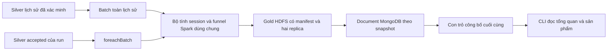

Spark dùng `lag`, điểm tách phiên và tổng tích lũy theo visitor; sau đó dùng các mốc thời gian để xác định chuỗi theo session–item. Các bảng trung gian dùng `DISK_ONLY`, được unpersist khi kết thúc. Không dùng pandas hoặc collect lịch sử về driver. Chỉ overview nhỏ và iterator sản phẩm có giới hạn bộ đệm đi qua driver.

Batch dùng Silver đã xác minh checksum, schema, marker và replica. Streaming dùng Silver accepted hiện có; quyết định dedup/lateness và DLQ giữ nguyên. Prepare bổ sung tham chiếu Python từ JSONL replay có tối đa 10.000 event, độc lập với thuật toán Spark.

### 2. Vai trò mã nguồn

| Module                                                                    | Công dụng                                                                                                          |
| ------------------------------------------------------------------------- | ------------------------------------------------------------------------------------------------------------------ |
| contracts.py (tham chiếu `../../app/ecommerce_behavior/contracts.py`)     | Phiên bản, ngưỡng 30 phút, ID xác định, công thức, kiểm tra counts/rates, fingerprint và oracle Python có giới hạn |
| pipeline.py (tham chiếu `../../app/ecommerce_behavior/pipeline.py`)       | Session hóa phân tán, bảng session–item, funnel và ghi Parquet/JSON cùng báo cáo đối soát                          |
| store.py (tham chiếu `../../app/ecommerce_behavior/store.py`)             | Ghi sản phẩm theo lô, xác minh MongoDB, chặn thay đổi snapshot và đọc trang kết quả                                |
| historical.py (tham chiếu `../../app/ecommerce_behavior/historical.py`)   | Xác minh Silver lịch sử, tạo identity, materialize/reuse Gold và công bố registry                                  |
| integration.py (tham chiếu `../../app/ecommerce_behavior/integration.py`) | Fixture thật Spark/HDFS/MongoDB, đối chiếu oracle, fault injection và cleanup UUID                                 |
| streaming manager (tham chiếu `../../app/streaming_manage.py`)            | Lệnh Make, spec qua stdin, khóa, cancel, monitor, artifact host và con trỏ lịch sử mới nhất                        |
| runtime dispatcher (tham chiếu `../../app/jobs/streaming.py`)             | Kiểm tra ZIP/code SHA rồi chạy Spark hoặc truy vấn MongoDB không tạo SparkContext                                  |

`ecommerce_streaming.batch` ghi hành vi trong Gold của batch; `Store.publish` công bố funnel và KPI trước một con trỏ chung; `stream.final_report` đối chiếu cả hai với prepared reference. Package builder thêm `ecommerce_behavior` vào profile streaming, không đổi các byte package ingestion.

### 3. Lưu trữ HDFS

Lịch sử nằm dưới `/ecommerce/gold/behavior/history/<analysis_id>/`. `analysis_id` là SHA-256 identity gồm request và checksum manifest Silver. Request gắn dataset, source path, code SHA, phiên bản hành vi và base namespace.

Streaming bổ sung dữ liệu vào Gold batch hiện có: `/ecommerce/gold/replay/<run_id>/<batch_id-20-digits>/`.

| Payload                     | Nội dung/công dụng                                                                            |
| --------------------------- | --------------------------------------------------------------------------------------------- |
| `sessions/`                 | Parquet session ID, visitor, start/end, số event từng loại và cờ đạt các bước                 |
| `session_items/`            | Parquet session–item với `view_at`, `cart_at`, `purchase_at` và số event; dùng đối soát chuỗi |
| `funnel_products/`          | Parquet tất cả sản phẩm, counts và tỷ lệ                                                      |
| `behavior.json`             | Overview và fingerprint sản phẩm                                                              |
| `behavior-quality.json`     | Đối soát số event giữa nguồn, session, session–item và sản phẩm                               |
| `manifest.json`, `_SUCCESS` | Identity, inventory, checksum và dấu công bố hoàn chỉnh                                       |

Session và session–item phân vùng theo ngày bắt đầu phiên; việc session hóa diễn ra trước khi phân vùng. Không chia thư mục theo visitor/item. Gold streaming vẫn giữ `metrics.json` với cấu trúc KPI cũ.

Snapshot được xây trong staging UUID, đạt hai replica rồi rename không ghi đè. Retry xác minh và tái sử dụng; snapshot hỏng không được tự sửa hoặc overwrite. Những file rỗng không có data block; replica được kiểm tra trên các payload có block, gồm JSON tổng hợp.

### 4. MongoDB và tính nhất quán

| Collection        | Khóa và vai trò                                                         |
| ----------------- | ----------------------------------------------------------------------- |
| `behavior_runs`   | `_id=analysis_id`, identity, trạng thái và đường dẫn lịch sử đã công bố |
| `funnel_overview` | `_id=snapshot_id`, overview bất biến                                    |
| `funnel_products` | `_id=snapshot_id:item_id`, toàn bộ kết quả sản phẩm                     |

Snapshot ID lịch sử là `history:<analysis_id>`, streaming là `<run_id>:<batch_id>`. Document có ownership `analysis_id` hoặc `run_id`/`batch_id`. Index unique `(snapshot_id,item_id)` chặn trùng; index `(snapshot_id,view_sessions DESC,item_id ASC)` phục vụ trang 20 sản phẩm.

MongoDB ghi replace/upsert theo lô 100, không `$inc`. Đọc lại toàn bộ fingerprint/counts sản phẩm trước công bố. Lịch sử đặt registry `published` cuối; host thay `latest-analysis.json` sau khi job/monitor thành công. Streaming chỉ đổi `committed_batch_id` sau KPI, funnel và batch metadata. Reader ghim pointer một lần để tránh trộn batch.

Nếu chết sau Gold hoặc giữa MongoDB, dữ liệu chưa công bố có thể còn; chạy lại cùng identity tái sử dụng Gold và ghi hoàn tất. Nếu chết sau pointer, retry vẫn ghi cùng document ID/nội dung. Không có transaction chung giữa HDFS, Kafka và MongoDB.

### 5. Tài nguyên và tương thích

Giữ driver 512 MiB, executor 640 MiB, hai core tổng và bốn shuffle partition. Lịch sử và streaming chạy riêng bằng khóa driver, có monitor container khoảng mỗi năm giây. Không thêm container/dependency hay thay cấu hình Compose.

`stream-v2` yêu cầu `behavior_version=behavior-v1` và `expected_behavior` trong prepared config. Code fingerprint thay đổi nên run cũ không tiếp tục bằng mã mới. Giữ mã/archive tương ứng để phục hồi run cũ, hoặc chuẩn bị run mới. Ingestion vẫn có SHA archive `ae42a5981bc20e1295df1dabbfab7e553af0f133a39c97fb52fa795ceafcb554`.

Nguồn: Spark Window (tham chiếu `https://spark.apache.org/docs/3.5.7/api/python/reference/pyspark.sql/api/pyspark.sql.Window.html`), unix_millis (tham chiếu `https://spark.apache.org/docs/3.5.7/api/python/reference/pyspark.sql/api/pyspark.sql.functions.unix_millis.html`), foreachBatch (tham chiếu `https://spark.apache.org/docs/3.5.7/structured-streaming-programming-guide.html#foreachbatch`), MongoDB atomicity (tham chiếu `https://www.mongodb.com/docs/manual/core/write-operations-atomicity/`).

## 2.31. Nguồn tài liệu: `docs/analytics/03-operations.md`

## 03 — Vận hành và phục hồi

← Mục lục (tham chiếu `README.md`)

### 1. Điều kiện

Cụm Docker healthy, Silver lịch sử đã ingest và `artifacts/data/latest-ingest.json` tồn tại trong cùng workspace. Dùng terminal có quyền Docker. Nếu chưa có Silver, chạy `make ingest`; nếu chưa xác nhận reuse ingestion, chạy lại và kiểm tra cờ reuse theo hướng dẫn ingestion (tham chiếu `../data/03-ingestion.md`).

```bash
make doctor
make test
make test-behavior
make test-stream
```

`test-behavior` kiểm tra batch/session/funnel trên fixture; `test-stream` kiểm tra Kafka, checkpoint và funnel qua nhiều batch. Hai lệnh dùng một Spark driver tại mỗi thời điểm, không chạy đồng thời.

### 2. Phân tích lịch sử

```bash
make analyze-behavior
make behavior-status
make behavior-status ITEM_ID=355908
```

Lệnh analyze đọc toàn bộ Silver đã công bố, không dùng giới hạn nguồn replay 10.000 event. Chạy lại cùng source/code tái sử dụng Gold. Nếu code hoặc source đổi, identity và analysis ID mới được sinh tự động, snapshot cũ được giữ.

Status mặc định trả overview và tối đa 20 sản phẩm, theo phiên xem giảm dần rồi ID chuỗi tăng dần. ITEM_ID là chuỗi chữ số, giữ nguyên số 0 đầu. Không tìm thấy sản phẩm trả `products=[]`; thiếu phân tích đã published báo lỗi. MongoDB vẫn lưu toàn bộ sản phẩm, không chỉ top 20.

### 3. Demo streaming mới

Sau khi cập nhật mã, dùng RUN_ID mới:

```bash
make prepare-demo RUN_ID=behavior-demo-001
```

Terminal A:

```bash
make stream RUN_ID=behavior-demo-001
```

Sau `STREAM_READY=behavior-demo-001`, terminal B:

```bash
make replay RUN_ID=behavior-demo-001
```

Terminal khác hoặc sau khi producer kết thúc:

```bash
make stream-status RUN_ID=behavior-demo-001
make behavior-status RUN_ID=behavior-demo-001
make behavior-status RUN_ID=behavior-demo-001 ITEM_ID=355908
```

`stream-status` có `funnel.overview` và `funnel.is_final`. `behavior-status` bổ sung trang sản phẩm. Trước batch đầu, chưa có funnel được công bố; dùng stream-status để xem producer/consumer pending. Sau offset drain, checkpoint và đối soát, streaming tự dừng, `is_final=true`.

Prepare mặc định dùng `[2015-09-10T10:00:00.000Z,2015-09-10T16:00:00.000Z)`, tối đa 10 event/giây. Khoảng khác vẫn bị giới hạn 10.000 event. Tham chiếu hành vi dùng đúng nguồn của run, không ghép lịch sử ngoài khoảng chọn.

### 4. Báo cáo

```text
artifacts/analytics/
  source-audit.json
  latest-analysis.json
  <analysis_id>/report.json
  <analysis_id>/behavior-status.json
  attempts/logs/analyze-behavior-<UUID>.log
  attempts/logs/resources-<UUID>.json
  attempts/resources.json
  tests/logs/...
  test-behavior.json
```

Report lịch sử chứa identity, source/code fingerprint, đường dẫn Gold, manifest, summary, replica, reused và kết quả monitor. Status nằm cạnh report của analysis. Log/mẫu tài nguyên giữ theo attempt; `resources.json` là lần quan sát mới nhất.

`source-audit.json` ghi đối soát CSV offline đã chạy trong phiên phát triển, với `streaming_runtime_verified=false`; đây không phải report Spark/MongoDB. Prepare và final report mới là đối soát của từng run thực tế.

Streaming tiếp tục lưu dưới `artifacts/streaming/<run_id>/`; `report.json` có thêm `behavior`, prepared config có `expected_behavior`, log có UUID. `passed=true` chỉ xác nhận chức năng; hiệu năng cần samples, `performance_target_met=true`, `no_oom_or_restart=true` và quan sát RAM đầy đủ. Xem báo cáo streaming (tham chiếu `../streaming/03-operations.md`).

Report cũ vẫn có thể còn sau lượt lỗi. Kiểm tra exit code, run/analysis ID, code fingerprint và log của attempt hiện tại; không suy từ việc file JSON tồn tại.

### 5. Ngắt, retry và xử lý lỗi

Ctrl+C yêu cầu wrapper dừng tiến trình từ xa trước khi giải phóng khóa. Lịch sử tiếp tục bằng `make analyze-behavior` với cùng source/code; streaming tiếp tục bằng hai lệnh stream/replay của cùng RUN_ID, trong hai terminal. Giữ checkpoint và snapshot đã commit.

| Tình huống                                         | Cách xử lý                                                                                                                            |
| -------------------------------------------------- | ------------------------------------------------------------------------------------------------------------------------------------- |
| Docker daemon/socket bị từ chối                    | Chạy từ terminal có quyền Docker; offline không cần daemon                                                                            |
| Thiếu latest-ingest                                | Ingest thành công trong cùng workspace trước                                                                                          |
| Another managed Spark job                          | Đợi driver hiện tại dừng; không chạy batch và streaming đồng thời                                                                     |
| Run code fingerprint changed / unsupported version | Chuẩn bị RUN_ID mới, hoặc khôi phục đúng mã cũ để tiếp tục run cũ                                                                     |
| Historical analysis not published                  | Chạy lại analyze với cùng source/code để hoàn tất sink                                                                                |
| Gold/Silver thiếu marker, sai checksum hoặc bị mất | Giữ dữ liệu/log để điều tra, khôi phục snapshot tương ứng; không overwrite                                                            |
| MongoDB ghi dở                                     | Pointer chưa đổi; chạy lại cùng identity để ghi hoàn tất                                                                              |
| Final session/funnel differs                       | So nguồn, khoảng replay, accepted/late và fingerprint; không tắt đối soát                                                             |
| Resource monitor báo OOM/restart                   | Kiểm tra log/resources và limit thực tế; không nâng RAM để che lỗi                                                                    |
| Remote stop unconfirmed                            | Theo guard/cancel token trong hướng dẫn streaming (tham chiếu `../streaming/03-operations.md`), xác nhận dừng trước khi chạy job khác |

Tính năng dùng bind mount `/opt/app`; không cần build image hoặc reset volume khi cập nhật mã. Test tự dọn namespace UUID. Dữ liệu lịch sử/demo được giữ để đối soát; chưa có lệnh xóa riêng analysis/run nghiệp vụ. Không xóa collection chung hoặc topic để dọn một lượt.

## 2.32. Nguồn tài liệu: `docs/analytics/04-testing.md`

## 04 — Kiểm thử và nghiệm thu

← Mục lục (tham chiếu `README.md`)

### 1. Offline

`make test` có 34 test hạ tầng và 78 ứng dụng: 16 ingestion, 39 streaming và 23 test mới cho contract/publication/host behavior. Lượt hiện tại có 105 đạt, 7 HTTP skipped vì môi trường cấm socket. `make config` và parse Python 3.10 đạt. Package ingestion giữ nguyên SHA; archive streaming cũng được compile từng file mà không import dependency container.

| Nhóm mới               | Kiểm tra                                                                                                                                                                                            |
| ---------------------- | --------------------------------------------------------------------------------------------------------------------------------------------------------------------------------------------------- |
| Contract: 12 test      | Biên 30 phút tới millisecond, qua ngày, cùng item/visitor/session, thứ tự nghiêm ngặt, ties, nhiều item, mua thiếu bước, late bridge, scope ID, nguồn rỗng/có giới hạn, counts/rates và fingerprint |
| Mongo boundary: 8 test | Lỗi sau 100/101 sản phẩm giữ pointer cũ, retry sau pointer không thêm document, sai nội dung bị chặn, v2 không công bố KPI thiếu funnel, phát hiện dữ liệu hỏng, trang 20, exact item và cờ final   |
| Host: 3 test           | Analyze lỗi không đổi latest pointer, request gắn source/code/version, status chọn đúng lịch sử/run và giữ string ID                                                                                |

Test Mongo dùng adapter có trạng thái trong bộ nhớ; chúng không chứng minh hành vi MongoDB server thật. Oracle chỉ nhận nguồn tối đa 10.000 event, không dùng để tính toàn bộ lịch sử.

### 2. Tích hợp thật

```bash
make test-behavior
make test-stream
```

`test-behavior` có sáu test: bảng Spark khớp oracle trên các biên/chuỗi; nguồn rỗng; 300 event xáo trộn với seed cố định; publish/reuse và exact item lookup; bốn điểm fault lịch sử; từ chối Gold mất marker. Fixture lịch sử có hơn 100 sản phẩm để lỗi giữa lô MongoDB thực sự để lại tập sản phẩm chưa đủ.

HDFS nằm dưới `/ecommerce/_tests/behavior/<UUID>`. Mongo cleanup lấy đúng analysis ID có source path UUID này rồi xóa ownership tương ứng. Cleanup chạy cả khi test lỗi; lỗi cleanup cũng khiến lệnh thất bại. Không đụng namespace nghiệp vụ hoặc Kafka topic.

`test-stream` hiện có mười test, gồm tám fault scenario. Tất cả test KPI hoàn chỉnh kiểm tra thêm funnel Gold/MongoDB. Hai test mới kiểm tra late bridge đúng biên 10 phút nối hai session qua batch, và batch chỉ có invalid công bố funnel rỗng trước khi nhận event hợp lệ. Fault `mongo_mid_funnel_products` kiểm tra trước con trỏ chung; fault sau MongoDB/trước checkpoint kiểm tra restart.

Traceback `injected ...` trong fault test là chủ đích; đánh giá tổng kết cuối, cleanup và exit code. Report tám test streaming cũ đã đạt chỉ chứng minh mã trước khi thêm behavior.

### 3. Tham chiếu nguồn demo

Đối soát offline CSV của khoảng mặc định, sau chuẩn hóa/loại trùng và session hóa chỉ trong khoảng replay:

| Chỉ số                           | Kỳ vọng |
| -------------------------------- | ------: |
| Event                            |   2.692 |
| Session                          |   1.893 |
| Phiên xem                        |   1.882 |
| Phiên có xem rồi thêm giỏ        |      35 |
| Phiên hoàn thành xem → giỏ → mua |       9 |
| Sản phẩm có tương tác            |   2.155 |

Tổng các bước theo sản phẩm lần lượt là 2.354, 43, 10; khác tổng quan vì một phiên có thể tương tác nhiều sản phẩm. KPI cũ vẫn phải có 19 transaction, 1.860 visitor, 17 buyer. Không đánh đồng 9 phiên hoàn thành funnel với 27 purchase event hoặc 19 giao dịch.

Các số tham chiếu offline này đã được run `behavior-demo-001` xác nhận bằng Spark runtime. Prepare tạo reference cùng scope ID từ nguồn JSONL; final report đối chiếu cả summary và fingerprint sản phẩm.

### 4. Nghiệm thu lịch sử và phục hồi

Chạy `make analyze-behavior` hai lần. Lần đầu phải đối soát tổng event với manifest Silver hiện tại: 2.755.641. Lần hai phải `reused=true`, manifest và checksum giữ nguyên. Mongo overview/sản phẩm khớp Gold; mọi counts/rates thỏa hợp đồng.

Chạy một demo hoàn chỉnh bằng RUN_ID mới, rồi một run khác để kiểm tra ngắt streaming và tiếp tục khi producer đang phát. Thử ngắt producer và tiếp tục cùng cursor. Kết quả cuối phải khớp reference, backlog 0, checkpoint batch cuối tồn tại và funnel final. Sự kiện phát lại không tăng số liệu.

Giữ bằng chứng hai worker của streaming, hai replica payload, không OOM/restart, tổng limit container dưới 7 GiB, RAM được quan sát đầy đủ. Mục tiêu p95 sau khởi động ≤60 giây; nếu thiếu samples hoặc chỉ có batch đầu thì chưa đủ bằng chứng hiệu năng. Không chạy batch lịch sử cùng streaming.

### 5. Trạng thái thật

- `artifacts/analytics/test-behavior.json`: 6/6 đạt, cleaned, hai replica, cả hai resource flag true.
- `artifacts/streaming/test-stream.json`: 10/10 đạt, tám fault scenario, cleanup và monitor đạt.
- History `f24f8bc4f1363134cb4c8a894e217d20c272a780b00784473fd8742dcf327be7`: 2.755.641 event, 1.761.675 session, 235.061 sản phẩm, funnel 1.755.781 → 34.042 → 10.399. Lần đầu 137,407 giây; lần hai 45,407 giây, reused và manifest/summary giống nhau. Product fingerprint `59ae504d1b3850e1129fc99ae09d5fa8f71f1e1c5cab189920f6f8aa15c2e7ce`.
- `artifacts/streaming/behavior-demo-001/report.json`: passed, 2.692 event, 1.893 session, 2.155 sản phẩm, funnel 1.882 → 35 → 9; backlog 0, checkpoint batch 18, hai worker/hai replica, p95 37,287 giây với 2.627 samples; resources đầy đủ và không OOM/restart.
- Artifact do người dùng chạy trên terminal có Docker. Phiên công cụ vẫn bị từ chối socket, nhưng đọc được artifact chia sẻ để kiểm tra. ML mới giữ nguyên hai archive cũ; nghiệm thu riêng tại `docs/ml/04-testing.md`.

## 2.33. Nguồn tài liệu: `docs/ml/README.md`

## Feature hành vi, K-Means và dự đoán mua hàng

← Tài liệu dự án (tham chiếu `../README.md`) · Bản đồ sơ đồ (tham chiếu `../diagrams/README.md`)

Phần ML chuyển Silver lịch sử thành tám đặc trưng hành vi, phân nhóm visitor bằng K-Means và dự đoán việc mua trong 24 giờ bằng Random Forest. Kết quả có model version, snapshot HDFS, metadata/lookup MongoDB và kiểm tra khi chạy lại. RF batch/policy và ML streaming đã có artifact runtime; live suite, replay, simulator và completed reuse ML đã đạt. API/dashboard local (tham chiếu `../serving/README.md`) đọc snapshot ML thật; thao tác và cách hiểu cluster/score/nhãn nằm ở hướng dẫn web (tham chiếu `../serving/06-web-user-guide.md`).

| Tài liệu                                                                        | Nội dung                                                                                                     |
| ------------------------------------------------------------------------------- | ------------------------------------------------------------------------------------------------------------ |
| 01 — Hợp đồng feature (tham chiếu `01-features.md`)                             | Cửa sổ thời gian, công thức, kiểu dữ liệu, chống dùng dữ liệu tương lai và đối soát                          |
| 02 — Phương pháp và kiến trúc (tham chiếu `02-methodology-and-architecture.md`) | Pipeline, chọn K, model version, HDFS, MongoDB và từng module                                                |
| 03 — Vận hành (tham chiếu `03-operations.md`)                                   | Lệnh chạy, tham số, báo cáo, retry, tài nguyên và xử lý lỗi                                                  |
| 04 — Kiểm thử K-Means (tham chiếu `04-testing.md`)                              | Tích hợp thật, fault injection và bằng chứng nguồn đầy đủ/reuse                                              |
| 05 — Dữ liệu dự đoán mua (tham chiếu `05-purchase-data.md`)                     | Nhãn 24 giờ, 128 cutoff, temporal split, sampling và daily snapshots                                         |
| 06 — Random Forest (tham chiếu `06-random-forest.md`)                           | Bốn candidate, validation/test, threshold, metrics/baselines, HDFS/Mongo và mã nguồn                         |
| 07 — Vận hành prediction (tham chiếu `07-purchase-operations.md`)               | Sáu lệnh, batch score/lookup, progress, retry, tài nguyên và xử lý lỗi                                       |
| 08 — Kiểm thử prediction (tham chiếu `08-purchase-testing.md`)                  | Offline/live suite, full history, reuse và trạng thái nghiệm thu                                             |
| 09 — Chính sách precision (tham chiếu `09-purchase-policy.md`)                  | Mục tiêu precision ≥70%/recall ≥10%, ngưỡng riêng, reassessment, apply/reuse và kiểm thử                     |
| 10 — ML streaming (tham chiếu `10-streaming-scoring.md`)                        | Seed trước replay, inference K-Means/RF/policy, simulator ba đợt, CLI/status, checkpoint/retry và nghiệm thu |

Chạy tại thư mục gốc repository, sau khi Silver đã ingest:

```bash
make test
make test-ml
make build-features
make train-segments
make segment-status
```

K-Means mặc định chốt lúc `2015-07-15T00:00:00.000Z`, sử dụng bảy ngày trước đó. Chạy lại build/train cùng identity sẽ kiểm tra và tái sử dụng snapshot.

Khi K-Means/Silver đã sẵn sàng, thực hiện RF độc lập bằng:

```bash
make test-purchase
make build-purchase-data
make train-purchase
make purchase-status
make score-purchases
make purchase-score-status
```

Builder RF chạy 20 chặng để tạo 128 daily snapshots; train giữ 1.750 positive và 35.000 negative, validation/test giữ toàn cohort. Score mặc định ngày 18/09/2015 có 69.052 visitor theo tham chiếu CSV. Không cần build lại image, reset volume hoặc thêm service; giữ ngân sách khoảng 7 GiB và một Spark driver mỗi lúc.

Hiện trạng 17/10/2026: **K-Means đã nghiệm thu** cả full-source reuse. **RF gốc đã chạy thành công lần đầu**: 7/7 live test, đủ 128 ngày, 50 cây/depth 5/ngưỡng 0,93, PR-AUC test 0,18172 và batch score 69.052 visitor; full-source reuse còn chờ bằng chứng. **Policy có artifact xác nhận 5/5 live test, eligible và apply/reuse đạt**: ngưỡng 0,96, precision test 73,88%, recall 13,64%; score mới vẫn đủ 69.052 visitor, bốn predicted positive. Toàn dự án đã có lượt offline 188 test đạt, 7 HTTP skipped do giới hạn socket của phiên kiểm tra. Xem chi tiết trong tài liệu 08 và 09; developer mới dùng runbook đầy đủ (tham chiếu `../GETTING_STARTED.md`).

Khi muốn thử mục tiêu precision ≥70%/recall ≥10%, dùng quy trình policy (tham chiếu `09-purchase-policy.md`): `make test-purchase-policy`, `make tune-purchase-policy`, `make purchase-policy-status`, rồi `make apply-purchase-policy` chỉ khi `eligible=true`. Quy trình dùng scores có sẵn, không build dataset hoặc fit RF lại; score run mới có ID riêng.

Cập nhật 18/10/2026: ML streaming (tham chiếu `10-streaming-scoring.md`) đã có mã và 26 offline test mới đạt, giữ nguyên năm archive cũ. Bằng chứng runtime bổ sung sau đó xác nhận live suite/replay/simulator và completed reuse; đọc tài liệu 10 thay vì dùng trạng thái pending của lượt công cụ ban đầu. Ngày 20/10, live hữu hạn hai lượt đã có report passed, nhưng stop/resume phiên liên tục còn cần kiểm chứng riêng; trạng thái serving (tham chiếu `../serving/README.md`) phân biệt các hạng mục đã và chưa nghiệm thu.

## 2.34. Nguồn tài liệu: `docs/ml/01-features.md`

## 01 — Hợp đồng feature

← Mục lục ML (tham chiếu `README.md`)

### Nguồn và thời điểm chốt

Nguồn là Silver `events-v1` đã chuẩn hóa, loại trùng theo event ID và lưu Parquet. Build xác minh identity, inventory/SHA-256, marker `_SUCCESS`, replica payload và schema typed Silver. Không suy luận lại schema từ CSV, không dùng dữ liệu replay trong bước này.

`features-v1` sử dụng khoảng **`[AS_OF − 7 ngày, AS_OF)`**. Biên trái được lấy; event đúng AS_OF và event tương lai bị loại. Mặc định:

```text
AS_OF  = 2015-07-15T00:00:00.000Z
start  = 2015-07-08T00:00:00.000Z
window = [start, AS_OF)
```

Tham số phải có dạng UTC với đúng ba chữ số millisecond. Bảy ngày phải nằm trong phạm vi quan sát nguồn: `start >= min_event_time` và `AS_OF <= max_event_time + 1 ms`. Không âm thầm rút ngắn cửa sổ. Cửa sổ không có visitor khiến build thất bại.

Spark lọc cả `event_date` để cắt phân vùng và `event_time` để kiểm tra chính xác hai biên. Session SQL phải UTC. Mỗi visitor có ít nhất một event trong cửa sổ tạo đúng một dòng; visitor không hoạt động trong cửa sổ không được tự bổ sung dòng toàn số 0.

### Tám cột đầu vào model

Thứ tự sau là hợp đồng cố định; thay đổi công thức/thứ tự cần phiên bản mới.

| Thứ tự | Feature                     | Kiểu Parquet | Cách tính và công dụng                                                                          |
| -----: | --------------------------- | ------------ | ----------------------------------------------------------------------------------------------- |
|      1 | `view_count_7d`             | bigint       | Đếm event `view`; đo mức độ xem                                                                 |
|      2 | `cart_count_7d`             | bigint       | Đếm event `add_to_cart`; đo hoạt động thêm giỏ                                                  |
|      3 | `transaction_count_7d`      | bigint       | Distinct `transaction_id` khác null trên event `purchase`; đo giao dịch thay vì số dòng mua     |
|      4 | `unique_items_7d`           | bigint       | Distinct `item_id` trên mọi loại event; đo độ rộng tương tác                                    |
|      5 | `active_days_7d`            | bigint       | Distinct ngày UTC có event; từ 1 đến 7 ở cutoff nửa đêm, có thể 8 khi cửa sổ chạm tám ngày lịch |
|      6 | `recency_hours`             | double       | `(AS_OF − last_event_time)` theo millisecond chia 3.600.000; đo thời gian từ tương tác cuối     |
|      7 | `cart_view_ratio_7d`        | double       | `cart_count_7d / view_count_7d`; trả 0 khi không có view                                        |
|      8 | `transaction_view_ratio_7d` | double       | `transaction_count_7d / view_count_7d`; trả 0 khi không có view                                 |

Distinct tính trên toàn cửa sổ của từng visitor. Không cộng distinct theo ngày. Một transaction mua hai sản phẩm trên nhiều dòng vẫn chỉ tạo một giao dịch. Transaction ID xuất hiện trên event khác `purchase` không được tính.

Cửa sổ luôn dài đúng 168 giờ. Nếu AS_OF là 12:00 UTC, khoảng từ 12:00 bảy ngày trước đến 12:00 hôm nay chạm tám ngày lịch UTC; vì vậy `active_days_7d=8` hợp lệ trong trường hợp này. Cutoff mặc định 00:00 có tối đa bảy ngày lịch.

Hai ratio có thể lớn hơn 1, vì đây là tỷ lệ giữa số đếm tương tác. Chúng khác tỷ lệ chuyển đổi funnel có yêu cầu thứ tự/cùng sản phẩm trong `docs/analytics/`. Giá trị 0 khi thiếu view là quy ước số học, không chứng minh visitor không có ý định mua; các count gốc vẫn nằm trong vector.

Ba cột audit không nằm trong vector: `visitor_id` string, `as_of` timestamp, `last_event_time` timestamp. Giữ nguyên ID dạng chuỗi, kể cả số 0 đầu. Không biến ID, thời gian tuyệt đối hoặc dữ liệu tương lai thành input ML.

### Kiểm tra chất lượng và fingerprint

Build kiểm tra đúng kiểu cột, AS_OF thống nhất, visitor duy nhất, count nguyên không âm, activity hợp lệ, last event nằm trong cửa sổ và derived feature hữu hạn/khớp công thức trong sai số tuyệt đối `1e-12`. Tổng views/carts phải đối soát với event được chọn. Report giữ thêm số purchase event, visitor không view, visitor có transaction và recency lớn nhất.

Fingerprint sắp visitor theo thứ tự chuỗi. Mỗi dòng canonical là JSON array gồm visitor, AS_OF, last event và năm count nguyên, sau đó newline, băm SHA-256 tăng dần. Derived doubles được kiểm tra rồi đại diện bằng các đầu vào chính xác của công thức để tránh khác biệt biểu diễn float giữa Python/Spark/Mongo. Fingerprint assignment nối thêm cluster ID vào cùng array. Không đưa toàn cohort vào `collect()` hoặc pandas; iterator đọc từng phân vùng đã sắp.

Oracle Python trong `contracts.reference` chỉ dành cho fixture nhỏ, giới hạn 100.000 event. Job lịch sử dùng Spark, không dùng oracle để gom lịch sử vào RAM driver.

### Tham chiếu offline cho nguồn hiện tại

Với dataset version `aef4779c2d9008f4a51f3d12f229c9dbb6718288ea4c380dbbebaa6b2eb24d2a` và AS_OF mặc định, đối soát CSV sau loại trùng có:

| Chỉ số                                 |   Kỳ vọng offline |
| -------------------------------------- | ----------------: |
| Event duy nhất trong cửa sổ            |           168.073 |
| Visitor / dòng feature                 |            99.038 |
| View                                   |           162.779 |
| Add to cart                            |             4.011 |
| Purchase event                         |             1.283 |
| Tổng distinct transaction theo visitor |               980 |
| Tổng unique item theo visitor          |           136.776 |
| Tổng active day theo visitor           |           104.481 |
| Visitor không có view                  |               192 |
| Visitor có transaction                 |               687 |
| Recency lớn nhất, giờ                  | 167,9964286111111 |

Các giá trị này chỉ áp dụng cho nguồn và cửa sổ trên. Tổng transaction theo visitor nói chung có thể khác global distinct transaction; trên cửa sổ hiện tại cả hai cùng bằng 980. Artifact Spark người dùng đã chạy xác nhận các tổng và fingerprint khớp, gồm lần build reuse; xem bằng chứng nghiệm thu (tham chiếu `04-testing.md`).

Đối soát offline trong lượt triển khai đã lưu tại `artifacts/ml/source-audit.json`, với `runtime_verified=false`. Feature fingerprint theo hợp đồng canonical ở trên là `43dc8b700488e0a2588dcdc9216d39b3c4fdf9d4ab3edc0441edb9049bff605c`. CSV nguồn có SHA-256 `3745aa83238b1e6d44d8fda209807899f420084398f94ddf745f3cbcfecbf9e7`.

## 2.35. Nguồn tài liệu: `docs/ml/02-methodology-and-architecture.md`

## 02 — Phương pháp và kiến trúc

← Mục lục ML (tham chiếu `README.md`)

### Luồng xử lý

```mermaid
flowchart LR
    S[Silver được kiểm tra] --> F[Feature 7 ngày]
    F --> G[HDFS feature snapshot]
    G --> P[log1p và StandardScaler]
    P --> K[K-Means K từ 2 đến 5]
    K --> E[Silhouette toàn cohort]
    E --> M[Pipeline thắng trên HDFS]
    M --> R[Tải lại và đối chiếu assignment]
    R --> D[Mongo assignments và profiles]
    D --> V[Registry published]
    V --> H[Host latest-model sau kiểm tra tài nguyên]
```

ML chạy batch độc lập dưới khóa Spark driver dùng chung ingestion/streaming/analytics. Không khởi động job huấn luyện trong lúc managed streaming đang chạy. Hạ tầng hiện tại tiếp tục có hai worker, hai DataNode và replication 2.

### Pipeline được lưu

Pipeline chỉ dùng stage có sẵn của Spark 3.5.7, lưu được bằng `PipelineModel.write()` và tải bằng `PipelineModel.load()`:

1. `SQLTransformer`: `log1p(x)` cho năm count đầu. Log giảm mức chi phối của đuôi count lớn; giữ nguyên recency và hai ratio.
2. `VectorAssembler`: nối đúng tám cột theo hợp đồng. Không tự sắp theo tên hoặc đưa cột audit vào.
3. `StandardScaler`: `withMean=True`, `withStd=True`, cân bằng thang đo các chiều. Feature phương sai bằng 0 được biến đổi thành 0 theo Spark.
4. `KMeansModel`: trả `cluster_id`.

Ba bước tiền xử lý được fit một lần cho toàn cohort. Dữ liệu đã scale được persist `DISK_ONLY`; các K được fit tuần tự và cuối cùng unpersist. Chỉ giữ pipeline thắng trên HDFS. Không thêm scikit-learn, pandas, UDF ML hoặc package tải từ mạng lúc chạy.

Image hiện tại chỉ cài Python client Kafka/MongoDB. API Python `pyspark.ml` cần NumPy; module `pyspark.ml.functions` còn import pandas. `native.py` gọi chính các stage JVM qua Py4J đã có trong PySpark, giữ vector UDT trong JVM và chỉ đưa cột scalar/array về Python. Vì vậy phần ML dùng được image hiện tại, không thêm dependency hoặc yêu cầu rebuild. Artifact vẫn là Spark PipelineModel chuẩn, có thể tải từ JVM hoặc từ PySpark ML trong môi trường đã cài đủ extra. Căn cứ: Spark dependency matrix (tham chiếu `https://spark.apache.org/docs/3.5.7/api/python/getting_started/install.html#dependencies`) và mã vector_to_array của Spark 3.5.7 (tham chiếu `https://github.com/apache/spark/blob/v3.5.7/python/pyspark/ml/functions.py`).

StandardScaler tạo vector dense khi center; mỗi visitor chỉ có tám chiều. Giới hạn hiện tại: driver 512m, max result 128m; mỗi executor 640m/1 core, tổng 2 core, shuffle/default parallelism 4. Giữ nguyên giới hạn khoảng 7 GiB của Compose.

### Cách chọn K và đọc kết quả

| Thiết lập            | Giá trị                         |
| -------------------- | ------------------------------- | --- | --------- |
| K ứng viên           | 2, 3, 4, 5                      |
| Seed                 | 42                              |
| Khởi tạo             | `k-means                        |     | `, 2 bước |
| Số vòng tối đa / tol | 30 / `1e-4`                     |
| Khoảng cách / solver | `euclidean` / `row`             |
| Silhouette           | Toàn cohort, `squaredEuclidean` |

Chọn silhouette lớn nhất; nếu chênh không quá `1e-12`, chọn K nhỏ hơn. Candidate không đủ distinct vector, số dòng không lớn hơn K, có cụm rỗng hoặc metric không hợp lệ được đánh dấu invalid cùng lý do. Nếu không còn candidate hợp lệ thì fail và không công bố model. Lỗi Spark/HDFS thực tế làm job fail, không tự chuyển thành một candidate invalid để che lỗi vận hành.

Mỗi candidate có thời gian chạy; candidate đã fit có training cost, số vòng và kích thước cụm; candidate hợp lệ có silhouette. Không đặt trước K thắng hoặc một ngưỡng silhouette để công bố kết quả đẹp. Training cost dùng để chẩn đoán, không phải luật chọn K.

Report phân biệt centroid trong **không gian đã scale** với profile gồm **mean feature gốc**, count và share mỗi cụm. Label mặc định `Cụm 0`, `Cụm 1`… Diễn giải dựa vào profile thực tế; dữ liệu không cung cấp doanh thu hoặc bằng chứng churn. Cluster ID chỉ có ý nghĩa trong một `model_version`.

Seed cố định giúp tái lập thí nghiệm nhưng không cam kết fit mới luôn tạo byte/model ID cụm giống nhau khi môi trường hoặc cách chia partition thay đổi. Cơ chế reuse dùng đúng pipeline đã lưu và kiểm tra assignment, tránh refit tùy tiện. Silhouette chỉ đo độ tách cụm trên cohort này; không phải accuracy dự đoán mua hàng.

Nguồn tham khảo: Spark KMeans (tham chiếu `https://spark.apache.org/docs/3.5.7/api/python/reference/api/pyspark.ml.clustering.KMeans.html`), KMeansSummary (tham chiếu `https://spark.apache.org/docs/3.5.7/api/python/reference/api/pyspark.ml.clustering.KMeansSummary.html`), StandardScaler (tham chiếu `https://spark.apache.org/docs/3.5.7/ml-features.html#standardscaler`), ClusteringEvaluator (tham chiếu `https://spark.apache.org/docs/3.5.7/api/python/reference/api/pyspark.ml.evaluation.ClusteringEvaluator.html`), PipelineModel (tham chiếu `https://spark.apache.org/docs/3.5.7/api/python/reference/api/pyspark.ml.PipelineModel.html`).

### Identity và HDFS

`feature_snapshot_id` là SHA-256 identity: feature version, lookback 7, AS_OF, dataset version, Silver path, Silver manifest SHA và ML code SHA. `model_version` là SHA-256 identity: model contract version, feature snapshot/path/manifest SHA, code SHA, Spark version, AS_OF và toàn bộ tham số/thứ tự feature.

```text
/ecommerce/gold/features/<feature_snapshot_id>/
  features/                 Parquet: audit + tám feature gốc
  quality.json              Số đếm và fingerprint
  manifest.json             Identity, inventory, SHA từng file, replica
  _SUCCESS

/ecommerce/models/segments/<model_version>/
  pipeline/                 PipelineModel đầy đủ, gồm scaler và KMeansModel
  assignments/              Parquet: feature gốc + cluster_id
  quality.json              Candidate metrics, profiles, centroids, fingerprint
  manifest.json
  _SUCCESS
```

Ghi vào staging UUID; kiểm tra hai replica payload, tạo manifest/marker rồi rename không ghi đè. `_SUCCESS` chỉ kết hợp với identity/checksum mới chứng minh snapshot hoàn chỉnh. Snapshot có sẵn phải được kiểm tra lại. File thiếu, bị đổi, sai version/identity khiến job dừng; không ghi đè hoặc tự sửa snapshot hỏng.

Model được tải lại từ staging và đối chiếu toàn bộ assignment trước rename. Sau commit, tải lại từ đường dẫn cuối và đối chiếu tiếp. Khi reuse, xác minh source features, assignment cohort/fingerprint/profiles và pipeline transform; không fit lại. Tính tổng/mean qua Spark; chỉ collect các tập nhỏ như tối đa năm profile hoặc ba event type.

### Công bố MongoDB

| Collection         | Khóa và nội dung                                    | Công dụng                                        |
| ------------------ | --------------------------------------------------- | ------------------------------------------------ |
| `segment_models`   | `_id=model_version`; identity, path, status, report | Registry và điểm công bố model                   |
| `segment_profiles` | `_id=model_version:cluster_id`                      | Count/share/mean feature để diễn giải            |
| `visitor_segments` | `_id=model_version:visitor_id`                      | Assignment và tám feature gốc để tra một visitor |

Registry bắt đầu `prepared`. Assignment upsert theo lô 100 với ID cố định; profile ghi theo model/cluster. Đọc lại theo thứ tự visitor, kiểm tra fingerprint/count và coverage profile. Chỉ sau đó cập nhật registry `published`. Status từ chối model chưa published, trả metadata/profile/metrics và chỉ tra visitor nếu được yêu cầu.

Lỗi giữa MongoDB để lại dữ liệu prepared chưa được CLI công bố. Retry cùng identity dùng lại Gold và điền đủ các ID còn thiếu, không cộng dồn. Phiên bản published được kiểm tra khi retry và không bị sửa lại. Không có transaction chung HDFS/MongoDB; registry là điểm hiển thị, HDFS là artifact để phục hồi có kiểm soát.

Host chỉ cập nhật latest pointer khi job đã trả kết quả và monitor xác nhận không OOM/restart, có quan sát tài nguyên đầy đủ. Nếu remote đã published nhưng host bị ngắt, chạy lại cùng lệnh để xác minh rồi khôi phục report/pointer host.

### Bản đồ mã nguồn

| File                                         | Làm gì                                                                                               |
| -------------------------------------------- | ---------------------------------------------------------------------------------------------------- |
| `app/ecommerce_ml/contracts.py`              | Công thức/version/order, oracle nhỏ, validation, hash và chọn K                                      |
| `app/ecommerce_ml/features.py`               | Kiểm tra Silver, aggregate phân tán, feature snapshot/reuse                                          |
| `app/ecommerce_ml/training.py`               | Fit pipeline/candidate, đánh giá, profiles, save/load và assignment                                  |
| `app/ecommerce_ml/native.py`                 | Cầu nối stage/pipeline JVM, chuyển vector thành array trước khi đọc bằng Python, dùng image hiện tại |
| `app/ecommerce_ml/store.py`                  | Mongo registry, upsert, kiểm tra và status                                                           |
| `app/ecommerce_ml/integration.py`            | Fixture thật và fault/cleanup trên Spark/HDFS/Mongo                                                  |
| `app/ml_manage.py`                           | CLI host, chọn artifact, driver lock và latest pointer                                               |
| `app/jobs/ml.py`                             | Dispatcher trong container, kiểm tra code ZIP, tạo/dừng Spark                                        |
| `app/streaming_manage.py::launch`            | Launcher chung có tham số profile/entry/result prefix/Spark/monitor; mặc định cũ giữ nguyên          |
| `app/run_job.py`, `app/streaming_monitor.py` | Cancel process group có kiểm tra ownership, timeout và theo dõi container                            |
| `app/package_code.py`                        | Profile `ml` chỉ chứa `ecommerce_analytics` và `ecommerce_ml`                                        |

Không sửa module ingestion/streaming/behavior trong archive cũ. Hai SHA regression được kiểm tra trong offline test, giúp run streaming hiện tại tiếp tục nhận đúng code fingerprint.

## 2.36. Nguồn tài liệu: `docs/ml/03-operations.md`

## 03 — Vận hành ML batch

← Mục lục ML (tham chiếu `README.md`)

### Điều kiện và thứ tự chạy

Docker healthy, Silver lịch sử đã ingest, `artifacts/data/latest-ingest.json` có quality passed và không có managed Spark job khác. Mã ứng dụng dùng bind mount hiện tại, dependency Spark ML đã có trong image. Không cần chạy `make setup`, `make build`, ingest lại hoặc reset volume chỉ để dùng phần ML mới.

```bash
make up
make doctor
make test
make test-ml
make build-features
make train-segments
make segment-status
```

Nếu cụm đã healthy thì bắt đầu từ `make test`. Các lệnh Spark chạy tuần tự. Chạy trên terminal có quyền truy cập Docker daemon; phiên agent hiện tại chưa có quyền đó.

### Từng lệnh làm gì

| Lệnh                                 | Xử lý                                                             | Đầu ra                                                                       |
| ------------------------------------ | ----------------------------------------------------------------- | ---------------------------------------------------------------------------- |
| `make build-features`                | Kiểm tra Silver, chốt cửa sổ, aggregate và đối soát               | Feature Parquet/quality/manifest HDFS, report và latest feature host         |
| `make train-segments`                | Chọn feature đã verified, thử K, lưu/tải lại model, công bố Mongo | Pipeline, assignments, profiles/metrics, model registry và latest model host |
| `make segment-status`                | Python đọc model published trên Mongo, không tạo Spark driver     | Identity, status, report, candidate metrics và profiles                      |
| `make segment-status VISITOR_ID=001` | Tra chính xác visitor trong model được chọn                       | Thêm field `visitor`; null nếu không thuộc cohort                            |
| `make test-ml`                       | Sáu test fixture thật, thử lỗi/retry/reuse và dọn dữ liệu test    | `artifacts/ml/test-ml.json`, log và resources                                |

Tuỳ chọn:

```bash
make build-features AS_OF=2015-07-15T00:00:00.000Z
make train-segments FEATURE_SNAPSHOT_ID=<64-hex>
make segment-status MODEL_VERSION=<64-hex>
make segment-status MODEL_VERSION=<64-hex> VISITOR_ID=001
```

Thay `<64-hex>` bằng ID thật, không giữ dấu ngoặc. ID snapshot/model là 64 ký tự hex chữ thường. Visitor là digit string, giữ số 0 đầu. `AS_OF` chỉ áp dụng build feature; train đọc AS_OF từ snapshot, không dùng biến môi trường để chốt lại thời gian. Train không tự build nếu thiếu feature; chạy build trước.

ML code SHA của feature phải bằng code hiện tại khi train. Khi thay công thức/mã ML, build lại để tạo snapshot ID mới. Không sửa report hoặc manifest để vượt kiểm tra này.

### File trên host

```text
artifacts/ml/
  source-audit.json                     Đối soát CSV offline; không phải kết quả Spark
  latest-features.json                  Feature snapshot mới nhất đã đạt
  latest-model.json                     Model mới nhất đã công bố và đạt monitor
  <feature_snapshot_id>/report.json     Feature identity, HDFS path, manifest SHA, quality, reuse
  <model_version>/report.json           Model identity, HDFS path, quality, reuse, resources
  <model_version>/status.json           Lần đọc Mongo gần nhất
  attempts/logs/<action>-<UUID>.log      Log Spark của từng lần build/train
  attempts/logs/resources-<UUID>.json   Bằng chứng tài nguyên từng lần
  attempts/resources.json              Bằng chứng lần build/train gần nhất
  tests/logs/                           Log và resource từng lượt test
  tests/resources.json
  test-ml.json                          Kết quả test thành công gần nhất
```

`quality` feature có fingerprint/count/sums và event counts. `quality` model có candidate metrics, K thắng, profiles, standardized centroids, assignment fingerprint và reload flag. `reused=true` chỉ bỏ build/fit; việc kiểm tra HDFS/model/Mongo vẫn thực hiện.

Log kết thúc bằng `ML_RESULT=...`; host bổ sung đường dẫn log và cờ resources. Một file report thành công cũ không chứng minh lần gọi mới thành công: đối chiếu exit code, log/resource UUID và mã hiện tại. Job/test lỗi không ghi đè latest pointer hoặc report thành công trước đó.

`ML_CANDIDATE=...` trong log ghi metric hoặc lý do invalid của từng K, kể cả khi toàn bộ candidate bị loại và không có model report. `ML_TEST_ROOT=...` ghi namespace UUID để có thể điều tra test bị ngắt trước cleanup.

### Đọc profiles

Xem count/share trước để biết quy mô, rồi so sánh tám raw feature means. Ví dụ chỉ có thể nói “cụm này có trung bình nhiều view và cart hơn” nếu số thực tế cho thấy điều đó. Các centroid dùng để tính khoảng cách sau log/scale, không dùng trực tiếp như số lượt tương tác.

Model phân loại toàn bộ active visitor của cửa sổ; visitor mới ở tương lai chưa có assignment. Lệnh status không quét/xuất toàn bộ `visitor_segments`, tránh log lớn và truy vấn không giới hạn. Parquet assignment là đầu ra đầy đủ phục vụ phân tích tiếp theo.

### Tài nguyên, ngắt và retry

Giữ hai worker × 1 core, executor 640m, driver 512m. Tổng limit chín container dài hạn 6,25 GiB, toàn bộ cả init tối đa 6,94 GiB. Mỗi managed job có timeout 1.800 giây và thời gian dừng cưỡng bức; không chạy nhiều driver để tăng tốc. Không tự sample cohort khi thiếu tài nguyên.

Monitor lấy mẫu Docker khoảng 5 giây và so sánh container ID, thời điểm start, restart count, OOM trước/sau job. Dữ liệu lấy mẫu không chứng minh peak tuyệt đối, và RAM daemon/OS nằm ngoài tổng limit container. Cả `no_oom_or_restart` và `memory_observations_complete` phải true để host công nhận kết quả ML.

Có thể Ctrl+C. Wrapper yêu cầu dừng process group remote; snapshot đã commit được giữ. Chạy lại cùng lệnh để kiểm tra rồi tiếp tục. Nếu chưa xác nhận driver remote đã dừng, guard `artifacts/infra/driver-unconfirmed.json` chặn managed driver mới. Kiểm tra driver/container/log và chỉ gỡ marker sau khi xác nhận tiến trình sở hữu token đã dừng; không xóa guard chỉ để ép chạy.

### Xử lý lỗi

| Dấu hiệu                                   | Cách xử lý                                                                     |
| ------------------------------------------ | ------------------------------------------------------------------------------ |
| Docker permission denied                   | Chạy từ terminal có quyền Docker hiện có, kiểm tra `docker info`/context       |
| Thiếu latest ingestion/quality chưa passed | Hoàn thành và kiểm tra ingestion theo `docs/data/`                             |
| Cửa sổ vượt observed range                 | Chọn AS_OF có đủ bảy ngày trong source; không đổi timezone hoặc nới điều kiện  |
| Thiếu latest feature/report                | Chạy build; explicit ID cũng cần report host tương ứng để pin manifest         |
| Code changed                               | Build feature bằng mã hiện tại rồi train; giữ artifact phiên bản cũ            |
| No valid K-Means candidate                 | Đọc candidate reasons; cohort đồng nhất/quá nhỏ không có mô hình hợp lệ        |
| Snapshot marker/checksum/identity lỗi      | Dừng và điều tra/khôi phục artifact; không tự ghi đè snapshot hỏng             |
| Published Gold missing                     | Khôi phục model từ bản sao đúng manifest; không tái fit để thay model cũ       |
| Mongo ghi dở                               | Registry prepared nên status chưa hiển thị; retry cùng lệnh dùng lại Gold      |
| Host thiếu pointer sau khi remote publish  | Retry build/train để xác minh và ghi lại pointer host                          |
| Thiếu resource samples/OOM/restart         | Xem resources và log, giải phóng tài nguyên, khắc phục rồi retry               |
| Hết 1.800 giây                             | Xem bottleneck Spark/HDFS trước; không tự tăng RAM hoặc đổi dữ liệu nghiệm thu |

Test tự dọn đúng UUID namespace kể cả khi lỗi. Artifact feature/model nghiệp vụ được giữ để tái lập; chưa có lệnh xóa riêng model. Không xóa toàn collection/Gold để dọn một test. `make reset CONFIRM=delete-project-data` là thao tác xóa dữ liệu của toàn Compose project, chỉ dùng khi chủ động muốn reset toàn bộ theo tài liệu hạ tầng.

## 2.37. Nguồn tài liệu: `docs/ml/04-testing.md`

## 04 — Kiểm thử và nghiệm thu ML

← Mục lục ML (tham chiếu `README.md`)

### Offline

```bash
make test
make config
```

Bộ toàn dự án hiện có 34 test hạ tầng và 161 test ứng dụng; 188 đạt, 7 HTTP skipped vì môi trường không cho tạo socket loopback. Phần K-Means có 26 test offline: 14 contract/selection/snapshot/package, 6 Mongo boundary và 6 host/launcher. Phần RF có 31 test, được mô tả riêng (tham chiếu `08-purchase-testing.md`); policy bổ sung 26 test (tham chiếu `09-purchase-policy.md`). Test offline không cài hoặc import PySpark thực tế; các phép toán Spark được xác nhận bởi bộ live riêng.

Các tình huống đã kiểm tra gồm biên cửa sổ tới millisecond, qua ngày UTC, nguồn không bị sửa, multi-item transaction, distinct nhiều ngày, zero view, ratio >1, input đảo thứ tự, leading zero, giới hạn oracle, timestamp/feature không hợp lệ, canonical fingerprint và tie chọn K. Kiểm tra thứ tự pipeline/log năm count/scaler flags, reuse không gọi build, marker/identity/inventory bị hỏng, archive ML tái lập/compile được và SHA hai archive cũ giữ nguyên.

Kiểm thử bridge dựng pipeline khi NumPy/pandas/Python ML bị chặn import, kiểm tra stage JVM đúng thứ tự và việc bọc SQL DataFrame/chuyển vector thành array. Đây là kiểm tra biên bằng adapter; save/load/fit/evaluate thực tế vẫn phải đạt qua suite live.

Mongo adapter có trạng thái thực sự lưu document, gây lỗi sau 100/121 assignment và kiểm tra phần còn thiếu chưa hiển thị, retry không duplicate, sai coverage không publish, corrupt published bị từ chối, lookup exact và missing Gold. Adapter không thay thế kiểm tra server MongoDB.

Host test kiểm tra request gắn code/source/manifest, không tự build khi train thiếu feature, pointer giữ nguyên nếu tài nguyên chưa đạt, status không Spark, launcher mặc định cũ, lựa chọn archive/entry/prefix ML và guard global khi cancel chưa xác nhận. Kiểm thử large spec qua stdin và ownership/cancel của wrapper tiếp tục nằm trong bộ regression hiện có.

Hai SHA được khóa trong test:

```text
ingestion ae42a5981bc20e1295df1dabbfab7e553af0f133a39c97fb52fa795ceafcb554
streaming 009c7d7d1d411e3f1810096f9c2954235ee6b92c7a3789514fe026b9af3516ac
```

### Sáu test tích hợp thật

```bash
make test-ml
```

Fixture tạo typed Silver có 121 active visitor, nhóm hành vi khác nhau, hơn 100 assignment để thử lỗi giữa lô Mongo, leading zero, mua nhiều item, zero view, biên trái/phải và event ngoài cửa sổ để kiểm tra observed range.

| Test | Nội dung                                                                                                              |
| ---- | --------------------------------------------------------------------------------------------------------------------- |
| a    | Feature Spark khớp oracle trên input đảo, đúng cohort, reuse không tính lại                                           |
| b    | Feature version sai bị từ chối; lỗi trước/sau Gold có thể retry đúng                                                  |
| c    | Lỗi trước model Gold; fit lại từ staging chưa commit; winner save/load assignment khớp; reuse không fit; Mongo lookup |
| d    | Sau model Gold, giữa Mongo, trước/sau registry pointer; trạng thái partial bị ẩn, retry dùng Gold                     |
| e    | StandardScaler cho vector toàn 0 khi feature hằng; cohort toàn giống nhau không có candidate hợp lệ                   |
| f    | Identity/schema/marker sai và model payload hỏng bị từ chối                                                           |

Có bảy điểm fault chủ động. Traceback của lỗi injection là một phần kiểm thử; chỉ kết luận đạt khi cuối suite `OK`, `ML_RESULT.passed=true`, `cleaned=true`, cả hai resource flag true và exit code 0.

HDFS test dưới `/ecommerce/_tests/ml/<UUID>`. Mongo cleanup chỉ xóa model ID được tạo từ feature path UUID đó. Cleanup chạy trong `finally`, kiểm tra không còn document/path sở hữu; cleanup lỗi khiến cả lệnh fail. Không xóa dữ liệu nghiệp vụ hoặc topic Kafka.

### Nghiệm thu nguồn thật

Chạy tuần tự khi không có streaming driver:

```bash
make build-features
make train-segments
make segment-status
make build-features
make train-segments
```

Đối chiếu build mặc định với tham chiếu CSV (tham chiếu `01-features.md`): 168.073 event, 99.038 dòng feature, views 162.779, carts 4.011, purchase events 1.283, tổng transaction theo visitor 980, zero-view 192 và buyer 687. Dùng report và fingerprint, không chỉ đọc vài dòng feature.

Với đúng source/cutoff này, `quality.fingerprint.sha256` phải là `43dc8b700488e0a2588dcdc9216d39b3c4fdf9d4ab3edc0441edb9049bff605c`, đã tính độc lập từ CSV bằng chuẩn hóa/loại trùng và aggregate theo visitor. Tổng unique items/active days theo visitor lần lượt 136.776 và 104.481. `source-audit.json` có `runtime_verified=false`; chỉ report build thật mới xác nhận Spark đã khớp.

Mỗi visitor có đúng một assignment, tổng kích thước cluster bằng 99.038 và coverage feature/assignment/Mongo trùng nhau. Candidate metrics hữu hạn, K thắng đúng luật silhouette/tie, không yêu cầu đoán trước K. Profiles raw và standardized centroids phải được đọc đúng ý nghĩa.

Pipeline tải lại phải sinh fingerprint assignment bằng bản đã lưu. Payload đạt hai replica. Build/train lần hai `reused=true`, cùng ID/manifest/fingerprint; không fit lại và không tăng document count. Giữ report/log/resource mỗi lượt để đối chiếu.

Mỗi job không quá timeout 1.800 giây; giữ tổng limit dưới 7 GiB, không OOM/restart và không thiếu quan sát tài nguyên. Thời gian build/train và RAM phải lấy từ kết quả thực tế, không suy ra từ tốc độ test nhỏ. Nếu lỗi tài nguyên, điều tra và tối ưu trong cùng ngân sách trước khi nghiệm thu.

### Trạng thái bằng chứng

Ngày 17/10/2026, đã đối chiếu độc lập artifact runtime do người dùng tạo trong `artifacts/ml/`, gồm report/log/resource của test, feature, train, status và lần chạy lại. `verification.json` có `artifact_checks_passed=true`, `full_source_reuse_verified=true`, `pending=[]`. Đây là kiểm tra bằng chứng đã lưu; phiên công cụ vẫn không có quyền Docker để truy vấn trực tiếp cụm.

| Bằng chứng                                       | Kết quả                                                                                            |
| ------------------------------------------------ | -------------------------------------------------------------------------------------------------- |
| Live suite                                       | 6/6 test đạt, 7 fault scenario, cleanup thành công                                                 |
| Cohort                                           | 99.038 visitor, 168.073 event; feature fingerprint khớp CSV                                        |
| Feature fingerprint                              | `43dc8b700488e0a2588dcdc9216d39b3c4fdf9d4ab3edc0441edb9049bff605c`                                 |
| Model                                            | K=2, silhouette `0.8538471325752618`                                                               |
| Kích thước hai cụm                               | 7.388 và 91.650, tổng 99.038                                                                       |
| Assignment fingerprint                           | `7b602438e868242ba83a41ba75e8a34babb5b891dc88bc384ea57ce54c5d7320`                                 |
| Build lần đầu / reuse                            | 39,339 / 25,361 giây                                                                               |
| Train lần đầu / reuse                            | 97,935 / 50,331 giây                                                                               |
| RAM tổng quan sát lớn nhất khi train đầu / reuse | 2,4817 / 2,2699 GiB, tổng container limit 6,25 GiB                                                 |
| Monitor/reload/reuse                             | Đủ quan sát chín container, không OOM/restart, hai replica; cùng manifest/quality và không fit mới |

Feature ID là `4b3e9d924c88fa6042ae6851871fcd537e5bdda793d3bc2b059df348ecfa89de`; model ID là `8ec975a8e4b74329ff1c68e4c78835a824a3ea3d98990db2e40a5277cc05779d`. Tên “Cụm 0/1” là nhãn mô tả trung tính; silhouette cao không tự chứng minh một chiến lược kinh doanh hiệu quả. `source-audit.json` vẫn giữ `runtime_verified=false` vì nó chỉ là CSV audit; các report Spark và verification mới xác nhận đối soát runtime.

K-Means đã hoàn tất nghiệm thu trong phạm vi này. Random Forest/batch purchase scoring đã chạy thành công lần đầu, còn chờ full-source reuse; xem kiểm thử prediction (tham chiếu `08-purchase-testing.md`). Policy ưu tiên precision đã có mã và offline test, live policy còn pending.

Phần hành vi trước ML đã có artifact thật: 6/6 behavior tests, 10/10 streaming tests, history/reuse và `behavior-demo-001` thành công. Bằng chứng đó xác nhận nền dữ liệu/streaming; nó không thay thế nghiệm thu pipeline ML mới.

## 2.38. Nguồn tài liệu: `docs/ml/05-purchase-data.md`

## 05 — Dữ liệu dự đoán mua hàng

← Mục lục ML (tham chiếu `README.md`) · Huấn luyện → (tham chiếu `06-random-forest.md`)

### Mục đích và đơn vị dự đoán

Giai đoạn này học từ lịch sử để xếp hạng visitor có dấu hiệu mua trong **24 giờ sau thời điểm chốt**. Một dòng là `(as_of, visitor_id)`. Visitor có thể xuất hiện ở nhiều ngày, với feature và nhãn khác nhau. Kết quả phục vụ ưu tiên theo dõi hoặc lựa chọn nhóm thử nghiệm chăm sóc; chưa chứng minh tác động lên doanh thu.

Nguồn là Silver `events-v1` đã ingest thành công. Builder kiểm tra schema, identity, manifest, inventory/checksum và hai replica trước khi sử dụng. Dataset gốc và các pipeline ingestion, streaming, K-Means đã nghiệm thu được giữ nguyên. Hợp đồng mới là `purchase-data-v1`; code prediction được đóng gói riêng.

### Cửa sổ feature và nhãn

Với `t = as_of`, mọi cutoff huấn luyện đều ở `00:00:00.000Z`:

| Thành phần                | Quy tắc                                                                                       |
| ------------------------- | --------------------------------------------------------------------------------------------- |
| Cohort                    | Visitor có ít nhất một event trong `[t − 7 ngày, t)`                                          |
| Feature                   | Chỉ dùng event trong đúng cửa sổ bảy ngày đó                                                  |
| Nhãn                      | `purchase_in_next_24h`, kiểu integer `0` hoặc `1`                                             |
| Nhãn 1                    | Visitor thuộc cohort có event `purchase`, `transaction_id` khác null, trong `[t, t + 24 giờ)` |
| Nhãn 0                    | Visitor thuộc cohort không có event mua thỏa điều kiện trên                                   |
| Người mới trong ngày nhãn | Không thêm vào cohort nếu không có event trong cửa sổ feature                                 |
| Biên                      | Event đúng `t` chỉ có thể vào nhãn; event đúng `t + 24 giờ` không vào nhãn ngày này           |

Builder yêu cầu nguồn quan sát đủ cả cửa sổ feature và ngày nhãn. Khoảng min/max event của Silver là bằng chứng giới hạn thời gian nguồn; điều này không tự chứng minh hệ thống thu thập ngoài đời không bỏ sót sự kiện.

Ví dụ chốt `2015-07-15T00:00:00.000Z`: feature dùng `[08/07 00:00, 15/07 00:00)` UTC; nhãn dùng `[15/07 00:00, 16/07 00:00)` UTC. Mua nhiều item hoặc nhiều transaction trong ngày nhãn vẫn chỉ tạo nhãn `1`.

### Tám feature đầu vào

Tái sử dụng nguyên hợp đồng features-v1 (tham chiếu `01-features.md`), đúng thứ tự:

| Thứ tự | Trường                      | Ý nghĩa                                      |
| -----: | --------------------------- | -------------------------------------------- |
|      1 | `view_count_7d`             | Tổng lượt xem trong bảy ngày                 |
|      2 | `cart_count_7d`             | Tổng lượt thêm giỏ                           |
|      3 | `transaction_count_7d`      | Số transaction khác nhau của visitor         |
|      4 | `unique_items_7d`           | Số sản phẩm khác nhau đã tương tác           |
|      5 | `active_days_7d`            | Số ngày UTC có hoạt động                     |
|      6 | `recency_hours`             | Số giờ từ event cuối trước cutoff đến cutoff |
|      7 | `cart_view_ratio_7d`        | Cart/view; bằng 0 khi view bằng 0            |
|      8 | `transaction_view_ratio_7d` | Transaction/view; bằng 0 khi view bằng 0     |

Năm trường đầu là `bigint`, ba trường cuối là `double`. Tỷ lệ có thể lớn hơn 1. `visitor_id` là chuỗi chữ số và giữ leading zero; `001` khác `1`. `as_of`, `last_event_time` là timestamp audit. Ba trường audit, nhãn và cluster K-Means đều không vào vector feature. Random Forest dùng feature thô, không dùng log/scaler của K-Means.

### Chia dữ liệu theo thời gian

Lịch mặc định có **128 cutoff**, dùng toàn bộ phần lịch sử có thể quan sát đủ cửa sổ:

| Split      | Cutoff đầu → cuối, bao gồm hai đầu | Số cutoff |     Số mẫu | Mẫu nhãn 1 |
| ---------- | ---------------------------------- | --------: | ---------: | ---------: |
| Train      | 11/05/2015 → 15/07/2015            |        66 |  5.196.014 |      1.750 |
| Validation | 17/07/2015 → 15/08/2015            |        30 |  2.560.155 |        729 |
| Test       | 17/08/2015 → 17/09/2015            |        32 |  2.380.550 |        726 |
| Tổng       |                                    |       128 | 10.136.719 |      3.205 |

Cutoff ngày **16/07 và 16/08** bị loại để tạo khoảng nghỉ giữa các split. Event trong các ngày đó vẫn có thể thuộc cửa sổ feature của những cutoff sau. Không random split, không dùng test để chọn mô hình/ngưỡng. Cùng visitor có thể có mặt ở cả ba split; kết quả đo khả năng dự đoán thời gian tiếp theo trên cohort hoạt động, không phải đánh giá visitor hoàn toàn mới. Các cửa sổ feature liên tiếp có phần giao nhau, nên mẫu theo ngày không độc lập hoàn toàn.

Các số trên được đối chiếu độc lập bằng tập visitor theo ngày từ CSV: union bảy ngày trước cho cohort, giao với tập người mua ngày nhãn cho positive. Duplicate event không làm thay đổi các tập này. Artifact tham chiếu local là `artifacts/prediction/source-audit.json`, có `runtime_verified=false`. Chỉ báo cáo Spark build thực tế mới xác nhận pipeline tạo ra đúng dữ liệu. Với đúng dataset version `aef4779c2d9008f4a51f3d12f229c9dbb6718288ea4c380dbbebaa6b2eb24d2a` và lịch mặc định, finalizer từ chối khi các tổng không khớp bảng.

### Sampling chỉ áp dụng train

Giữ **tất cả positive train**, chọn đúng `min(số negative, 20 × số positive)` negative. Với nguồn hiện tại: 1.750 positive + 35.000 negative = **36.750 dòng để fit**. Validation và test giữ nguyên toàn bộ cohort, không downsample, không lấy tỷ lệ positive của train đã sampling làm baseline.

Mỗi negative có khóa SHA-256 của JSON array compact sau, UTF-8:

```json
[
  "purchase-sampling-v1",
  "<dataset_version>",
  "<as_of UTC có milliseconds>",
  "<visitor_id>",
  "42"
]
```

Sắp theo SHA tăng dần, rồi `as_of`, rồi visitor theo thứ tự chuỗi; lấy đúng số lượng cần thiết. Đây là sampling xác định, seed 42, không phụ thuộc thứ tự partition. Fingerprint kiểm tra số positive và số dòng sau khi lưu/tải lại sample. Hợp đồng sampling được gắn vào model identity.

### Snapshot và tiếp tục khi bị ngắt

Builder chia lịch thành **20 chặng**, mỗi chặng tối đa bảy cutoff và chỉ thuộc một split: 10 chặng train, 5 validation, 5 test. Các chặng chạy tuần tự. Mỗi ngày là một snapshot độc lập:

```text
/ecommerce/gold/purchase-data/<purchase_dataset_id>/
  days/YYYY-MM-DD/
    samples/          # Parquet: audit + tám feature + nhãn
    quality.json
    manifest.json
    _SUCCESS
  index/
    index.json        # Danh sách đủ 128 ngày + manifest hash + tổng từng split
    manifest.json
    _SUCCESS
```

Mỗi snapshot ghi vào staging riêng, kiểm tra inventory/checksum/hai replica rồi rename không ghi đè. Fingerprint yêu cầu khóa `(as_of, visitor_id)` duy nhất, sắp tăng dần, đúng nhãn, đúng feature và đúng tổng năm count. Index nằm trong thư mục riêng để việc kiểm tra inventory không lẫn các snapshot ngày.

Chỉ công bố index khi đủ toàn bộ ngày và cả ba split có hai lớp. Không có index hoàn chỉnh thì train từ chối. Khi bị ngắt, chạy lại cùng `make build-purchase-data`: ngày đã commit được kiểm tra và tái sử dụng; staging chưa commit không trở thành dữ liệu công bố. `progress.json` ở host ghi những chặng đã hoàn thành, còn HDFS là nguồn xác định snapshot nào thực sự tồn tại.

Đổi prediction code, nguồn hoặc lịch tạo identity mới; không tiếp tục ghép ngày thuộc các identity khác nhau. Snapshot đã công bố bị mất marker hoặc hỏng payload sẽ bị từ chối để điều tra/khôi phục, không tự ghi đè.

## 2.39. Nguồn tài liệu: `docs/ml/06-random-forest.md`

## 06 — Huấn luyện Random Forest và kiến trúc công bố

← Mục lục ML (tham chiếu `README.md`) · Dữ liệu (tham chiếu `05-purchase-data.md`) · Vận hành → (tham chiếu `07-purchase-operations.md`)

### Pipeline và lựa chọn mô hình

Pipeline Spark ML gồm `VectorAssembler` với tám feature thô theo thứ tự cố định, rồi `RandomForestClassifier`. Các stage chạy qua JVM bridge đã dùng cho K-Means. Driver không import `pyspark.ml` Python, NumPy hoặc pandas; không cần dependency/image mới. Kết quả vector của Spark được chuyển thành scalar rồi bỏ khỏi DataFrame trước khi Python đọc schema.

Huấn luyện chạy **bốn cấu hình tuần tự**:

| Candidate | `numTrees` | `maxDepth` |
| --------- | ---------: | ---------: |
| 1         |         50 |          5 |
| 2         |         50 |          8 |
| 3         |        100 |          5 |
| 4         |        100 |          8 |

Thông số chung: seed 42, `featureSubsetStrategy=sqrt`, `impurity=gini`, `maxBins=32`, `maxMemoryInMB=64`, `cacheNodeIds=false`, `minInstancesPerNode=1`, `minInfoGain=0`, `subsamplingRate=1`, `bootstrap=true`. `maxMemoryInMB` là bộ nhớ cho thống kê dựng cây, không phải giới hạn tổng RAM của job.

Mỗi candidate fit trên sample train, lưu pipeline và toàn bộ validation predictions vào HDFS, lưu metrics/feature importance/fingerprint. Tải lại candidate phải cho cùng fingerprint trên sample; khi chọn mô hình, pipeline đã tải lại phải cho cùng fingerprint trên toàn validation. Chạy lại candidate đã commit kiểm tra snapshot và predictions, không gọi fit lại.

Chọn **PR-AUC validation cao nhất**. Chênh lệch tối đa `1e-12` được xem là hòa; ưu tiên ít cây hơn, rồi depth nhỏ hơn. Phải có đủ bốn candidate hợp lệ. Lỗi vận hành, lớp dữ liệu thiếu, score không hợp lệ hoặc snapshot hỏng làm lệnh fail; không bỏ qua candidate bị lỗi để chọn từ tập còn lại.

Sau đó chọn threshold trên validation bằng lưới cố định `0.00, 0.01, …, 1.00`: ưu tiên F1 cao nhất, tiếp đến precision, rồi threshold cao hơn. Quy tắc dự đoán là `purchase_score >= threshold`. Lưu model được chọn cùng selection/threshold trước khi đọc test. **Không refit trên train + validation** sau khi chọn.

Đây là quy tắc của RF gốc. Khi cần ưu tiên precision ≥70%, recall ≥10%, sử dụng policy riêng (tham chiếu `09-purchase-policy.md`) trên các score đã lưu; không sửa threshold/selection của model gốc đã published.

### Score và các chỉ số

`purchase_score` là phần tử thứ 1 của vector `probability` từ RF, hữu hạn trong `[0,1]`. Negative sampling làm thay đổi phân phối train; điểm này **chưa được hiệu chuẩn theo tỷ lệ mua thực tế**. Dùng để xếp hạng/so ngưỡng, không hiển thị như “xác suất mua X%”. `predicted_label` là integer theo ngưỡng validation, không dùng hard prediction mặc định của RF.

| Chỉ số             | Công dụng                                                              |
| ------------------ | ---------------------------------------------------------------------- |
| PR-AUC             | Chỉ số chính để so candidate trên dữ liệu ít positive                  |
| ROC-AUC            | Bổ sung đánh giá khả năng xếp hạng hai lớp                             |
| Precision          | Trong các mẫu dự đoán mua, tỷ lệ thật sự mua                           |
| Recall             | Trong các mẫu thật sự mua, tỷ lệ được phát hiện                        |
| F1                 | Trung bình điều hòa precision/recall tại ngưỡng đã khóa                |
| TP/FP/FN/TN        | Đếm đầy đủ confusion matrix, phục vụ đối soát                          |
| Precision@1%       | Mức tập trung positive trong nhóm ưu tiên nhỏ mỗi ngày                 |
| Feature importance | Tầm quan trọng impurity của tám feature; không suy ra quan hệ nhân quả |

PR/ROC dùng Spark `BinaryClassificationEvaluator`, `numBins=0` để không giảm số điểm trên đường cong. PR-AUC ở đây là **diện tích hình thang theo quy ước Spark**, không phải chỉ số average precision. Bộ oracle nhỏ khớp cùng quy ước. RDD trung gian của native metrics được `unpersist()` trong `finally`.

Precision@1% tính riêng từng cutoff: chọn đúng `ceil(0.01 × cohort_ngày)` dòng, score giảm dần; khi bằng điểm, visitor theo thứ tự chuỗi tăng dần. Báo cáo tổng positive được chọn / tổng dòng được chọn trên mọi ngày của split, kèm đếm từng ngày. Không chọn top 1% gộp cả tháng vì cách đó có thể bỏ qua nhiều ngày.

Validation và test đều được so với hai baseline trên **cohort nguyên bản**:

1. Luôn không mua: score `0`, threshold `1`.
2. Score hằng bằng prevalence của train trước sampling, threshold `0.5`.

Hai baseline đều có AUC, confusion và top 1% theo cùng quy tắc tie. Model report ghi `beats_prevalence_pr_auc` đúng theo kết quả test. Không đặt trước con số accuracy hay đảm bảo RF thắng baseline. Tất cả split được đánh giá AUC phải có cả hai lớp.

### Luồng lưu trữ

```text
Silver đã kiểm tra
  → 128 daily labeled snapshots → purchase index
  → exact training sample
  → 4 candidate pipelines + validation predictions
  → selection + locked pipeline + threshold
  → held-out test evaluation + predictions
  → Mongo purchase_models: published
  → historical batch features → scalar scores
  → HDFS score snapshot → Mongo scores → published score registry
```

| Nơi lưu                                                                 | Nội dung                                                                 |
| ----------------------------------------------------------------------- | ------------------------------------------------------------------------ |
| `/ecommerce/gold/purchase-samples/<sample_id>/`                         | Sample Parquet, quality, manifest/marker                                 |
| `/ecommerce/models/purchase-candidates/<model_version>/<candidate_id>/` | Pipeline, validation scores phân vùng `cutoff_date`, metrics/fingerprint |
| `/ecommerce/models/purchases/<model_version>/`                          | Pipeline được khóa, `selection.json`, manifest/marker                    |
| `/ecommerce/gold/purchase-evaluations/<evaluation_id>/`                 | Test scores theo `cutoff_date`, `evaluation.json`, manifest/marker       |
| `/ecommerce/gold/purchase-scores/<score_run_id>/`                       | Batch score Parquet, quality, manifest/marker                            |

Mọi payload được kiểm tra SHA và tối thiểu hai block replica trước rename không ghi đè. Model version gắn dataset/index/sample manifest, code SHA, Spark version, thứ tự feature, RF params, candidate grid và quy tắc chọn. Evaluation identity gắn manifest của model đã khóa, nên test không thể âm thầm thay model selection. Candidate/selection/evaluation đã commit được tái sử dụng theo cùng identity.

### MongoDB và tính nhất quán

| Collection            | Nội dung và cách đọc                                                                                |
| --------------------- | --------------------------------------------------------------------------------------------------- |
| `purchase_models`     | Identity, HDFS paths, selection, validation/test metrics, baselines, trạng thái model               |
| `purchase_score_runs` | Identity nguồn/model/cutoff/threshold, path, coverage/fingerprint và trạng thái score batch         |
| `purchase_scores`     | Một document cho mỗi `(score_run_id, visitor_id)`, tám raw feature, audit, score, label và metadata |

Không đưa hàng triệu validation/test prediction vào MongoDB; các prediction đó nằm trên HDFS. Mongo chỉ nhận model metadata và batch score cohort được yêu cầu. `purchase_scores` có unique index `(score_run_id, visitor_id)` và `_id = score_run_id + ':' + visitor_id`.

Registry bắt đầu ở `prepared`. Ghi score bằng upsert tối đa 100 document mỗi lô, đọc lại và đối chiếu **toàn bộ** count/fingerprint/metadata với Gold, rồi mới cập nhật registry `published`. Lệnh status chỉ trả model/run đã published; partial Mongo chưa trở thành kết quả công bố. Retry sau khi ghi dở dùng lại Gold và deterministic ID, không nhân đôi document.

Nếu registry đã published, retry xác minh dữ liệu hiện có thay vì sửa ngầm document hỏng. Nếu Gold của bản đã published bị mất, hệ thống yêu cầu khôi phục snapshot. Host latest pointer chỉ cập nhật sau khi child trả kết quả thành công và monitor có đủ quan sát, không OOM/restart. Mongo có thể đã commit khi host bị ngắt hoặc monitor fail; chạy lại đúng identity để đối chiếu và hoàn tất pointer host.

Status là thao tác đọc metadata/visitor trong Mongo, không chạy Spark và không tái kiểm toàn bộ HDFS. Để kiểm chứng checksum, reload và coverage toàn bộ, chạy lại build/train/score tương ứng.

### Vai trò mã nguồn

| File/module                         | Công dụng                                                                        |
| ----------------------------------- | -------------------------------------------------------------------------------- |
| `app/prediction_manage.py`          | CLI host, orchestration 20 chặng/bốn candidate, progress/latest và resource gate |
| `app/jobs/prediction.py`            | Kiểm archive/spec SHA, dispatch child, quản lý Spark/Store và kết quả JSON       |
| `ecommerce_prediction/contracts.py` | Hợp đồng, lịch, hash sampling, fingerprint, oracle nhỏ và tie rules              |
| `data.py`                           | Silver validation, feature/nhãn từng ngày, snapshot và composite index           |
| `training.py`                       | Sample, pipeline JVM, candidate, selection khóa và test evaluation               |
| `metrics.py`                        | Exact PR/ROC, 101 threshold, confusion, baseline và daily top 1%                 |
| `scoring.py`                        | Kiểm model/code/Spark/source, batch score, reload fingerprint và công bố         |
| `store.py`                          | Ba collection riêng, partial visibility, upsert và registry cuối cùng            |
| `integration.py`                    | Fixture trên Spark/HDFS/Mongo và fault injection/cleanup theo UUID               |

Archive profile `prediction` chứa analytics + ML + prediction; không đưa streaming/behavior vào gói mới. Ba archive ingestion/streaming/ML cũ được khóa hash trong regression để bảo vệ các phiên bản đã nghiệm thu.

## 2.40. Nguồn tài liệu: `docs/ml/07-purchase-operations.md`

## 07 — Vận hành purchase prediction

← Mục lục ML (tham chiếu `README.md`) · Kiểm thử → (tham chiếu `08-purchase-testing.md`)

### Điều kiện và lệnh chạy lần đầu

Chạy tại thư mục gốc repository từ terminal có quyền Docker. Cụm cần healthy, hai worker/hai DataNode sẵn sàng và có `artifacts/data/latest-ingest.json` với `quality_status=passed`. Dừng/đợi streaming driver và các Spark job khác trước khi chạy batch. Prediction dùng cùng driver lock, wrapper cancel và monitor hiện có.

```bash
make doctor
make test
make test-purchase
make build-purchase-data
make train-purchase
make purchase-status
make score-purchases
make purchase-score-status
```

Không cần chạy lại setup/build/ingest khi Silver và cụm hiện tại đã sẵn sàng. Mã `/opt/app` dùng bind mount, không có service/dependency/image mới cho phần này.

| Lệnh                         | Công dụng                                                                                | Spark                 |
| ---------------------------- | ---------------------------------------------------------------------------------------- | --------------------- |
| `make build-purchase-data`   | Chuẩn bị 128 cutoff, 20 chặng daily snapshots rồi công bố index                          | Có, các child tuần tự |
| `make train-purchase`        | Sample, fit/reuse bốn RF, chọn theo validation, khóa model, đánh giá test, công bố Mongo | Có, các child tuần tự |
| `make purchase-status`       | Xem model metadata, lựa chọn, ngưỡng, metrics và baselines                               | Không                 |
| `make score-purchases`       | Dùng model published để score một cohort lịch sử ở cutoff yêu cầu                        | Có                    |
| `make purchase-score-status` | Xem score run metadata và tùy chọn một visitor                                           | Không                 |
| `make test-purchase`         | Bảy test tích hợp thật trong namespace riêng, có cleanup                                 | Có                    |

Train yêu cầu dataset report hoàn chỉnh đã có; không tự build 128 ngày khi thiếu. `purchase-status` mặc định chọn model prediction gần nhất; không dùng pointer K-Means dù cả hai lệnh có tham số `MODEL_VERSION`.

### Tham số chọn phiên bản

| Biến                  | Lệnh áp dụng                         | Mặc định                       |
| --------------------- | ------------------------------------ | ------------------------------ |
| `PURCHASE_DATASET_ID` | `train-purchase`                     | `latest-purchase-data.json`    |
| `MODEL_VERSION`       | `purchase-status`, `score-purchases` | `latest-purchase-model.json`   |
| `SCORE_RUN_ID`        | `purchase-score-status`              | `latest-purchase-score.json`   |
| `AS_OF`               | `score-purchases`                    | `2015-09-18T00:00:00.000Z`     |
| `VISITOR_ID`          | `purchase-score-status`              | Không tra visitor khi bỏ trống |

`MODEL_VERSION` không dùng để ép tên/ghi đè model ở bước train; `PURCHASE_DATASET_ID` cũng không đổi ID builder. Các ID là 64 ký tự hex chữ thường. Lịch train/split là hợp đồng cố định, không thay bằng `AS_OF` trên Makefile.

Ví dụ, thay các chuỗi ID bằng ID thực từ report:

```bash
make train-purchase PURCHASE_DATASET_ID=<purchase_dataset_id>
make purchase-status MODEL_VERSION=<model_version>
make score-purchases MODEL_VERSION=<model_version> AS_OF=2015-09-18T00:00:00.000Z
make purchase-score-status SCORE_RUN_ID=<score_run_id> VISITOR_ID=001
```

Giữ visitor dưới dạng chuỗi; `001` khác `1`. Lookup chỉ trả đúng một visitor, không tải toàn collection. Không tìm thấy visitor thì trường `visitor` bằng null; có thể visitor không hoạt động trong cửa sổ bảy ngày được score.

### Batch scoring lịch sử

Mặc định score tại **18/09/2015 00:00 UTC**, dùng feature `[11/09 00:00, 18/09 00:00)`. Cohort tham chiếu từ CSV là **69.052 visitor**; mã kiểm tra con số này khi đúng source/cutoff mặc định. Bước này không cần nhãn tương lai, không đọc event tương lai để tạo feature và không báo cáo accuracy cho cutoff thiếu đủ ngày nhãn.

Cho phép cutoff từ ngày test đầu tiên trở đi, miễn nguồn quan sát đủ toàn cửa sổ feature. Input là timestamp UTC có milliseconds. Score bắt buộc dùng đúng prediction archive SHA và Spark version đã gắn với model, model đã published, manifest/feature order/threshold khớp. Sai code hoặc payload làm lệnh fail trước công bố.

Kết quả visitor gồm audit, tám feature thô, `model_version`, `score_run_id`, `threshold`, `purchase_score` và `predicted_label`. Score chưa hiệu chuẩn, không diễn giải thành phần trăm xác suất mua. Chưa có API, dashboard, streaming scoring hoặc kết hợp cluster K-Means trong vector RF ở giai đoạn này.

### Report, log và progress

```text
artifacts/prediction/
  source-audit.json                 # CSV tham chiếu offline; runtime_verified=false
  latest-purchase-data.json
  latest-purchase-model.json
  latest-purchase-score.json
  test-purchase.json
  attempts/logs/                    # Chuẩn bị dữ liệu/huấn luyện
  tests/logs/                       # Live suite và resource samples
  <purchase_dataset_id>/
    progress.json                  # completed_chunks, stages, daily results
    report.json                    # Chỉ có sau finalize thành công
    logs/
  <model_version>/
    training.json
    progress.json                  # Các candidate hoàn tất
    report.json                    # Selection + evaluation + publication
    status.json
    logs/                          # Candidate, finalization, status và score attempts
  <score_run_id>/
    report.json
    status.json
```

Mỗi child có log và file resource samples tương ứng do launcher tạo. `PREDICTION_RESULT=` là kết quả JSON của child; `PURCHASE_DAY=`, `PURCHASE_CANDIDATE=` và `PURCHASE_BUILD_CHUNK=` cho biết tiến độ. Không kết luận từ một dòng log giữa job: yêu cầu exit 0, `passed=true` và hai cờ resource đều true. Latest host pointer chỉ đổi khi toàn bộ tác vụ public thành công.

### Khi ngắt hoặc chạy lại

Có thể nhấn `Ctrl+C`; wrapper xử lý dừng driver theo cơ chế hiện tại. Giữ nguyên volume, marker, mã phiên bản và artifacts. Khi driver đã dừng/xác nhận cleanup, chạy lại **đúng lệnh bị ngắt**:

```bash
make build-purchase-data
make train-purchase
make score-purchases
```

Không cần chạy lại cả chuỗi nếu chỉ một bước bị lỗi. Builder sẽ duyệt lại lịch để xác minh/reuse các ngày đã commit; `progress.json` được lập lại cho lượt hiện tại nên số chặng hoàn tất có thể bắt đầu lại từ 0. Các ngày còn nguyên trên HDFS vẫn được tái sử dụng. Candidate đã commit cũng được kiểm tra/reuse, không fit lại. Candidate đang ở staging chưa commit phải chạy lại candidate đó. Mongo partial được upsert từ Gold rồi xác minh trước publish.

Nếu global driver guard báo việc cancel chưa xác nhận, kiểm tra driver theo hướng dẫn streaming (tham chiếu `../streaming/04-testing-and-recovery.md`) trước khi chạy tiếp. Không xóa lock/guard để chạy chồng job. Nếu published snapshot/checksum bị hỏng, giữ log để điều tra và khôi phục; retry không sửa âm thầm dữ liệu đã công bố.

### Tài nguyên và thời gian

Giữ hai worker, mỗi worker một core/executor heap 640 MiB; driver 512 MiB, `maxResultSize=128m`, shuffle/default parallelism 4, UTC. Tổng limit chín service 6,25 GiB; tối đa cộng ba init là 6,94 GiB. Chỉ một Spark driver; producer replay có khóa riêng nhưng không nên mở thêm tải trong nghiệm thu batch.

Nguồn, feature và prediction lớn dùng `DISK_ONLY` ở các chặng cần tái sử dụng; không `collect` hàng triệu dòng. Fingerprint validation/test được đọc tuần tự theo ngày; Mongo gửi từng 100 document. Các task Spark vẫn cần scratch disk và HDFS cần hai replica: **10,1 triệu sample và prediction của bốn candidate làm tăng dung lượng đáng kể**, dù không thêm image. Kiểm tra dung lượng trước và sau khi build. Artifact lần đầu ghi tổng RAM quan sát lớn nhất 3,6563 GiB; xem bằng chứng runtime (tham chiếu `08-purchase-testing.md`). Thời gian riêng `duration_seconds` trong final report chỉ tính child cuối, không phải toàn chuỗi build/train.

Timeout **1.800 giây cho mỗi child**, không phải cho cả 20 chặng hoặc cả public command. Không chạy candidate song song hoặc tăng RAM để vượt ngân sách đã chốt. Nếu timeout/OOM, xem child log/resources, xác định chặng và tối ưu trong ngân sách rồi chạy lại.

### Chẩn đoán thường gặp

| Hiện tượng                                               | Hành động                                                                                          |
| -------------------------------------------------------- | -------------------------------------------------------------------------------------------------- |
| Docker socket permission denied                          | Chạy lệnh trong terminal có quyền Docker/context đúng; job chưa bắt đầu                            |
| Không có latest ingestion/dataset/model                  | Kiểm tra artifacts; chạy đúng bước tạo dữ liệu/model còn thiếu                                     |
| `Prediction code changed` / `code/Spark version changed` | Dùng lại đúng code gốc để resume hoặc build dataset/train phiên bản mới theo code hiện tại         |
| Chưa đủ cửa sổ feature/label                             | Chọn cutoff score có đủ quan sát; train dùng đúng Silver đầy đủ theo hợp đồng                      |
| Thiếu một lớp, sample/count khác baseline                | Kiểm tra dữ liệu/lịch/nguồn; không bỏ assertion hoặc dùng random split                             |
| Inventory/marker/checksum sai                            | Ngừng công bố, kiểm tra/khôi phục snapshot; không xóa volume toàn dự án                            |
| Registry `prepared` / status từ chối                     | Tác vụ chưa công bố xong; xem log và retry cùng identity                                           |
| Metrics thấp hơn baseline                                | Đọc confusion/top 1% và giới hạn nhãn; đây là kết quả thực nghiệm, không sửa test để đảm bảo thắng |

Ngừng cụm bằng `make down` vẫn giữ dữ liệu. `make reset CONFIRM=...` thuộc quy trình hạ tầng và xóa dữ liệu persistent theo lifecycle (tham chiếu `../infra/04-bootstrap-and-lifecycle.md`); không dùng để xử lý một job RF lỗi. Chưa có lệnh public xóa riêng mọi purchase version: giữ snapshot phục vụ tái lập và chỉ dọn có chọn lọc sau khi xác định các ID còn được tham chiếu.

## 2.41. Nguồn tài liệu: `docs/ml/08-purchase-testing.md`

## 08 — Kiểm thử và nghiệm thu purchase prediction

← Mục lục ML (tham chiếu `README.md`) · Lệnh vận hành (tham chiếu `07-purchase-operations.md`)

### Bằng chứng hiện có

Ngày 17/10/2026: RF gốc có 31 test offline và bảy test tích hợp Spark/HDFS/Mongo. Sau khi thêm policy precision (tham chiếu `09-purchase-policy.md`), `make test` có 34 test hạ tầng + 161 test ứng dụng: **188 đạt, 7 HTTP skipped** do môi trường cấm tạo socket loopback. `make config` đạt. Bốn archive ingestion/streaming/ML/prediction giữ nguyên hash.

Đã đối chiếu artifact runtime người dùng tạo: **7/7 live test RF đạt, sáu fault scenario, cleanup thành công**; build đủ 128 ngày/20 chặng, số mẫu/positive từng ngày và split khớp CSV; sample 36.750 dòng có 1.750 positive. RF chọn 50 cây/depth 5, threshold 0,93. Test có PR-AUC 0,181722, ROC-AUC 0,915084, precision 43,63%, recall 21,21%, F1 0,28545 (TP=154, FP=199, FN=572, TN=2.379.625). Model/status và score/status đều published; batch ngày 18/09 có 69.052 visitor, 10 người vượt ngưỡng.

Monitor của 30 Spark child có đủ chín container, hai worker, không OOM/restart; tổng limit 6,25 GiB, tổng RAM quan sát lớn nhất 3,6563 GiB. Các liên kết identity/manifest, payload JSON hash và fingerprint tổng hợp trong report/log khớp. Kiểm tra này dựa trên artifact đã lưu, không phải truy vấn mới HDFS/Mongo: Docker socket của phiên công cụ vẫn bị từ chối. **Full-source build/train/score reuse RF chưa có bằng chứng**. Policy riêng đã có artifact 5/5 live test, đánh giá toàn nguồn và apply/reuse đạt; xem bằng chứng policy (tham chiếu `09-purchase-policy.md`).

K-Means đã được nghiệm thu bằng artifact người dùng tạo, gồm full-source reuse; xem kiểm thử K-Means (tham chiếu `04-testing.md`). Bằng chứng đó xác nhận pipeline trước, không thay thế kiểm thử RF.

### Kiểm thử offline

```bash
make test
make config
```

| File                                 | Số test | Phạm vi                                                                                                                    |
| ------------------------------------ | ------: | -------------------------------------------------------------------------------------------------------------------------- |
| `app/tests/test_prediction.py`       |      17 | Lịch/gap/chunk, nhãn/biên/chống leakage, sampling, fingerprint, metrics/tie, package/JVM và snapshot                       |
| `app/tests/test_prediction_store.py` |       7 | Mongo stateful adapter, ghi dở 100/121 dòng, hidden prepared, retry/idempotence, corruption, leading zero và model pointer |
| `app/tests/test_prediction_host.py`  |       7 | Resource gate, failed stage giữ latest, tiến độ/reuse, không autobuild, selectors/status và native AUC unpersist khi lỗi   |

Oracle stdlib giới hạn fixture tối đa 100.000 dòng để tránh vô tình đưa full history vào RAM Python. Test host không cần PySpark/NumPy/pandas/Mongo thật; adapter kiểm tra biên và state machine, không thay thế fit/save/load/metric trên Spark.

Regression archive khóa:

```text
ingest    ae42a5981bc20e1295df1dabbfab7e553af0f133a39c97fb52fa795ceafcb554
streaming 009c7d7d1d411e3f1810096f9c2954235ee6b92c7a3789514fe026b9af3516ac
ml        b3991c1379b84c0a440ce9ad023c411221e357dca6750cbd86bf917c6af831a9
```

### Bảy test tích hợp thật

```bash
make test-purchase
```

Fixture có 121 visitor, `001` khác `0001`, hai positive mỗi cutoff, multi-item transaction, ba cutoff theo thứ tự train/validation/test và event ngoài biên bảo đảm coverage. Nguồn typed Silver có Parquet phân vùng ngày, marker/checksum và hai replica. Suite không dùng full CSV để fit trong kiểm thử nhỏ.

| Test | Kiểm tra                                                                                                                        |
| ---- | ------------------------------------------------------------------------------------------------------------------------------- |
| a    | Lỗi sau daily commit; index chưa xuất hiện khi thiếu ngày; retry/reuse; feature + nhãn khớp oracle từng ngày; final index reuse |
| b    | Spark hash sampling khớp stdlib: giữ hai positive + 40 negative, sample reuse                                                   |
| c    | Fit đủ bốn RF thật; lỗi trước model commit; selection, locked pipeline, held-out test; reload và reuse không refit              |
| d    | PR/ROC, confusion, daily top 1% khớp oracle trên điểm phân biệt và điểm hằng; đủ 101 threshold                                  |
| e    | Batch score/lookup/leading zero; bốn fault point, registry partial bị ẩn, retry không thêm duplicate                            |
| f    | Feature hằng vẫn fit RF; evaluated split một lớp bị từ chối; sai code và score trước test bị từ chối                            |
| g    | Model inventory bị chèn file hoặc daily marker bị mất phải bị từ chối                                                           |

Sáu fault scenario của suite: sau daily Gold, trước model Gold, sau score Gold, giữa Mongo scores, trước và sau score registry pointer. Các fault trước/sau model Mongo pointer còn được kiểm tra trong bộ offline. Không coi số scenario là bao phủ mọi lỗi hệ thống có thể xảy ra.

Lỗi injection cố ý có thể xuất hiện trong log. Chỉ đạt khi cuối suite `OK`, `PREDICTION_RESULT.passed=true`, `cleaned=true`, `minimum_block_replicas=2`, cả hai resource flag true và exit code 0.

Namespace HDFS là `/ecommerce/_tests/purchase/<UUID>`, in ra từ đầu suite. Cleanup trong `finally` chỉ xóa score run/model ID có source/data path của UUID đó và xóa chính HDFS test root. Có kiểm tra không còn score document/registry/model/path; cleanup lỗi làm suite fail. Không xóa topic Kafka hoặc dữ liệu nghiệp vụ.

### Nghiệm thu toàn lịch sử

Sau khi live suite đạt, chạy tuần tự ở terminal có quyền Docker, không có Spark driver khác:

```bash
make build-purchase-data
make train-purchase
make purchase-status
make score-purchases
make purchase-score-status
```

Kiểm tra các điểm sau trong report/log/resource:

1. Dataset đủ 128 ngày/20 chặng; counts từng split đúng 5.196.014/1.750, 2.560.155/729 và 2.380.550/726. Daily/index fingerprints và manifest links đầy đủ; không có index partial.
2. Sample đúng 36.750 dòng, trong đó 1.750 positive; validation/test không downsample. Tám feature đúng thứ tự, không ID/audit/nhãn/cluster trong vector.
3. Đủ bốn candidate. Winner theo PR-AUC validation và tie; threshold đúng lưới/rule. Locked selection được commit trước test, không refit và không lấy test để chọn.
4. Metrics hữu hạn, confusion cộng đúng số dòng; baseline dùng prevalence train nguyên bản; daily top 1% có `ceil(N/100)` mỗi ngày. Đọc thực tế model có hơn baseline hay không.
5. Pipeline reload sinh fingerprint đúng. Validation/test prediction chỉ ở HDFS; Mongo model report khớp selection/evaluation. Status chỉ trả published.
6. Score cutoff mặc định có 69.052 visitor, không có nhãn tương lai, score `[0,1]`, predicted label theo threshold; Mongo count/fingerprint khớp Gold và lookup đúng ID.
7. Mỗi child dưới 1.800 giây, đủ quan sát chín container, không OOM/restart, giữ limit 6,25 GiB và hai worker/hai replica. Đọc số đo thực tế, không suy rộng từ fixture.

### Nghiệm thu reuse và phục hồi

Chạy lại ba lệnh sau với cùng mã/nguồn/tham số:

```bash
make build-purchase-data
make train-purchase
make score-purchases
```

Yêu cầu `reused=true`, cùng dataset/model/score ID, cùng manifest/fingerprint/selection/test report. Không xuất hiện fit mới và không tăng score document count. Giữ cả log/resources của lần đầu và lần hai; một report cuối ghi đè ở host không đủ để so hai lượt, nhưng các attempt log vẫn được giữ riêng.

Nếu bị ngắt giữa build, chạy lại phải reuse ngày đã commit, hoàn tất các ngày thiếu rồi mới finalize. Nếu bị ngắt sau Gold/trước Mongo pointer, retry phải dùng Gold và hoàn tất registry đúng count. Nếu published payload/Mongo bị sửa, lệnh phải fail thay vì tự chữa. Khi monitor hoặc một child fail, latest host pointer trước đó phải còn nguyên.

RF gốc hiện đã có artifact live suite, full history, score và resource của lần đầu; chỉ đánh dấu hoàn tất nghiệm thu khi có thêm full-source reuse. Policy mới có vòng nghiệm thu riêng, xem 09 — policy precision (tham chiếu `09-purchase-policy.md`).

## 2.42. Nguồn tài liệu: `docs/ml/09-purchase-policy.md`

## 09 — Chính sách ngưỡng ưu tiên precision

← Mục lục ML (tham chiếu `README.md`) · RF gốc (tham chiếu `06-random-forest.md`) · Vận hành RF (tham chiếu `07-purchase-operations.md`)

### Mục tiêu và kết quả hiện biết

Người dùng chọn mục tiêu **precision ≥70%, recall ≥10%**. Ngưỡng RF gốc 0,93 được chọn để tối đa F1; chính sách mới chọn nhóm dự đoán mua chắc hơn và chấp nhận bỏ sót nhiều lượt mua hơn.

| Ngưỡng        | Precision validation | Recall validation | TP / tổng dự đoán mua |
| ------------- | -------------------: | ----------------: | --------------------: |
| 0,93, bản gốc |               42,90% |            19,48% |               142/331 |
| 0,95          |               59,79% |            15,91% |               116/194 |
| 0,96          |               79,65% |            12,35% |                90/113 |

Bảng trên là số từ **validation đã lưu**. Artifact runtime người dùng tạo ngày 17/10/2026 đã xác nhận policy chọn 0,96, `eligible=true`; **test precision 73,88%, recall 13,64%**, TP=99, FP=35, FN=627, TN=2.379.789. Test RF gốc tại 0,93 có precision 43,63%, recall 21,21%, TP=154, FP=199. Apply giữ đủ 69.052 visitor và có bốn predicted positive, so với 10 của score gốc. Nhãn batch này không có ground truth tương lai đầy đủ để suy ra precision trên cohort score.

`purchase_score` là điểm RF chưa hiệu chuẩn sau negative sampling. Điểm 0,96 không có nghĩa xác suất mua 96%. Thay threshold chỉ đổi `predicted_label`, không làm PR-AUC/ROC-AUC hoặc thứ tự xếp hạng tốt lên.

### Quy tắc chọn, đánh giá và áp dụng

1. Đọc model `published`, kiểm tra identity/Spark version, model/index/winning-candidate manifest, metadata và hai replica HDFS. Đọc đúng validation predictions của candidate thắng; không dựng feature hoặc fit lại.
2. Đối chiếu fingerprint validation với RF gốc, tính lại đủ 101 ngưỡng `0.00..1.00` và so với bảng đã lưu. Mỗi ngưỡng phải có confusion/count hợp lệ, cùng cohort và số dự đoán giảm theo ngưỡng.
3. Chọn trong các ngưỡng có precision ≥0,70, recall ≥0,10 và ít nhất một dự đoán mua. Ưu tiên recall cao nhất; hòa thì precision cao hơn, rồi ngưỡng cao hơn. Với artifact nguồn hiện có, kết quả đã xác nhận là **0,96**; không hardcode ngưỡng này cho lần chạy khác.
4. Commit snapshot selection trước khi truy cập test payload. Không có ngưỡng đạt thì lưu lý do, `threshold=null`, `test_skipped=true`, `eligible=false`; không đọc test để tìm ngưỡng thay thế.
5. Nếu validation đạt, kiểm tra original test evaluation/prediction, fingerprint và nhãn gốc; đánh giá đúng một ngưỡng đã khóa. Chỉ `eligible=true` khi **cả validation và test** đạt mục tiêu. Test không đạt thì giữ ngưỡng đã chọn, ghi `test_targets_not_met`, chặn apply; không dò lại test để chọn ngưỡng khác.
6. Apply chỉ nhận original score run của cùng model, policy hợp lệ và đúng policy code/Spark version. Kiểm tra nguồn, đổi label bằng `purchase_score >= threshold`, giữ nguyên audit/tám raw feature/score và đủ mọi visitor. Không lọc bỏ visitor dưới ngưỡng.

Test trước đó đã được xem nên báo cáo policy ghi `evaluation_kind=posthoc_threshold_reassessment`, `fresh_holdout=false`. Đây là đánh giá lại chính sách trên dữ liệu hiện có; để có xác nhận độc lập mạnh hơn cần dữ liệu tương lai chưa sử dụng hoặc một thực nghiệm theo thời gian được thiết kế trước.

PR-AUC, ROC-AUC và daily top 1% được kế thừa từ report gốc sau khi xác minh toàn bộ score/label fingerprint: các chỉ số này không đổi theo threshold. Precision/recall/F1/confusion được tính lại. Report giữ `validation_original`, `validation`, `test_original`, `test`, mục tiêu, lý do và nguồn manifest để so sánh trực tiếp.

### Lệnh vận hành

Chạy từ thư mục gốc, với RF gốc và original batch score đã công bố, không có Spark driver khác:

```bash
make test
make test-purchase-policy
make tune-purchase-policy
make purchase-policy-status
```

Đọc `eligible` và phần `report.evaluation`. `passed=true` nghĩa tác vụ phân tích chạy đúng; **không đồng nghĩa đã đạt precision/recall**. `eligible=false` vẫn có report/status và không cho apply. `latest-policy.json` chọn lần đánh giá mới nhất, kể cả kết quả không đạt; hệ thống không tự quay về một policy cũ để che kết quả.

Khi `eligible=true`, chạy:

```bash
make apply-purchase-policy
```

Lệnh in ra score run ID mới và câu lệnh lookup. Có thể lấy đúng ID này bằng:

```bash
POLICY_SCORE_RUN_ID="$(python3 -c 'import json; print(json.load(open("artifacts/prediction/policies/latest-policy-score.json"))["score_run_id"])')"
make purchase-score-status SCORE_RUN_ID="$POLICY_SCORE_RUN_ID"
make purchase-score-status SCORE_RUN_ID="$POLICY_SCORE_RUN_ID" VISITOR_ID=001
```

Không truyền `SCORE_RUN_ID` cho status thì vẫn xem score **gốc**, vì policy không thay pointer `latest-purchase-score.json`. Visitor là chuỗi: `001` khác `1`.

| Lệnh                     | Công dụng                                                      | Selector mặc định                                                          |
| ------------------------ | -------------------------------------------------------------- | -------------------------------------------------------------------------- |
| `tune-purchase-policy`   | Chọn ngưỡng, khóa selection, đánh giá lại test, công bố policy | `MODEL_VERSION` từ latest purchase model                                   |
| `purchase-policy-status` | Đọc policy/report Mongo, không chạy Spark                      | `POLICY_VERSION` từ latest policy                                          |
| `apply-purchase-policy`  | Tạo score run mới từ điểm batch gốc                            | `POLICY_VERSION` từ latest policy; `SCORE_RUN_ID` từ latest original score |
| `test-purchase-policy`   | Năm test Spark/HDFS/Mongo trong namespace UUID                 | Không dùng dữ liệu nghiệp vụ                                               |

Các selector có thể truyền qua Make như `MODEL_VERSION=...`, `POLICY_VERSION=...`, `SCORE_RUN_ID=...` với ID 64 hex thực từ report. `AS_OF` không áp dụng ở bước policy: cutoff lấy từ original score run. Nếu muốn cutoff khác, tạo original batch bằng `score-purchases AS_OF=...` trước. Policy v1 cố định mục tiêu 0,70/0,10; không nhận biến môi trường để đổi ngưỡng/mục tiêu ngoài identity.

Không áp dụng policy lên output của một policy khác; nguồn phải là `purchase-score-v1` gốc. Sai model/code/Spark, source fingerprint, metadata hoặc payload đều bị từ chối. Ngưỡng mới không sửa model/report/prediction đã công bố trước đó.

### Phiên bản và dữ liệu lưu

`policy_version` là SHA-256 identity có model ID, model/index/candidate/original-evaluation manifest hash, prediction code SHA gốc, policy code SHA riêng, Spark version, mục tiêu và selection rule. Đổi policy code tạo phiên bản policy mới, không đổi identity dataset/model gốc.

```text
HDFS:
  <base>/models/purchase-policies/<policy_version>/selection/
    selection.json, manifest.json, _SUCCESS
  <base>/models/purchase-policies/<policy_version>/evaluation/
    evaluation.json, manifest.json, _SUCCESS
  <base>/gold/purchase-policy-scores/<new_score_run_id>/
    scores/, quality.json, manifest.json, _SUCCESS

Host:
  artifacts/prediction/policies/
    latest-policy.json
    latest-policy-score.json
    test-purchase-policy.json
    attempts/logs/
    tests/logs/
    <policy_version>/report.json, status.json, logs/
  artifacts/prediction/<new_score_run_id>/report.json
```

Registry Mongo `purchase_policies` lưu model, selection/evaluation paths, trạng thái và report. Batch mới dùng lại `purchase_score_runs` và `purchase_scores`, nhưng có ID mới; registry và từng visitor có thêm `policy_version`, `source_score_run_id`. Vì vậy lệnh `purchase-score-status` gốc vẫn đọc được.

Ghi HDFS bằng staging, kiểm SHA/inventory/hai replica rồi rename không ghi đè. Policy registry được published sau khi hai snapshot hoàn tất. Score Mongo upsert 100 dòng/lô, đối chiếu toàn bộ fingerprint/count/metadata rồi cập nhật registry cuối cùng. Khi đã published, retry chỉ xác minh; không tự sửa dữ liệu bị hỏng. Latest host pointer chỉ cập nhật khi child và monitor đều đạt. Nếu Mongo đã commit nhưng host chưa cập nhật, chạy lại cùng lệnh/identity để hoàn tất.

Ctrl+C rồi chạy lại `tune-purchase-policy` hoặc `apply-purchase-policy` sẽ reuse snapshot đã commit. Nếu ngắt sau selection, test vẫn dùng đúng ngưỡng đã khóa. Nếu ngắt sau Gold hoặc giữa Mongo, retry dùng Gold và deterministic ID, không thêm duplicate. Snapshot published bị mất/hỏng phải được điều tra/khôi phục.

### Mã nguồn và tài nguyên

| Thành phần                                   | Vai trò                                                           |
| -------------------------------------------- | ----------------------------------------------------------------- |
| `app/purchase_policy_manage.py`              | CLI host, selector, pointer riêng, resource gate                  |
| `app/jobs/purchase_policy.py`                | Kiểm archive/spec SHA, dispatch Spark/status và lifecycle         |
| `app/ecommerce_purchase_policy/contracts.py` | Targets, validation grid, selection rule và identities            |
| `workflow.py`                                | Kiểm nguồn, freeze selection, reassess test, relabel score        |
| `store.py`                                   | Policy registry, immutable publication và score Mongo theo policy |
| `integration.py`                             | Fixture scalar score trên Spark/HDFS/Mongo và fault/cleanup       |

Archive mới `purchase-policy` chứa analytics + ML + prediction + policy. Bốn archive cũ giữ nguyên SHA, đặc biệt prediction `a8b1243293bd1ed091ccb1cbcf1673ca8437d4ef48f0e50b1749d72ec3c7e4e0`. Không sửa module đã đóng gói của RF, không build lại image/dependency/service và không cần chạy lại `build-purchase-data` hay `train-purchase` cho policy này.

Tái sử dụng global driver lock, cancel guard, timeout 1.800 giây/child và monitor. Giữ hai core Spark, driver 512 MiB, executor 640 MiB/worker, tổng limit container 6,25 GiB. Validation/test dùng `DISK_ONLY` và fingerprint theo ngày; không collect hàng triệu dòng. Apply chỉ đọc batch scores hiện có, không tải RF pipeline và không truy cập Silver để tạo feature.

### Kiểm thử và nghiệm thu

26 test offline mới: 8 contract/package, 7 Mongo boundary, 5 host/pointer và 6 workflow/snapshot. Kiểm tra chọn ngưỡng, biên `>=`, no-feasible/zero-prediction, metric/grid hỏng, khóa selection trước test, validation đạt/test fail, report posthoc, reuse không tính lại, giữ nguyên pointer gốc, metadata và partial Mongo.

`make test-purchase-policy` có năm test tích hợp và sáu fault scenario: sau selection, trước policy registry pointer, sau score Gold, giữa Mongo score, trước/sau score registry pointer. Fixture tạo typed scalar predictions có 121 visitor, source model metadata và sentinel pipeline không thể load; không fit RF. Test vá fit/feature-builder/model-loader để fail nếu policy gọi các bước đó. Đây là kiểm thử xử lý policy trên Spark/HDFS/Mongo, không thay thế kiểm thử huấn luyện RF gốc.

Suite kiểm tra qualification, test fail/no feasible, apply/reuse, raw score giữ nguyên, leading zero, zero-positive batch hợp lệ, sai model/code/nested policy, corruption và immutable original run. Namespace `/ecommerce/_tests/purchase-policy/<UUID>`; `finally` xóa/kiểm tra HDFS root và document có model ID thuộc đúng namespace đó. Cleanup lỗi làm lệnh fail.

Nghiệm thu thực tế cần: live suite `passed=true, cleaned=true`, policy test đạt hai mục tiêu hoặc báo rõ không đạt; apply đủ 69.052 visitor cho cutoff mặc định, score-only fingerprint không đổi, label đúng threshold, Mongo published/count khớp; lần hai `reused=true`, không duplicate, resource đủ quan sát/không OOM/restart. Nếu policy test fail thì dừng apply và giữ score gốc.

Hiện tại 26 offline test mới đã đạt; artifact người dùng tạo xác nhận **5/5 live test, sáu fault scenario, `cleaned=true`, hai replica và hai resource flag đạt**. Policy toàn nguồn chọn 0,96, đạt cả hai mục tiêu validation/test; policy và score status đều published. Apply lần hai có `reused=true`, cùng manifest/fingerprint, không duplicate hoặc OOM/restart; pointer score gốc giữ nguyên. Lượt tune toàn nguồn hiện có `reused=false`, nên chưa đánh dấu full-source tune reuse đã được nghiệm thu. Các kết luận runtime dựa trên report/log/resources đã lưu, không phải truy vấn mới Docker/HDFS/Mongo trong phiên công cụ bị giới hạn socket. Người nhận chạy và đối chiếu theo hướng dẫn máy mới (tham chiếu `../GETTING_STARTED.md#policy`).

## 2.43. Nguồn tài liệu: `docs/ml/10-streaming-scoring.md`

## 10 — ML scoring trên streaming

← Mục lục ML (tham chiếu `README.md`) · Runbook máy mới (tham chiếu `../GETTING_STARTED.md#streaming-ml`) · Policy precision (tham chiếu `09-purchase-policy.md`)

### Mục đích và trạng thái

Pipeline mới đưa event Kafka qua validation/dedup, KPI/session/funnel, feature bảy ngày, K-Means, Random Forest và policy precision. Kết quả được lưu thành snapshot HDFS và công bố vào MongoDB để CLI tra cứu. Model không được fit lại khi streaming; không cần thêm service, dependency, image hoặc tăng ngân sách khoảng 7 GiB.

Ngày **18/10/2026**, đã triển khai hợp đồng `stream-ml-v1`, profile ZIP `streaming-ml`, CLI, simulator và kiểm thử. **26 test offline mới đạt**; năm archive cũ giữ nguyên checksum. Artifact người dùng đã chạy được đối chiếu: **7/7 live test, 7 fault scenario, cleanup/hai replica/monitor đạt**; `ml-replay-001` xử lý 1.528 event/1.016 visitor, `ml-sim-001` đủ 9 event/3 visitor và ba phase committed. Hai lượt replay completed reuse giữ nguyên scoring/count/checkpoint. P95 replay 41,888 giây, simulator 28,303 giây; resource observations đầy đủ, không OOM/restart. Đây là xác minh artifact/log, không phải truy vấn mới Docker trong phiên bị giới hạn socket.

Lớp API/dashboard local (tham chiếu `../serving/README.md`) được triển khai riêng ngày 20/10, không thay archive/model/checkpoint. Policy hiện có từng đạt precision test 73,88% và recall 13,64%, nhưng đó là reassessment trên test đã xem; không suy ra precision mới cho streaming khi chưa có nhãn tương lai đầy đủ. `purchase_score` chưa hiệu chuẩn, không diễn giải thành phần trăm xác suất mua.

### Điều kiện và phiên bản được khóa

Trước khi chạy cần có: cụm healthy, Silver ingest `quality_status=passed`, K-Means published, RF published và policy **eligible** của đúng RF. Chạy từng Spark job tuần tự; producer là tiến trình Python riêng có thể chạy cùng consumer.

`prepare-ml-demo` mặc định đọc các pointer hiện có một lần, xác minh registry/snapshot, rồi khóa vào config:

| Selector                 | Mặc định                                                        |
| ------------------------ | --------------------------------------------------------------- |
| `SEGMENT_MODEL_VERSION`  | Model trong `artifacts/ml/latest-model.json`                    |
| `PURCHASE_MODEL_VERSION` | RF trong `artifacts/prediction/latest-purchase-model.json`      |
| `POLICY_VERSION`         | Policy trong `artifacts/prediction/policies/latest-policy.json` |

Có thể truyền selector ngay trên lệnh prepare bằng ID thực từ máy mình. Những lệnh stream/replay/status sau đó đọc config của RUN_ID; đổi latest pointer hoặc truyền selector khác không thay model của run đã chuẩn bị. Muốn thay model/mã/tham số, tạo RUN_ID mới.

Kiểm tra nguồn gồm: feature order/version, Spark 3.5.7, checksum model/feature/Silver, RF candidate/evaluation và policy selection/evaluation. K-Means và RF phải dùng cùng Silver. Thiếu model, policy không eligible hoặc provenance khác sẽ bị từ chối; không tự fallback về threshold cũ.

Checksum archive chạy streaming khác checksum archive đã tạo model. Job tái tạo checksum năm profile cũ từ ZIP đang chạy và so đúng profile với nguồn; không sửa metadata model để khớp checksum mới.

### Lịch sử trước replay và cutoff

Mặc định mới:

```text
START = 2015-09-18T00:00:00.000Z
END   = 2015-09-18T03:00:00.000Z
RATE  = 10 event/giây
```

Cửa sổ chuẩn có **1.528 event và 1.016 visitor**, gồm 1.479 lượt xem, 34 event thêm giỏ và 15 event mua theo CSV nguyên bản. Đây không phải cohort batch 69.052 visitor; streaming chỉ score visitor đã có accepted event trong run.

Demo ML không dùng mặc định cũ ngày 10/09: policy đã quan sát nhãn của test đến hết 17/09. `START` phải từ thời điểm kết thúc cửa sổ nhãn test trở đi, đồng thời không trước cutoff K-Means. Giới hạn demo: tối đa 10.000 event, cửa sổ tối đa 24 giờ, `0 < RATE <= 10`.

Prepare tạo seed từ **`[START − 7 ngày, START)`**, giữ trong snapshot HDFS có checksum/hai replica. Trong mỗi batch chỉ đọc seed và accepted events đã qua Kafka đến batch đó. Nguồn replay đã chuẩn bị không được dùng để tính trước feature của event chưa nhận.

Với batch có accepted event:

1. `t = max(event_time đã accepted của run) + 1 ms`, không dùng giờ hiện tại làm cutoff.
2. Xác định toàn bộ visitor đã có accepted event trong run.
3. Gọi hàm feature batch hiện có trên `[t − 7 ngày, t)` cho cohort này; distinct được tính trên toàn cửa sổ.
4. Transform bằng hai PipelineModel đã tải một lần lúc khởi động.
5. Giữ cả label ở ngưỡng RF gốc và label ở ngưỡng policy đã khóa.

Mọi visitor trong snapshot có cùng cutoff. Không yêu cầu cohort phải xuất hiện đủ K cluster; fingerprint giữ cả cluster có count 0. Batch chỉ có duplicate/invalid/foreign/late giữ nguyên nội dung prediction trước; trước accepted event đầu tiên, scoring ở `waiting_for_events`.

### Chạy kiểm thử tích hợp trước

Từ root repository, terminal có quyền Docker, không có driver khác:

```bash
make doctor
make test-stream-ml
```

Suite có **bảy test tích hợp** và **bảy fault scenario**. Fixture tạo Silver, K-Means/RF thật và saved validation/test predictions trong namespace `/ecommerce/_tests/streaming-ml/<UUID>`; RF fixture nhỏ có 5 cây/depth 2, không phải huấn luyện lại model nghiệp vụ.

| Test                 | Kiểm tra                                                                                      |
| -------------------- | --------------------------------------------------------------------------------------------- |
| Prepare              | Source/seed, reuse, model binding, sai checksum và START trước policy observation cutoff      |
| Simulator theo batch | Ba đợt, visitor mới/leading zero, feature khớp oracle, không fit/load model trong mỗi batch   |
| Retry                | Lỗi sau Bronze/Silver/Gold, giữa Mongo, trước/sau committed pointer; manifest/count không đổi |
| Validation           | Duplicate, malformed, foreign và batch không accepted; snapshot không bị xóa về số 0          |
| Corruption           | Thiếu checkpoint/marker, Mongo published bị sửa phải fail thay vì tự chữa                     |
| Kafka thật           | Producer ACK, lỗi sau Mongo trước checkpoint commit, restart và completed reuse               |
| Simulator Kafka thật | Producer chờ ba snapshot ML committed, consumer auto-stop và batch reconciliation             |

Các lỗi `injected ...` giữa log là chủ động. Chỉ coi suite đạt khi exit 0, cuối log `OK`, `STREAM_ML_RESULT.passed=true`, `cleaned=true`, `minimum_block_replicas=2`, cùng hai resource flag true. Cleanup chỉ xóa run/model/policy/topic thuộc UUID; lỗi cleanup làm suite fail. Topic test và nguồn/model nghiệp vụ được giữ tách biệt.

### Replay dữ liệu thật: hai terminal

Chuẩn bị RUN_ID mới tại root:

```bash
make prepare-ml-demo RUN_ID=ml-replay-001
```

Terminal A, cùng clone và thư mục gốc:

```bash
make stream-ml RUN_ID=ml-replay-001
```

Đợi **`STREAM_ML_READY=ml-replay-001`**, rồi terminal B:

```bash
make replay-ml RUN_ID=ml-replay-001
```

Terminal thứ ba có thể đọc status:

```bash
make stream-ml-status RUN_ID=ml-replay-001
```

Producer xong chưa đủ: đợi consumer drain ACK, commit checkpoint, đối soát batch và trả về prompt. Không chạy Spark job khác trong lúc đó.

Đạt khi report có `passed=true`, `batch_reconciled=true`, backlog 0, 1.528 processed event, 1.016 prediction, hai worker/hai replica, monitor đầy đủ và không OOM/restart. Số predicted positive hoặc cluster distribution lấy từ report, không hardcode theo batch score cũ. Pipeline tái tính feature và transform batch từ đúng seed + accepted source để kiểm fingerprint cuối.

Mục tiêu steady-state latency p95 ≤60 giây, bỏ batch đầu. Report giữ `startup_seconds` từ khởi động/kiểm model đến query ready và `first_batch_seconds` riêng; completed reuse giữ số startup của lượt stream đã chạy. `performance_target_met=false` là chưa đạt mục tiêu hiệu năng dù các kiểm tra đúng dữ liệu có thể đạt. Không tự tăng RAM để làm kết quả đo đẹp hơn; giữ report/log/resources cho điều tra.

### Simulator: ba visitor mới, ba đợt

Sau khi replay trước đã kết thúc, chuẩn bị run riêng:

```bash
make prepare-ml-demo RUN_ID=ml-sim-001 DEMO_SOURCE=simulator
```

Terminal A:

```bash
make stream-ml RUN_ID=ml-sim-001
```

Sau `STREAM_ML_READY=ml-sim-001`, terminal B:

```bash
make simulate-ml RUN_ID=ml-sim-001
```

| Visitor           | Đợt 1            | Đợt 2            | Đợt 3       |
| ----------------- | ---------------- | ---------------- | ----------- |
| `990000000001`    | Xem item 10      | Thêm giỏ item 10 | Mua item 10 |
| `990000000002`    | Xem item 20      | Xem item 21      | Xem item 22 |
| `000099000000003` | Thêm giỏ item 30 | Xem item 30      | Mua item 30 |

Prepare xác minh ba ID không có trong seed. Wire dùng `source=simulator`; dataset version chỉ tham chiếu seed chung, không giả đây là event Retailrocket thật. Event ID ổn định theo run và nội dung. Thời gian nghiệp vụ vẫn là năm 2015 trong cửa sổ run; `emitted_at` dùng giờ phát thực tế.

Sau mỗi ba event, producer lưu ACK rồi chờ committed ML snapshot đã xử lý đủ offset. Dòng `SIMULATOR_PHASE_COMMITTED` cho biết đợt/batch/fingerprint. Mỗi lần chờ tối đa 180 giây; timeout hoặc consumer failed sẽ dừng producer và giữ cursor để retry. Không phát tất cả event liên tiếp rồi giả đã quan sát ba lần cập nhật.

Tra visitor ở terminal khác:

```bash
make stream-ml-status RUN_ID=ml-sim-001 VISITOR_ID=990000000001
make stream-ml-status RUN_ID=ml-sim-001 VISITOR_ID=000099000000003
```

Đạt khi đủ chín event/ba visitor, feature đổi qua từng đợt, model/policy ID giữ nguyên và consumer kết thúc. Visitor thứ ba có zero view ở đợt đầu; tỷ lệ chia cho 0 là 0. Funnel của visitor này không tự bổ sung lượt xem trước giỏ. Score hoặc label không bắt buộc tăng sau mỗi hành động.

### Đọc status, report và lưu trữ

`stream-ml-status` dùng Python/Mongo, không tạo Spark driver. `backlog` là tổng ACK end offsets trừ processed offsets của snapshot committed, chặn âm về 0; không phải báo cáo Kafka consumer-group lag. Trước khi producer phát, backlog 0 không có nghĩa run đã hoàn thành.

Status gồm consumer/producer, committed batch, KPI, funnel, bindings và `scoring`:

- `status`: `waiting_for_events`, `ready` hoặc `not_ready` khi startup thất bại mà chưa có snapshot.
- `as_of`: cutoff event-time, `scored_at`: thời điểm tạo snapshot inference đầu tiên.
- `fingerprint`: số visitor, SHA nội dung/score, predicted positive gốc/policy và counts theo cluster.
- `feature_fingerprint`, `carried_forward`, snapshot ID.
- `visitor` khi truyền `VISITOR_ID`; null hợp lệ nếu visitor không thuộc run. `001` và `1` là hai chuỗi khác nhau.

Mỗi prediction giữ tám raw feature, cluster, purchase score, `original_predicted_label`, `predicted_label`, hai threshold, ba model/policy ID và feature version. Label chính dùng policy; score chưa hiệu chuẩn. Các failure state ở `consumer` không làm xóa snapshot committed trước đó.

```text
artifacts/streaming-ml/
  latest-run.json
  test-stream-ml.json
  tests/logs/
  <RUN_ID>/
    config.json, manifest.json, prepare.json, events.jsonl
    ack.json, producer.json, report.json, status.json, resources.json
    logs/

HDFS:
  /ecommerce/streaming-ml/<RUN_ID>/       # config, source và seed
  /ecommerce/{bronze,silver,gold}/streaming-ml/<RUN_ID>/<batch_id>/
  /ecommerce/checkpoints/streaming-ml/<RUN_ID>/
```

Gold mỗi batch có `metrics.json`, session/funnel, `features/`, `predictions/`, `ml-quality.json`, manifest và completion marker. Source/seed cũng nằm trong snapshot được kiểm checksum và hai replica. Mongo dùng thêm `stream_ml_snapshots`, `stream_ml_predictions`; run/KPI/funnel dùng registry streaming chung với RUN_ID bất biến. RUN_ID đã thuộc cấu hình khác bị từ chối.

Rows Mongo được ghi 100 dòng/lô, xác minh count/fingerprint rồi mới công bố chung qua committed run pointer. Reader khóa pointer trước khi đọc, không trộn prediction mới với KPI cũ. Snapshot ML đã published mà thiếu/sai row sẽ fail khi verify/retry, không tự sửa. Report host chỉ được chấp nhận sau khi job và monitor đạt.

### Retry, đổi phiên bản và vận hành

- Ctrl+C: chờ manager xác nhận remote job dừng, giữ source/seed/checkpoint. Consumer restart bằng cùng `stream-ml RUN_ID=...`; producer retry bằng lệnh đúng loại nguồn.
- Simulator resume tại biên đợt phải chờ snapshot đã ACK trước khi phát đợt kế tiếp. Producer completed không phát lại.
- Run completed: chạy lại consumer phải có `reused=true`, cùng fingerprint, không thêm Mongo duplicate. Kiểm checkpoint commit cuối và model/seed nguồn trước khi reuse.
- Dùng producer sai loại nguồn sẽ bị từ chối. `replay-ml` chỉ nhận replay; `simulate-ml` chỉ nhận simulator.
- Mã app thay đổi làm checksum archive mới: khôi phục đúng mã để resume hoặc chuẩn bị RUN_ID mới. Không đổi manifest/config/checkpoint bằng tay.
- Lỗi khóa driver/producer và `driver-unconfirmed.json`/`producer-unconfirmed.json` dùng cơ chế chung. Không xóa lock/marker để chạy chồng job; xem phục hồi streaming (tham chiếu `../streaming/04-testing-and-recovery.md`).
- Profile mới không thay các pointer batch/policy gốc. `make stream`/`make replay` vẫn dành cho run v2; dùng các target `*-ml` cho namespace mới.
- Không cần `make build`, reset volume, build-purchase-data hoặc train-purchase để sử dụng tính năng. App bind mount phải có sẵn; nếu thiếu mount, dừng job rồi `make up` để áp cấu hình hiện tại.

### Mã nguồn và nghiệm thu bàn giao

| Thành phần                                               | Vai trò                                                                              |
| -------------------------------------------------------- | ------------------------------------------------------------------------------------ |
| `app/streaming_ml_manage.py`, `app/jobs/streaming_ml.py` | CLI host, selector, upload spec, dispatcher và resource gate                         |
| `contracts.py`, `models.py`                              | Wire/simulator/fingerprint; đối chiếu profile cũ, provenance và tải PipelineModel    |
| `prepare.py`, `producer.py`                              | Seed/source bất biến; producer ACK, phase barrier và retry                           |
| `batch.py`, `inference.py`, `store.py`, `stream.py`      | Bronze/Silver/Gold, feature/scoring, publication, checkpoint và batch reconciliation |
| `fixtures.py`, `integration.py`                          | Model fixture thật, fault injection, Kafka/checkpoint và cleanup UUID                |
| `app/tests/test_streaming_ml*.py`                        | 26 offline test cho contracts/package, binding, host, producer và Mongo boundary     |

Đánh dấu riêng: offline/config đạt; live suite đạt; replay nguồn thật đạt; simulator thật đạt; completed reuse đạt; latency/resource đạt. Chưa có artifact của hạng mục nào thì để pending. Bằng chứng K-Means/RF/policy batch cũ không thay thế nghiệm thu streaming ML mới.

## 2.44. Nguồn tài liệu: `docs/serving/README.md`

## API local và dashboard HTML/CSS/JS

← Tài liệu dự án (tham chiếu `../README.md`) · Bản đồ sơ đồ (tham chiếu `../diagrams/README.md`) · Chạy từ đầu (tham chiếu `../GETTING_STARTED.md#serving`) · Sử dụng web và đọc kết quả (tham chiếu `06-web-user-guide.md`)

Phần này đưa snapshot của **replay/simulator ML** lên trình duyệt. Frontend là HTML/CSS/JavaScript thuần, mở bằng **Live Server của VS Code**. FastAPI chạy trực tiếp trên host và đọc MongoDB đang có trong Docker. Không có image web, container web hoặc bước build frontend.

| Tài liệu                                                              | Nội dung                                                                                                     |
| --------------------------------------------------------------------- | ------------------------------------------------------------------------------------------------------------ |
| 01 — Kiến trúc (tham chiếu `01-architecture.md`)                      | Luồng đọc, snapshot nhất quán, nguồn model, giới hạn và vai trò từng file                                    |
| 02 — API (tham chiếu `02-api.md`)                                     | Endpoint, tham số, phân trang, HTTP errors và CORS                                                           |
| 03 — Dashboard và cách chạy (tham chiếu `03-dashboard.md`)            | Cài API, mở Live Server, ba màn hình, replay/simulator và đổi cổng                                           |
| 04 — Kiểm thử và vận hành (tham chiếu `04-testing-and-operations.md`) | Test offline/live, smoke, bằng chứng, lỗi thường gặp và dừng/dọn                                             |
| 05 — Demo liên tục (tham chiếu `05-live-demo.md`)                     | Nhiều lượt dữ liệu, feed mỗi giây, backpressure, dừng và tiếp tục                                            |
| 06 — Hướng dẫn sử dụng web (tham chiếu `06-web-user-guide.md`)        | Từng thao tác, KPI/funnel, cluster/prediction, biểu đồ đánh giá ML, pipeline, ví dụ kết quả và bài thực hành |

### Chạy nhanh trên máy đã có dữ liệu

Tại thư mục gốc repository, cụm MongoDB đang chạy và ML streaming đã có run:

```bash
make api-setup
make api-indexes
make api
```

Giữ terminal API hoạt động. Trong VS Code, mở `web/index.html`, bấm **Open with Live Server**. URL thường là `http://127.0.0.1:5500/web/index.html`; đường dẫn thay đổi theo folder bạn mở trong VS Code. Chọn RUN_ID trên dashboard.

API: `http://127.0.0.1:8000/docs`. Health: `http://127.0.0.1:8000/api/v1/health`.

`api-setup` tạo virtualenv riêng tại `services/.venv/`; không cài package vào Python toàn hệ thống. `api-indexes` tạo index đọc có thể chạy lại; không thay model, checkpoint hoặc nội dung snapshot. Frontend không cần Node/npm để chạy. Node 18+ chỉ dùng cho `make test-web`.

### Trạng thái ngày 20/10/2026

- Pipeline streaming ML trước đó đã có artifact xác nhận: 7/7 test tích hợp, replay 1.528 event/1.016 visitor, simulator 9 event/3 visitor và hai lượt replay reuse giữ nguyên fingerprint.
- Serving hiện tại: **23 test HTTP API offline**, **15 test JavaScript**, **24 test live offline** và **4 test host serving** đã đạt. Bốn test pacing bổ sung xác minh lỗi sleep âm, đúng deadline, RATE/late wakeup và pause/resume. `make test` có 38 test hạ tầng + 211 ứng dụng, 7 HTTP skipped trong sandbox; 24 test live nằm trong suite ứng dụng. Số lượng được ghi theo phiên bản đã đối chiếu, không phải yêu cầu giữ nguyên khi thêm test.
- Test API dùng FastAPI/Pydantic/Starlette đã khóa phiên bản, database adapter nhỏ; chưa thay thế truy vấn MongoDB thật. Phiên kiểm thử local dùng Python 3.12 và polling heartbeat trong test runner để khắc phục giới hạn đánh thức event loop của sandbox; app production không có shim này.
- Lượt kiểm tra tiếp theo bằng Chrome headless qua Live Server và API/MongoDB đang chạy đã đạt: ba màn hình với cả `ml-sim-001` và `ml-replay-001`, KPI thật, tra visitor có zero đầu, đổi run/reset filter, Cập nhật và tự cập nhật. Lỗi `Illegal invocation` của native `fetch` đã được sửa. Bằng chứng tại `artifacts/serving/fetch-browser-check.json` trên máy kiểm tra.
- Bộ test HTTP với fixture MongoDB thật, smoke đối chiếu fingerprint/đo latency, nghiệm thu layout desktop/mobile và số đo RAM API vẫn **chưa nghiệm thu** trong lượt sửa lỗi này. Kiểm tra browser trên run đã hoàn tất chưa xác nhận cập nhật khi pipeline tiến batch mới.
- Browser fixture live đã kiểm feed ACK/processed, pointer/chuyển lượt, chọn lịch sử và layout 390px; fixture không thay cho Kafka/Spark thật.
- Artifact người dùng chạy sau bản sửa pacing xác nhận **`live-check-002` completed, 240 event/hai lượt, passed, hai resource flags true**. `demo-live-002-000001` đối soát đủ 1.000 event/200 visitor, backlog 0, p95 42,269 giây; API đọc được KPI, funnel, cluster và prediction batch 15.
- Parent `demo-live-002` bị gián đoạn ở lượt 2: 1.035 ACK/1.000 processed, stop_requested và heartbeat stale; report failed. Monitor không ghi OOM/restart nhưng thiếu một quan sát; log chưa đủ xác định nguyên nhân. Dừng/drain/resume liên tục thật vẫn cần nghiệm thu riêng; không dùng thành công lượt đầu để đánh dấu cả phiên passed.

Scope v1 chỉ đọc run `stream-ml-v1` nghiệp vụ ở base `/ecommerce`. Batch lịch sử và các run KPI v2 chưa nằm trong bộ chọn. Metrics huấn luyện của model gắn với run vẫn được hiển thị riêng.

### Chế độ live liên tục

Sau khi khởi động lại API để nạp route mới, chạy `make live-demo LIVE_ID=demo-live-001 RATE=5`. Producer/consumer được quản lý cùng một lệnh; mặc định 1.000 event/lượt, tối đa 200 visitor/100 sản phẩm, tiếp tục chuyển lượt đến khi Ctrl+C. Chọn phiên và bật **Theo dõi live** trên web. Xem hướng dẫn đầy đủ và nghiệm thu (tham chiếu `05-live-demo.md`); simulator 9 event cũ vẫn giữ nguyên.

Nếu ID đã được tạo bằng mã trước bản sửa, dùng ID mới thay vì sửa request. Máy mới có thể theo lộ trình nghiệm thu hữu hạn rồi chạy liên tục (tham chiếu `../GETTING_STARTED.md#live-demo`); người đọc kết quả dùng hướng dẫn web (tham chiếu `06-web-user-guide.md#walkthrough`).

## 2.45. Nguồn tài liệu: `docs/serving/01-architecture.md`

## 01 — Kiến trúc serving

← Mục lục (tham chiếu `README.md`)

### Luồng dữ liệu và công dụng

1. Producer replay/simulator gửi Kafka như trước.
2. Spark xử lý event, ghi HDFS, ghi KPI/funnel/ML vào MongoDB và công bố `committed_batch_id` sau cùng.
3. FastAPI trên host kết nối `127.0.0.1:<MONGO_HOST_PORT>`, đọc các snapshot đã công bố.
4. Trang HTML từ Live Server gọi HTTP API; SVG và bảng được dựng trực tiếp bằng JavaScript.

MongoDB credentials chỉ tồn tại ở API trên host. Browser chỉ biết URL API công khai trong `web/config.js`. Các trường dữ liệu đưa vào HTML đều được escape; visitor ID giữ chuỗi, kể cả số 0 đầu.

Serving không chạy Spark, không fit/load model cho inference, không đọc Parquet/HDFS và không thực thi job từ trình duyệt. Kết quả prediction đã được pipeline ML xử lý trước khi API đọc.

### Khóa snapshot khi đọc

Frontend gọi `/pipeline?run_id=...` trước để lấy batch đã commit. Các request overview, timeseries, funnel, segments, predictions, models và visitor sau đó dùng cùng `batch_id`.

API kiểm tra immutable config hash, batch registry, KPI/funnel, trạng thái published của ML snapshot, quality/config binding và số lượng prediction/sản phẩm. Batch tương lai đã có row nhưng chưa qua committed pointer vẫn bị từ chối. Prediction được đọc phải đúng feature version, model/policy, threshold và kiểu dữ liệu.

Một lượt refresh chỉ thay nội dung trang khi các request cần thiết cùng thành công và cùng run/batch. Lỗi giữa chừng giữ lần hiển thị hoàn chỉnh gần nhất. Đổi run/tab/bộ lọc hủy lượt đọc cũ và bỏ cache của ngữ cảnh trước; response đến muộn không được ghi đè trang mới.

Cursor prediction gắn run, batch, cluster và nhãn lọc; thứ tự score giảm dần rồi visitor ID tăng dần. Khi committed batch tiến, frontend quay về trang đầu. Đọc trang tiếp bằng batch đã khóa vẫn hợp lệ khi pointer đã tiến.

### Nguồn dữ liệu

| Collection                                               | Công dụng                                                                       |
| -------------------------------------------------------- | ------------------------------------------------------------------------------- |
| `stream_runs`                                            | Config, model/policy binding, trạng thái producer/consumer và pointer đã commit |
| `stream_batches`                                         | Counts, offsets, batch duration, latency và ML quality của từng batch           |
| `kpi_overview`, `kpi_minute`                             | Tổng KPI của snapshot và chuỗi theo phút                                        |
| `funnel_overview`, `funnel_products`                     | Funnel có thứ tự và sản phẩm của snapshot                                       |
| `stream_ml_snapshots`, `stream_ml_predictions`           | Metadata ML đã published, feature, cluster và score của visitor                 |
| `segment_models`, `purchase_models`, `purchase_policies` | Báo cáo của đúng ba version đã khóa trong run                                   |

Segments tính phân bố và trung bình feature từ prediction của run đang xem; không lấy distribution huấn luyện để thay thế. Model/policy lấy theo config, không đọc latest pointer của máy chủ.

### Mã nguồn

| Vị trí                                   | Vai trò                                                                    |
| ---------------------------------------- | -------------------------------------------------------------------------- |
| `services/manage.py`                     | Tạo venv, nạp cấu hình host, chạy API/test/smoke và lưu report             |
| `services/serving/api.py`                | FastAPI, validation, CORS localhost và xử lý HTTP error                    |
| `services/serving/repository.py`         | MongoDB reads có timeout, khóa snapshot, phân trang và tổng hợp            |
| `services/serving/indexes.py`            | Bước tạo index rõ ràng, có thể chạy lại, ngoài request HTTP                |
| `services/serving/smoke.py`, `checks.py` | Đối chiếu HTTP/Mongo/source, benchmark và runner kiểm thử                  |
| `web/index.html`, `styles.css`           | Cấu trúc ba màn hình và giao diện responsive                               |
| `web/app.js`                             | Bộ chọn run, filter, paging, polling, hủy request cũ và trạng thái kết nối |
| `web/core.mjs`, `views.mjs`              | HTTP client, contracts frontend, escape, SVG và bảng                       |
| `web/config.js`                          | URL API và chu kỳ refresh công khai; không đặt mật khẩu ở đây              |

Mã serving nằm ngoài các package đóng vào archive Spark. Cả sáu archive hiện tại được đối chiếu giữ nguyên SHA. Compose, số service và giới hạn RAM container giữ như trước; API và trình duyệt dùng RAM host riêng.

Phạm vi demo vẫn tối đa 10.000 event/cửa sổ 24 giờ. Query Mongo có timeout 2 giây, page tối đa 200. Chỉ một API worker, Mongo pool tối đa 8 connection. Refresh không chạy chồng; tự cập nhật tạm ngừng khi tab browser bị ẩn.

## 2.46. Nguồn tài liệu: `docs/serving/02-api.md`

## 02 — Hợp đồng API

← Mục lục (tham chiếu `README.md`)

Base mặc định: `http://127.0.0.1:8000/api/v1`. Chạy `make api` trên host. OpenAPI ở `/docs`, JSON schema ở `/openapi.json`.

### Endpoint

| GET                      | Tham số                                                            | Kết quả                                                                     |
| ------------------------ | ------------------------------------------------------------------ | --------------------------------------------------------------------------- |
| `/health`                | Không                                                              | API/MongoDB sẵn sàng; Mongo lỗi trả 503                                     |
| `/runs`                  | `limit=50`, `after`                                                | Run ML nghiệp vụ mới nhất trước, cùng timestamp thì theo RUN_ID; max 200    |
| `/pipeline`              | `run_id`, `batch_id` tùy chọn                                      | Producer/consumer, backlog ACK, counts, history, duration và latency        |
| `/overview`              | Như trên                                                           | KPI toàn bộ snapshot                                                        |
| `/timeseries`            | Như trên; `start`, `end` tùy chọn                                  | KPI phút trong `[start,end)`; chuẩn hóa ISO 8601 có timezone về UTC         |
| `/funnel`                | Như trên; `limit=20`, max 200                                      | Funnel và top sản phẩm theo view sessions rồi item ID                       |
| `/segments`              | `run_id`, `batch_id`                                               | Cluster count/share và trung bình tám feature; cluster rỗng vẫn giữ count 0 |
| `/predictions`           | Như trên; `limit=50`, `after`, `cluster_id`, `predicted_label=0/1` | Visitor xếp theo score giảm dần, ID tăng dần; max 200                       |
| `/visitors/{visitor_id}` | `run_id`, `batch_id`                                               | Feature, cluster, score, hai label/threshold và model/policy IDs            |
| `/models`                | `run_id`, `batch_id`                                               | Bindings và báo cáo của model/policy đã published                           |

Các endpoint nghiệp vụ bắt buộc `run_id`. `batch_id` bỏ trống nghĩa là đọc pointer hiện tại trong request đó. Dashboard luôn truyền batch từ bước `/pipeline` để nhiều request dùng chung snapshot. Không chuyển visitor ID sang số.

Response nghiệp vụ có:

```json
{
  "run_id": "ml-sim-001",
  "batch_id": 4,
  "as_of_event_time": "2015-09-18T00:02:02.001Z",
  "observed_at": "2026-10-20T00:00:00.000Z",
  "status": "ready",
  "data": {}
}
```

Đây là ví dụ hình dạng response, không phải kết quả một lần gọi mới. Trước accepted event đầu tiên, `data`/cutoff là `null`, status `waiting_for_events`; nếu consumer lỗi trước đó thì `not_ready`. Run có snapshot cũ vẫn giữ dữ liệu đã commit khi consumer gặp lỗi.

`/predictions` và `/runs` thêm `next_cursor`. Dùng cursor với đúng run/batch/bộ lọc đã tạo nó. Muốn đổi bộ lọc hoặc chuyển sang snapshot mới, bắt đầu từ trang đầu.

### Ví dụ

```bash
curl -fsS http://127.0.0.1:8000/api/v1/health
curl -fsS 'http://127.0.0.1:8000/api/v1/runs?limit=20'
curl -fsS 'http://127.0.0.1:8000/api/v1/pipeline?run_id=ml-sim-001'
curl -fsS 'http://127.0.0.1:8000/api/v1/visitors/000099000000003?run_id=ml-sim-001'
```

Đọc `batch_id` thực từ response pipeline trước khi truyền vào request tiếp theo; không hardcode batch ID từ máy người khác. Các run chưa tồn tại trên máy mới trả 404.

### Ý nghĩa số liệu và lỗi

- KPI/funnel là toàn bộ run đến snapshot. Bộ lọc thời gian chỉ tác động timeseries. Không cộng distinct visitor từng phút để tạo visitor tổng.
- Backlog dùng ACK end offsets trừ processed offsets đã commit, chặn âm về 0; không phải Kafka consumer group lag.
- Latency p95 bỏ batch đầu; chưa có sample sẽ là `null`. Producer rate là trung bình ACK của run, không giả là throughput tức thời.
- Prediction score chưa hiệu chuẩn; policy metrics là đánh giá lịch sử, giữ `fresh_holdout=false`.

| HTTP | Mã lỗi thường gặp                                          | Xử lý                                                             |
| ---- | ---------------------------------------------------------- | ----------------------------------------------------------------- |
| 404  | `RUN_NOT_FOUND`, `VISITOR_NOT_FOUND`                       | Kiểm tra bộ chọn run/visitor hoặc chờ visitor xuất hiện           |
| 409  | `SNAPSHOT_NOT_COMMITTED`                                   | Đọc lại pointer; không lấy batch tương lai                        |
| 422  | `INVALID_ARGUMENT`, `INVALID_CURSOR`, `INVALID_TIME_RANGE` | Sửa tham số; bỏ cursor khi đổi snapshot/filter                    |
| 503  | `BACKEND_UNAVAILABLE`, `SNAPSHOT_INCOMPLETE`               | Kiểm tra MongoDB/registry; không chuyển thành dashboard toàn số 0 |

Error body: `{"detail":{"code":"...","message":"..."}}`. API không trả backend exception text hoặc credentials. Consumer reason được rút gọn; dùng log job để chẩn đoán chi tiết.

CORS cho phép origin HTTP `localhost` và `127.0.0.1`, gồm cổng Live Server tùy chọn; không bật credentials. API bind `127.0.0.1`, phù hợp scope máy cá nhân. Chỉ có GET nghiệp vụ; không có endpoint huấn luyện, producer hoặc quản lý Docker.

## 2.47. Nguồn tài liệu: `docs/serving/03-dashboard.md`

## 03 — Dashboard và cách chạy

← Mục lục (tham chiếu `README.md`) · Hướng dẫn thao tác và đọc kết quả (tham chiếu `06-web-user-guide.md`)

Tài liệu này là runbook cài/mở API và Live Server. Hướng dẫn từng nút, từng chỉ số, phân cụm/prediction và bài thực hành nằm trong 06 — Sử dụng web (tham chiếu `06-web-user-guide.md`); lộ trình từ clone ở GETTING_STARTED (tham chiếu `../GETTING_STARTED.md#serving`).

### Chuẩn bị một lần

Cần Python **3.11+** cho API (khuyến nghị 3.11/3.12), module venv/pip và VS Code với extension Live Server. Python host 3.10 vẫn dùng được cho hạ tầng cũ; khi cần chọn interpreter khác, dùng `PYTHON=python3.11 make api-setup`. Trên Ubuntu nếu thiếu venv: cài package venv tương ứng interpreter. Frontend không có bước npm install hoặc build.

Từ root repository, dùng cụm và MongoDB đã dựng ở các giai đoạn trước:

```bash
make api-setup
make api-indexes
```

`api-setup` tạo `services/.venv/` và cài dependency đã khóa; chạy lại giữ cấu trúc venv và xác minh dependency bằng `pip check`. Lần đầu cần internet. `api-indexes` dùng application account để tạo indexes phục vụ run list, minute series, prediction rank và session/feed live; không sửa snapshot hay xóa dữ liệu. Lệnh này chưa khởi động API; cần giữ `make api` chạy ở bước dưới.

### Mở API và Live Server

Terminal A tại root:

```bash
make api
```

Giữ terminal này mở. Kiểm tra `http://127.0.0.1:8000/api/v1/health` có `status=ready`. API lấy database, username/password và Mongo host port từ `.env`; root password không được truyền vào tiến trình API.

Trong VS Code:

1. Mở folder repository.
2. Mở `web/index.html`.
3. Bấm chuột phải → **Open with Live Server**.
4. Chọn RUN_ID, ví dụ `ml-replay-001` hoặc `ml-sim-001`, nếu các run đó đã có trên máy.

Nếu mở root repository, URL thường là `http://127.0.0.1:5500/web/index.html`; nếu mở riêng folder `web`, URL thường là `/index.html`. Dùng URL Live Server in ra. Không double-click mở bằng `file://`, vì trình duyệt cần HTTP để nạp ES modules và gọi API.

Trên WSL, chạy API cùng môi trường chứa repository và mở project bằng VS Code Remote WSL; xác nhận URL health truy cập được từ browser trước khi đọc dashboard.

### Ba màn hình

#### Tổng quan

KPI gồm accepted event, visitor duy nhất, giao dịch, buyer rate và các lượt xem/giỏ/mua. Biểu đồ SVG hiển thị theo phút UTC. Funnel giữ cùng phiên/sản phẩm và đúng thứ tự; bảng sản phẩm xếp theo view sessions.

Hai ô thời gian chỉ lọc biểu đồ. Tỷ lệ funnel dùng đơn vị phiên/sản phẩm, không trộn với buyer rate theo visitor. Trước batch đầu tiên hiển thị trạng thái đang chờ, không tạo số liệu mẫu.

#### Phân khúc và dự đoán

Phân bố cluster thuộc cohort đã có event trong run. Bảng feature trung bình lấy từ cùng snapshot; cluster rỗng giữ count 0. Lọc cluster, nhãn policy và tra visitor bằng chuỗi ID. Trang prediction có 50 dòng; bấm trang tiếp/trước, tự quay về đầu khi batch mới xuất hiện.

Chi tiết visitor giữ cả tám feature. Phần metrics đọc đúng model/policy của run, hiển thị precision/recall/PR-AUC lịch sử, threshold và version. `000099000000003` được giữ nguyên. Score không phải xác suất đã hiệu chuẩn, không bắt buộc tăng sau mỗi event. Bộ chọn hiển thị tối đa 200 run ML nghiệp vụ mới nhất; API vẫn hỗ trợ cursor khi cần tra danh sách cũ hơn.

#### Pipeline

Hiển thị trạng thái producer/consumer/scoring, backlog đã ACK, counts validation, worker tham gia, batch durations và latency p95 nếu đã đủ sample. Backlog 0 trước lúc phát event không có nghĩa đã hoàn tất.

Liên kết Spark/HDFS UI lấy cổng mặc định hoặc cấu hình công khai trong `web/config.js`.

### Xem dữ liệu thay đổi trực tiếp

Để demo nhiều event và chạy đến khi dừng, dùng chế độ mới live-demo (tham chiếu `05-live-demo.md`): `make live-demo LIVE_ID=demo-live-001 RATE=5`. Web có feed sau Kafka ACK mỗi giây và theo dõi snapshot của các run con tự động. Phần dưới là kịch bản kiểm thử nhỏ, cố định 9 event/3 visitor.

Run cũ completed chỉ phục vụ dữ liệu đã lưu. Để xem cập nhật, tạo run mới, ví dụ:

```bash
make prepare-ml-demo RUN_ID=web-sim-001 DEMO_SOURCE=simulator
```

Chọn `web-sim-001` trên dashboard. Terminal B:

```bash
make stream-ml RUN_ID=web-sim-001
```

Sau `STREAM_ML_READY=web-sim-001`, terminal C:

```bash
make simulate-ml RUN_ID=web-sim-001
```

Quan sát ba đợt commit, đủ 9 event/3 visitor. Không ép phải có đúng ba batch, vì một đợt có thể được chia qua nhiều micro-batch. Cuối cùng scoring ready, producer/consumer completed và backlog 0. Chạy từng Spark job tuần tự; API/Live Server có thể hoạt động cùng job.

Tự cập nhật mỗi 5 giây, tạm ngừng khi tab bị ẩn. Có thể tắt checkbox và bấm Cập nhật thủ công. Nếu API lỗi, banner giải thích trạng thái và giữ snapshot hoàn chỉnh gần nhất của đúng ngữ cảnh. Đổi run xóa filter/visitor/cursor cũ.

### Đổi cổng

Thêm `API_HOST_PORT=8001` vào `.env` nếu cổng 8000 đang dùng, rồi khởi động lại API. Sửa cấu hình browser tương ứng:

```js
window.ECOMMERCE_CONFIG = {
  apiBaseUrl: "http://127.0.0.1:8001",
  refreshMs: 5000,
  sparkUiPort: 18080,
  hdfsUiPort: 9870,
};
```

Refresh browser sau khi sửa. Live Server đổi cổng độc lập; CORS chấp nhận các cổng localhost HTTP. Không đưa MongoDB URI hoặc mật khẩu vào file JS.

## 2.48. Nguồn tài liệu: `docs/serving/04-testing-and-operations.md`

## 04 — Kiểm thử và vận hành serving

← Mục lục (tham chiếu `README.md`)

### Kiểm thử offline

```bash
make test
make test-web
make test-api-offline
```

- `make test`: hồi quy hạ tầng/app; không cần dependency serving. Lượt đã kiểm có 38 + 211 test, 7 HTTP skipped do sandbox; 24 test live nằm trong suite ứng dụng.
- `test-web`: 15 test Node cho client/feed live, ngữ cảnh gọi native `fetch`, snapshot pinning, đổi run/filter, phân trang, visitor leading zero, error recovery, escape và render ba màn hình. DOM adapter nhỏ kiểm tra controller; không thay cho kiểm tra layout trong browser.
- `test-api-offline`: 23 test FastAPI HTTP với database adapter, cần `make api-setup` trước. Không kết nối MongoDB.
- `test-live`: 24 test offline cho nguồn live, ACK, buffer, owner fencing, backpressure, chuyển lượt, pause/resume, guard và vòng đời controller; gồm bốn test pacing cho deadline/RATE/late wakeup/cursor. Nghiệm thu Kafka/Spark thật theo hướng dẫn live (tham chiếu `05-live-demo.md`).

Test API gồm: run list ẩn namespace test, config/published snapshot, batch tương lai, pointer tiến, cursor ràng buộc filter/batch, leading zero, CORS Live Server, thời gian có múi giờ, missing prediction/funnel product, pinned model, empty cluster và error redaction.

### HTTP với MongoDB thật

Cụm MongoDB đang chạy; chưa cần giữ `make api` vì test tạo app trong process:

```bash
make test-api
```

Lệnh chạy 23 case offline và 23 case HTTP/Mongo thật. Fixture tạo collection prefix `_webtest_<UUID>_` trong database ứng dụng, chỉ drop các collection thuộc chính UUID và xác nhận cleanup. Không xóa collection nghiệp vụ hoặc reset volume.

Report/log: `artifacts/serving/test-api.json`, `test-api.log`; offline có `test-api-offline.*`. Chỉ nhận `passed=true` khi command exit 0, có kết quả suite và không có skipped case. Test interrupted/failed không được coi là đã nghiệm thu cleanup.

### Smoke dữ liệu thật qua API

Giữ `make api` chạy ở terminal khác, chọn run đã completed:

```bash
make smoke-web RUN_ID=ml-replay-001
make smoke-web RUN_ID=ml-sim-001
```

Smoke đọc pointer Mongo, đối chiếu KPI/minute/funnel với source reference của config, đọc hết prediction qua cursor rồi tính lại fingerprint, kiểm tra cluster/model bindings và visitor. Sau đó gọi overview 100 lần tuần tự, ghi p95 response; mục tiêu ≤1 giây trên máy đang kiểm. Chưa đủ điều kiện hoặc không đạt thì report `passed=false`.

Hai lệnh trên dùng replay hoặc simulator nhỏ chín event. Smoke hiện có lookup visitor cố định cho loại simulator nhỏ; không dùng nguyên kịch bản này để nghiệm thu run con live sinh ngẫu nhiên. Live dùng source reference, `LIVE_SEGMENT_RESULT`, report/resources và API của đúng run theo runbook live (tham chiếu `../GETTING_STARTED.md#live-demo`).

Report/log: `artifacts/serving/smoke-web-<RUN_ID>.json/.log`. Đây là số đo API trên run completed, không phải benchmark toàn bộ pipeline đang nhận event. Latency của streaming lấy riêng từ report/monitor streaming; không cộng số đo từ các lần chạy khác nhau để tuyên bố end-to-end.

### Nghiệm thu browser Live Server

- Ba màn hình desktop/mobile không tràn ngang toàn trang; bảng có vùng cuộn riêng.
- Replay có 1.528 event/1.016 visitor và số liệu khớp report trên chính máy đang chạy.
- Simulator mới có đủ ba đợt cập nhật, 9 event/3 visitor, tra đúng ID có zero đầu.
- Khi pipeline tiến batch, không trộn KPI/funnel/prediction; cursor trở về trang đầu.
- Tắt API: browser báo mất kết nối, giữ dữ liệu lần đọc hoàn chỉnh gần nhất. Bật API lại: Cập nhật khôi phục được.
- Đổi run: không giữ visitor/filter/page từ run trước.
- Không diễn giải precision lịch sử thành precision của run mới hoặc score thành phần trăm xác suất mua.

Ngày 20/10/2026, sau khi sửa ngữ cảnh gọi native `fetch`, Chrome headless đã kiểm tra thành công cả ba màn hình qua Live Server với API/MongoDB đang chạy: simulator 9 event/3 visitor, replay 1.528 event/1.016 visitor, tra visitor có zero đầu, đổi run/reset filter, Cập nhật và tự cập nhật. Report tại `artifacts/serving/fetch-browser-check.json`. Đây là kiểm tra chức năng browser trên hai run đã hoàn tất; chưa nghiệm thu layout desktop/mobile, pipeline tiến batch mới, mất/kết nối lại API, bộ test fixture MongoDB, smoke fingerprint/latency hoặc RAM API host. Các test đã đạt được nêu riêng trong trạng thái (tham chiếu `README.md`).

Artifact live mới xác nhận `live-check-002` đủ hai lượt/240 event, passed và monitor đầy đủ; run `demo-live-002-000001` hoàn tất 1.000 event/200 visitor, đối soát batch 15 và p95 42,269 giây. Phiên cha `demo-live-002` gián đoạn ở lượt 2 nên dừng/drain/resume liên tục vẫn pending. API đã được đối chiếu trên snapshot thật; lần browser tự động kiểm snapshot live mới bị chặn bởi quyền socket, không coi đó là một lượt kiểm layout thành công. Hướng dẫn web (tham chiếu `06-web-user-guide.md#walkthrough`) có checklist thao tác và ví dụ đọc đúng phạm vi.

### Lỗi và phục hồi

| Hiện tượng              | Kiểm tra / xử lý                                                                                                                                      |
| ----------------------- | ----------------------------------------------------------------------------------------------------------------------------------------------------- |
| Không kết nối API       | Giữ `make api` chạy; mở URL health; đối chiếu cổng trong `.env` và `web/config.js`                                                                    |
| API 503                 | MongoDB đang chạy, cổng host đúng, application credentials còn khớp volume; xem error code. Snapshot incomplete cần điều tra dữ liệu, không tự ghi đè |
| Bộ chọn run rỗng        | Chưa có `stream-ml-v1` nghiệp vụ; run v2 và batch lịch sử không nằm trong v1 serving                                                                  |
| Model 503               | Registry của model/policy đã khóa chưa published hoặc identity sai; không fallback latest model                                                       |
| Visitor 404             | Visitor chưa thuộc run/batch; giữ nguyên chuỗi ID có zero đầu                                                                                         |
| Cursor 422              | Bỏ cursor, về trang đầu; không dùng cursor của run/filter/snapshot khác                                                                               |
| Biểu đồ trống           | Khoảng thời gian không có điểm hoặc nhập sai timezone; KPI tổng vẫn theo toàn snapshot                                                                |
| Mở file không hoạt động | Dùng Open with Live Server; không dùng file://                                                                                                        |
| Thiếu Node              | Node chỉ cần cho test-web; dashboard vẫn chạy bằng Live Server                                                                                        |
| pip không tải được      | Kiểm tra DNS/internet/proxy; chạy lại api-setup. Không cần build lại Spark hoặc xóa Docker volume                                                     |

API đọc `.env` bằng parser hiện có và truyền mật khẩu qua environment, không qua command-line. Không xoay credential khi khởi động API. `api-indexes` là bước riêng, idempotent.

### Dừng và dọn

- Ctrl+C tại terminal `make api` để dừng API; bấm **Port: ...** / Stop Live Server trong VS Code để dừng frontend.
- `make down` chỉ dừng hạ tầng Docker; API là process host nên dừng riêng bằng Ctrl+C.
- Muốn bỏ dependency local: dừng API rồi xóa riêng `services/.venv/`. Report tại `artifacts/serving/` có thể xóa khi không cần giữ bằng chứng.
- Không có image/container/volume web để prune. Dọn Docker của phần hạ tầng tiếp tục dùng quy trình lifecycle (tham chiếu `../infra/04-bootstrap-and-lifecycle.md`).

Container limits giữ nguyên 6,25 GiB thường trực/6,94 GiB gồm init. API và browser dùng RAM host ngoài các cgroup đó; giai đoạn này chưa có số đo để cam kết mức RAM của chúng.

## 2.49. Nguồn tài liệu: `docs/serving/05-live-demo.md`

## 05 — Demo liên tục và feed sự kiện trực tiếp

← Mục lục (tham chiếu `README.md`) · API và Live Server (tham chiếu `03-dashboard.md`) · Sử dụng web và đọc kết quả (tham chiếu `06-web-user-guide.md`)

### Vì sao hai run cũ giống nhau?

`ml-sim-001` và `web-live-001` dùng cùng simulator kiểm thử: 9 event, 3 visitor, cùng hành trình và model. Đổi RUN_ID hoặc RATE không đổi hành vi của kịch bản đó. Các lệnh `prepare-ml-demo` / `simulate-ml` vẫn giữ nguyên để chạy lại kiểm thử cũ.

Chế độ `live-demo` sinh nguồn đa dạng và chạy nhiều lượt nối tiếp đến khi bạn yêu cầu dừng. Nguồn mỗi phiên có seed riêng; resume giữ seed và nguồn đã chuẩn bị. Thống kê, feature, cluster và nhãn do pipeline/model thực tính; không ép điểm hoặc số người dự đoán mua tăng theo thời gian.

### Chạy trên máy đã có dữ liệu và model

Cần cụm healthy, Silver ingest passed, K-Means/RF published và policy eligible của đúng RF. Dùng cùng workspace chứa các pointer model đã chạy trước đó.

Sau khi cập nhật mã, dừng tiến trình API cũ bằng Ctrl+C rồi chạy trong terminal A:

```bash
make api-indexes
make api
```

Giữ terminal API mở. Mở `web/index.html` bằng Live Server, tải lại trang để nạp JS mới.

Terminal B tại root repository:

```bash
make live-demo LIVE_ID=demo-live-001 RATE=5
```

Lệnh này tự quản lý Spark consumer và producer. Không cần chạy `stream-ml` hoặc `simulate-ml` riêng. Chờ chuẩn bị seed/model và dòng `LIVE_SEGMENT_READY=demo-live-001-000001`.

Trên web, chọn `demo-live-001` trong **Phiên live**, bật **Theo dõi live** và **Tự cập nhật KPI**. Feed mở sẵn, tối đa 50 dòng mới nhất. Chọn run lịch sử ở bộ chọn RUN_ID sẽ tắt theo dõi tự động; bật lại checkbox để trở về snapshot mới của phiên live.

### Những phần cập nhật trên web

| Thành phần                        | Nguồn và cách cập nhật                                                                             |
| --------------------------------- | -------------------------------------------------------------------------------------------------- |
| Feed mỗi giây                     | Mongo telemetry được ghi sau Kafka ACK; có giờ phát, visitor, sản phẩm, hành động                  |
| Kafka đã ACK · chờ Spark          | Broker xác nhận nhận event; chưa có bằng chứng offset đó nằm trong snapshot đã commit              |
| Spark đã xử lý                    | Đối chiếu partition/offset với batch đã commit hoặc lượt đã đối soát hoàn tất                      |
| Tổng toàn phiên                   | Event đã ACK, đã xử lý và số lượt hoàn tất; không reset khi chuyển lượt, không cộng lặp khi resume |
| KPI, funnel, phân khúc và dự đoán | Các endpoint cũ, khóa cùng RUN_ID/batch; chỉ thay khi có snapshot đã công bố                       |
| Chuyển lượt                       | Giữ snapshot hoàn chỉnh gần nhất đến khi lượt mới có batch đầu tiên                                |
| Mất heartbeat                     | Sau 20 giây không có heartbeat mới, báo trạng thái chưa được xác nhận; vẫn giữ snapshot trước      |

Feed được đọc mỗi 1 giây, tạm dừng khi tab bị ẩn. KPI có lượt kiểm tra dự phòng mỗi 5 giây và được yêu cầu đọc lại khi feed báo pointer mới. Backend vẫn xử lý micro-batch với trigger 15 giây; thời gian xử lý có thể dài hơn trigger. Mục tiêu feed sau ACK khoảng 2 giây và mục tiêu latency Spark ≤60 giây là hai số đo khác nhau, cần đo trên máy chạy thật.

Giờ phát event là giờ hiện tại, hiển thị UTC. Thời gian nghiệp vụ của nguồn vẫn là cửa sổ mô phỏng năm 2015 để phù hợp provenance/cutoff model. Không gộp trục event-time giữa các lượt thành một chuỗi thời gian hiện tại.

### Dừng và tiếp tục

Tại terminal B, bấm **Ctrl+C một lần**. Controller yêu cầu ngừng phát event mới, lưu ACK/cursor và chờ consumer xử lý phần đã nhận trong tối đa 180 giây. Giữ terminal mở trong thời gian drain.

Có thể yêu cầu dừng từ terminal khác:

```bash
make live-stop LIVE_ID=demo-live-001
```

Tiếp tục sau khi phiên đã dừng:

```bash
make live-demo LIVE_ID=demo-live-001
```

Lệnh tiếp tục run con còn dở từ cursor/checkpoint khi giữ nguyên mã và cấu hình của phiên. LIVE_ID khóa cả checksum archive, RATE và các tham số nguồn/model; cập nhật mã live cũng làm đổi checksum. Muốn dùng mã hoặc cấu hình mới, tạo LIVE_ID mới.

Xem trạng thái mà không mở Spark application mới:

```bash
make live-status LIVE_ID=demo-live-001
```

Một lượt dừng giữa nguồn có trạng thái `paused`, không được coi là đã đối soát toàn bộ 1.000 event. Report phiên có thể `passed=true` cho vòng đời dừng/drain và monitor thành công; `completed_segments` chỉ đếm lượt đã xử lý đủ nguồn và đối soát hoàn tất.

Nếu dừng không được xác nhận, guard driver và producer cùng giữ token của phiên. Xác nhận/dừng đúng process group trước khi gỡ đúng marker theo quy trình phục hồi (tham chiếu `../streaming/04-testing-and-recovery.md`). Không dùng Ctrl+C lần hai để thay cho việc đợi drain bình thường; lần hai kích hoạt cancel process group đang được quản lý.

### Khắc phục lỗi `sleep length must be non-negative`

Nếu traceback kết thúc ở `ecommerce_live/producer.py` với `ValueError: sleep length must be non-negative`, nguyên nhân là vòng điều tiết tốc độ đọc đồng hồ hai lần: deadline có thể hết giữa lúc kiểm tra và tính thời gian ngủ. Bản sửa kiểm tra yêu cầu dừng trước, tính thời gian còn lại đúng một lần, rồi chỉ ngủ khi thời gian đó dương. Khi deadline đã qua, producer tiếp tục gửi thay vì truyền số âm vào `sleep()`.

Thông báo Spark `TaskKilled (Stage cancelled...)` có thể xuất hiện khi consumer được dọn sau lỗi producer. Đối chiếu traceback và `resources.json` để xác định nguyên nhân; bản thân thông báo hủy task không chứng minh hết RAM.

Sau khi áp dụng bản sửa, kiểm tra offline:

```bash
make test-live
make test
```

Nếu phiên lỗi là `demo-live-001`, chạy phiên mới để sử dụng checksum mới:

```bash
make live-demo LIVE_ID=demo-live-002 RATE=5
```

Chọn `demo-live-002` trong bộ chọn **Phiên live** trên web. Giữ nguyên request, log, checkpoint và dữ liệu của `demo-live-001` để đối chiếu. Không sửa `code_sha256` trong request cũ để vượt kiểm tra tương thích. Nếu ID mới đã tồn tại với mã khác, chọn một ID chưa dùng.

Không cần build lại image, khởi tạo lại hạ tầng hoặc train lại model cho bản sửa Python này: `app/` được mount vào `spark-client`, và lệnh live đóng gói mã hiện tại khi khởi chạy. Sau khi phiên mới đã dừng/drain bình thường, chạy lại cùng LIVE_ID với cùng mã/cấu hình để resume.

### Quy mô và bộ nhớ

| Biến khi tạo phiên |         Mặc định | Giới hạn                                                 |
| ------------------ | ---------------: | -------------------------------------------------------- |
| `RATE`             |     5 event/giây | >0 và ≤10                                                |
| `LIVE_EVENTS`      | 1.000 event/lượt | 12..1.000                                                |
| `LIVE_VISITORS`    |              200 | 3..200; không quá nửa số event/lượt                      |
| `LIVE_ITEMS`       |              100 | 3..100                                                   |
| `LIVE_SEGMENTS`    |                0 | 0 chạy liên tục; số dương giới hạn số lượt để nghiệm thu |

Mỗi lượt có nguồn hữu hạn, được sắp thời gian và cố định checksum trước khi phát. Visitor có các nhóm xem, bỏ giỏ và mua với hành vi lặp lại khác nhau; namespace visitor khác nhau theo phiên/lượt và được kiểm tra không va vào seed lịch sử. Một Spark application tải cặp model một lần, xử lý từng lượt tuần tự. Không train lại model khi đang live.

Producer chờ khi backlog đạt 200 event đã ACK nhưng chưa được xử lý. Feed Mongo giữ 2.000 event gần nhất/phiên; web giữ 50 dòng; buffer quan sát tài nguyên host giữ 720 mẫu gần nhất và 100 lỗi gần nhất, đồng thời giữ tổng số mẫu/lỗi. Đây là giới hạn buffer, không phải cam kết Spark xử lý nhanh hơn tốc độ phát.

Không thêm service hoặc tăng memory limit Compose. Trong lúc live đang chạy, khóa driver/producer được giữ; chạy job Spark khác sau khi live đã dừng. Profile `streaming-live` mới có cơ chế cancel như cũ và không áp timeout 30 phút; các job cũ vẫn có timeout 1.800 giây.

HDFS snapshot, checkpoint, registry và report từng lượt được giữ. Kiểm tra disk reserve trước mỗi lượt mới, theo `MIN_DOCKER_DISK_GIB` đã khóa khi tạo phiên. Chạm ngưỡng sẽ dừng báo lỗi, không tự xóa lịch sử. Chế độ liên tục vì vậy vẫn phụ thuộc tài nguyên máy và dung lượng còn lại.

### API chỉ đọc và lưu trữ

```text
GET /api/v1/live/sessions
GET /api/v1/live/sessions/{live_id}
GET /api/v1/live/sessions/{live_id}/events?after=123&limit=100
```

Danh sách trả tối đa 20 phiên gần nhất thuộc base `/ecommerce`; không lộ owner token, không trả namespace kiểm thử. Feed có cursor số thứ tự, `next_after`, `gap` và thông tin phiên/pointer. Không truyền `after` thì lấy đuôi mới nhất. Nếu cursor đã nằm ngoài buffer, `gap=true` và trả đuôi mới để đồng bộ lại. `limit` tối đa 200. API không có endpoint bật/tắt job.

| Thành phần                 | Công dụng                                                                              |
| -------------------------- | -------------------------------------------------------------------------------------- |
| `app/live_manage.py`       | CLI host, pin tham số/model, giữ hai khóa, gửi yêu cầu dừng và giám sát job            |
| `app/ecommerce_live/`      | Generator, shared seed, nguồn từng lượt, ACK telemetry, pause và vòng xử lý Spark      |
| `app/jobs/live_demo.py`    | Entry point riêng của archive live; tách action Spark với control/status Python        |
| `app/live_monitor.py`      | Buffer quan sát tài nguyên có giới hạn cho phiên chạy dài                              |
| `services/serving/live.py` | Đọc trạng thái/feed, xác định offset đã xử lý và trạng thái heartbeat                  |
| `web/live.mjs`             | Poll không chồng request, cursor, chống trùng, giữ đuôi feed và thông báo snapshot mới |

Artifact host ở `artifacts/live/<LIVE_ID>/`: `request.json`, `control.json`, `report.json`, `resources.json`, log theo UUID và `status.json`. `control.json` chứa owner token để CLI chỉ dừng đúng phiên, không đưa lên frontend.

Mongo thêm `live_sessions`, `live_events`. Run con vẫn lưu trong registry/KPI/funnel/ML hiện có. Shared seed ở `/ecommerce/live/<LIVE_ID>/seed`; nguồn từng run, Bronze/Silver/Gold và checkpoint dùng namespace streaming ML sẵn có. Sáu archive cũ và model/policy đã công bố được giữ nguyên.

### Kiểm thử và nghiệm thu

```bash
make test-live
make test-web
make test-api-offline
make test
```

`test-live` là kiểm thử offline cho generator, wire, fingerprint archive, ACK/retry, buffer, fencing, backpressure, vòng đời qua các boundary giả lập, stop/resume, checkpoint và wrapper timeout. Các test pacing kiểm tra deadline bị vượt trong lúc đọc yêu cầu dừng, đúng deadline, RATE 1/5/10, thức dậy muộn và pause/resume giữ ACK cursor. Nó không thay thế Spark/Kafka/Mongo thật. Test API offline sử dụng adapter; browser fixture nếu có cũng không chứng minh streaming đã chạy.

Nghiệm thu hai lượt thật với model đã có, dùng LIVE_ID riêng:

```bash
make live-demo LIVE_ID=live-check-002 RATE=5 LIVE_EVENTS=120 LIVE_VISITORS=24 LIVE_ITEMS=12 LIVE_SEGMENTS=2
```

Đợi hai dòng `LIVE_SEGMENT_RESULT` có `passed=true`, `batch_reconciled=true`, backlog 0 và cuối phiên `completed_segments=2`, `completed_events=240`. Resource flags cần `no_oom_or_restart=true`, `memory_observations_complete=true`. Trên web thấy feed tăng, trạng thái ACK/processed thay đổi, pointer tự chuyển run con và tổng phiên không giảm.

Sau đó kiểm tra riêng phiên không giới hạn: dừng giữa lượt bằng Ctrl+C, ghi nhận cursor/pointer, chạy lại cùng LIVE_ID và xác nhận không cộng trùng; đợi qua ít nhất hai lượt. Lưu log/report và đo latency thực. Nếu Docker socket hoặc browser bị chặn, ghi hạng mục tương ứng chưa nghiệm thu, không suy kết quả live từ các test offline.

### Bằng chứng đối chiếu ngày 20/10/2026

`artifacts/live/live-check-002/report.json` do người dùng chạy xác nhận `passed=true`, `status=completed`, hai lượt/240 event và cả hai resource flags true. Hai kết quả run con đều `batch_reconciled=true`, backlog 0. Đây là bằng chứng thực tế bổ sung sau lượt công cụ trước bị chặn Docker socket.

`demo-live-002-000001` đối soát đủ 1.000 event/200 visitor, batch 15, p95 42,269 giây. Tuy nhiên parent `demo-live-002` gián đoạn ở lượt 2 với 1.035 ACK/1.000 processed, stop_requested và heartbeat stale; report phiên failed. Monitor không ghi OOM/restart nhưng thiếu một quan sát; log chưa đủ xác định nguyên nhân kết thúc. Stop/drain/resume liên tục vẫn cần nghiệm thu riêng. Giữ snapshot lượt đầu để xem lịch sử; không sửa trạng thái thành công bằng tay.

Các ID, số liệu và thời gian trên là tham chiếu của máy bàn giao, không tự tồn tại trên fresh clone. Lộ trình cho máy mới dùng tên `onboarding-live-check-001` và `onboarding-live-001` ở GETTING_STARTED (tham chiếu `../GETTING_STARTED.md#live-demo`); bài thực hành đọc kết quả ở hướng dẫn web (tham chiếu `06-web-user-guide.md#walkthrough`).

## 2.50. Nguồn tài liệu: `docs/serving/06-web-user-guide.md`

## 06 — Hướng dẫn sử dụng web và đọc kết quả

← Mục lục serving (tham chiếu `README.md`) · Chạy từ clone GitHub (tham chiếu `../GETTING_STARTED.md`) · Vận hành live (tham chiếu `05-live-demo.md`)

Tài liệu dành cho developer, người trình bày demo và người phân tích kết quả trên dashboard **E-commerce User Behavior Analytics Platform**. Bạn sẽ biết cách mở ứng dụng, chọn đúng dữ liệu, đọc KPI/funnel, phân cụm, dự đoán mua hàng và xác định pipeline có đang hoạt động.

Đối chiếu giao diện, API, mã mô hình và artifact ngày **20/10/2026**. Các số liệu từ `demo-live-002-000001` là ví dụ đã quan sát trên máy bàn giao; ID này không tự có sau khi clone và nguồn live mới có thể cho kết quả khác. Tài liệu hướng dẫn thao tác theo nhãn đang có trên giao diện, không yêu cầu xem lịch sử chat.

### Mục lục

1. Ứng dụng trả lời những câu hỏi nào? (mục `#purpose`)
2. Mở ứng dụng và xác nhận kết nối (mục `#open`)
3. Chọn phiên, lượt dữ liệu và snapshot (mục `#selection`)
4. Đọc feed sự kiện trực tiếp (mục `#feed`)
5. Màn hình Tổng quan (mục `#overview`)
6. Màn hình Phân khúc & dự đoán (mục `#predictions`)
7. Hiểu mô hình, feature và kết quả dự báo (mục `#interpretation`)
8. Màn hình Theo dõi pipeline (mục `#pipeline`)
9. Bài thực hành từ xem lịch sử đến demo live (mục `#walkthrough`)
10. Lỗi thường gặp và cách đối chiếu (mục `#troubleshooting`)
11. Dừng, mở lại và lưu bằng chứng (mục `#daily`)
12. Tra cứu nhanh API và thuật ngữ (mục `#reference`)

### 1. Ứng dụng trả lời những câu hỏi nào?

| Nhu cầu                                | Xem ở đâu?                         | Kết quả nhận được                                             |
| -------------------------------------- | ---------------------------------- | ------------------------------------------------------------- |
| Có bao nhiêu người xem, thêm giỏ, mua? | Tổng quan                          | KPI của event đã được Spark chấp nhận và commit trong run     |
| Người dùng dừng ở bước nào?            | Tổng quan → Hành trình chuyển đổi  | Funnel xem → thêm giỏ → mua, đúng thứ tự và cùng sản phẩm     |
| Sản phẩm nào được quan tâm?            | Tổng quan → Sản phẩm được quan tâm | Top sản phẩm theo phiên có xem, số phiên đi tiếp qua funnel   |
| Có những nhóm hành vi nào?             | Phân khúc & dự đoán                | Cluster của K-Means, quy mô và feature trung bình             |
| Visitor nào có dấu hiệu mua tiếp?      | Phân khúc & dự đoán                | Điểm Random Forest, nhãn theo policy và danh sách xếp hạng    |
| Stream còn chạy hay đang chờ?          | Feed live và Theo dõi pipeline     | ACK, processed, backlog, heartbeat, producer/consumer/scoring |

Web đọc snapshot đã được công bố. Khởi tạo dữ liệu, train model và bật/tắt producer/consumer được thực hiện từ terminal. API và web có thể mở cùng lúc với một job Spark.

Nếu là máy mới chưa có dữ liệu/model, thực hiện runbook từ clone đến dashboard (tham chiếu `../GETTING_STARTED.md`). Bốn CSV hoặc model batch tồn tại chưa đủ để bộ chọn run trên web có dữ liệu: cần run streaming ML nghiệp vụ `stream-ml-v1`. Namespace test, streaming KPI v2 và toàn bộ cohort batch lịch sử không nằm trong bộ chọn v1 này.

### 2. Mở ứng dụng và xác nhận kết nối

#### 2.1. Những phần cần hoạt động

| Phần                                | Vị trí chạy                      | Vai trò                                                          |
| ----------------------------------- | -------------------------------- | ---------------------------------------------------------------- |
| MongoDB và hạ tầng dữ liệu          | Docker Compose                   | Giữ kết quả, model/registry; Kafka/Spark/HDFS xử lý khi chạy job |
| FastAPI                             | Host, `make api`                 | Đọc MongoDB và trả snapshot HTTP                                 |
| Frontend                            | VS Code Live Server              | Phục vụ HTML/CSS/JS cho browser                                  |
| Live job, nếu muốn dữ liệu thay đổi | Terminal riêng, `make live-demo` | Sinh event và xử lý nhiều lượt                                   |

Để xem run đã hoàn tất, không cần bật lại producer. Để tạo dữ liệu mới, chạy thêm job theo bài thực hành (mục `#walkthrough`).

#### 2.2. Mở API

Tất cả lệnh dưới đây chạy từ root repository trong Bash Linux/Ubuntu WSL2. Dùng `.env` được tạo trên chính máy này. Nếu đã cài API và indexes, bỏ hai lệnh chuẩn bị đầu:

```bash
make api-setup
make api-indexes
make api
```

Giữ terminal `make api` mở. `api-indexes` chỉ chuẩn bị indexes; dòng `Serving indexes verified` không có nghĩa HTTP server đã chạy. Với cấu hình mặc định, từ terminal khác:

```bash
curl -sS http://127.0.0.1:8000/api/v1/health
```

Đạt khi có `{"status":"ready","mongodb":true}`. Swagger ở `http://127.0.0.1:8000/docs` (tham chiếu `http://127.0.0.1:8000/docs`). Nếu health không mở được, xử lý kết nối trước khi điều tra biểu đồ.

#### 2.3. Mở web

1. Mở folder root repository trong VS Code.
2. Cài extension Live Server — Ritwick Dey (tham chiếu `https://marketplace.visualstudio.com/items?itemName=ritwickdey.LiveServer`), ID `ritwickdey.LiveServer`, nếu chưa có.
3. Mở `web/index.html` → chuột phải → **Open with Live Server**.
4. Dùng URL VS Code cung cấp; thường là `http://127.0.0.1:5500/web/` (tham chiếu `http://127.0.0.1:5500/web/`) hoặc `/web/index.html`.
5. Đợi bộ chọn **LƯỢT DỮ LIỆU** được nạp và trạng thái bên trái báo dữ liệu đã kết nối.

Không mở HTML bằng `file://`. Nếu chỉ mở folder `web` trong VS Code, URL thường là `/index.html`. Khi 5500 bận, Live Server có thể dùng cổng khác. Frontend chạy không cần npm, Node hoặc build image; Node chỉ cần cho test JS.

#### 2.4. Địa chỉ nào dùng cho việc gì?

| Địa chỉ mặc định                      | Chức năng                                             |
| ------------------------------------- | ----------------------------------------------------- |
| `http://127.0.0.1:5500/web/`          | Dashboard người dùng                                  |
| `http://127.0.0.1:8000/api/v1/health` | Kiểm tra API/MongoDB                                  |
| `http://127.0.0.1:8000/docs`          | Tra cứu và thử GET API                                |
| `http://127.0.0.1:18080`              | Spark master: worker và application thực sự đang chạy |
| `http://127.0.0.1:9870`               | HDFS: DataNode, block và dung lượng                   |
| `127.0.0.1:27018`                     | MongoDB host port, không phải trang web               |

API port nằm ở `API_HOST_PORT` trong `.env`, mặc định 8000. `web/config.js` phải có `apiBaseUrl` tương ứng. Đổi API port cần khởi động lại API và tải lại web; xem hướng dẫn đổi cổng (tham chiếu `03-dashboard.md#đổi-cổng`). Live Server có cổng riêng; trên WSL kiểm tra health từ browser Windows và dùng workspace Remote WSL.

### 3. Chọn phiên, lượt dữ liệu và snapshot

#### 3.1. Phân biệt bốn cấp dữ liệu

| Khái niệm | Ví dụ                        | Phạm vi                                                                          |
| --------- | ---------------------------- | -------------------------------------------------------------------------------- |
| LIVE_ID   | `onboarding-live-001`        | Cả phiên demo, có nhiều lượt; tổng ACK/processed cộng qua các lượt               |
| RUN_ID    | `onboarding-live-001-000001` | Một lượt nguồn hữu hạn; KPI/funnel/prediction phía dưới thuộc lượt này           |
| Batch     | `15`                         | Một micro-batch Spark đã được xử lý/công bố trong run; ID có thể có khoảng trống |
| Snapshot  | RUN_ID + batch               | Phiên bản kết quả được khóa để KPI, funnel và ML đọc cùng ngữ cảnh               |

Một run replay như `ml-replay-001` có thể không thuộc phiên live. Số `000001` cuối ID live là thứ tự lượt, không phải cluster, model hoặc batch. Khi lượt mới chuẩn bị, web có thể tiếp tục hiển thị snapshot của lượt trước.

#### 3.2. Các điều khiển chung

| Điều khiển            | Thao tác                      | Hành vi cần biết                                                                       |
| --------------------- | ----------------------------- | -------------------------------------------------------------------------------------- |
| LƯỢT DỮ LIỆU          | Chọn RUN_ID                   | Đổi KPI/funnel/ML/pipeline; xóa bộ lọc, visitor và trang cũ; tắt Theo dõi live         |
| Nhãn nguồn            | Đọc `replay` hoặc `simulator` | Nguồn của run; live sinh ngẫu nhiên vẫn dùng loại simulator                            |
| Tự cập nhật KPI       | Bật/tắt checkbox              | Đọc lại nội dung chính tối thiểu theo nhịp 5 giây và khi live có pointer mới           |
| Cập nhật              | Bấm nút                       | Đọc lại nội dung chính của run đang chọn; không phát thêm event                        |
| Dòng khoảng thời gian | Đọc START → END               | Cửa sổ nghiệp vụ của nguồn run, UTC                                                    |
| Batch / Đọc … UTC     | Đọc nhãn snapshot             | Batch đang xem và giờ API được đọc; giờ đọc không phải event-time                      |
| Phiên live            | Chọn LIVE_ID                  | Đổi feed và tổng toàn phiên; bật theo dõi để nội dung chính đi theo snapshot của phiên |
| Theo dõi live         | Bật checkbox                  | Nội dung chính theo run/batch mới đã commit; cần Tự cập nhật KPI đang bật              |
| Xem event mới nhất    | Bấm để thu gọn/mở             | Thu gọn bảng feed để thấy KPI/biểu đồ/bảng phân khúc phía dưới                         |

Muốn xem lịch sử ổn định: chọn RUN_ID thủ công và có thể tắt Tự cập nhật KPI. Feed vẫn kiểm tra độc lập mỗi giây; việc tắt KPI không dừng producer. Muốn quay lại live: chọn đúng Phiên live, bật Theo dõi live và Tự cập nhật KPI.

Bộ chọn run hiện tối đa 200 run nghiệp vụ gần nhất; danh sách phiên live tối đa 20. Nếu không thấy dữ liệu, kiểm tra run/version/base và phạm vi danh sách trước. Reload trang nạp lại lựa chọn theo logic hiện tại; không coi đó là bookmark cố định RUN_ID.

#### 3.3. Nhịp cập nhật

Feed poll khoảng **1 giây**; danh sách phiên được kiểm tra khoảng **5 giây**. KPI có nhịp dự phòng **5 giây**, đồng thời theo pointer snapshot live. Tab bị ẩn tạm dừng polling; trở lại tab sẽ đọc tiếp. Những nhịp này là tần suất đọc, không phải cam kết xử lý xong từng event trong một giây.

Spark trigger **15 giây**, nhưng thời gian xử lý batch có thể dài hơn. Chỉ khi snapshot commit thì số liệu nghiệp vụ thay đổi; event đã ACK trước đó có thể còn chờ. Khi chuyển lượt, tổng live vẫn tích lũy, còn KPI run mới bắt đầu theo dữ liệu riêng của lượt đó.

### 4. Đọc feed sự kiện trực tiếp

#### 4.1. Mỗi dòng cho biết gì?

| Cột            | Ý nghĩa                                   | Cách đọc                                                          |
| -------------- | ----------------------------------------- | ----------------------------------------------------------------- |
| PHÁT LÚC · UTC | Giờ producer phát event, `emitted_at`     | Giờ hiện tại của demo; UI rút gọn ngày thành giờ UTC              |
| HÀNH ĐỘNG      | Xem / Thêm giỏ / Mua                      | Tương ứng `view`, `add_to_cart`, `purchase`                       |
| VISITOR        | ID chuỗi của visitor                      | Giữ nguyên mọi chữ số, kể cả số 0 đầu                             |
| SẢN PHẨM       | Item ID của event                         | Dùng để đọc hành trình tương tác của event đó                     |
| TRẠNG THÁI     | Kafka đã ACK · chờ Spark / Spark đã xử lý | Đối chiếu offset với snapshot đã commit, không suy ra từ giờ phát |

**Kafka đã ACK**: broker đã xác nhận nhận event, telemetry đã được ghi. **Spark đã xử lý**: offset đã nằm trong snapshot đã commit hoặc lượt đã hoàn tất đối soát. Nhận ACK không tự chứng minh có KPI/prediction mới.

Web giữ **50 dòng mới nhất**, Mongo telemetry giữ **2.000 event gần nhất mỗi phiên**. Không thấy event cũ trong feed không có nghĩa pipeline làm mất dữ liệu. Khi cursor nằm ngoài buffer, thông báo đồng bộ lại feed xuất hiện; snapshot/checkpoint và tổng phiên vẫn có phạm vi riêng.

#### 4.2. Tổng phiên và cảnh báo

| Dòng thông tin | Đơn vị/phạm vi                      | Kết luận hợp lệ                                                        |
| -------------- | ----------------------------------- | ---------------------------------------------------------------------- |
| Event đã ACK   | Event, toàn LIVE_ID                 | Đã được broker xác nhận theo cursor của các lượt                       |
| Đã xử lý       | Event, toàn LIVE_ID                 | Lượt đã hoàn tất cộng accepted event thuộc snapshot của lượt đang chạy |
| Lượt hoàn tất  | Số run con                          | Đã đủ nguồn và đối soát hoàn tất; dừng giữa lượt không tăng chỉ số này |
| Mất heartbeat  | Trạng thái kiểm tra sau hơn 20 giây | Chưa xác nhận tiến trình live còn hoạt động; cần đối chiếu job/log     |

Ví dụ **1.035 ACK / 1.000 processed / một lượt hoàn tất**: lượt đầu có 1.000 event đã xử lý, lượt thứ hai đã ACK thêm 35 event nhưng chưa có commit tương ứng. KPI phía dưới có thể đang giữ lượt đầu. Chỉ riêng chênh lệch này chưa xác định nguyên nhân gián đoạn.

`stop_requested=true` ở status/API nghĩa yêu cầu dừng đã được ghi. Phải chờ producer ngừng và consumer drain thành công; request stop không phải chứng nhận đã xử lý hết ACK.

#### 4.3. Hai loại thời gian

- **Giờ phát/đọc/heartbeat** là wall-clock hiện tại, hiển thị UTC. Nếu so với giờ Việt Nam, UTC+7 tương ứng 13:56 là 06:56 UTC.
- **Event-time** là thời gian nghiệp vụ của dữ liệu; demo hiện dùng năm 2015 để tương thích model/cutoff. Biểu đồ, cửa sổ feature và `as_of` dùng thời gian này.

Không đổi bộ lọc biểu đồ sang ngày hôm nay chỉ vì feed đang phát hôm nay. Các run con có thể dùng lại cùng cửa sổ lịch sử với visitor khác; trục thời gian giữa các lượt không phải một chuỗi thời gian hiện tại liên tục.

### 5. Màn hình Tổng quan

Chọn **Tổng quan** ở menu trái, rồi kiểm tra RUN_ID/batch trước khi đọc số. Các bảng/biểu đồ bên dưới feed thuộc snapshot đó.

#### 5.1. Các KPI và tổng hành động

| Chỉ số            | Cách tính/đơn vị                             | Lưu ý                                                         |
| ----------------- | -------------------------------------------- | ------------------------------------------------------------- |
| Event đã xử lý    | Số accepted event của run đến batch đang xem | Sau validation/dedup; không cộng event lỗi/trùng/khác run     |
| Visitor           | Visitor ID khác nhau trong accepted event    | Một người có nhiều event vẫn tính một                         |
| Giao dịch         | Số `transaction_id` khác nhau                | Một giao dịch có thể có nhiều event mua/sản phẩm              |
| Event mua hàng    | Số event loại purchase                       | Có thể khác số giao dịch và số người mua                      |
| Tỷ lệ visitor mua | `buyers / visitors × 100%`                   | Buyers là visitor có purchase đã quan sát; cohort là toàn run |
| Xem               | Tổng accepted event loại view                | Cùng số liệu xuất hiện trong legend Nhịp tương tác            |
| Thêm giỏ          | Tổng accepted event loại add_to_cart         | Đếm hành động, không phải số phiên đi đúng funnel             |
| Mua               | Tổng accepted event loại purchase            | Cùng nghĩa event mua; chưa phải forecast                      |

API/status còn có `active_visitors`: visitor có event trong năm phút event-time cuối tính theo event mới nhất. Đây là chỉ số bổ sung, không phải thẻ Visitor tổng trên màn hình.

Ví dụ run 1.000 event: **895 xem + 82 thêm giỏ + 23 mua = 1.000**; 13/200 visitor đã mua nên buyer rate **6,5%**. Số người mua 13 và giao dịch 23 khác nhau vì một visitor có thể mua nhiều lần.

#### 5.2. Nhịp tương tác và bộ lọc thời gian

Biểu đồ theo phút UTC có ba chuỗi Xem, Thêm giỏ, Mua. Mỗi điểm là tổng của phút đó trong accepted event; không cộng distinct visitor/giao dịch theo từng phút để suy ra distinct toàn run.

Hai ô **Biểu đồ từ · ISO 8601** và **Đến · không bao gồm** chỉ lọc dữ liệu biểu đồ. Ví dụ:

```text
Từ:  2015-09-18T00:00:00.000Z
Đến: 2015-09-18T00:10:00.000Z
```

Bấm **Lọc biểu đồ**. API lấy phút có mốc trong khoảng từ đầu tới trước mốc kết thúc. KPI, số tổng trong legend, funnel và bảng sản phẩm vẫn theo toàn snapshot. Biểu đồ không có điểm có thể chỉ do khoảng thời gian không giao với dữ liệu. Để bỏ lọc, chọn lại RUN_ID rồi kiểm tra khoảng nguồn mặc định.

#### 5.3. Hành trình chuyển đổi

Phiên mới bắt đầu khi visitor không hoạt động **quá 30 phút**. Chuỗi funnel yêu cầu cùng phiên, cùng sản phẩm, thời gian tăng theo thứ tự **xem → thêm giỏ → mua**. Thêm giỏ trước lượt xem hoặc mua thiếu bước giỏ vẫn được tính ở event/KPI, nhưng không tự được bổ sung vào chuỗi funnel đầy đủ.

Funnel tổng quan đếm phiên đạt từng bước, mỗi phiên tối đa một lần ở mỗi bước nếu có sản phẩm đạt chuỗi tương ứng. Bảng sản phẩm đếm theo cặp phiên–sản phẩm; một phiên tương tác nhiều sản phẩm có thể xuất hiện ở nhiều dòng sản phẩm.

| Chỉ số          | Công thức                                           | Ví dụ 200 → 57 → 13 |
| --------------- | --------------------------------------------------- | ------------------: |
| Có lượt xem     | Phiên có xem                                        |                 200 |
| Xem → thêm giỏ  | Phiên có chuỗi xem rồi giỏ cho cùng sản phẩm        |                  57 |
| Xem → giỏ → mua | Phiên có đủ chuỗi cho cùng sản phẩm                 |                  13 |
| Tỷ lệ xem → giỏ | Cart sessions / view sessions                       |               28,5% |
| Tỷ lệ xem → mua | Purchase sessions / view sessions                   |                6,5% |
| Tỷ lệ giỏ → mua | Purchase sessions / cart sessions                   |              22,81% |
| Rời sau xem     | (View sessions − cart sessions) / view sessions     |               71,5% |
| Rời sau giỏ     | (Cart sessions − purchase sessions) / cart sessions |              77,19% |

Phần trăm bên cạnh ba thanh funnel trên web đều dùng **phiên có xem** làm mẫu số: 100%, 28,5%, 6,5% trong ví dụ. Tỷ lệ giỏ → mua 22,81% là chỉ số điều kiện riêng trong API/report, không phải phần trăm thanh thứ ba.

Badge **TẠM TÍNH** nghĩa run còn cập nhật; **HOÀN TẤT** ứng với funnel của consumer completed. Phiên cha live có thể còn lượt khác dù funnel run đang xem đã hoàn tất.

#### 5.4. Sản phẩm được quan tâm

Bảng lấy tối đa 20 sản phẩm, ưu tiên số phiên có xem. Các cột là mã sản phẩm, phiên có xem, phiên xem → giỏ, phiên xem → giỏ → mua, tỷ lệ thêm giỏ và tỷ lệ mua; hai tỷ lệ lấy phiên có xem của chính sản phẩm làm mẫu số. Đồng hạng được sắp theo ID.

Nhiều lượt xem nhưng ít phiên đi tiếp gợi ý sản phẩm cần điều tra thêm về nội dung, giá, trải nghiệm hoặc nhu cầu. Dữ liệu hiện tại không xác định nguyên nhân bỏ giỏ và không có giá để tính doanh thu; tránh biến tương quan trong bảng thành kết luận nguyên nhân.

### 6. Màn hình Phân khúc & dự đoán

#### 6.1. Tìm đúng khu vực

1. Bấm **Phân khúc & dự đoán** ở menu trái.
2. Chọn RUN_ID muốn đọc trong **LƯỢT DỮ LIỆU**.
3. Thu gọn **Xem event mới nhất** hoặc cuộn xuống dưới feed.
4. Bắt đầu bằng bộ lọc **Tất cả cluster** và **Tất cả visitor**.

#### 6.2. Phân bố khách hàng và đặc trưng phân khúc

Biểu đồ vòng hiển thị visitor đã có accepted event trong run, được gán cụm bởi K-Means tại cutoff của snapshot. Tổng các cụm bằng số prediction/visitor được score trong run. Model thử K=2..5 lúc train; dashboard dùng K của model đã khóa, không tự fit lại khi bạn mở trang.

Bảng **Đặc trưng phân khúc** hiển thị count và trung bình feature gốc của visitor trong cụm. Trung bình là giá trị trên mỗi visitor, không phải tổng event của cụm. Cluster ID chỉ là mã trong model; không có thứ hạng tốt/xấu mặc định.

Ví dụ snapshot `demo-live-002-000001`, batch 15:

| Cụm | Visitor | Tỷ trọng | View trung bình | Cart trung bình | Transaction trung bình |
| --- | ------: | -------: | --------------: | --------------: | ---------------------: |
| 0   |     108 |      54% |            6,59 |            0,76 |                   0,21 |
| 1   |      92 |      46% |            1,99 |               0 |                      0 |

Với profile này có thể mô tả cụm 0 tương tác mạnh hơn, cụm 1 chủ yếu xem ít. Tên “VIP”, “sắp rời bỏ” hoặc “chắc chắn mua” chưa được mô hình chứng minh. Giữ model version khi so sánh vì cluster 0 của model khác có thể mang profile khác.

#### 6.3. Bảng Visitor ưu tiên theo điểm mô hình

| Cột            | Ý nghĩa                                                                           |
| -------------- | --------------------------------------------------------------------------------- |
| VISITOR ID     | Khóa chuỗi của người dùng; giữ số 0 đầu và toàn bộ chữ số                         |
| CLUSTER        | Cụm hành vi theo K-Means đã khóa                                                  |
| ĐIỂM MÔ HÌNH   | Điểm Random Forest trong [0,1], xếp hạng giảm dần; chưa hiệu chuẩn thành xác suất |
| NHÃN POLICY    | Dự đoán mua khi điểm ≥ ngưỡng; còn lại Chưa dự đoán mua                           |
| NGƯỠNG         | Threshold policy đang áp dụng cho run                                             |
| XEM · 7D       | Lượt xem trong cửa sổ bảy ngày trước cutoff                                       |
| GIỎ · 7D       | Lượt thêm giỏ trong cửa sổ đó                                                     |
| GIAO DỊCH · 7D | Transaction khác nhau của visitor trong cửa sổ đó                                 |

Mỗi trang tối đa **50 visitor**, score giảm dần rồi visitor ID tăng dần khi bằng điểm. Bấm **Trang tiếp/Trang trước** để đọc tiếp. Batch mới, đổi run hoặc áp dụng bộ lọc sẽ quay về trang đầu; không coi việc danh sách đổi vị trí là visitor bị xóa.

#### 6.4. Bộ lọc và tra visitor

- **Phân khúc:** chọn một cluster để lọc bảng xếp hạng.
- **Nhãn theo policy:** Tất cả visitor / Dự đoán mua / Chưa dự đoán mua.
- **Tra visitor ID:** dán ID dạng chuỗi chữ số, bấm **Áp dụng** để mở chi tiết visitor thuộc run/batch hiện tại.

Lọc cluster và nhãn có thể kết hợp. Chúng không tính lại biểu đồ phân bố cụm hoặc KPI toàn snapshot. Tra visitor là lookup riêng trên cùng run/batch; visitor được tìm không bắt buộc trùng bộ lọc cluster/nhãn của bảng xếp hạng.

ID dài và số 0 đầu phải được giữ nguyên; `001` khác `1`. Sao chép ID từ bảng/feed cùng run, không đổi sang số JavaScript/Excel hoặc ký pháp khoa học. Lookup không tìm thấy có thể do visitor thuộc run khác, chưa vào batch đang xem hoặc ID đã bị thay chữ số. ID trong feed lượt mới chưa chắc có prediction khi nội dung chính còn giữ snapshot lượt trước.

Trong ví dụ batch 15, score lớn nhất 0,8341 thấp hơn ngưỡng 0,96 nên lọc **Dự đoán mua** trả bảng trống là kết quả hợp lệ. Chuyển về Tất cả visitor để xem đủ danh sách.

### 7. Hiểu mô hình, feature và kết quả dự báo

#### 7.1. Hai mô hình và một luật gắn nhãn

K-Means trả lời **visitor này có hành vi giống nhóm nào**. Random Forest học mục tiêu **visitor có ít nhất một giao dịch mua trong 24 giờ sau `as_of` hay không**, dựa trên bảy ngày trước `as_of`. Policy so điểm với ngưỡng đã được lựa chọn/đánh giá để gắn nhãn ưu tiên.

RF dùng tám feature thô bên dưới; cluster K-Means không nằm trong vector RF. Cả hai model đã train được tải để inference, không train lại sau mỗi event.

| Feature                     | Ý nghĩa / đơn vị                             |
| --------------------------- | -------------------------------------------- |
| `view_count_7d`             | Số event xem                                 |
| `cart_count_7d`             | Số event thêm giỏ                            |
| `transaction_count_7d`      | Số transaction khác nhau của visitor         |
| `unique_items_7d`           | Số sản phẩm khác nhau đã tương tác           |
| `active_days_7d`            | Số ngày UTC có hoạt động                     |
| `recency_hours`             | Số giờ từ event cuối trước cutoff tới cutoff |
| `cart_view_ratio_7d`        | Cart/view; bằng 0 nếu không có view          |
| `transaction_view_ratio_7d` | Transaction/view; bằng 0 nếu không có view   |

Cửa sổ feature là `[as_of − 7 ngày, as_of)`. Trong streaming, `as_of` lấy event-time lớn nhất đã accepted +1 ms; không dùng giờ máy hiện tại để thay ngày 2015. Feature có thể gồm seed lịch sử trước START và event đã accepted của run. Đếm feature bảy ngày vì vậy có thể khác tổng hành động chỉ trong run.

#### 7.2. Ví dụ một visitor

Visitor `6498541375336314341117329260` trong snapshot tham chiếu có 20 lượt xem, ba lần thêm giỏ, hai transaction và tám sản phẩm trong cửa sổ feature. Kết quả: cluster 0, score **0,834149**, policy threshold **0,96**, nhãn **0**. Ngưỡng RF gốc 0,93 cũng cho nhãn 0.

Nhãn 0 nghĩa chưa được đưa vào nhóm dự đoán mua theo ngưỡng, không khẳng định chắc chắn visitor sẽ không mua. Điểm 0,834149 chưa phải xác suất mua 83,4149%: RF chưa được hiệu chuẩn sau negative sampling. Thêm event có thể làm score tăng hoặc giảm; không ép dự báo đi cùng số lượt xem.

**13 người đã mua** trong KPI mô tả quá khứ đã quan sát. **0 người được dự đoán mua** mô tả nhãn cho cửa sổ tương lai 24 giờ tính từ cutoff. Hai số này đo hai việc khác nhau; muốn đánh giá dự báo phải đợi đủ nhãn tương lai của đúng cohort/cutoff.

#### 7.3. Đánh giá mô hình ở cuối trang

| Chỉ số                 | Cách hiểu                                                     | Điều kiện/giới hạn                                  |
| ---------------------- | ------------------------------------------------------------- | --------------------------------------------------- |
| Precision test lịch sử | TP / (TP + FP): trong nhóm dự đoán mua, bao nhiêu thực sự mua | Thuộc tập test/policy lịch sử được hiển thị         |
| Recall test lịch sử    | TP / (TP + FN): trong người thực sự mua, tìm được bao nhiêu   | Ngưỡng chặt có thể tăng precision và giảm recall    |
| PR-AUC test lịch sử    | Chất lượng xếp hạng qua các ngưỡng trên precision–recall      | Phụ thuộc cohort và mức mất cân bằng nhãn           |
| Ngưỡng policy          | Điểm tối thiểu để mang nhãn 1                                 | Không phải precision hoặc tỷ lệ phần trăm người mua |
| Ngưỡng RF gốc          | Threshold gốc trước khi áp policy riêng                       | Giữ lại phục vụ đối chiếu                           |

Policy tham chiếu 0,96 có precision test lịch sử khoảng **73,88%**, recall **13,64%**; đây là **đánh giá lại trên test từng được quan sát**, `fresh_holdout=false`. Không dùng nó làm precision hiện tại của simulator hoặc cam kết cho dữ liệu tương lai. Cohort chưa có positive prediction không đủ để suy ra precision bằng 0% hoặc 100%.

#### 7.4. Đọc các biểu đồ đánh giá mô hình

Panel **Đánh giá mô hình** có các biểu đồ lấy từ report đã publish của đúng run/batch:

| Biểu đồ                                    | Cách đọc                                                                                                                                                                                           |
| ------------------------------------------ | -------------------------------------------------------------------------------------------------------------------------------------------------------------------------------------------------- |
| **Silhouette theo K**                      | So sánh các candidate K-Means. Cột được đánh dấu là K đang dùng; giá trị cao hơn cho thấy các cụm tách nhau tốt hơn trong cohort đó. Đây không phải accuracy dự đoán mua.                          |
| **Phân bố kích thước cluster**             | So sánh số visitor của mỗi cụm trong snapshot hiện tại. Dùng cùng bảng feature để hiểu cụm đông/ít và đặc điểm hành vi.                                                                            |
| **Candidate Random Forest**                | Đối chiếu PR-AUC và ROC-AUC của bốn cấu hình trên validation. PR-AUC cần được xem cùng mức mất cân bằng nhãn.                                                                                      |
| **Feature importance**                     | Xem đóng góp tương đối của tám feature trong winner. Đây là mức quan trọng của model, không chứng minh quan hệ nhân quả.                                                                           |
| **Precision / Recall / F1 theo threshold** | Đọc trade-off khi ngưỡng thay đổi. Marker `RF` là ngưỡng gốc, marker `Policy` là ngưỡng đang áp dụng. Threshold cao thường làm nhóm dự đoán nhỏ hơn; cần đọc số liệu thực tế trên đường biểu diễn. |
| **Confusion matrix**                       | `TP` là dự đoán mua đúng, `FP` là báo nhầm, `FN` là bỏ sót và `TN` là không mua đúng. Matrix lấy test policy; nếu policy chưa có test thì fallback về test RF gốc.                                 |

Các metric không có trong report sẽ hiển thị trạng thái **Chưa có dữ liệu**, không tự đổi thành 0. Nếu policy chưa eligible, panel vẫn cho xem metric và lý do nhưng không được hiểu là policy đã đạt mục tiêu. Biểu đồ lịch sử không đo precision của event đang stream.

Phía dưới có version K-Means, Random Forest và policy; mở **Tham số và báo cáo mô hình đã khóa** để xem report chi tiết. Model đang chọn trong latest pointer của CLI không tự thay model của run cũ. Nội dung học sâu hơn: feature (tham chiếu `../ml/01-features.md`), dự đoán 24 giờ (tham chiếu `../ml/05-purchase-data.md`), policy (tham chiếu `../ml/09-purchase-policy.md`).

### 8. Màn hình Theo dõi pipeline

#### 8.1. Bốn thẻ vận hành

| Chỉ số          | Ý nghĩa                                                          | Đọc đúng phạm vi                                          |
| --------------- | ---------------------------------------------------------------- | --------------------------------------------------------- |
| Backlog đã ACK  | Chênh offset đã ACK và processed đã commit trên từng partition   | Của RUN_ID đang xem, không phải tổng mọi event trên topic |
| Latency p95     | Khoảng thời gian phát → công bố kết quả của sample; bỏ batch đầu | Giây; `—` khi chưa đủ mẫu, không phải latency HTTP        |
| Batch hiện tại  | Batch commit của snapshot                                        | `—` trước commit đầu tiên                                 |
| Tốc độ producer | Event/giây ACK trung bình của run                                | Tốc độ đo được có thể thấp hơn RATE cấu hình              |

Mục tiêu streaming p95 ≤60 giây và mục tiêu smoke API response p95 ≤1 giây là hai phép đo khác nhau. Browser poll một giây không tạo ra cam kết xử lý một giây. Batch đầu có startup/warm-up nên xem riêng.

#### 8.2. Producer, Consumer và Scoring

| Trạng thái                 | Cách hiểu và hành động                                                                  |
| -------------------------- | --------------------------------------------------------------------------------------- |
| Producer running           | Đang phát/chờ backpressure; đối chiếu ACK có tăng                                       |
| Producer completed         | Đã gửi đủ nguồn hữu hạn; consumer có thể còn drain                                      |
| Paused                     | Đã ngừng phần đang chạy để tiếp tục cùng cấu hình; chưa coi là đã đủ nguồn              |
| Consumer running           | Registry ghi consumer đang hoạt động; phải đối chiếu heartbeat/job nếu số liệu đứng lâu |
| Consumer completed         | Run đã đi qua bước hoàn tất; đối chiếu backlog/report/fingerprint                       |
| Failed / interrupted       | Job gặp lỗi hoặc bị ngắt; giữ log và snapshot đã commit để điều tra                     |
| Scoring waiting_for_events | Chưa có snapshot ML từ accepted event                                                   |
| Scoring ready              | Snapshot ML đã công bố; chưa chứng minh toàn phiên live đã hoàn tất                     |

Panel phiên live còn có **Đang chuẩn bị lượt**, **Đang chuyển lượt**, **Đã dừng**, **Đã hoàn tất**, **Phiên gặp lỗi**, **Mất heartbeat**. Một consumer completed và backlog 0 là bằng chứng cho run đó; cần report phiên để đánh giá cả LIVE_ID. `stale` là trạng thái mất xác nhận heartbeat, không xác định nguyên nhân chết tiến trình.

#### 8.3. Chất lượng xử lý

| Nhóm                   | Ý nghĩa                                                                    |
| ---------------------- | -------------------------------------------------------------------------- |
| HỢP LỆ / accepted      | Event thuộc run, hợp lệ, chưa trùng và chưa quá trễ; tham gia analytics/ML |
| TRÙNG / duplicate      | Event đã được nhận diện trước; không cộng lại KPI                          |
| KHÔNG HỢP LỆ / invalid | Payload/giá trị không đạt hợp đồng; kiểm tra audit/DLQ                     |
| QUÁ TRỄ / late         | Event bị loại theo quy tắc lateness của run; xem audit/DLQ                 |
| KHÁC RUN / foreign     | Event cùng topic nhưng không thuộc RUN_ID; không cộng vào KPI run này      |

Các số là tổng đến batch đang xem. Topic Kafka được chia sẻ nên foreign có thể xuất hiện hợp lệ. Tỷ lệ accepted cao không tự chứng minh model dự báo tốt; chất lượng xử lý dữ liệu và chất lượng ML là hai đánh giá riêng.

#### 8.4. Batch duration, worker và UI hạ tầng

Biểu đồ **Thời gian xử lý mỗi batch** dùng giây từ bắt đầu xử lý tới bước công bố. Thời gian lớn hơn trigger 15 giây cho thấy batch đang chậm hơn nhịp kích hoạt; kiểm tra backlog và xu hướng qua nhiều batch. Worker đã tham gia phải được đọc theo run; chưa có batch có thể chưa có worker trong report.

**Mở Spark UI**: xem application đang active và worker; application không còn active trong khi registry còn running cần điều tra trạng thái cũ. **Mở HDFS UI**: xem dung lượng, DataNode và block. Nút mở Spark master không phải application UI 14040; application UI chỉ có khi driver còn chạy.

### 9. Bài thực hành từ xem lịch sử đến demo live

#### 9.1. Đọc một run đã hoàn tất

Trên máy đã có ví dụ `demo-live-002-000001`:

1. Chọn RUN_ID này ở LƯỢT DỮ LIỆU; thao tác tắt Theo dõi live. Kiểm tra batch **15**.
2. Thu gọn feed. Tổng quan phải có 1.000 event, 200 visitor, 23 giao dịch, 13 người mua/6,5%; legend 895 xem, 82 giỏ, 23 mua.
3. Đọc funnel 200 → 57 → 13; giải thích mẫu số phần trăm trước khi so với buyer rate.
4. Sang Phân khúc & dự đoán: hai cụm 108/92, tương ứng 54%/46%.
5. Chọn cluster 0, bấm Áp dụng; bảng rank chỉ còn visitor cụm đó, biểu đồ tổng vẫn mô tả toàn snapshot.
6. Chọn nhãn Dự đoán mua, bấm Áp dụng: bảng rỗng vì score cao nhất 0,8341 <0,96. Trở về Tất cả visitor.
7. Dán visitor ví dụ ở mục 7.2, bấm Áp dụng và đọc đủ tám feature ở chi tiết. Xóa ô ID rồi Áp dụng để bỏ lookup.
8. Sang Theo dõi pipeline: producer/consumer completed, backlog 0, accepted 1.000, các nhóm trùng/lỗi/trễ/khác run bằng 0; p95 khoảng **42,269 giây**.

Máy mới chưa có ID này: chọn run completed do mình tạo, dùng số trong report của chính run để đối chiếu. Không cần tạo lại seed để ép số liệu giống ví dụ.

#### 9.2. Quan sát hai lượt live hữu hạn

Điều kiện: ingest, hai model, policy eligible và API đã sẵn sàng; mọi Spark job khác kết thúc. Terminal API và Live Server giữ mở. Terminal job tại root:

```bash
make live-demo LIVE_ID=onboarding-live-check-001 RATE=5 LIVE_EVENTS=120 LIVE_VISITORS=24 LIVE_ITEMS=12 LIVE_SEGMENTS=2
```

ID này trùng ví dụ trong runbook để bạn xem chính phiên vừa tạo. Nếu đã hoàn tất thì nó chỉ xác minh/reuse; muốn một buổi demo mới dùng ID chưa có thay vì sửa request cũ.

1. Chọn Phiên live `onboarding-live-check-001`, bật Theo dõi live và Tự cập nhật KPI.
2. Sau READY, feed có event đã ACK; chờ Spark commit để KPI/prediction xuất hiện.
3. Khi lượt 1 kết thúc, quan sát tổng phiên không giảm. KPI có thể giữ lượt 1 trong lúc lượt 2 chuẩn bị.
4. Khi lượt 2 có snapshot, RUN_ID chính chuyển sang `onboarding-live-check-001-000002`.
5. Đợi terminal tự kết thúc, tổng phiên đủ **240 ACK/240 processed/hai lượt hoàn tất**.
6. Kiểm tra `artifacts/live/onboarding-live-check-001/report.json`: passed, completed và resource flags đều đạt. Mỗi run con có 120 event; KPI chính không cần hiển thị tổng 240 vì thuộc một run con.

Nguồn ngẫu nhiên có thể không có mua hoặc không ai vượt ngưỡng. Nghiệm thu dữ liệu/rotation dựa vào nguồn đã khóa, snapshot và đối soát, không dựa vào việc bắt buộc có nhãn mua.

#### 9.3. Demo liên tục và xem lại lịch sử

Khi phiên hữu hạn đã kết thúc:

```bash
make live-demo LIVE_ID=onboarding-live-001 RATE=5
```

Chọn phiên mới trên web. Mặc định 1.000 event/lượt, 200 visitor, 100 sản phẩm; dữ liệu được model tính thật. Dành thời gian cho chuẩn bị seed/model, batch đầu và đối soát cuối lượt. Tổng số event đã ACK có thể chững khi backlog đạt 200 hoặc khi chuyển lượt.

Để xem lại một lượt: chọn RUN_ID thủ công, kiểm tra Theo dõi live đã tắt. Feed vẫn có thể mô tả phiên hiện tại trong khi các thẻ KPI đang xem lịch sử. Muốn quay lại realtime, chọn đúng phiên và bật lại hai checkbox. Không so tổng ACK toàn phiên với KPI một run rồi kết luận mất dữ liệu.

#### 9.4. Checklist tự kiểm tra trên browser

- [ ] API health ready, không có banner kết nối lỗi.
- [ ] Chọn được đúng run và đọc được batch đã commit.
- [ ] KPI, funnel và prediction thuộc cùng run/batch.
- [ ] Thu gọn feed, tìm được cả ba màn hình.
- [ ] Lọc cluster/nhãn, phân trang và tra visitor đúng ID chuỗi.
- [ ] Hiểu nhãn 0, score chưa hiệu chuẩn và metrics lịch sử.
- [ ] Live có ACK mới, sau đó processed/snapshot mới.
- [ ] Chuyển lượt giữ snapshot trước rồi theo lượt mới, tổng phiên không giảm.
- [ ] Dừng/drain/resume được kiểm tra riêng; ghi pending nếu chỉ mới chạy hữu hạn.

### 10. Lỗi thường gặp và cách đối chiếu

| Hiện tượng                                         | Kiểm tra và hành động                                                                                                  |
| -------------------------------------------------- | ---------------------------------------------------------------------------------------------------------------------- |
| Đang tải RUN_ID, báo Không kết nối được API        | Giữ `make api` chạy; mở health từ chính browser; kiểm tra `apiBaseUrl`/port; reload sau cập nhật mã                    |
| Chỉ chạy api-indexes nhưng web chưa có dữ liệu     | Chạy thêm `make api`; indexes không khởi động server                                                                   |
| API ready nhưng bộ chọn rỗng                       | Cần run ML nghiệp vụ; ingest/model batch hoặc v2 không tự tạo run dashboard                                            |
| Chưa thấy phân cụm/dự đoán                         | Chọn menu đúng, thu gọn feed/cuộn xuống; kiểm tra batch và scoring đã ready                                            |
| Biểu đồ trống, KPI vẫn có                          | Kiểm tra bộ lọc event-time 2015, timezone và khoảng đầu/cuối; filter chỉ tác động biểu đồ                              |
| Lọc Dự đoán mua rỗng                               | So score/ngưỡng; bỏ lọc để xem toàn bộ visitor; không tự hạ policy cho có số                                           |
| Visitor không tìm thấy                             | Đúng run/batch, giữ số 0 đầu; visitor feed mới có thể chưa được commit                                                 |
| Số liệu không tăng                                 | Run completed là dữ liệu lịch sử; với live kiểm tra hai checkbox, tab đang hiện, ACK/backlog, heartbeat và application |
| Feed mới nhưng KPI cũ                              | ACK chưa commit hoặc lượt mới chưa có snapshot; xem trạng thái chờ và tổng từng phạm vi                                |
| Parent stale nhưng run completed                   | Snapshot cũ vẫn dùng được; kiểm tra lượt đang active và job, không gán trạng thái parent cho mọi run con               |
| Registry running nhưng Spark không có active app   | Trạng thái đã lưu có thể chưa được cập nhật khi process bị gián đoạn; giữ log/report và điều tra                       |
| API 503 hoặc thông báo snapshot/model không hợp lệ | Kiểm Mongo, model registry, checksum/publication; không sửa manifest hoặc fallback sang model khác                     |
| Bảng tự về trang đầu                               | Batch/run/filter thay đổi; đọc lại snapshot mới trước khi phân trang                                                   |
| Chưa có latency p95                                | Chưa đủ sample; dấu — không phải 0 giây                                                                                |
| Lỗi code/config changed khi chạy tiếp live         | Giữ nguyên phiên bản để resume hoặc tạo LIVE_ID mới; không sửa code_sha256 trong request                               |

#### 10.1. Đọc nguồn bằng chứng theo thứ tự

1. Ghi LIVE_ID, RUN_ID, batch và thời điểm quan sát trên web.
2. Kiểm tra health, rồi pipeline/live session API để phân biệt kết nối, backlog và heartbeat.
3. Đọc report/log đúng ID, đúng attempt; một report thành công cũ không chứng minh lần chạy mới thành công.
4. Kiểm tra Spark master: application có thật sự active không; đọc resources để phân biệt OOM/restart với lỗi ứng dụng/quan sát.
5. Chỉ khi đã xác định nguyên nhân mới retry hoặc khôi phục theo quy trình chạy (tham chiếu `../GETTING_STARTED.md#recovery`).

Trên máy bàn giao, `live-check-002` có report passed, 240 event/hai lượt, monitor đầy đủ và không OOM/restart. `demo-live-002-000001` cũng đối soát thành công 1.000 event. Tuy nhiên parent `demo-live-002` từng kết thúc với report failed, stop_requested, mất heartbeat và 35 ACK chưa commit ở lượt 2. Monitor ghi không OOM/restart nhưng thiếu một quan sát tài nguyên; log chưa đủ để kết luận nguyên nhân kết thúc. Đây là ví dụ để đọc đúng trạng thái, không phải dấu đạt cho live liên tục.

#### 10.2. Lệnh đọc trạng thái

```bash
make live-status LIVE_ID=onboarding-live-001
python3 -m json.tool artifacts/live/onboarding-live-001/report.json
```

Với replay/simulator ML kiểu cũ:

```bash
make stream-ml-status RUN_ID=ml-replay-001
```

Các lệnh status không mở thêm Spark application. File có thể chưa tồn tại khi job chưa tạo report hoặc chưa được chạy trên máy này; xem log tương ứng. Không xóa guard driver/producer để ép chạy thêm job.

### 11. Dừng, mở lại và lưu bằng chứng

#### 11.1. Dừng buổi demo

1. Tại terminal live, Ctrl+C **một lần**, giữ terminal để chờ drain; hoặc gửi `make live-stop LIVE_ID=onboarding-live-001` từ terminal khác.
2. Chờ lệnh live kết thúc, kiểm tra status/report/backlog và job đã dừng. Ctrl+C lần hai có thể kích hoạt cancel cưỡng bức, không thay cho drain bình thường.
3. Ctrl+C terminal `make api` nếu không cần API nữa.
4. Trong VS Code dùng **Live Server: Stop Live Server** hoặc nút cổng trạng thái.
5. Khi không còn job, `make down` nếu muốn dừng hạ tầng và giữ volume. Web/API là tiến trình host nên cần dừng riêng.

Snapshot committed vẫn được giữ. Nếu drain không được xác nhận, giữ token/guard và theo hướng dẫn phục hồi (tham chiếu `../streaming/04-testing-and-recovery.md`); không xóa marker để giả lập job đã dừng.

#### 11.2. Mở lại ngày hôm sau

Trong cùng clone, Docker daemon/Desktop đã hoạt động, giữ nguyên `.env`/volume:

```bash
make up
make doctor
make api
```

Giữ API, mở lại Live Server rồi chọn run cũ. Không cần train lại để xem snapshot. Nếu đã dừng/drain đúng và muốn tiếp tục cùng live ID/mã/config, chạy `make live-demo LIVE_ID=onboarding-live-001` ở terminal job. Muốn nguồn/tốc độ/model mới, tạo LIVE_ID khác; không tái sử dụng ID với tham số đã đổi.

#### 11.3. Lưu một kết quả để bàn giao

Ghi commit, LIVE_ID/RUN_ID, batch, event-time cutoff, model/policy version, các bộ lọc, số liệu và thời điểm đọc. Giữ report, log UUID và resources đúng lượt; snapshot/model/checkpoint nằm trong Docker volumes, còn pointer/report host ở `artifacts/`.

| Artifact                                             | Nội dung                                                              |
| ---------------------------------------------------- | --------------------------------------------------------------------- |
| `artifacts/live/<LIVE_ID>/report.json`               | Kết quả vòng đời phiên và tổng lượt/event hoàn tất                    |
| `artifacts/live/<LIVE_ID>/status.json`               | Lần đọc status gần nhất, không phải nguồn heartbeat tự cập nhật       |
| `artifacts/live/<LIVE_ID>/logs/live-demo-<UUID>.log` | Batch, kết quả từng run con, lỗi của attempt                          |
| `artifacts/live/<LIVE_ID>/resources.json`            | Quan sát tài nguyên gần nhất; cần đối chiếu UUID khi có nhiều attempt |
| `artifacts/streaming-ml/<RUN_ID>/`                   | Config/report/status/log của replay/simulator ML kiểu cũ              |
| `artifacts/serving/`                                 | Test API và smoke HTTP; không thay báo cáo xử lý Spark                |

Run con của live được quản lý trong registry/HDFS và log của phiên; không giả định mỗi run con có sẵn thư mục host `artifacts/streaming-ml/`. `control.json` chứa owner token, `.env` chứa credentials: không đưa vào ảnh chụp/ticket công khai. Runbook cleanup (tham chiếu `../GETTING_STARTED.md#cleanup`) phân biệt dừng giữ dữ liệu và reset phá hủy volume.

### 12. Tra cứu nhanh API và thuật ngữ

API chỉ đọc; không có endpoint web để tự train hoặc phát stream. Các ví dụ sau dùng run/batch tham chiếu chỉ có trên máy đã tạo nó:

```bash
curl -sS 'http://127.0.0.1:8000/api/v1/runs'
curl -sS 'http://127.0.0.1:8000/api/v1/overview?run_id=demo-live-002-000001&batch_id=15'
curl -sS 'http://127.0.0.1:8000/api/v1/segments?run_id=demo-live-002-000001&batch_id=15'
curl -sS 'http://127.0.0.1:8000/api/v1/predictions?run_id=demo-live-002-000001&batch_id=15&limit=5'
curl -sS 'http://127.0.0.1:8000/api/v1/pipeline?run_id=demo-live-002-000001&batch_id=15'
curl -sS 'http://127.0.0.1:8000/api/v1/live/sessions/demo-live-002'
```

Giữ URL trong dấu nháy để Bash không xử lý `&`. Thay đúng ID/batch trên máy mình, và API port nếu đã đổi. Bỏ batch cho pipeline để tìm committed batch hiện tại, sau đó dùng cùng batch khi đối chiếu endpoint khác. Hợp đồng đầy đủ: 02 — API (tham chiếu `02-api.md`).

| Thuật ngữ          | Nghĩa trong dự án                                                      |
| ------------------ | ---------------------------------------------------------------------- |
| Visitor            | Người dùng theo ID của dataset/simulator                               |
| Session            | Phiên tương tác; tách khi khoảng không hoạt động quá 30 phút           |
| Cohort             | Tập visitor được phân tích/score tại một cutoff                        |
| Feature            | Đại lượng hành vi tính từ dữ liệu trước cutoff                         |
| `as_of` / cutoff   | Mốc chốt feature và bắt đầu cửa sổ dự báo                              |
| Cluster            | Nhóm hành vi của cùng model K-Means                                    |
| Score              | Điểm RF phục vụ xếp hạng, chưa là xác suất hiệu chuẩn                  |
| Threshold / policy | Ngưỡng và quy tắc gắn nhãn mua                                         |
| Prediction         | Điểm/nhãn cho visitor và cutoff, gắn đúng model/policy                 |
| Commit / published | Kết quả đã qua bước công bố để reader được phép sử dụng                |
| Checkpoint         | Trạng thái Spark phục vụ tiếp tục xử lý offset/batch                   |
| Backlog            | Phần đã ACK nhưng chưa nằm trong processed offset đã commit            |
| Reused             | Kiểm tra và sử dụng lại kết quả đã có; không chứng minh có dữ liệu mới |

Sau khi đọc tài liệu này, bạn có thể quay về runbook chạy đầy đủ (tham chiếu `../GETTING_STARTED.md#live-demo`) để tự tạo một phiên mới hoặc live runbook (tham chiếu `05-live-demo.md`) để điều chỉnh quy mô trong giới hạn hỗ trợ.

## 3. Phụ lục kiểm kê nguồn hợp nhất

Bản này bao gồm nội dung từ 51 tài liệu Markdown: 49 file dưới `docs/`, cùng `README.md` và `IMPLEMENTATION_PLAN.md`. `docs/PROJECT_AUDIT.md` được dùng làm phần audit mở đầu; các file còn lại được đưa vào các chương nguồn ở trên.

Các nhóm tài liệu gồm:

- Tổng quan và kế hoạch: `README.md`, `IMPLEMENTATION_PLAN.md`, `docs/README.md`, `docs/GETTING_STARTED.md`.
- Sơ đồ: `docs/diagrams/README.md`.
- Hạ tầng: toàn bộ `docs/infra/`.
- Dữ liệu: toàn bộ `docs/data/`.
- Streaming: toàn bộ `docs/streaming/`.
- Analytics: toàn bộ `docs/analytics/`.
- Machine Learning: toàn bộ `docs/ml/`.
- Serving: toàn bộ `docs/serving/`.

Không có thay đổi nào đối với mã nguồn, schema, endpoint, cấu hình runtime hoặc artifact. File này chỉ hợp nhất nội dung tài liệu để có thể đọc và bàn giao từ một nơi duy nhất.
